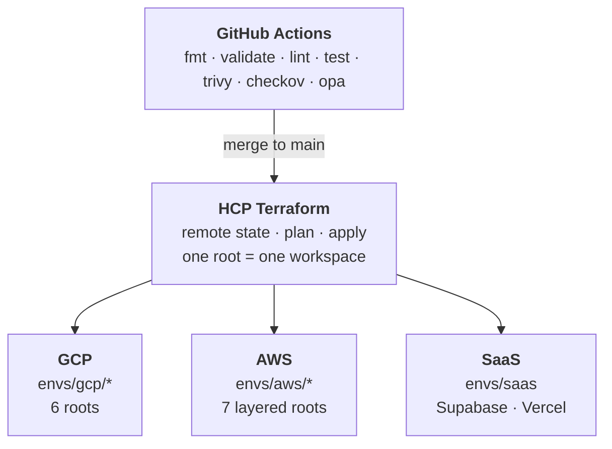

<div align="center">


# Ashes DevOps Tools

**One Terraform landing zone for AWS, GCP, Supabase and Vercel. Deploy any combination.**

[](https://terraform.io)
[](https://aws.amazon.com)
[](https://cloud.google.com)
[](https://supabase.com)
[](https://vercel.com)
[](https://opensource.org/licenses/MIT)

[](https://github.com/EdwinKassier/Ashes-Devops-Tools/actions/workflows/terraform-plan.yml)
[](https://github.com/EdwinKassier/Ashes-Devops-Tools/actions/workflows/security-scan.yml)
[](https://pre-commit.com)
[](modules/)
[](modules/)

[Quick Start](#quick-start) · [Architecture](#architecture) · [Modules](#module-library) · [Docs](#documentation) · [Security](#security)

</div>

---

## Overview

**Ashes DevOps Tools** is a reference landing zone built on Terraform and HCP Terraform. Each cloud has its own roots and workspaces, so you apply only the clouds you use.

- **Any combination of clouds.** A cloud you do not apply needs no credentials.
- **One config file.** `config/landing-zone.yaml` feeds all 15 roots. VCS-driven runs need no tfvars.
- **Guardrails as code.** Org policies, SCPs and RCPs, IAM deny policies, VPC-SC, CMEK and org-wide audit logs.
- **Tested without credentials.** Mock-provider tests and a planned example for every module, plus Trivy, Checkov and OPA.
- **Remote execution only.** HCP Terraform owns state and applies. GitHub Actions gates every pull request.

| Cloud | What you get |
|:------|:-------------|
| **GCP** | Org hierarchy, org policies, IAM deny guardrails, CMEK, audit logs, hub-and-spoke Shared VPC, VPC-SC, per-environment workloads |
| **AWS** | Multi-account SRA organization, SCP/RCP guardrails, GuardDuty, Security Hub, CloudTrail, Transit Gateway, IAM Identity Center, org backup |
| **Supabase** | Projects, settings and vault secrets across three environments |
| **Vercel** | Projects across three environments |

---

## Quick Start

```bash
# 1. Clone and install the tooling
git clone https://github.com/EdwinKassier/Ashes-Devops-Tools.git && cd Ashes-Devops-Tools
make install && make pre-commit-install

# 2. Describe your landing zone in one committed file
scripts/init-landing-zone.sh          # interactive, or --org-name ... --clouds gcp,aws
git add config/landing-zone.yaml && git commit -m "chore(config): landing zone"

# 3. Run the offline gates (no cloud credentials needed)
make ci-quick

# 4. Apply envs/tfc-admin to create the workspaces, then bootstrap each cloud
```

Explicit variables win over the config file, and an unset or placeholder value fails the plan. Schema: [`config/landing-zone.example.yaml`](config/landing-zone.example.yaml).

**Next:** [Quick Start Guide](docs/guides/QUICK_START.md) · [AWS bootstrap](docs/runbooks/aws-bootstrap.md) · [SaaS bootstrap](docs/runbooks/saas-bootstrap.md) · [Production hardening](docs/runbooks/production-hardening.md) · [Upgrading](UPGRADING.md)

---

## Architecture



Both clouds are full landing zones with the same responsibilities, packaged into roots that line up layer for layer:

| Layer | GCP | AWS |
|:------|:----|:----|
| Foundation identity | `gcp-bootstrap` | phase-0 ([runbook](docs/runbooks/aws-bootstrap.md)) |
| Organization and guardrails | `gcp-organization`, `gcp-guardrails` | `aws-organization` |
| Security baseline | in `gcp-organization` | `aws-security` |
| Human access (SSO) | in `gcp-organization` | `aws-identity` |
| Shared platform | `gcp-projects` | `aws-shared-services` |
| Network hub | `gcp-network-hub` | `aws-network` |
| Central backup | per-project policies | `aws-backup` |
| Workload, per environment | `gcp-workload-<env>` | `aws-workload-<env>` |
| SaaS | `saas-<name>` | `saas-<name>` |

Apply order and remote-state reads enforce the sequence. Cloud selection is which workspaces you apply, not a runtime flag: a `provider` block cannot be conditional.

**Deep dives:** [GCP Landing Zone](docs/architecture/gcp-landing-zone.md) · [AWS Landing Zone](docs/architecture/aws-landing-zone.md) · [Provider Selection](docs/architecture/provider-selection.md) · [Cross-Cloud Comparison](docs/architecture/cross-cloud-comparison.md)

---

## Module Library

126 modules — **66 GCP · 53 AWS · 6 SaaS · 1 TFC** — each with auto-generated docs and `mock_provider` tests.

Both clouds use the same domains, so each table maps a capability to its GCP module and its AWS module. `—` means no dedicated module; the cell names where that capability lives instead.

### SaaS Integrations

| Module | Provider | Purpose |
|:-------|:---------|:--------|
| [`supabase/project`](modules/supabase/project/) | Supabase | Project provisioning with lifecycle guard |
| [`supabase/settings`](modules/supabase/settings/) | Supabase | Auth + API settings management |
| [`supabase/environment`](modules/supabase/environment/) | Supabase | Composite: project + settings + API keys |
| [`supabase/vault-secrets`](modules/supabase/vault-secrets/) | Supabase + Node.js | Vault bootstrap and secret reconciliation |
| [`vercel/project`](modules/vercel/project/) | Vercel | Three-environment project with drift resistance |
| [`saas/stages/saas-workload`](modules/saas/stages/saas-workload/) | All three | Full SaaS environment in one call |

### Cloud modules by domain

<details>
<summary><strong>Networking</strong> — GCP 24 · AWS 11</summary>

Both clouds build a hub-and-spoke private network from the same primitives; the names differ, the roles line up.

| Capability | Google Cloud | Amazon Web Services |
|:-----------|:-------------|:--------------------|
| Core private network | [`network/vpc`](modules/gcp/network/vpc/), [`network/subnet`](modules/gcp/network/subnet/), [`network/tiered-vpc`](modules/gcp/network/tiered-vpc/) (shared VPC, three subnet tiers, baseline firewall core) | [`network/vpc`](modules/aws/network/vpc/) |
| IP address management | *(manual CIDR planning)* | [`network/ipam`](modules/aws/network/ipam/) |
| Hub interconnect / transit | [`network/shared-vpc-service`](modules/gcp/network/shared-vpc-service/), [`network/vpc-peering`](modules/gcp/network/vpc-peering/), [`network/ncc-hub`](modules/gcp/network/ncc-hub/) + [`network/ncc-spoke`](modules/gcp/network/ncc-spoke/) (opt-in), [`network/interconnect`](modules/gcp/network/interconnect/) | [`network/transit-gateway`](modules/aws/network/transit-gateway/) |
| Private service access | [`network/private-service-connect`](modules/gcp/network/private-service-connect/), [`network/private-service-access`](modules/gcp/network/private-service-access/) | [`network/vpc-endpoints`](modules/aws/network/vpc-endpoints/) |
| DNS | [`network/dns`](modules/gcp/network/dns/) | [`network/route53-resolver`](modules/aws/network/route53-resolver/), [`network/dns-records`](modules/aws/network/dns-records/) *(library-only)* |
| Hybrid VPN | [`network/vpn`](modules/gcp/network/vpn/) (HA VPN on the hub; `gcp.network.vpn` + `vpn_shared_secret_wo` on `gcp-network-hub`) | [`network/vpn`](modules/aws/network/vpn/) (Site-to-Site on the Transit Gateway; `aws.network.vpn`) |
| Egress NAT | [`network/nat`](modules/gcp/network/nat/) | *(native, in `network/vpc`)* |
| Egress FQDN control | [`network/secure-web-proxy`](modules/gcp/network/secure-web-proxy/) (opt-in preview, hub + PSC) | [`network/network-firewall`](modules/aws/network/network-firewall/) (egress domain allowlist) |
| Load balancing | [`network/internal-lb`](modules/gcp/network/internal-lb/) *(library-only)* | [`network/load-balancer`](modules/aws/network/load-balancer/) (ALB/NLB) |
| Application ingress | [`network/app-ingress`](modules/gcp/network/app-ingress/) (Cloud Run front door) | [`network/load-balancer`](modules/aws/network/load-balancer/) |
| Content delivery / CDN | [`network/cdn`](modules/gcp/network/cdn/) *(library-only)* | *(Security → `edge-security`: CloudFront + WAF/Shield)* |
| API gateway / edge | [`network/api-gateway`](modules/gcp/network/api-gateway/) *(library-only)* | [`network/api-gateway`](modules/aws/network/api-gateway/) *(library-only)* |
| Stateful firewall | [`network/network-firewall`](modules/gcp/network/network-firewall/), [`network/hierarchical-firewall`](modules/gcp/network/hierarchical-firewall/) | [`network/network-firewall`](modules/aws/network/network-firewall/) |
| Web app firewall / DDoS | [`network/cloud-armor`](modules/gcp/network/cloud-armor/) | *(Security → `edge-security`, `firewall-manager-org`)* |
| Traffic mirroring / analysis | [`network/packet-mirroring`](modules/gcp/network/packet-mirroring/) *(library-only)* | [`network/network-access-analyzer`](modules/aws/network/network-access-analyzer/) |
| Flow logging | [`network/vpc-flow-logs`](modules/gcp/network/vpc-flow-logs/) | *(native VPC flow logs)* |
| Service perimeter | [`network/vpc-sc`](modules/gcp/network/vpc-sc/) | *(Governance → `organization-policy` SCP/RCP)* |

</details>

<details>
<summary><strong>IAM &amp; Identity</strong> — GCP 8 · AWS 4</summary>

| Capability | Google Cloud | Amazon Web Services |
|:-----------|:-------------|:--------------------|
| Workforce identity / SSO | [`iam/identity-group`](modules/gcp/iam/identity-group/) *(library-only)*, [`iam/identity-group-memberships`](modules/gcp/iam/identity-group-memberships/) *(library-only)* | [`iam/iam-identity-center`](modules/aws/iam/iam-identity-center/) |
| Roles &amp; permissions | [`iam/organization`](modules/gcp/iam/organization/), [`iam/role`](modules/gcp/iam/role/) *(library-only)* | [`iam/iam-role`](modules/aws/iam/iam-role/) |
| Deny-policy guardrails | [`iam/deny-policy`](modules/gcp/iam/deny-policy/), [`iam/principal-access-boundary`](modules/gcp/iam/principal-access-boundary/) | *(SCP/RCP — see Governance)* |
| Service / machine identity | [`iam/service-account`](modules/gcp/iam/service-account/) | *(IAM roles + instance profiles)* |
| Federated workload identity | [`iam/workload-identity`](modules/gcp/iam/workload-identity/) | *(OIDC via `iam/iam-role`)* |
| Terraform Cloud run roles | *(plan/apply service accounts from `stages/bootstrap`)* | [`iam/tfc-oidc-baseline`](modules/aws/iam/tfc-oidc-baseline/), [`iam/tfc-management-roles`](modules/aws/iam/tfc-management-roles/) |

</details>

<details>
<summary><strong>Security &amp; Threat Detection</strong> — GCP 2 · AWS 14</summary>

GCP consolidates detection into Security Command Center plus audit logs; the AWS SRA breaks the same surface into many org-wide, delegated-admin services — hence the count asymmetry.

| Capability | Google Cloud | Amazon Web Services |
|:-----------|:-------------|:--------------------|
| Posture / findings management | [`governance/scc`](modules/gcp/governance/scc/) | [`security/securityhub-org`](modules/aws/security/securityhub-org/) |
| Threat detection | *(SCC / Event Threat Detection)* | [`security/guardduty-org`](modules/aws/security/guardduty-org/) |
| Audit &amp; activity logging | [`governance/cloud-audit-logs`](modules/gcp/governance/cloud-audit-logs/) | [`security/cloudtrail-org`](modules/aws/security/cloudtrail-org/) |
| Config &amp; compliance recording | *(SCC posture)* | [`security/config-org`](modules/aws/security/config-org/), [`security/config-recorder-stackset`](modules/aws/security/config-recorder-stackset/) |
| Security data lake | — | [`security/securitylake`](modules/aws/security/securitylake/) |
| Delegated security administration | — | [`security/security-delegated-admin`](modules/aws/security/security-delegated-admin/), [`security/org-security-service`](modules/aws/security/org-security-service/) |
| IAM access analysis | *(IAM Recommender / Policy Analyzer)* | [`security/access-analyzer-org`](modules/aws/security/access-analyzer-org/) |
| Edge / WAF management | *(Networking → `cloud-armor`)* | [`security/edge-security`](modules/aws/security/edge-security/), [`security/firewall-manager-org`](modules/aws/security/firewall-manager-org/) |
| Secrets baseline | *(SaaS → `supabase/vault-secrets`)* | [`security/secrets-baseline`](modules/aws/security/secrets-baseline/) |
| Incident response | — | [`security/incident-response`](modules/aws/security/incident-response/) |
| Finding notifications | *(Observability → `alert-policy`)* | [`security/security-notifications`](modules/aws/security/security-notifications/) |

</details>

<details>
<summary><strong>Governance &amp; Org Management</strong> — GCP 4 · AWS 7</summary>

| Capability | Google Cloud | Amazon Web Services |
|:-----------|:-------------|:--------------------|
| Org / account structure | *(folders via `stages/organization`)* | [`governance/organization`](modules/aws/governance/organization/), [`governance/account`](modules/aws/governance/account/) |
| Policy guardrails | [`governance/org-policy`](modules/gcp/governance/org-policy/) | [`governance/organization-policy`](modules/aws/governance/organization-policy/) |
| Account / project baseline | [`project`](modules/gcp/project/) (the single project primitive used by every stage) | [`governance/account-baseline`](modules/aws/governance/account-baseline/) |
| Cost &amp; budgets | [`governance/billing`](modules/gcp/governance/billing/) | [`governance/cost-governance`](modules/aws/governance/cost-governance/) |
| Resource tagging | [`governance/tags`](modules/gcp/governance/tags/) | *(tag policies via `governance/organization-policy`)* |
| Service quotas | — | [`governance/service-quotas`](modules/aws/governance/service-quotas/) |
| Org-wide IAM features | *(via `iam/organization`)* | [`governance/iam-organizations-features`](modules/aws/governance/iam-organizations-features/) |

</details>

<details>
<summary><strong>Data, Storage &amp; Encryption</strong> — GCP 4 · AWS 4</summary>

| Capability | Google Cloud | Amazon Web Services |
|:-----------|:-------------|:--------------------|
| Object storage / log archive | [`cloud-storage`](modules/gcp/cloud-storage/) *(library-only)* | [`data/log-archive-bucket`](modules/aws/data/log-archive-bucket/) |
| Artifact / image registry | [`artifact-registry`](modules/gcp/artifact-registry/) | [`data/ecr`](modules/aws/data/ecr/) |
| Encryption keys (CMEK / KMS) | [`governance/kms`](modules/gcp/governance/kms/) | [`data/kms-key`](modules/aws/data/kms-key/) |
| Private certificate authority | [`governance/private-ca`](modules/gcp/governance/private-ca/) *(library-only)* (CAS) | [`data/private-ca`](modules/aws/data/private-ca/) |

</details>

<details>
<summary><strong>Backup &amp; Resilience</strong> — GCP 2 · AWS 2</summary>

| Capability | Google Cloud | Amazon Web Services |
|:-----------|:-------------|:--------------------|
| Scheduled backups / snapshots | [`backup/backup-plan`](modules/gcp/backup/backup-plan/) (snapshot schedules + retention), [`backup/backup-vault`](modules/gcp/backup/backup-vault/) (Backup and DR vault for Cloud SQL) | [`backup/backup-vault`](modules/aws/backup/backup-vault/) |
| Org-wide backup policy | *(per-project resource policies)* | [`backup/backup-org-policy`](modules/aws/backup/backup-org-policy/) |

</details>

<details>
<summary><strong>Observability &amp; Operations</strong> — GCP 5 · AWS 2</summary>

| Capability | Google Cloud | Amazon Web Services |
|:-----------|:-------------|:--------------------|
| Metrics &amp; alerting | [`monitoring/alert-policy`](modules/gcp/monitoring/alert-policy/) (used by `net-hub` / `net-spoke` data-plane alerts) | [`ops/cloudwatch`](modules/aws/ops/cloudwatch/) (metric alarms + SNS) |
| Dashboards | [`monitoring/compute-dashboard`](modules/gcp/monitoring/compute-dashboard/) *(library-only)* | [`ops/cloudwatch`](modules/aws/ops/cloudwatch/) (dashboard) |
| Landing-zone self-observability | [`monitoring/control-plane`](modules/gcp/monitoring/control-plane/) | *(see `ops/cloudwatch`)* |
| Service level objectives | [`monitoring/slo`](modules/gcp/monitoring/slo/) | *(see `ops/cloudwatch`)* |
| Fleet / patch management | [`ops/os-config`](modules/gcp/ops/os-config/) (VM Manager) | [`ops/systems-manager`](modules/aws/ops/systems-manager/) |

</details>

<details>
<summary><strong>Application Platform</strong> — GCP 6 · AWS 2</summary>

| Capability | Google Cloud | Amazon Web Services |
|:-----------|:-------------|:--------------------|
| Container runtime | [`compute/cloud-run`](modules/gcp/compute/cloud-run/), [`compute/cloud-run-job`](modules/gcp/compute/cloud-run-job/), [`compute/gke-autopilot`](modules/gcp/compute/gke-autopilot/) | [`compute/ecs-fargate`](modules/aws/compute/ecs-fargate/) |
| Relational database | [`data/cloud-sql`](modules/gcp/data/cloud-sql/) | [`data/rds-aurora`](modules/aws/data/rds-aurora/) |
| Application secrets | [`data/secret-manager`](modules/gcp/data/secret-manager/) | *(see Security → `secrets-baseline`)* |
| App / mobile backend | [`firebase/project`](modules/gcp/firebase/project/) *(library-only)* | *(Amplify / App Runner — no module)* |

</details>

<details>
<summary><strong>Orchestration Stages</strong> — GCP 11 · AWS 7</summary>

Composite stages wrap the primitives above into deployable landing-zone layers, one per root/workspace. Layers line up across clouds even where a cloud folds two responsibilities into one stage.

| Layer | Google Cloud | Amazon Web Services |
|:------|:-------------|:--------------------|
| Bootstrap / foundation | [`stages/bootstrap`](modules/gcp/stages/bootstrap/) | *(phase-0, out-of-band — see aws-bootstrap runbook)* |
| Organization &amp; guardrails | [`stages/organization`](modules/gcp/stages/organization/), [`stages/guardrails`](modules/gcp/stages/guardrails/) *(org IAM deny policies, security-team `gcp-guardrails` workspace)* | [`stages/organization`](modules/aws/stages/organization/) |
| Security baseline | *(folded into `stages/organization`)* | [`stages/security`](modules/aws/stages/security/) |
| Projects / accounts | [`stages/projects`](modules/gcp/stages/projects/) | *(accounts via `stages/organization`)* |
| Network hub | [`stages/network-hub`](modules/gcp/stages/network-hub/) (composes [`stages/net-hub`](modules/gcp/stages/net-hub/) + [`stages/dns-anchor`](modules/gcp/stages/dns-anchor/)) | [`stages/network-hub`](modules/aws/stages/network-hub/) |
| Shared services | *(via `stages/projects`)* | [`stages/shared-services`](modules/aws/stages/shared-services/) |
| Backup | — | [`stages/backup`](modules/aws/stages/backup/) |
| Application services (golden path) | [`stages/app-services`](modules/gcp/stages/app-services/) | [`stages/app-services`](modules/aws/stages/app-services/) |
| Workload (per environment) | [`stages/environment`](modules/gcp/stages/environment/), [`stages/workload`](modules/gcp/stages/workload/), [`stages/net-spoke`](modules/gcp/stages/net-spoke/) *(replaced the removed `stages/host`)* | [`stages/workload`](modules/aws/stages/workload/) |

</details>

<details>
<summary><strong>Library-only modules</strong> — not wired into a root</summary>

These modules are tested and documented, but no root composes them. They are marked *(library-only)* in the tables above. Call them from your own root or stage.

| Module | Why it is library-only |
|:-------|:-----------------------|
| [`gcp/cloud-storage`](modules/gcp/cloud-storage/) | Example-only (`examples/cloud-storage`); buckets are app-specific |
| [`gcp/firebase/project`](modules/gcp/firebase/project/) | Example-only; Firebase is opt-in per app |
| [`gcp/iam/identity-group`](modules/gcp/iam/identity-group/), [`gcp/iam/identity-group-memberships`](modules/gcp/iam/identity-group-memberships/) | Example-only; Cloud Identity groups are usually managed in the IdP / Workspace |
| [`gcp/iam/role`](modules/gcp/iam/role/) | Example-only; custom roles are org-specific |
| [`gcp/monitoring/compute-dashboard`](modules/gcp/monitoring/compute-dashboard/) | Example-only; app-level dashboards (the landing zone's own alerting is `monitoring/control-plane`) |
| [`gcp/network/api-gateway`](modules/gcp/network/api-gateway/), [`gcp/network/cdn`](modules/gcp/network/cdn/), [`gcp/network/internal-lb`](modules/gcp/network/internal-lb/), [`gcp/network/packet-mirroring`](modules/gcp/network/packet-mirroring/) | Not composed by `net-hub` / `net-spoke`; example-only — compose directly |
| [`gcp/governance/private-ca`](modules/gcp/governance/private-ca/) | Private CA (CAS) is opt-in; no root needs internal certificates by default |
| [`aws/network/dns-records`](modules/aws/network/dns-records/) | Write records into an existing zone (DNS unification); caller-owned records |
| [`aws/network/api-gateway`](modules/aws/network/api-gateway/) | Opt-in API edge per workload |

</details>

---

## Commands

```bash
make ci-quick                       # Fast offline gates (no terraform init)
make ci                             # Every workstation-runnable CI gate
make test                           # All terraform test suites, mock providers
make examples-plan                  # Plan every module example, mock providers
make lint && make security          # TFLint, Trivy and Checkov
make docs                           # Regenerate module and root READMEs
make plan-gcp-<root>                # Read-only plan in HCP Terraform
make plan-aws-<root>
make plan-gcp-workload APP_ENV=dev
```

---

## CI / CD

| Workflow | Trigger | What it does |
|:---------|:--------|:-------------|
| [`terraform-plan.yml`](.github/workflows/terraform-plan.yml) | Pull request | fmt, docs, validate, examples plan, lint, Trivy, Checkov, tests, meta-lint → `Validation Summary` |
| [`terraform-apply.yml`](.github/workflows/terraform-apply.yml) | Workspace tags (`gcp-*/v*`, `aws-*/v*`, `saas/*/v*`, `tfc-admin/v*`) | Verifies the HCP Terraform run and publishes release metadata |
| [`security-scan.yml`](.github/workflows/security-scan.yml) | Push and weekly | Trivy, Checkov and Gitleaks → GitHub Security tab |
| [`release.yml`](.github/workflows/release.yml) | Push to `main` | release-please release PR and `vX.Y.Z` tags |
| [`drift-detection.yml`](.github/workflows/drift-detection.yml) | Scheduled | Infrastructure drift detection |
| [`sandbox-e2e.yml`](.github/workflows/sandbox-e2e.yml) | Nightly, manual or `e2e` label | Real apply and destroy in a sandbox ([guide](docs/guides/sandbox-e2e.md)) |
| [`state-backup.yml`](.github/workflows/state-backup.yml), [`tfc-audit-trail.yml`](.github/workflows/tfc-audit-trail.yml) | Daily | State and audit-trail export to write-once buckets ([runbook](docs/runbooks/state-backup.md)) |
| [`documentation.yml`](.github/workflows/documentation.yml) | Module changes | Regenerates module docs and opens a PR |

Releases follow Conventional Commits and [semantic versioning](docs/policies/versioning-and-compatibility.md). See the [CHANGELOG](CHANGELOG.md).

---

## Documentation

| Start here | Operate | Reference |
|:-----------|:--------|:----------|
| [Documentation Index](docs/INDEX.md) | [Troubleshooting](docs/guides/TROUBLESHOOTING.md) | [Compliance Control Matrix](docs/compliance/control-matrix.md) |
| [Quick Start](docs/guides/QUICK_START.md) | [Branch Protection](docs/guides/BRANCH_PROTECTION.md) | [Landing-Zone Conformance](docs/architecture/landing-zone-conformance.md) |
| [Architecture](docs/architecture/ARCHITECTURE.md) | [Production Hardening](docs/runbooks/production-hardening.md) | [Known Gaps](docs/known-gaps.md) |
| [Network Topology](docs/architecture/network-topology.md) | [Upgrading](UPGRADING.md) | [Adding a Cloud](docs/architecture/adding-a-cloud.md) |
| [Examples](examples/README.md) | [Contributing](CONTRIBUTING.md) | [CLAUDE.md](CLAUDE.md) (AI agents) |

**Runbooks, the same for both clouds:**

| Scenario | Google Cloud | Amazon Web Services |
|:---------|:-------------|:--------------------|
| First-time stand-up | [Bootstrap](docs/runbooks/bootstrap.md) | [AWS Bootstrap](docs/runbooks/aws-bootstrap.md) |
| Add a deployable unit | [Add Environment](docs/runbooks/add-environment.md) | [AWS Add Account](docs/runbooks/aws-add-account.md) |
| Onboard a service team | [Service Team Onboarding](docs/runbooks/service-team-onboarding.md) | via Add Account |
| Break-glass access | [Break Glass](docs/runbooks/break-glass.md) | [AWS Break Glass](docs/runbooks/aws-break-glass.md) |
| Incident response | [Incident Response](docs/runbooks/incident-response.md) | [AWS Incident Response](docs/runbooks/aws-incident-response.md) |
| KMS key rotation | [KMS Rotation](docs/runbooks/kms-rotation.md) | [AWS KMS Rotation](docs/runbooks/aws-kms-rotation.md) |
| CIDR expansion | [CIDR Expansion](docs/runbooks/cidr-expansion.md) | [AWS CIDR Expansion](docs/runbooks/aws-cidr-expansion.md) |
| Teardown | [Teardown](docs/runbooks/teardown.md) | [AWS Teardown](docs/runbooks/aws-teardown.md) |

---

## Security

Report vulnerabilities through [SECURITY.md](SECURITY.md). Do not open a public issue.

- Trivy, Checkov and OPA policy gates on every pull request.
- Weekly Trivy and Gitleaks scans, with findings in the GitHub Security tab.
- A plan-time code-execution guard blocks provisioners, external data sources and unpinned file reads.
- False positives are skipped inline on the resource, with a reason.

---

<div align="center">

Built with [Terraform](https://terraform.io) · [AWS](https://aws.amazon.com) · [Google Cloud](https://cloud.google.com) · [Supabase](https://supabase.com) · [Vercel](https://vercel.com) · MIT licensed

</div>
