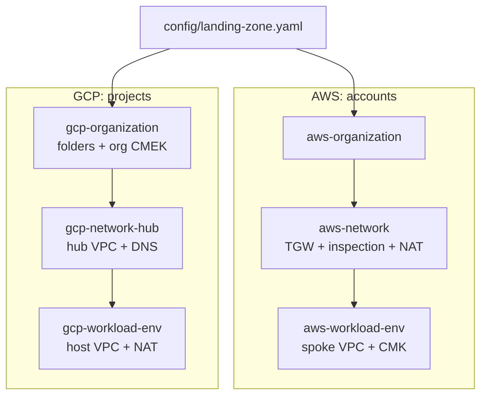

# Primer

This primer is the shared foundation of the [system design library](README.md).
Every walkthrough links here instead of repeating the framework, the numbers or
the landing-zone conventions. When a walkthrough and this primer disagree, this
primer wins: fix the walkthrough.

Stable anchors that walkthroughs link to:

- [`#interview-framework`](#interview-framework)
- [`#estimation-cheat-sheet`](#estimation-cheat-sheet)
- [`#aws-gcp-service-map`](#aws-gcp-service-map)
- [`#how-this-landing-zone-anchors-a-design`](#how-this-landing-zone-anchors-a-design)
- [`#conventions`](#conventions), including
  [`#vpc-tier-placement`](#vpc-tier-placement) and [`#data-zones`](#data-zones)
- [`#how-to-read-a-walkthrough`](#how-to-read-a-walkthrough)

Repository references use `path:line`. They were correct at commit `95bff95`.
If a line has moved, search for the quoted name.

---

## Interview framework

A system design round tests whether you can turn a vague prompt into a design
someone could build, and whether you can say why. Interviewers mark the process
as much as the answer. The template every walkthrough follows is that process
written down.

### The arc and why each step exists

| # | Section | What you do | Why it exists |
|---|---|---|---|
| 1 | The question | Restate the prompt and its common variants. | It proves you heard the question. It also tells you which variant you are solving. |
| 2 | The two-minute answer | Give a five-to-eight-sentence summary and sketch one small diagram. | The interviewer gets a map before the detail. If time runs out, you have still answered. |
| 3 | Clarify the requirements | Ask about users, scale, latency, consistency, durability and regions. Write down your assumptions. | Most bad designs solve the wrong problem. A stated assumption is something the interviewer can correct early. |
| 4 | Back-of-envelope estimates | Do the arithmetic for QPS, bandwidth, storage, connections and fan-out. | The numbers choose the design. Ten writes a second and a million writes a second need different systems. Say which choice each number drives. |
| 5 | API and data model | Name the endpoints, events and key entities, and their access patterns. | Access patterns choose the storage engine and the partition key. |
| 6 | High-level design | Draw the components and walk the read path and the write path. | It shows the whole system works end to end before you optimise any part of it. |
| 7 | Deep dives | Go deep on two or three of the hardest parts, with alternatives and where each breaks. | This is where seniority shows. Interviewers usually pick one; have the others ready. |
| 8 | Trade-offs to defend | Table each decision, what you chose, what you rejected, why, and what would change your mind. | "What would change the answer" is the follow-up you will be asked. |
| 9 | Failure modes and scaling limits | Say what breaks first at ×10 and ×100, and each component's blast radius. | It shows you can operate the system as well as draw it. |
| 10 | AWS and GCP mapping | Name the managed service per component on each cloud, and the differences that matter. | "Which service would you use?" is a common follow-up. |
| 11 | Build it here | Map the design onto this repo's roots, modules and config. | It answers "how would you actually build this?" with specifics. |
| 12 | Runbook | Give the procedure for the most likely serious failure. | Platform and SRE rounds often end on "it's 3am and this alarm fires". |
| 13 | Study aids | List the numbers to memorise, likely follow-ups and classic mistakes. | Rehearsal material. |

Sections 1 to 9 are what you say in the room. Sections 10 to 13 are what you
draw on when the interviewer pushes.

### Timing for a 45-minute round

| Minutes | Sections | Notes |
|---|---|---|
| 0–2 | 1, 2 | Restate the question and give the two-minute answer. Ask "shall I go deeper on requirements?" |
| 2–8 | 3 | Ask five to eight clarifying questions. Write the answers where the interviewer can see them. |
| 8–12 | 4 | Do the estimates at the board, round aggressively, and keep the arithmetic visible. |
| 12–17 | 5 | Name the API and the core entities. Skip CRUD that adds nothing. |
| 17–27 | 6 | Draw the design and walk one read and one write through it. |
| 27–40 | 7, 8 | Do the deep dives, steered by the interviewer. State each trade-off as you make it. |
| 40–45 | 9, then questions | Say what breaks at ×10, then take questions. Sections 10 to 13 come up only if asked. |

These splits are a rehearsal aid, not a rule. A good interviewer interrupts.
Follow them and come back to the arc.

---

## Estimation cheat sheet

Round hard. The point of an estimate is the order of magnitude and the decision
it drives, not the third significant figure.

### Latency numbers

These are the classic figures from Jeff Dean's
[LADIS 2009 keynote](https://www.cs.cornell.edu/projects/ladis2009/talks/dean-keynote-ladis2009.pdf).
They are **order-of-magnitude only**. Hardware has moved since then, especially
SSDs and networks; Colin Scott's
[interactive latency page](https://colin-scott.github.io/personal_website/research/interactive_latency.html)
extrapolates them by year. Use them for ratios, not for SLOs. **Verify before
relying on** any single figure.

| Operation | Order of magnitude |
|---|---|
| L1 cache reference | ~1 ns |
| Branch mispredict | ~5 ns |
| L2 cache reference | ~10 ns |
| Mutex lock or unlock | ~25 ns |
| Main memory reference | ~100 ns |
| Compress 1 KB (fast codec) | ~3 µs |
| Send 2 KB over a 1 Gbps link | ~20 µs |
| Read 1 MB sequentially from memory | ~250 µs |
| Round trip within one datacenter | ~500 µs |
| Disk seek (spinning disk) | ~10 ms |
| Read 1 MB sequentially from disk | ~20 ms |
| Packet round trip, California to Netherlands and back | ~150 ms |

Rules of thumb that follow from the table:

- A memory reference is thousands of times faster than a network round trip
  in the same datacenter. That is why a cache hit is cheap and a cross-service call is not.
- A cross-region or cross-continent round trip costs tens to hundreds of
  milliseconds. Synchronous cross-region writes put that on every request.
- Sequential I/O beats random I/O. Logs, LSM trees and columnar scans exist
  because of it.

### Throughput per instance and per partition

These are documented limits, so they are exact for the date checked. Partition
and shard limits are the ones that set your sharding math.

| Limit | Value | Source |
|---|---|---|
| DynamoDB, per partition | 3,000 read units and 1,000 write units per second | [AWS docs](https://docs.aws.amazon.com/amazondynamodb/latest/developerguide/bp-partition-key-design.html) (checked 2026-11) |
| DynamoDB, per table, default quota | 40,000 read and 40,000 write request units per second, adjustable | [AWS docs](https://docs.aws.amazon.com/amazondynamodb/latest/developerguide/ServiceQuotas.html) (checked 2026-11) |
| Kinesis Data Streams, per shard (provisioned) | Write 1 MB/s or 1,000 records/s; read 2 MB/s | [AWS docs](https://docs.aws.amazon.com/streams/latest/dev/service-sizes-and-limits.html) (checked 2026-11) |
| SQS FIFO, per partition (not high-throughput mode) | 300 transactions/s per API action; 3,000 messages/s with batches of 10 | [AWS docs](https://docs.aws.amazon.com/AWSSimpleQueueService/latest/SQSDeveloperGuide/quotas-messages.html) (checked 2026-11) |
| SQS standard | "Nearly unlimited" API calls per second; maximum message 1 MiB | [AWS docs](https://docs.aws.amazon.com/AWSSimpleQueueService/latest/SQSDeveloperGuide/quotas-messages.html) (checked 2026-11) |
| Pub/Sub, per ordering key | 1 MBps publish | [Google Cloud docs](https://docs.cloud.google.com/pubsub/quotas) (checked 2026-11) |
| Pub/Sub, publish per region | 4 GB/s large, 800 MB/s medium, 200 MB/s small regions; maximum message 10 MB | [Google Cloud docs](https://docs.cloud.google.com/pubsub/quotas) (checked 2026-11) |
| S3, per partitioned prefix | At least 3,500 PUT/COPY/POST/DELETE and 5,500 GET/HEAD per second | [AWS docs](https://docs.aws.amazon.com/AmazonS3/latest/userguide/optimizing-performance.html) (checked 2026-11) |
| Cloud Storage, per bucket, initial | About 1,000 writes and 5,000 reads per second; ramp no faster than doubling every 20 minutes | [Google Cloud docs](https://docs.cloud.google.com/storage/docs/request-rate) (checked 2026-11) |
| Bigtable, per SSD node | Up to about 14,000 row writes/s or 17,000 row reads/s (1 KB rows), scans up to 220 MBps | [Google Cloud docs](https://docs.cloud.google.com/bigtable/docs/performance) (checked 2026-11) |
| Cloud Run, per instance | Concurrency defaults to 80 per vCPU when deployed by gcloud or Terraform; maximum 1,000 | [Google Cloud docs](https://docs.cloud.google.com/run/docs/about-concurrency) (checked 2026-11) |
| Lambda, per account and Region | 1,000 concurrent executions by default; a requests-per-second limit of 10 × concurrency | [AWS docs](https://docs.aws.amazon.com/lambda/latest/dg/lambda-concurrency.html) (checked 2026-11) |

Folk rules of thumb. No vendor documents these as limits; they depend heavily on
payload, code and instance size. Use them only to pick an order of magnitude,
and **verify before relying on** them:

- A stateless HTTP service handles hundreds to a few thousand simple requests
  per second per vCPU.
- A single relational primary sustains thousands to low tens of thousands of
  simple writes per second before you shard, queue or batch.
- A single Redis-compatible cache shard serves on the order of 100,000 simple
  operations per second.
- A tuned WebSocket server holds tens to hundreds of thousands of mostly idle
  connections. Memory per connection and the kernel's file-descriptor limits set
  the ceiling.

Concurrency by Little's law: **concurrency = arrival rate × time in system**.
5,000 requests a second at 200 ms each is 1,000 requests in flight. The
[Lambda concurrency docs](https://docs.aws.amazon.com/lambda/latest/dg/lambda-concurrency.html)
(checked 2026-11) use the same formula.

### Storage and bandwidth units

| Quantity | Rounded value |
|---|---|
| 1 KB × 1 million | 1 GB |
| 1 KB × 1 billion | 1 TB |
| 1 MB × 1 million | 1 TB |
| 1 Gbps | 125 MB/s |
| 10 Gbps | 1.25 GB/s |
| 1 MB/s sustained for a day | ~86 GB/day |
| 1 MB/s sustained for a year | ~31.5 TB/year |
| ASCII character / UUID / int64 | 1 byte / 16 bytes (binary) or 36 (text) / 8 bytes |

Decimal (KB = 1,000 bytes) is fine for estimates. Some services bill and limit
in binary units, where 1 KB = 1,024 bytes; DynamoDB says so explicitly in its
[quotas page](https://docs.aws.amazon.com/amazondynamodb/latest/developerguide/ServiceQuotas.html)
(checked 2026-11).

### Availability nines

Computed with a 365.25-day year and a 30.44-day average month.

| Availability | Downtime per year | Downtime per month |
|---|---|---|
| 99% | 3.65 days | 7.31 hours |
| 99.9% | 8.77 hours | 43.8 minutes |
| 99.95% | 4.38 hours | 21.9 minutes |
| 99.99% | 52.6 minutes | 4.38 minutes |
| 99.999% | 5.26 minutes | 26.3 seconds |

Two rules:

- **Serial dependencies multiply.** Three components at 99.9% each, all on the
  request path, give 0.999³ ≈ 99.7%.
- **Redundancy helps only if failures are independent.** Two replicas at 99%
  each with independent failures give 1 − 0.01² = 99.99%. Shared fate (one
  zone, one config push, one deploy) breaks that independence.

### QPS conversions

| Volume | Average rate |
|---|---|
| 1 day | 86,400 s (call it 10⁵) |
| 1 million per day | ~12 per second |
| 10 million per day | ~120 per second |
| 100 million per day | ~1,200 per second |
| 1 billion per day | ~12,000 per second |
| 1 month | ~2.6 million seconds |

Peak is a multiple of average. An assumption of 2–3× peak-to-average for
consumer traffic is common. **Verify before relying on** it for your workload,
and state it as an assumption.

Worked example: 100 million daily active users each make 10 requests a day.
That is 10⁹ requests a day, about 12,000 per second on average, and about
30,000 per second at a 2.5× peak.

---

## AWS-GCP service map

One primary managed service per cell. Every external link goes to the vendor's
official product page (the NAT gateway row links its documentation page, which
has no product page), and every link was checked 2026-11.

| Capability | AWS | Google Cloud |
|---|---|---|
| Virtual machines | [Amazon EC2](https://aws.amazon.com/ec2/) | [Compute Engine](https://cloud.google.com/products/compute) |
| Kubernetes | [Amazon EKS](https://aws.amazon.com/eks/) | [GKE](https://cloud.google.com/kubernetes-engine) |
| Serverless containers | [ECS on AWS Fargate](https://aws.amazon.com/fargate/) | [Cloud Run](https://cloud.google.com/run) |
| Functions | [AWS Lambda](https://aws.amazon.com/lambda/) | [Cloud Run functions](https://cloud.google.com/functions) |
| Load balancing | [Elastic Load Balancing](https://aws.amazon.com/elasticloadbalancing/) (ALB, NLB) | [Cloud Load Balancing](https://cloud.google.com/load-balancing) |
| WAF and edge protection | [AWS WAF](https://aws.amazon.com/waf/) | [Cloud Armor](https://cloud.google.com/security/products/armor) |
| CDN | [Amazon CloudFront](https://aws.amazon.com/cloudfront/) | [Cloud CDN](https://cloud.google.com/cdn) |
| DNS | [Amazon Route 53](https://aws.amazon.com/route53/) | [Cloud DNS](https://cloud.google.com/dns) |
| API gateway | [Amazon API Gateway](https://aws.amazon.com/api-gateway/) | [API Gateway](https://cloud.google.com/api-gateway) (or [Apigee](https://cloud.google.com/apigee)) |
| Work queues | [Amazon SQS](https://aws.amazon.com/sqs/) | [Pub/Sub](https://cloud.google.com/pubsub) (or [Cloud Tasks](https://cloud.google.com/tasks) for dispatch with rate control) |
| Event streams | [Kinesis Data Streams](https://aws.amazon.com/kinesis/data-streams/) (or [Amazon MSK](https://aws.amazon.com/msk/) for Kafka) | [Pub/Sub](https://cloud.google.com/pubsub) (or [Managed Service for Apache Kafka](https://cloud.google.com/products/managed-service-for-apache-kafka)) |
| Pub/sub fan-out and event bus | [Amazon SNS](https://aws.amazon.com/sns/), [Amazon EventBridge](https://aws.amazon.com/eventbridge/) | [Pub/Sub](https://cloud.google.com/pubsub), [Eventarc](https://cloud.google.com/eventarc) |
| Workflow orchestration | [AWS Step Functions](https://aws.amazon.com/step-functions/) | [Workflows](https://cloud.google.com/workflows) |
| Scheduled triggers | [EventBridge Scheduler](https://aws.amazon.com/eventbridge/scheduler/) | [Cloud Scheduler](https://cloud.google.com/scheduler) |
| Relational | [Amazon Aurora](https://aws.amazon.com/rds/aurora/) / [Amazon RDS](https://aws.amazon.com/rds/) | [Cloud SQL](https://cloud.google.com/sql) (or [AlloyDB](https://cloud.google.com/alloydb)) |
| Globally distributed relational | [Amazon Aurora DSQL](https://aws.amazon.com/rds/aurora/dsql/) | [Spanner](https://cloud.google.com/spanner) |
| Key-value and document | [Amazon DynamoDB](https://aws.amazon.com/dynamodb/) | [Firestore](https://cloud.google.com/firestore) |
| Wide-column | [Amazon Keyspaces](https://aws.amazon.com/keyspaces/) | [Bigtable](https://cloud.google.com/bigtable) |
| In-memory cache | [Amazon ElastiCache](https://aws.amazon.com/elasticache/) | [Memorystore](https://cloud.google.com/memorystore) |
| Object storage | [Amazon S3](https://aws.amazon.com/s3/) | [Cloud Storage](https://cloud.google.com/storage) |
| Data warehouse | [Amazon Redshift](https://aws.amazon.com/redshift/) | [BigQuery](https://cloud.google.com/bigquery) |
| Lake, table formats and governance | [Amazon S3 Tables](https://aws.amazon.com/s3/features/tables/) (Iceberg), [AWS Lake Formation](https://aws.amazon.com/lake-formation/) | [BigLake](https://cloud.google.com/biglake) (Iceberg), [Dataplex](https://cloud.google.com/dataplex) |
| Batch ETL | [AWS Glue](https://aws.amazon.com/glue/) (or [Amazon EMR](https://aws.amazon.com/emr/)) | [Dataflow](https://cloud.google.com/dataflow) (or [Dataproc](https://cloud.google.com/dataproc)) |
| Stream processing | [Managed Service for Apache Flink](https://aws.amazon.com/managed-service-apache-flink/) | [Dataflow](https://cloud.google.com/dataflow) |
| Search | [Amazon OpenSearch Service](https://aws.amazon.com/opensearch-service/) | [Vertex AI Search](https://cloud.google.com/enterprise-search) (no first-party OpenSearch service; see below) |
| Vector search | [Amazon S3 Vectors](https://aws.amazon.com/s3/features/vectors/) (or OpenSearch vector engine) | [Vertex AI Vector Search](https://cloud.google.com/vertex-ai/docs/vector-search/overview) |
| Model serving and foundation models | [Amazon Bedrock](https://aws.amazon.com/bedrock/), [Amazon SageMaker AI](https://aws.amazon.com/sagemaker-ai/) | [Vertex AI](https://cloud.google.com/vertex-ai) |
| Metrics and alarms | [Amazon CloudWatch](https://aws.amazon.com/cloudwatch/) | [Cloud Monitoring](https://cloud.google.com/monitoring) |
| Logs | [Amazon CloudWatch](https://aws.amazon.com/cloudwatch/) Logs | [Cloud Logging](https://cloud.google.com/logging) |
| Traces | [AWS X-Ray](https://aws.amazon.com/xray/) | [Cloud Trace](https://cloud.google.com/trace) |
| Key management | [AWS KMS](https://aws.amazon.com/kms/) | [Cloud KMS](https://cloud.google.com/security/products/security-key-management) |
| Secrets | [AWS Secrets Manager](https://aws.amazon.com/secrets-manager/) | [Secret Manager](https://cloud.google.com/security/products/secret-manager) |
| Workload identity | [AWS IAM](https://aws.amazon.com/iam/) roles | [IAM](https://cloud.google.com/iam) service accounts |
| Workforce identity | [IAM Identity Center](https://aws.amazon.com/iam/identity-center/) | [Cloud Identity](https://cloud.google.com/identity) |
| Virtual network | [Amazon VPC](https://aws.amazon.com/vpc/) (regional) | [VPC](https://cloud.google.com/vpc) (global, regional subnets) |
| Hub and transit | [AWS Transit Gateway](https://aws.amazon.com/transit-gateway/) | [Shared VPC](https://cloud.google.com/vpc/docs/shared-vpc) with peering, or [Network Connectivity Center](https://cloud.google.com/network-connectivity-center) |
| Network inspection | [AWS Network Firewall](https://aws.amazon.com/network-firewall/) | [Cloud NGFW](https://cloud.google.com/firewall) |
| Internet egress (NAT) | [NAT gateway](https://docs.aws.amazon.com/vpc/latest/userguide/vpc-nat-gateway.html) | [Cloud NAT](https://cloud.google.com/nat) |
| Private access to services | [AWS PrivateLink](https://aws.amazon.com/privatelink/) | [Private Service Connect](https://cloud.google.com/vpc/docs/private-service-connect) |
| Data perimeter | Resource control policies and SCPs (in [`modules/aws/governance/organization-policy`](../../modules/aws/governance/organization-policy/)) | [VPC Service Controls](https://cloud.google.com/vpc-service-controls) |
| Backup | [AWS Backup](https://aws.amazon.com/backup/) | [Backup and DR Service](https://cloud.google.com/backup-disaster-recovery) |
| Disaster recovery for servers | [AWS Elastic Disaster Recovery](https://aws.amazon.com/disaster-recovery/) | [Backup and DR Service](https://cloud.google.com/backup-disaster-recovery) |

### Differences that change a design

These are the gaps that move boxes, not just rename them. Each walkthrough's
"AWS and GCP mapping" section adds its own.

- **Network scope.** A GCP VPC is global with regional subnets. An AWS VPC is
  regional. A multi-region design on AWS needs a VPC per region and a transit
  path between them; on GCP one VPC can span regions. This repo's GCP
  `tiered-vpc` adds extra regions to the same VPC through `additional_regions`
  ([`modules/gcp/network/tiered-vpc/main.tf:13`](../../modules/gcp/network/tiered-vpc/main.tf)).
- **Messaging.** Pub/Sub topics are global and scale without shards. Kinesis
  shards are regional and, in provisioned mode, sized by you. SQS and Pub/Sub
  both serve as work queues, but only Pub/Sub also serves as a fan-out stream.
- **Search.** AWS has a first-party OpenSearch service. Google Cloud has none:
  you choose between Vertex AI Search (managed, opinionated), Elastic or
  OpenSearch from the Marketplace, or a self-run cluster on GKE. **Verify
  before relying on** a specific option's features.
- **Data perimeter.** VPC Service Controls draws a perimeter around Google APIs.
  AWS builds the equivalent from resource control policies, SCPs and endpoint
  policies, and the two are not one-to-one.
- **Identity binding.** An AWS role is assumed by a principal named in its
  trust policy. A GCP service account is attached to the resource that runs as
  it, and other principals need `iam.serviceAccounts.actAs` to attach it.

---

## How this landing zone anchors a design

Every walkthrough places its components inside this structure. Read the
architecture docs once; the walkthroughs assume them.



### Accounts and projects

- **AWS: one account per layer and per environment.** The Security OU holds
  log archive, security tooling and forensics; the Infrastructure OU holds
  network, shared services and backup; per-environment workload accounts sit
  under Workloads/Prod and Workloads/NonProd. A design's application components
  go in the workload account for its environment, applied by the
  `aws-workload-<env>` workspace. See
  [AWS landing zone: account and OU model](../../docs/architecture/aws-landing-zone.md#account--ou-model)
  and its [layer map](../../docs/architecture/aws-landing-zone.md#layer-map--which-root-deploys-what).
- **GCP: one folder and one host project per environment.** A `Shared Services`
  folder holds the `shared-hub` and `shared-dns` projects. Each environment has
  its own folder and `<env>-host` project, a Shared VPC host that service
  projects attach to. A design's application components go in the environment's
  host project or an attached service-team project, applied by the
  `gcp-workload-<env>` workspace. See
  [GCP landing zone: folder and project model](../../docs/architecture/gcp-landing-zone.md#folder--project-model).
- **Apply order** is enforced by applying roots in order and reading remote
  state, never by cross-root `depends_on`. AWS: `aws-organization` →
  `aws-security` → `aws-network` → … → `aws-workload-<env>`. GCP:
  `gcp-bootstrap` → `gcp-organization` → `gcp-projects` → `gcp-network-hub` →
  `gcp-workload-<env>`.

### Hub-spoke and the tiered VPC

- **AWS:** a Transit Gateway hub in the network account, with separate prod and
  nonprod route tables. Each workload spoke VPC has `private`, `isolated` and
  `tgw` tiers by default, and an optional `public` tier
  ([`modules/aws/stages/workload/variables.tf:117`](../../modules/aws/stages/workload/variables.tf),
  [`modules/aws/stages/workload/main.tf:69`](../../modules/aws/stages/workload/main.tf)).
  Built by [`modules/aws/stages/workload`](../../modules/aws/stages/workload/)
  on [`modules/aws/network/vpc`](../../modules/aws/network/vpc/).
- **GCP:** a Shared VPC host per environment that peers to the hub VPC in
  `shared-hub`. Its subnets come in three tiers per zone, `public`, `private`
  and `database`
  ([`modules/gcp/network/tiered-vpc/main.tf:6`](../../modules/gcp/network/tiered-vpc/main.tf)),
  built by [`modules/gcp/network/tiered-vpc`](../../modules/gcp/network/tiered-vpc/)
  through [`modules/gcp/stages/net-spoke`](../../modules/gcp/stages/net-spoke/).
- Topology diagrams and the subnet layout are in
  [Network Topology](../../docs/architecture/network-topology.md). Which
  component goes in which tier is under [VPC-tier placement](#vpc-tier-placement).

### Inspected egress

- **AWS:** spokes have no NAT of their own. The private tier routes `0.0.0.0/0`
  to the Transit Gateway
  ([`modules/aws/stages/workload/variables.tf:166`](../../modules/aws/stages/workload/variables.tf)),
  the hub sends it through AWS Network Firewall in the inspection VPC, and then
  out through a central NAT gateway. See
  [AWS landing zone: network topology](../../docs/architecture/aws-landing-zone.md#network-topology).
  Two caveats from [known gaps](../../docs/known-gaps.md#open--validate-before-relying-on):
  a spoke has no routing until it is listed in `aws.network.spoke_attachments`,
  and with `enable_network_firewall = false` wired spokes have no egress at all.
- **GCP:** egress is **not** inspected through the hub. Each environment's host
  VPC has its own Cloud NAT for the `private` and `database` tiers, the
  `database` tier's egress is denied by firewall, and VMs cannot have external
  IPs (`compute.vmExternalIpAccess`). See
  [GCP landing zone: network topology](../../docs/architecture/gcp-landing-zone.md#network-topology).
  If a design needs inspected egress on GCP, say that it is an addition
  (for example Cloud NGFW or Secure Web Proxy) and not something this repo
  provides today.

### Per-stage identities

- **Pipeline identities.** Every root has its own read-only plan identity and
  least-privilege apply identity. On GCP these are `<prefix>-<stage>-plan|apply`
  and, per environment, `<prefix>-wl-<env>-plan|apply`, bound per TFC
  `workspace:run_phase`
  ([`modules/gcp/stages/bootstrap/service_accounts.tf:154`](../../modules/gcp/stages/bootstrap/service_accounts.tf),
  [GCP automation identity](../../docs/architecture/gcp-landing-zone.md#automation-identity--break-glass)).
  On AWS each account has `tfc-plan` and `tfc-apply` roles from
  [`modules/aws/iam/tfc-oidc-baseline`](../../modules/aws/iam/tfc-oidc-baseline/),
  and `tfc-apply` is capped by a permissions boundary that it must also put on
  every role it creates.
- **Runtime identities** are one per component; see
  [Per-component identity](#per-component-identity).

### CMEK

Customer-managed keys protect everything that supports them. On AWS the
workload root creates one CMK per workload account. On GCP the organization
stage creates org-level keys for audit and billing, and there is no
per-environment workload key yet. Exactly which key a walkthrough uses is under
[CMEK source](#cmek-source).

### One config file

One committed file, [`config/landing-zone.yaml`](../../config/landing-zone.example.yaml)
(the schema is
[`config/landing-zone.schema.json`](../../config/landing-zone.schema.json)),
feeds every root. A walkthrough's "Build it here" names the keys it sets, such
as `gcp.environments`, `aws.workload_environments` or `aws.workload_accounts`.
An explicit variable beats the file, which beats the built-in default.

```yaml
# Illustrative excerpt. The keys are real; the values are placeholders.
org:
  name: my-org
  prefix: my-org
  owner: platform-team
  cost_center: platform
gcp:
  environments:
    dev:
      cidr_block: 10.10.0.0/16
aws:
  workload_environments:
    dev:
      account_key: workload_dev
      vpc_cidr: 10.20.0.0/16
```

### Typed contracts between roots

A producer root publishes one non-sensitive `contract` output, and downstream
roots read `terraform_remote_state` `.outputs.contract` and nothing else.
`scripts/check-contracts.sh` (`make consistency`) enforces the shape. See
[Adding a Cloud, section 4](../../docs/architecture/adding-a-cloud.md#4-one-contract-output-is-the-cross-root-api).
In a design, that is how the workload layer learns the account IDs, the hub
network and the organization's keys without hard-coding them.

---

## Conventions

Every raw resource in a walkthrough follows these rules. They are derived from
the code; each cites where it comes from.

### Naming

Use the pattern of the nearest existing resource of the same class.

| Resource class | AWS pattern | GCP pattern | Source |
|---|---|---|---|
| Account or project | Account key, e.g. `workload_dev` | `<prefix>-<folder>-<name>-<suffix>` | [`modules/gcp/stages/projects/main.tf:41`](../../modules/gcp/stages/projects/main.tf) |
| VPC | `workload-<env>` | `<prefix>-<env>-vpc` | [`modules/aws/stages/workload/main.tf:83`](../../modules/aws/stages/workload/main.tf), [`modules/gcp/stages/environment/main.tf:88`](../../modules/gcp/stages/environment/main.tf) |
| Subnet | Per tier, built by the `vpc` module | `<vpc>-public-<zone>`, `<vpc>-private-<zone>`, `<vpc>-db-<zone>` | [`modules/gcp/network/tiered-vpc/main.tf:116`](../../modules/gcp/network/tiered-vpc/main.tf) (and :132, :150) |
| Component (service, queue, function, cache) | `<env>-<component>` | `<component>`; the project already scopes the environment | [`modules/aws/stages/app-services/main.tf:59`](../../modules/aws/stages/app-services/main.tf), [`modules/gcp/stages/app-services/main.tf:768`](../../modules/gcp/stages/app-services/main.tf) |
| Dead-letter queue | `<env>-<component>-dlq` | `<component>-dlq` | [`modules/aws/stages/app-services/main.tf:115`](../../modules/aws/stages/app-services/main.tf), [`modules/gcp/stages/app-services/main.tf:779`](../../modules/gcp/stages/app-services/main.tf) |
| Runtime identity | Role `<env>-<component>-exec` (platform) and `<env>-<component>-task` (application) | Service account `<component>-run` | [`modules/aws/stages/app-services/main.tf:245`](../../modules/aws/stages/app-services/main.tf) (and :315), [`modules/gcp/stages/app-services/main.tf:247`](../../modules/gcp/stages/app-services/main.tf) |
| Deploy identity | Role `<env>-<component>-deploy` | Service account `<component>-deploy` | [`modules/aws/stages/app-services/main.tf:407`](../../modules/aws/stages/app-services/main.tf), [`modules/gcp/stages/app-services/main.tf:539`](../../modules/gcp/stages/app-services/main.tf) |
| Security group | `<env>-<component>-svc`, `<env>-<component>-db` | Not applicable (firewall by tier) | [`modules/aws/stages/app-services/main.tf:513`](../../modules/aws/stages/app-services/main.tf) (and :565) |
| Database instance | Created by the Aurora module per service | `<component>-db` | [`modules/gcp/stages/app-services/main.tf:52`](../../modules/gcp/stages/app-services/main.tf) |
| Log group | `/ecs/<env>/<component>` (ECS) | Not applicable | [`modules/aws/stages/app-services/main.tf:60`](../../modules/aws/stages/app-services/main.tf) |
| KMS key or key ring | Alias `alias/workload-<env>` | Key ring `<prefix>-<purpose>`, e.g. `<prefix>-org-cmek`, `<prefix>-flow-logs` | [`envs/aws/workload/kms.tf:135`](../../envs/aws/workload/kms.tf), [`modules/gcp/stages/organization/main.tf:101`](../../modules/gcp/stages/organization/main.tf), [`modules/gcp/stages/net-spoke/main.tf:271`](../../modules/gcp/stages/net-spoke/main.tf) |

Two consequences:

- AWS names carry the environment because one account can hold shared names
  (IAM is account-global). GCP names usually do not, because the environment's
  project already scopes them.
- A new per-environment GCP key ring follows the key-ring pattern as
  `<prefix>-<env>-cmek`. That name is this primer's choice; no existing code
  uses it. See [CMEK source](#cmek-source).

### Tags and labels

The provider sets them, so a raw resource normally adds nothing but a
component key.

- **AWS `default_tags`** in every provider of the workload root
  ([`envs/aws/workload/providers.tf:65`](../../envs/aws/workload/providers.tf)):
  `ManagedBy = "terraform"`, `LandingZone = <org.name>`,
  `Workspace = "aws-workload-<env>"`, `Environment = <env>`, plus
  `CostCenter` and `Owner` from `org.cost_center` and `org.owner`.
- **GCP `default_labels`** in every provider of the workload root
  ([`envs/gcp/workload/providers.tf:26`](../../envs/gcp/workload/providers.tf)):
  `managed-by = "terraform"`, `landing-zone = <org.prefix>`,
  `workspace = "gcp-workload-<env>"`, `environment = <env>`.
- **The four shared keys** are managed-by, landing-zone, workspace and
  environment, in each cloud's casing. AWS adds two cost-allocation keys,
  `CostCenter` and `Owner`, so it carries six. The `LandingZone` value comes
  from `org.name` on AWS and `landing-zone` from `org.prefix` on GCP.
- **Component key.** Add the component name the way app-services does: AWS
  `tags = { Service = "<component>" }`
  ([`modules/aws/stages/app-services/main.tf:250`](../../modules/aws/stages/app-services/main.tf)),
  GCP `labels = merge(local.labels, { service = "<component>" })`
  ([`modules/gcp/stages/app-services/main.tf:770`](../../modules/gcp/stages/app-services/main.tf)).
- **Enforcement.** [`policies/opa/require_labels.rego`](../../policies/opa/require_labels.rego)
  checks that each covered resource type carries at least one label or tag, and
  provider defaults count. It is **advisory**: a violation is reported but
  does not block the run
  ([`policies/opa/policies.hcl:83`](../../policies/opa/policies.hcl)). The
  default tags and labels, not the policy, are what put the keys on every
  resource.
- GCP labels are lowercase, at most 63 characters, and at most 64 per resource
  ([Google Cloud docs](https://docs.cloud.google.com/resource-manager/docs/labels-overview),
  checked 2026-11). AWS tag keys and values are case-sensitive
  ([AWS docs](https://docs.aws.amazon.com/tag-editor/latest/userguide/tagging.html),
  checked 2026-11).

### CMEK source

- **AWS: `workload_kms_key_arn`.** The `aws-workload-<env>` root outputs the
  CMK it uses as `workload_kms_key_arn`
  ([`envs/aws/workload/outputs.tf:56`](../../envs/aws/workload/outputs.tf)).
  Inside the root it is `local.kms_key_arn`
  ([`envs/aws/workload/kms.tf:117`](../../envs/aws/workload/kms.tf)): a key the
  root creates as `alias/workload-<env>`, unless `kms_key_arn` supplies one.
  Its key policy already grants the account root (IAM delegation), CloudWatch
  Logs in the region and ECR. A new service that encrypts through a grant or
  its caller's IAM permissions works as is. A new service principal that needs
  its own key-policy statement must be added to `envs/aws/workload/kms.tf`.
- **GCP: no per-environment workload key exists.** Neither
  [`envs/gcp/workload/outputs.tf`](../../envs/gcp/workload/outputs.tf) nor
  [`modules/gcp/stages/environment/outputs.tf`](../../modules/gcp/stages/environment/outputs.tf)
  outputs a key. What exists today:
  - the organization stage's `cmek_key_names` output
    ([`modules/gcp/stages/organization/outputs.tf:41`](../../modules/gcp/stages/organization/outputs.tf)),
    which holds org-scoped keys for audit logs, billing and SCC in the admin or
    logging project, not keys for workloads;
  - optional per-service inputs in app-services, `artifact_registry_kms_key_name`
    and `pubsub_kms_key_name`
    ([`modules/gcp/stages/app-services/variables.tf:118`](../../modules/gcp/stages/app-services/variables.tf),
    [`:464`](../../modules/gcp/stages/app-services/variables.tf)), which default
    to Google-managed encryption when unset;
  - the flow-logs key ring that `net-spoke` creates for its own export
    ([`modules/gcp/stages/net-spoke/main.tf:266`](../../modules/gcp/stages/net-spoke/main.tf)).
- **What GCP walkthroughs use.** Add a key ring per environment in
  `gcp-workload-<env>` with the existing
  [`modules/gcp/governance/kms`](../../modules/gcp/governance/kms/) module:
  `<prefix>-<env>-cmek` in the environment's host project and region, one key
  per component, each key granting its service agent
  `roles/cloudkms.cryptoKeyEncrypterDecrypter` through `encrypter_decrypters`.
  Reference keys as `module.workload_cmek.key_ids["<component>"]`. That output
  is the full `projects/…/cryptoKeys/<name>` ID. `key_names` holds the short
  name only, which resource `kms_key_name` arguments do not accept
  ([`modules/gcp/governance/kms/outputs.tf:11`](../../modules/gcp/governance/kms/outputs.tf)).
  The workload apply identity already holds `roles/cloudkms.admin`
  ([`modules/gcp/stages/bootstrap/variables.tf:235`](../../modules/gcp/stages/bootstrap/variables.tf)).
  This is a gap in the repo: every GCP walkthrough that uses it says so.
- **Key location.** Most Google services need the key in the same location as
  the resource. Cloud Run, for example, requires a key in the service's region
  ([Google Cloud docs](https://docs.cloud.google.com/run/docs/securing/using-cmek),
  checked 2026-11). Create the key ring in the environment's region.

### VPC-tier placement

Which tier hosts which component class. The AWS column uses the spoke tiers of
[`modules/aws/stages/workload`](../../modules/aws/stages/workload/); the GCP
column uses the tiers of
[`modules/gcp/network/tiered-vpc`](../../modules/gcp/network/tiered-vpc/).
Walkthrough #14 elaborates; this table is the rule.

| Component class | AWS spoke tier | GCP tier | Source |
|---|---|---|---|
| Internet-facing load balancer | `public`, only with `app_ingress_mode = "public_alb"`; otherwise CloudFront reaches an internal ALB through a VPC origin | None: Google's external Application Load Balancer is not in a subnet; its serverless or instance backends sit in `private` | [`envs/aws/workload/main.tf:154`](../../envs/aws/workload/main.tf), [`modules/gcp/network/app-ingress`](../../modules/gcp/network/app-ingress/) |
| Internal load balancer | `private` (`app_alb_subnet_tier`, default `private`) | `private` | [`envs/aws/workload/variables.tf:487`](../../envs/aws/workload/variables.tf) |
| Reverse proxies, API-gateway targets, NAT-less edge VMs | `public` only if they must receive internet traffic directly; prefer `private` behind a load balancer | `public` (network tag `public`; reachable from the API-gateway tag on 443/80) | [`modules/gcp/network/tiered-vpc/main.tf:258`](../../modules/gcp/network/tiered-vpc/main.tf) |
| Compute: containers, functions, VMs | `private` (`app_service_subnet_tier`, default `private`) | `private` (network tag `compute`; Cloud Run uses Direct VPC egress into the first private subnet) | [`envs/aws/workload/variables.tf:481`](../../envs/aws/workload/variables.tf), [`modules/gcp/stages/environment/main.tf:378`](../../modules/gcp/stages/environment/main.tf) |
| Managed relational databases | `isolated` (`app_database_subnet_tier`, default `isolated`: no route off the VPC) | Private IP through Private Service Access, not a tier subnet. Self-managed databases go in `database` (tag `database`) | [`envs/aws/workload/variables.tf:493`](../../envs/aws/workload/variables.tf), [`modules/gcp/network/tiered-vpc/main.tf:300`](../../modules/gcp/network/tiered-vpc/main.tf) |
| Caches and other stateful data stores | `isolated` | Private Service Access or PSC for managed stores; `database` for self-managed | Convention: same as databases |
| Message brokers you run or that live in your VPC (Kafka, MSK, RabbitMQ) | `isolated` | `database` for self-managed; PSC endpoints for managed Kafka | Convention: stateful, needs no internet |
| Serverless brokers (SQS, SNS, Pub/Sub, Kinesis) | No tier: reached over endpoints | No tier: reached over Private Google Access or PSC | See [Private access](#private-access) |
| Interface endpoints to cloud APIs | Centralised in the network account's endpoints VPC and shared over the TGW; S3 and DynamoDB gateway endpoints on the spoke's non-public route tables | Private Google Access on `private` and `database`; PSC for Google APIs | [`modules/aws/stages/workload/main.tf:120`](../../modules/aws/stages/workload/main.tf), [`modules/gcp/network/tiered-vpc/main.tf:141`](../../modules/gcp/network/tiered-vpc/main.tf) |
| Transit Gateway attachment ENIs | `tgw` only | Not applicable | [`modules/aws/stages/workload/variables.tf:111`](../../modules/aws/stages/workload/variables.tf) |

**How traffic flows between tiers.**

- **AWS:** security groups per component do the work. The app-services pattern
  is a `-svc` group for compute and a `-db` group that admits only the `-svc`
  group on the database port.
- **GCP:** the baseline tier firewall allows api-gateway → public on 443/80,
  public → compute on `compute_tier_ports` (default 8080, 8443, 3000), and
  compute → database on `database_ports`; it denies all egress from the
  database tier, and a logged deny-all catches the rest of ingress
  ([`modules/gcp/network/tiered-vpc/main.tf:258`](../../modules/gcp/network/tiered-vpc/main.tf)).
  With `firewall_mode = "policy"` the same rules select tiers by subnet CIDR
  instead of network tag
  ([`modules/gcp/network/tiered-vpc/main.tf:406`](../../modules/gcp/network/tiered-vpc/main.tf)).

**How egress works.**

- **AWS `private`:** `0.0.0.0/0` → Transit Gateway → Network Firewall in the
  inspection VPC → central NAT. This is inspected egress.
- **AWS `isolated`:** no route off the VPC, except the S3 and DynamoDB gateway
  endpoints, which by default attach to every non-public tier
  ([`modules/aws/stages/workload/variables.tf:166`](../../modules/aws/stages/workload/variables.tf),
  [AWS gateway endpoints](https://docs.aws.amazon.com/vpc/latest/privatelink/gateway-endpoints.html),
  checked 2026-11).
- **AWS `public`:** to the internet gateway, and only in VPCs excluded from the
  org's VPC Block Public Access
  ([`modules/aws/stages/workload/main.tf:262`](../../modules/aws/stages/workload/main.tf)).
- **GCP `private`:** the environment's Cloud NAT, not inspected through the hub.
  Cloud Run with `PRIVATE_RANGES_ONLY`, the app-services default
  ([`modules/gcp/stages/app-services/variables.tf:219`](../../modules/gcp/stages/app-services/variables.tf)),
  sends only internal-range traffic into the VPC. Its internet-bound traffic
  bypasses the VPC firewall and Cloud NAT. `ALL_TRAFFIC` sends everything
  through the VPC
  ([Google Cloud docs](https://docs.cloud.google.com/run/docs/configuring/vpc-direct-vpc),
  checked 2026-11). The docs do not say whether `ALL_TRAFFIC` also needs Cloud
  NAT for internet access; **verify before relying on** it.
- **GCP `database`:** egress denied by the tier firewall.

### Data zones

The shared vocabulary for data platforms. Walkthrough #11 lands data in these
zones and #12 governs them. Both use these names and do not redefine them.

| Zone | What lives there | Retention and immutability |
|---|---|---|
| **raw** | Data exactly as received: CDC change records, event payloads, file drops. Append-only, partitioned by arrival time, with source and offset metadata. | Immutable. Writes are append-only, and nothing updates or deletes in place except a deliberate retention or erasure job. Keep it longest, because it is the source of every replay and backfill. Lock it with [S3 Object Lock](https://docs.aws.amazon.com/AmazonS3/latest/userguide/object-lock.html) or a [Cloud Storage bucket lock](https://docs.cloud.google.com/storage/docs/bucket-lock) (checked 2026-11) where regulation requires. |
| **curated** | Cleaned, deduplicated, conformed, schema-checked tables, usually in a table format such as Iceberg, keyed by business entity. | Versioned, not immutable: tables change by atomic commits, and old snapshots expire on a schedule. It can be rebuilt from raw, so keep it shorter than raw. |
| **serving** | Aggregates, marts, features and indexes shaped for one consumer: dashboards, APIs, models, search. | Disposable and rebuildable from curated. Keep it shortest. Overwrite or refresh it freely, and keep only what its consumers need. |

How long each zone is kept is a per-dataset policy, often set by regulation. The
rule is the ordering, raw ≥ curated ≥ serving, and that each zone can be
rebuilt from the one before it.

### Private access

- **No public IPs by default.** On GCP, `compute.vmExternalIpAccess` is denied
  org-wide
  ([`modules/gcp/stages/organization/main.tf:387`](../../modules/gcp/stages/organization/main.tf)).
  On AWS, the org's declarative EC2 policy enforces VPC Block Public Access on
  every member VPC, and only a workload that chooses `public_alb` ingress gets
  an exclusion
  ([`modules/aws/stages/workload/main.tf:262`](../../modules/aws/stages/workload/main.tf)).
- **Private service access.** On AWS, reach AWS APIs through interface endpoints
  ([AWS PrivateLink](https://docs.aws.amazon.com/vpc/latest/privatelink/what-is-privatelink.html),
  checked 2026-11), centralised in the network account by
  [`modules/aws/network/vpc-endpoints`](../../modules/aws/network/vpc-endpoints/),
  plus S3 and DynamoDB gateway endpoints in each spoke. On GCP, Private Service
  Access and Private Service Connect are on by default in the host stage
  ([`modules/gcp/stages/environment/main.tf:106`](../../modules/gcp/stages/environment/main.tf),
  [Private Service Connect](https://docs.cloud.google.com/vpc/docs/private-service-connect),
  [Private services access](https://docs.cloud.google.com/vpc/docs/private-services-access),
  checked 2026-11).
- **Mandatory policies that a raw resource must pass**
  ([`policies/opa/policies.hcl`](../../policies/opa/policies.hcl)):
  - managed databases are private and encrypted
    ([`database_private_encrypted.rego`](../../policies/opa/database_private_encrypted.rego));
  - no publicly invokable Cloud Run URL
    ([`gcp_cloud_run_no_public_url.rego`](../../policies/opa/gcp_cloud_run_no_public_url.rego));
  - no public buckets or IAM members;
  - KMS key rotation on AWS keys.
- **Ingress defaults.** On GCP, app-services defaults Cloud Run to
  `INGRESS_TRAFFIC_INTERNAL_ONLY`
  ([`modules/gcp/stages/app-services/variables.tf:209`](../../modules/gcp/stages/app-services/variables.tf)).
  On AWS, the shared ALB is internal unless `app_ingress_mode` says otherwise.

### Per-component identity

One least-privilege identity per component, created in the workload root that
owns the component. Never share one identity between components.

- **AWS** ([`modules/aws/stages/app-services/main.tf:242`](../../modules/aws/stages/app-services/main.tf)):
  - a role per component, assumable only by its service principal;
  - an inline policy scoped to that component's own resources (its log group,
    its secrets, its queue);
  - `permissions_boundary` set to the account's `tfc-apply-boundary` policy,
    because the member-account `tfc-apply` role may only create roles that carry
    it ([`modules/aws/stages/app-services/variables.tf:439`](../../modules/aws/stages/app-services/variables.tf),
    [AWS docs](https://docs.aws.amazon.com/IAM/latest/UserGuide/access_policies_boundaries.html),
    checked 2026-11);
  - for containers, the platform role (`-exec`) is separate from the
    application role (`-task`).
- **GCP** ([`modules/gcp/stages/app-services/main.tf:243`](../../modules/gcp/stages/app-services/main.tf)):
  - a `<component>-run` service account per component;
  - grants on the narrowest resource rather than the project, for example
    `secretAccessor` on its own secrets
    ([`:254`](../../modules/gcp/stages/app-services/main.tf)) and Cloud SQL
    client on its own instance
    ([`:438`](../../modules/gcp/stages/app-services/main.tf));
  - project-level roles only when listed explicitly
    (`runtime_project_roles`).
- **Deploy identities** are separate again: `<env>-<component>-deploy` on AWS
  and `<component>-deploy` on GCP, federated from GitHub OIDC with no keys.

### Canonical snippets

One worker component per cloud with every convention above applied: naming,
provider tags and labels plus a component key, CMEK, private-tier placement and
a dedicated identity. Both are **illustrative**. They show the important
arguments, not every one, and are not applied or tested. Argument names were
checked against the provider docs for aws v6.72.0 and google v8.10.0 (checked
2026-11):
[`aws_lambda_function`](https://registry.terraform.io/providers/hashicorp/aws/6.72.0/docs/resources/lambda_function),
[`aws_iam_role`](https://registry.terraform.io/providers/hashicorp/aws/6.72.0/docs/resources/iam_role),
[`aws_cloudwatch_log_group`](https://registry.terraform.io/providers/hashicorp/aws/6.72.0/docs/resources/cloudwatch_log_group),
[`aws_vpc_security_group_egress_rule`](https://registry.terraform.io/providers/hashicorp/aws/6.72.0/docs/resources/vpc_security_group_egress_rule),
[`google_cloud_run_v2_service`](https://registry.terraform.io/providers/hashicorp/google/8.10.0/docs/resources/cloud_run_v2_service),
[`google_service_account`](https://registry.terraform.io/providers/hashicorp/google/8.10.0/docs/resources/google_service_account).

#### AWS canonical snippet

It lives in `envs/aws/workload` (workspace `aws-workload-<env>`) and uses that
root's existing `local.environment`, `local.kms_key_arn`,
`local.workload_account_id`, `data.aws_partition.current` and
`module.aws_workload`.

```hcl
# Gap: the repo has no Lambda module; raw resources in the landing zone's conventions.
locals {
  ingest_name = "${local.environment}-ingest" # <env>-<component>
}

resource "aws_iam_role" "ingest" {
  name = "${local.ingest_name}-exec" # one role per component
  assume_role_policy = jsonencode({
    Version = "2012-10-17"
    Statement = [{
      Effect    = "Allow"
      Principal = { Service = "lambda.amazonaws.com" }
      Action    = "sts:AssumeRole"
    }]
  })
  # tfc-apply may only create roles that carry its own boundary.
  permissions_boundary = "arn:${data.aws_partition.current.partition}:iam::${local.workload_account_id}:policy/tfc-apply-boundary"
  tags                 = { Service = "ingest" } # default_tags add the rest
}

resource "aws_iam_role_policy_attachment" "ingest_vpc" {
  role       = aws_iam_role.ingest.name
  policy_arn = "arn:${data.aws_partition.current.partition}:iam::aws:policy/service-role/AWSLambdaVPCAccessExecutionRole"
}

resource "aws_cloudwatch_log_group" "ingest" {
  name              = "/aws/lambda/${local.ingest_name}"
  retention_in_days = 30
  kms_key_id        = local.kms_key_arn # workload CMK; its key policy already admits CloudWatch Logs
  tags              = { Service = "ingest" }
}

resource "aws_security_group" "ingest" {
  name        = "${local.ingest_name}-svc"
  description = "ingest: no ingress; HTTPS egress through the TGW to inspection"
  vpc_id      = module.aws_workload.vpc_id
  tags        = { Name = "${local.ingest_name}-svc", Service = "ingest" }
}

resource "aws_vpc_security_group_egress_rule" "ingest_https" {
  security_group_id = aws_security_group.ingest.id
  cidr_ipv4         = "0.0.0.0/0"
  ip_protocol       = "tcp"
  from_port         = 443
  to_port           = 443
}

resource "aws_lambda_function" "ingest" {
  function_name = local.ingest_name
  role          = aws_iam_role.ingest.arn
  package_type  = "Image"
  image_uri     = "REPLACE_WITH_ECR_IMAGE_URI"
  kms_key_arn   = local.kms_key_arn # environment variables under the workload CMK

  vpc_config {
    subnet_ids         = module.aws_workload.subnet_ids_by_tier["private"]
    security_group_ids = [aws_security_group.ingest.id]
  }

  logging_config {
    log_format = "JSON"
    log_group  = aws_cloudwatch_log_group.ingest.name
  }

  tags = { Service = "ingest" }
}
```

Notes:

- A VPC-attached function needs the network-interface permissions in
  `AWSLambdaVPCAccessExecutionRole`, and it reaches the internet only through
  the VPC's own routes
  ([AWS docs](https://docs.aws.amazon.com/lambda/latest/dg/configuration-vpc.html),
  checked 2026-11). Here that means the TGW and the inspection VPC.
- The application's own permissions go in a separate inline policy on the same
  role, scoped to named resources.

#### GCP canonical snippet

It lives in `envs/gcp/workload` (workspace `gcp-workload-<env>`) and uses that
root's existing `local.env_config`, `local.project_prefix`, `local.region`,
`local.labels`, `var.environment` and `module.environment`.

```hcl
# Gap: no per-environment workload CMEK exists yet (see CMEK source);
# this adds one with the existing kms module.
module "workload_cmek" {
  source = "../../../modules/gcp/governance/kms"

  project_id   = local.env_config.host_project_id
  keyring_name = "${local.project_prefix}-${var.environment}-cmek"
  location     = local.region # same region as the resources it encrypts
  labels       = local.labels
  keys = {
    "ingest" = {
      encrypter_decrypters = [
        "serviceAccount:service-${local.env_config.host_project_number}@serverless-robot-prod.iam.gserviceaccount.com",
      ]
    }
  }
}

# Gap: a raw Cloud Run service outside app-services, in the landing zone's conventions.
resource "google_service_account" "ingest" {
  project      = local.env_config.host_project_id
  account_id   = "ingest-run" # <component>-run
  display_name = "ingest runtime (${var.environment})"
}

resource "google_cloud_run_v2_service" "ingest" {
  project             = local.env_config.host_project_id
  name                = "ingest"
  location            = local.region
  ingress             = "INGRESS_TRAFFIC_INTERNAL_ONLY"
  deletion_protection = true
  labels              = merge(local.labels, { service = "ingest" }) # default_labels add the rest

  template {
    service_account = google_service_account.ingest.email
    encryption_key  = module.workload_cmek.key_ids["ingest"] # full key ID, not key_names

    vpc_access {
      egress = "ALL_TRAFFIC" # internet-bound traffic also goes through the VPC firewall and Cloud NAT
      network_interfaces {
        subnetwork = values(module.environment.subnets.private)[0].id
        tags       = ["compute"] # the tiered-vpc compute tier tag
      }
    }

    containers {
      image = "REPLACE_WITH_ARTIFACT_REGISTRY_IMAGE"
    }
  }

  depends_on = [module.workload_cmek] # the service agent's key grant must exist first
}
```

Notes:

- The Cloud Run service agent,
  `service-<project-number>@serverless-robot-prod.iam.gserviceaccount.com`,
  needs Encrypter/Decrypter on the key
  ([Google Cloud docs](https://docs.cloud.google.com/run/docs/securing/using-cmek),
  checked 2026-11).
- Grants for the component's own resources go on those resources, not on the
  project, as in [Per-component identity](#per-component-identity).
- `ALL_TRAFFIC` differs from the app-services default `PRIVATE_RANGES_ONLY`.
  It is chosen here so that internet-bound traffic meets the VPC's controls. See
  [VPC-tier placement](#vpc-tier-placement).

---

## How to read a walkthrough

- **The 13 sections are always the same, in the same order,** as `##`
  headings. See the [interview framework](#interview-framework) for what each
  one is for. Deep dives and sub-parts use `###` and below.
- **Start with the two-minute answer** and stop there if you are short of time.
  Each later section adds depth without changing that answer.
- **Numbers.** An estimate shows its arithmetic and its assumptions. A
  documented limit carries a link and "(checked 2026-11)". Anything the docs do
  not state is marked **verify before relying on**. Treat that marker as a
  question to settle before you depend on the number.
- **Repo references.** Module paths, inputs, config keys and root names in
  `hcl` and `yaml` fences are checked mechanically by `make examples-refs`.
  Raw `resource` blocks are not checked by it; they follow
  [Conventions](#conventions) and are reviewed by hand.
- **Gap notes.** A raw resource carries a one-line comment saying the repo has
  no module for it. That marks a real gap in this landing zone, not an omission
  in the walkthrough.
- **Snippets are illustrative.** They show the arguments that matter to the
  design, use google `~> 8.0` and aws `>= 6.46.0, < 7.0.0` argument names, and
  are not applied or tested. The same pins appear in the roots' `versions.tf`,
  for example [`envs/gcp/workload/versions.tf`](../../envs/gcp/workload/versions.tf).
- **Diagrams** are Mermaid with at most 15 nodes. A bigger picture is split.
- **Cross-references.** Walkthroughs link to this primer's anchors rather than
  restate them, and to each other where one builds on another: the outbox in #3,
  the adapter in #4, active-active in #16.
