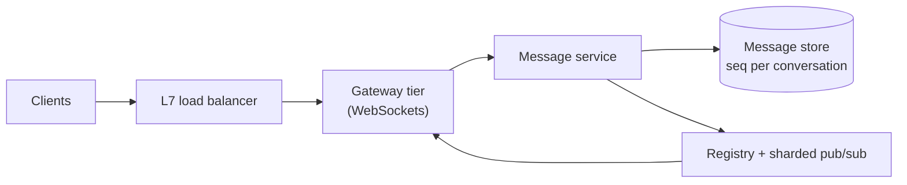
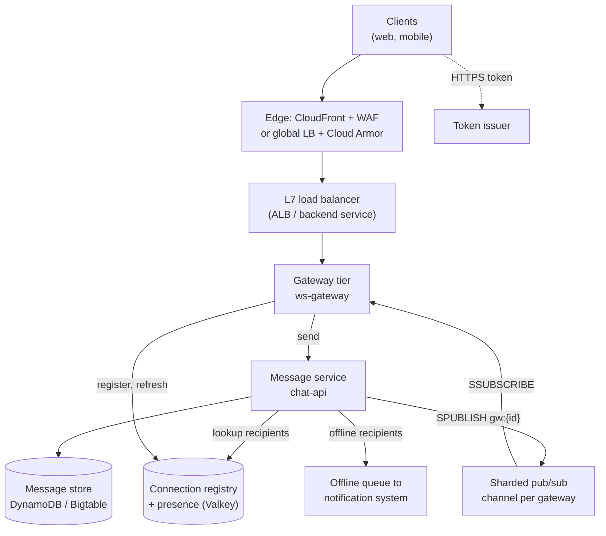
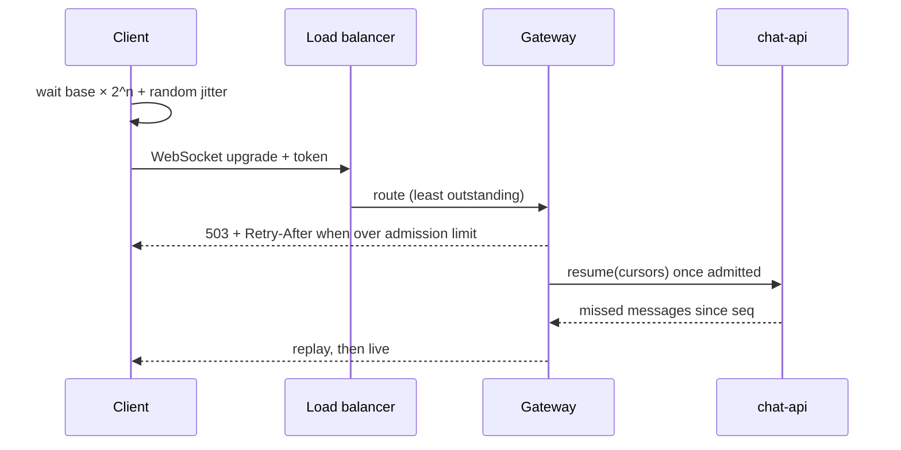

# Real-time WebSocket platform

Part of the [system design library](README.md). The framework, the estimation
numbers and the landing-zone conventions live in the [primer](00-primer.md);
this walkthrough links to them rather than repeating them.

## The question

> "Design a real-time messaging platform: chat with presence. Millions of users
> keep a connection open, messages arrive in well under a second, and the
> client and server both push data at high frequency."

Common variants, and what each changes:

- **Live collaboration** (cursors, shared documents): tiny, frequent updates
  where stale ones can be dropped.
- **Live feeds** (scores, prices): server-to-client broadcast to large rooms,
  no per-message durability.
- **"Just presence"**: the same connection tier with no message store.

This walkthrough answers chat with presence, the hardest variant: it needs both
durable messages and ephemeral, high-churn state.

## The two-minute answer

Each client holds one WebSocket to a thin **gateway tier** behind a layer-7 load
balancer; the gateway authenticates it and records `device → gateway` in a
**connection registry** with a TTL. A separate **message service**
receives sends, assigns a per-conversation sequence number, and writes the
message to a **durable store** before anything is delivered. It then looks up
the recipients' gateways in the registry and publishes once per target gateway
on a **sharded pub/sub** channel; each gateway pushes to its local sockets.
Pub/sub is at-most-once, so delivery is best-effort and **the sequence number is
the source of truth**: a client that sees a gap, or reconnects, asks for
everything after its last sequence. Presence is ephemeral TTL keys, coalesced
and fanned out only to online subscribers. Slow consumers get bounded buffers and are disconnected rather than back up the
gateway; reconnect storms meet jittered backoff, admission limits and resume
cursors. On AWS this is ECS Fargate behind an ALB, ElastiCache for Valkey and
DynamoDB; on GCP it is Cloud Run (or GKE at very large scale) behind the global
external Application Load Balancer, Memorystore for Valkey and Bigtable.



## Clarify the requirements

Questions to ask, with the assumptions this walkthrough takes if the
interviewer leaves them open.

| Question | Assumption |
|---|---|
| How many users, and how many online at peak? | 50 million daily active users; 10 million concurrent connections at peak (20% of DAU). |
| What kinds of conversation? | 1:1 and small groups (up to 100 members) dominate. Large rooms (up to 100,000 members) exist but are rare. |
| Ordering? | Total order **within a conversation**. No order across conversations. |
| Delivery guarantee? | At-least-once to every device, with client-side dedup: effectively exactly-once display. |
| Durability? | A message acknowledged to the sender is never lost. |
| History? | Kept for 1 year, paginated by conversation. |
| Multi-device? | Up to 5 devices per user, each with its own cursor. |
| Presence? | Online, away, last seen. Eventually consistent within about 30 seconds. Typing indicators are best-effort. |
| Offline users? | Handed to the notification system (its own walkthrough). |
| Latency? | p99 send-to-deliver under 500 ms in-region. |
| Regions? | One region, three zones. |

**Functional:** connect, send, receive in order, acknowledge, fetch history,
presence and typing, resume without loss. **Non-functional:** 99.95% for the
send path; losing a gateway or a zone costs only a reconnect; no hot shard.
**Out of scope:** end-to-end encryption, media (see the video upload
walkthrough), search and moderation.

## Back-of-envelope estimates

The arithmetic follows the [estimation cheat sheet](00-primer.md#estimation-cheat-sheet).
Peak-to-average is assumed to be 3×.

**Message rate.**

- 50 M DAU × 40 messages sent per day = 2 × 10⁹ messages/day.
- 2 × 10⁹ / 86,400 s ≈ **23,000 messages/s average**, ≈ **70,000/s at peak**.

**Delivery fan-out.**

- Average recipients per message, counting each online device: assume 5.
- 70,000 × 5 = **350,000 socket deliveries/s at peak**.
- Each message touches about 4 distinct gateways (recipients are spread out), so
  the pub/sub layer carries about 70,000 × 4 = **280,000 publishes/s**.

**Heartbeats.**

- The AWS ALB closes a connection idle for 60 s by default
  ([AWS docs](https://docs.aws.amazon.com/elasticloadbalancing/latest/application/edit-load-balancer-attributes.html#connection-idle-timeout),
  checked 2026-11), so clients ping every 25 s: 10 M / 25 s = **400,000
  pings/s**, all ending at the gateway. That rules out writing presence per ping.

**Connection churn and presence.**

- Assume an average session of 30 minutes: 10 M / 1,800 s ≈ **5,500 connects/s
  and 5,500 disconnects/s** in steady state.
- Each presence change is relevant to about 50 contacts, of whom 20% are
  online: 11,000 changes/s × 10 = **110,000 presence deliveries/s** before
  coalescing.

**Bandwidth.**

- 350,000 deliveries/s × 1 KB ≈ 350 MB/s ≈ **2.8 Gbps** of egress at peak
  (1 Gbps = 125 MB/s).

**Storage.**

- 2 × 10⁹ messages/day × 1 KB = **2 TB/day**, ≈ **730 TB/year** before
  replication. Retention, not throughput, drives the storage bill.
- 70,000 writes/s spread over millions of conversation keys, against 1,000
  write units/s per DynamoDB partition (primer's
  [throughput table](00-primer.md#throughput-per-instance-and-per-partition)):
  only a pathological room makes a key hot.

**Gateway count.**

- Target **50,000 connections per gateway task**. Fargate's default `nofile`
  limit is 65,535, adjustable to 1,048,576
  ([AWS docs](https://docs.aws.amazon.com/AmazonECS/latest/developerguide/fargate-tasks-services.html#fargate-resource-limits),
  checked 2026-11), and each socket is a file descriptor. Memory per idle
  connection is assumed at about 64 KB including buffers (**verify before
  relying on**: measure your runtime), so 50,000 × 64 KB ≈ 3.2 GB.
- 10 M / 50,000 = 200 tasks, plus 30% headroom so that losing one zone of three
  does not overload the others: **about 260 tasks of 4 vCPU and 8 GB**.
- On Cloud Run, concurrency per instance caps at 1,000
  ([Google Cloud docs](https://docs.cloud.google.com/run/docs/triggering/websockets),
  checked 2026-11). 10 M / 1,000 = **10,000 instances**. That number is what
  pushes the very large GCP case to GKE (see the trade-offs).

**Load balancer capacity.**

- One ALB LCU covers 3,000 active connections per minute and 25 new connections
  per second ([AWS pricing](https://aws.amazon.com/elasticloadbalancing/pricing/),
  checked 2026-11).
- 10 M / 3,000 ≈ **3,300 LCUs** for active connections versus 5,500 / 25 = 220
  for new ones. Long-lived sockets make **active connections the ALB bill**,
  the main argument for a Network Load Balancer at this scale.

**Decisions these numbers drive:** presence in memory with TTLs; per-gateway
channels, not broadcast; density per task matters more than CPU; a 10 M-client
reconnect must be spread over minutes.

## API and data model

### Connection handshake

1. `POST /v1/realtime/token` (HTTPS, user session) returns a 60 s signed
   connect token.
2. `GET wss://rt.example.com/v1/ws?token=…` upgrades. The gateway verifies the
   token locally, never calling the identity service on the hot path.
3. The first frame, `hello`, carries the device ID and any resume cursors.

### Frames

Every frame is a JSON (or protobuf) envelope `{type, id, payload}`.

| Direction | Type | Payload | Notes |
|---|---|---|---|
| C → S | `hello` | `device_id`, `resume: {conversation_id: last_seq}` | Server replies with `welcome` and replays gaps. |
| C → S | `send` | `client_msg_id` (UUID), `conversation_id`, `body` | `client_msg_id` is the idempotency key. |
| S → C | `send_ack` | `client_msg_id`, `seq`, `server_ts` | Sent only after the durable write. |
| S → C | `message` | `conversation_id`, `seq`, `sender`, `body`, `server_ts` | Client drops duplicates by `(conversation_id, seq)`. |
| C → S | `read` | `conversation_id`, `seq` | Advances the device cursor; batched every few seconds. |
| C ↔ S | `ping` / `pong` | none | Every 25 s. Keeps the load balancer from idling the socket out. |
| S → C | `presence` | `user_id`, `state`, `last_seen` | Coalesced; may skip intermediate states. |
| C → S | `typing` | `conversation_id` | Fire-and-forget, rate-limited, never stored. |
| S → C | `goaway` | `reconnect_after_ms` | Graceful drain on deploy or rebalance. |

History is HTTPS: `GET /v1/conversations/{id}/messages?after_seq=1200&limit=100`.

### Entities and access patterns

| Entity | Store | Key | Access pattern |
|---|---|---|---|
| Message | DynamoDB / Bigtable | PK `conversation_id`, SK `seq` | Append; range read "after seq N"; newest page. |
| Conversation counter | Same store | `conversation_id` | Atomic increment to allocate `seq`. |
| Idempotency record | Same store, TTL 24 h | `conversation_id#client_msg_id` | Conditional put; on conflict return the original `seq`. |
| Membership | Same store | PK `conversation_id`, SK `user_id` (plus an inverse index) | Recipients of a conversation; conversations of a user. |
| Device cursor | Same store | PK `user_id#device_id`, SK `conversation_id` | Last delivered and last read `seq`. |
| Connection registry | Valkey hash, TTL 90 s | `conn:{user_id}` → `{device_id: gateway_id}` | Read per recipient on every send; refreshed by the gateway every 60 s. |
| Presence | Valkey key, TTL 90 s | `presence:{user_id}` | Set on connect, refreshed with the registry, expires on silent death. |

On Bigtable, the row key is `conversation_id#seq` (zero-padded so it sorts)
and the counter is a read-modify-write increment.

## High-level design



### Request path: connect

1. The client opens the WebSocket with its connect token. On an ALB the target
   is chosen by least outstanding requests and the connection is then
   "inherently sticky"
   ([AWS docs](https://docs.aws.amazon.com/elasticloadbalancing/latest/application/edit-target-group-attributes.html),
   checked 2026-11).
2. The gateway writes `conn:{user_id}[device_id] = gateway_id` and
   `presence:{user_id}` with a 90 s TTL, and publishes a presence change.
3. It replays anything after the `hello` cursors before live traffic.

### Write path: send

1. The gateway forwards `send` to `chat-api`. Gateways stay thin: no database
   credentials and no business logic, so they are cheap to restart.
2. `chat-api` conditionally writes the idempotency record. If it exists, it
   returns the original `seq`, so a client retry is harmless.
3. It increments the conversation counter, writes the message with that `seq`,
   and only then sends `send_ack` back through the gateway. **Durable before
   visible** is the invariant that makes everything downstream best-effort.
4. It reads the membership list (cached), then `HGETALL conn:{user_id}` for
   each recipient, pipelined. It groups the recipient devices by gateway.
5. For each gateway it issues one `SPUBLISH gw:{gateway_id}` carrying the
   message and the list of target devices.
6. Each gateway pushes the frame to its local sockets. Recipients with no live
   device go to the offline queue for push notifications.

Steps 4 to 6 may lose messages; the client repairs any `seq` gap from the store.

## Deep dives

### 1. Connection-tier scaling and routing a message to the right socket

The core problem: a message is produced on one machine and must reach sockets
held by a handful of the 260 gateways. Four ways to do it:

| Option | How it works | Why not (or why) |
|---|---|---|
| Broadcast to all gateways | Every gateway subscribes to one channel and filters locally. | 70,000 msg/s × 260 gateways = 18 M deliveries/s, almost all discarded. |
| Hash users to gateways | The load balancer routes `user_id` to a fixed gateway; the sender computes the target. | Needs custom routing on an application identity, and every scale-out remaps users and forces mass reconnects. |
| **Registry + per-gateway channel** | Gateways record where each device lives; senders publish once per target gateway. | **Chosen.** Cost is proportional to actual recipients. Any gateway can hold any user. |
| Per-room channel | Gateways subscribe to the room channels of the users they hold. | **Chosen for large rooms only.** One publish reaches every interested gateway, with no registry lookup per member. |

**Why sharded pub/sub.** In a Valkey cluster, classic pub/sub propagates every
message to every node over the cluster bus. Sharded pub/sub (`SPUBLISH`,
`SSUBSCRIBE`), introduced in Redis OSS 7.0, hashes a channel to a slot like a
key and keeps the message inside that shard, so pub/sub capacity grows with
shards ([Valkey docs](https://valkey.io/topics/pubsub/), checked 2026-11). With
260 `gw:{id}` channels spread over, say, 6 shards, each shard carries about
280,000 / 6 ≈ 47,000 publishes/s. That is inside the folk figure of about
100,000 simple operations per second per shard in the primer, which is itself
marked **verify before relying on**: load-test the node type.

**Large rooms.** In a 100,000-member room one message would be 100,000 registry
reads. Above a threshold (say 1,000 members) the room gets a channel
`room:{id}`; a gateway subscribes while any local socket is in the room and fans
out locally. Doing this for every small conversation would explode the
subscription count, hence the hybrid.

**Where it breaks.**

- **Pub/sub is at-most-once.** A message the server sent is never resent
  ([Valkey docs](https://valkey.io/topics/pubsub/), checked 2026-11). A gateway
  that is resubscribing, or a shard failover, loses messages. The `seq` gap
  check on the client covers it, at the cost of an extra history read.
- **Stale registry entries.** A dead gateway's entries live up to the 90 s TTL;
  publishes to it go nowhere. Resume means nothing is lost, but presence is
  stale for up to 90 s.
- **Connection density.** One task failure is a 50,000-client reconnect.
  Smaller tasks mean smaller blasts but more channels. 20,000–50,000 is a
  reasonable band; **verify before relying on** it for your runtime.
- **Registry and pub/sub client connections** are modest: 260 gateways plus the
  `chat-api` fleet, each with a few connections per shard, against 65,000
  `maxclients` per ElastiCache node
  ([AWS docs](https://docs.aws.amazon.com/AmazonElastiCache/latest/dg/ParameterGroups.Engine.html),
  checked 2026-11). On Memorystore for Valkey the maximum is 32,000–64,000 per
  node depending on node type
  ([Google Cloud docs](https://docs.cloud.google.com/memorystore/docs/valkey/quotas),
  checked 2026-11).

### 2. Backpressure and slow consumers

A WebSocket is a TCP stream. If a phone on a weak network reads slower than the
server writes, the bytes pile up somewhere. The design question is where, and
what you drop.

**The three queues that fill up, in order.**

1. **The kernel socket send buffer.** Use non-blocking writes so one full socket
   never stalls the event loop.
2. **The per-connection outbound queue.** The one you control. Bound it by
   bytes and count (for example 256 KB or 500 frames).
3. **The gateway's pub/sub subscription.** If the whole gateway falls behind,
   the Valkey server buffers output for it. ElastiCache disconnects a pub/sub
   client whose output buffer passes 32 MB, or stays above 8 MB for 60 s
   (`client-output-buffer-limit-pubsub-*` defaults,
   [AWS docs](https://docs.aws.amazon.com/AmazonElastiCache/latest/dg/ParameterGroups.Engine.html),
   checked 2026-11). One overloaded gateway therefore loses its subscription and,
   with it, every message for its 50,000 users until it resubscribes.

**Policy per message class.** Not all traffic deserves the same treatment:

| Class | When the per-socket queue is full |
|---|---|
| Chat messages | Stop pushing; send a `resync` hint and let the client fetch from the store. Never drop silently: the `seq` makes the gap visible anyway. |
| Presence | Coalesce: keep only the latest state per user. An intermediate "away" is worthless. |
| Typing | Drop. |
| Live-feed ticks (variant) | Conflate to the latest value per key. |

**Disconnect as the last resort.** A socket whose queue stays full for, say,
30 s is closed; the client resumes from its cursor, an already-built path.
Unbounded state for one bad client endangers the 49,999 others.

**Alternatives considered.**

- *Unbounded queues:* one slow client becomes an out-of-memory kill of the
  gateway, then a reconnect storm.
- *Blocking the publisher* (end-to-end flow control): one slow group member
  would slow everyone. Right for single-consumer streams, wrong for fan-out.
- *A durable queue per user:* 50 M queues, when the store is already a
  replayable log.

**Protecting the whole gateway.** Shed load before the Valkey buffer limit does
it for you. On high event-loop lag or total queued bytes, fail readiness (not
liveness) so new sockets go elsewhere, and drop presence and typing first.

**Where it breaks.** None of this protects `chat-api` from a flood of sends.
That is per-user rate limiting; see the rate limiter walkthrough.

### 3. Reconnect storms

The scenario: a zone fails, a bad deploy restarts every gateway, or the load
balancer drops connections. Ten million clients reconnect at once. Each
reconnect is a TLS handshake, a token check, a registry write, a presence
change and a resume query. At 10 M in 10 seconds that is 1 M connects/s, about
180 times the steady-state 5,500/s.

**What fails first,** roughly in order: the load balancer's new-connection
rate, the token issuer, resume queries against the store, presence fan-out.



**Client side (the most effective lever).**

- **Exponential backoff with full jitter.** Never a fixed retry interval: a fixed
  interval turns one storm into a synchronised wave every N seconds.
- **Honour `Retry-After` and `goaway.reconnect_after_ms`.** The server spreads
  the herd explicitly.
- **Resume, don't refetch.** Cursors mean the server sends only the gap.
- **Cache the refresh token,** so a storm does not also hammer the identity
  provider.

**Server side.**

- **Admission control per gateway.** A token bucket on upgrades (say 500/s per
  task); over it, return 503 with `Retry-After` before any expensive work.
- **Debounce presence.** Publish "offline" only at TTL expiry, and nothing for a
  device back within the TTL, so a storm makes almost no presence traffic.
- **Graceful drains on deploy.** Send `goaway` with randomised delays, then
  close. On AWS, the target group's deregistration delay
  (default 300 s,
  [AWS docs](https://docs.aws.amazon.com/elasticloadbalancing/latest/application/edit-target-group-attributes.html#deregistration-delay),
  checked 2026-11) is the window the gateway has to drain. Roll out a few
  percent of tasks at a time.
- **Pre-scale.** Keep headroom for a zone's worth of reconnects; for planned
  events, reserve ALB LCUs
  ([AWS docs](https://docs.aws.amazon.com/elasticloadbalancing/latest/application/capacity-unit-reservation.html),
  checked 2026-11).

**Forced reconnects you must plan for.**

- **Cloud Run** closes every WebSocket at the request timeout, which is at most
  60 minutes ([Google Cloud docs](https://docs.cloud.google.com/run/docs/triggering/websockets),
  checked 2026-11). Behind the global load balancer a serverless NEG uses a
  fixed 60-minute timeout that is not configurable
  ([Google Cloud docs](https://docs.cloud.google.com/load-balancing/docs/negs/serverless-neg-concepts),
  checked 2026-11). At 10 M connections that is at least 10 M / 3,600 ≈ 2,800
  forced reconnects/s, forever. Clients must reconnect before the cap, with
  jitter, or the cap synchronises them.
- **GKE behind the global external Application Load Balancer**: active
  WebSockets close after 24 hours, and idle ones after the backend service
  timeout, which defaults to 30 s
  ([Google Cloud docs](https://docs.cloud.google.com/load-balancing/docs/https/request-distribution),
  checked 2026-11). Raise the timeout above the ping interval.
- **API Gateway WebSocket APIs** cap a connection at 2 hours and close it after
  10 minutes idle
  ([AWS docs](https://docs.aws.amazon.com/apigateway/latest/developerguide/apigateway-execution-service-websocket-limits-table.html),
  checked 2026-11).

**Where it breaks.** If every gateway restarts at once, admission control only
turns a crash into a slow recovery. The real fix is canary-then-batch deploys;
the runbook covers the case where it happens anyway.

## Trade-offs to defend

| Decision | Chosen | Rejected | Why | What would change the answer |
|---|---|---|---|---|
| Transport | WebSocket | Server-sent events plus HTTP POST; long polling | Bidirectional, high-frequency traffic in both directions; one connection per device. | Mostly server-to-client feeds: SSE is simpler and works through more proxies. |
| Connection tier (AWS) | ECS Fargate behind an ALB | API Gateway WebSocket APIs; NLB | The repo's app-services path gives Fargate + ALB today. API Gateway's 500 new connections/s default and 2-hour cap fit a smaller product. | Above a few million connections the ALB's per-active-connection LCU cost argues for an NLB with TLS at the gateway. |
| Connection tier (GCP) | Cloud Run behind the global external ALB | GKE Autopilot | The repo's app-services path; zero cluster operations; fine up to about 1 M connections. | 10 M connections means 10,000 Cloud Run instances and a 60-minute forced reconnect. Move to GKE (the repo can enable an Autopilot cluster) for denser pods and 24-hour connections. |
| Routing | Registry + per-gateway sharded channel | Broadcast; consistent hashing | Work proportional to actual recipients; any gateway holds any user. | Mostly huge rooms (live events): per-room channels everywhere. |
| Delivery guarantee | Durable write, then best-effort push, with client gap repair | Durable per-user queues | One replayable log (the store) instead of 50 M queues. | Strict server-side delivery receipts for compliance: add a per-device delivery log. |
| Ordering | Per-conversation `seq` from an atomic counter | Timestamps; global sequencer | Timestamps collide and skew; a global sequencer is a bottleneck. | Very hot rooms: allocate `seq` in blocks. |
| Message store | DynamoDB / Bigtable | Relational database | Append-heavy, key-range reads, 70,000 writes/s, 730 TB/year. | Small scale (under 1,000 writes/s): Aurora or Cloud SQL is simpler and gives you joins. |
| Presence | TTL keys in Valkey, debounced | Database rows | 400,000 pings/s and high churn; staleness of seconds is acceptable. | Presence that must be exact (a call is ringing): a separate, stricter path. |
| Slow consumers | Bounded queues, coalesce, then disconnect | Unbounded buffering; end-to-end flow control | Protects the other sockets on the gateway. | Single-consumer streams: credit-based flow control. |

## Failure modes and scaling limits

### What fails first as load grows

| Load | First thing to fail | Fix |
|---|---|---|
| ×1 (10 M connections) | Nothing, if sized as above. | |
| ×10 (100 M connections) | Load-balancer cost; registry reads (3.5 M/s); 2,600 channels. | NLB; more shards; cells (a full stack per slice of users) with a cross-cell router. |
| ×100 | A single region. Cross-cell routing and per-region data residency dominate. | Multi-region active-active; see the multi-region walkthrough. |
| Hot room (one room ×100) | The room's counter key and its pub/sub channel, both on one shard. | Per-room channels split by sub-channel; block allocation of `seq`; drop typing and presence for rooms above a size. |

### Blast radius per component

| Component | If it fails | Blast radius | Recovery |
|---|---|---|---|
| One gateway task | Its sockets drop. | Up to 50,000 clients reconnect. | Clients reconnect elsewhere with jitter; registry entries expire in 90 s. |
| One zone | A third of the gateways and a third of the load balancer's nodes. | About 3.3 M reconnects. | 30% headroom absorbs it; admission control spreads it. |
| Valkey shard primary | Failover to a replica; in-flight publishes on that shard lost. | Messages to gateways whose channels hash to that shard are delayed until clients repair gaps. | Automatic failover; clients fetch `after_seq`. |
| Whole Valkey cluster | No routing, no presence. | Live delivery stops; sends still succeed (durable first). | Degrade to client polling of `after_seq` every few seconds until restored. |
| Message store | Sends fail. | Total for writes; reads of history fail. | The one component you cannot degrade around. Use a multi-zone managed store and point-in-time recovery. |
| `chat-api` | Sends and resumes fail. | Total for writes. | Stateless; scale out. |

## AWS and GCP mapping

| Component | AWS | GCP | Difference that matters |
|---|---|---|---|
| Edge and WAF | CloudFront + AWS WAF | Global external Application Load Balancer + Cloud Armor | CloudFront needs the `Sec-WebSocket-*` headers forwarded and supports WebSockets over HTTP/1.1 only ([AWS docs](https://docs.aws.amazon.com/AmazonCloudFront/latest/DeveloperGuide/distribution-working-with.websockets.html), checked 2026-11). The repo's CloudFront origin request policy (`AllViewerExceptHostHeader`) already forwards them. **Verify before relying on** CloudFront's timeouts for hour-long sockets. |
| Load balancer | ALB (idle timeout 1–4,000 s, default 60 s) | Global external ALB with a serverless NEG (fixed 60-minute timeout) or a GKE backend (idle closes at the backend timeout, active at 24 h) | The ALB's idle timeout means clients must ping under 60 s unless you raise it. |
| Gateway compute | ECS Fargate | Cloud Run (or GKE Autopilot at scale) | Cloud Run's 1,000 concurrency and 60-minute cap; Fargate's `nofile` 65,535 default. |
| Managed alternative | API Gateway WebSocket APIs | None first-party | Limits in the trade-offs and study aids. |
| Registry and pub/sub | ElastiCache for Valkey, cluster mode | Memorystore for Valkey, cluster mode | Memorystore connects over Private Service Connect through a service connection policy; ElastiCache sits in a subnet. |
| Message store | DynamoDB | Bigtable (Firestore at small scale) | DynamoDB on-demand bills per request; Bigtable bills per provisioned node, so a small deployment pays a floor (**verify before relying on** current pricing). |
| Offline handoff | SQS | Pub/Sub | See the notification system walkthrough. |
| Keys | KMS CMK `alias/workload-<env>` | Cloud KMS key ring `<prefix>-<env>-cmek` | GCP needs the key added (see [CMEK source](00-primer.md#cmek-source)). |

## Build it here

### Where it lives

| Part | AWS | GCP |
|---|---|---|
| Root and workspace | [`envs/aws/workload`](../../envs/aws/workload/), workspace `aws-workload-prod` | [`envs/gcp/workload`](../../envs/gcp/workload/), workspace `gcp-workload-prod` |
| Account or project | The prod workload account (`workload_prod`) | The prod host project (`<prefix>-prod-host`) |
| Gateway and `chat-api` | Fargate tasks in the `private` tier behind the shared ALB | Cloud Run with Direct VPC egress into the `private` tier |
| Valkey | `isolated` tier | Private Service Connect endpoints in the `database` tier subnet |
| Message store | DynamoDB, reached through the spoke's gateway endpoint | Bigtable, reached through Private Google Access |
| Egress | Through the Transit Gateway to the inspection VPC | The environment's own Cloud NAT, not inspected through the hub |

Tiers follow [VPC-tier placement](00-primer.md#vpc-tier-placement). Apply order
is the usual chain, `aws-network` → `aws-workload-prod` and `gcp-network-hub` →
`gcp-workload-prod` (see [accounts and projects](00-primer.md#accounts-and-projects));
nothing here adds a cross-root dependency.

### Config

The gateway and the message service are ordinary app-services entries, sized
from the estimates.

```yaml
aws:
  app_ingress_mode: cloudfront_vpc_origin # internal ALB, CloudFront + WAF in front
  workload_environments:
    prod:
      account_key: workload_prod
      services:
        ws-gateway:
          cpu: 4096
          memory: 8192
          enable_autoscaling: true
          autoscaling_min_capacity: 12
          autoscaling_max_capacity: 300
          path_patterns: [/v1/ws]
          health_check_path: /readyz
        chat-api: {enable_autoscaling: true, health_check_path: /healthz}
gcp:
  environments:
    prod:
      services:
        ws-gateway:
          cpu: "4000m"
          memory: 8Gi
          concurrency: 1000 # Cloud Run maximum
          timeout: 3600s # 60-minute cap; clients reconnect before it
          min_instances: 20
          max_instances: 2000
        chat-api: {min_instances: 3}
  workload:
    public_ingress:
      prod:
        ws-gateway:
          domains: [rt.example.com]
```

Repo gaps the config cannot express:

- [`modules/aws/network/load-balancer`](../../modules/aws/network/load-balancer/)
  has no `idle_timeout` input, so the 60 s default applies and clients ping
  every 25 s.
- app-services sets no `ulimits`, so a task keeps Fargate's 65,535 `nofile`
  limit: roughly 60,000 sockets per task at most.
- [`modules/gcp/compute/cloud-run`](../../modules/gcp/compute/cloud-run/) does
  not expose session affinity. This design does not need it.

### AWS: registry, pub/sub and message store

These go in `envs/aws/workload` and reuse the root's `local.environment`,
`local.kms_key_arn` and `module.aws_workload`, plus `module.app_services`.
Argument names were checked against aws v6.72.0
([`aws_elasticache_replication_group`](https://registry.terraform.io/providers/hashicorp/aws/6.72.0/docs/resources/elasticache_replication_group),
[`aws_dynamodb_table`](https://registry.terraform.io/providers/hashicorp/aws/6.72.0/docs/resources/dynamodb_table),
checked 2026-11). Illustrative only.

```hcl
# Gap: the repo has no ElastiCache module; raw resources in the landing zone's conventions.
resource "aws_elasticache_subnet_group" "realtime" {
  name       = "${local.environment}-realtime"
  subnet_ids = module.aws_workload.subnet_ids_by_tier["isolated"] # no route off the VPC
}

resource "aws_security_group" "realtime_cache" {
  name        = "${local.environment}-realtime-db"
  description = "realtime Valkey: only the gateway and chat-api tasks"
  vpc_id      = module.aws_workload.vpc_id
  tags        = { Service = "realtime" }
}

resource "aws_vpc_security_group_ingress_rule" "realtime_from_services" {
  for_each                     = toset(["ws-gateway", "chat-api"])
  security_group_id            = aws_security_group.realtime_cache.id
  referenced_security_group_id = module.app_services.services[each.key].security_group_id
  ip_protocol                  = "tcp"
  from_port                    = 6379
  to_port                      = 6379
}

resource "aws_elasticache_replication_group" "realtime" {
  replication_group_id       = "${local.environment}-realtime"
  description                = "connection registry, presence, sharded pub/sub"
  engine                     = "valkey"
  node_type                  = "cache.r7g.large"
  cluster_mode               = "enabled"
  num_node_groups            = 6 # shards: pub/sub and registry capacity scale with these
  replicas_per_node_group    = 1
  automatic_failover_enabled = true
  multi_az_enabled           = true
  subnet_group_name          = aws_elasticache_subnet_group.realtime.name
  security_group_ids         = [aws_security_group.realtime_cache.id]
  at_rest_encryption_enabled = true
  kms_key_id                 = local.kms_key_arn # workload CMK; verify its key policy admits ElastiCache
  transit_encryption_enabled = true
  tags                       = { Service = "realtime" }
}

# Gap: the repo has no DynamoDB module; raw resource in the landing zone's conventions.
resource "aws_dynamodb_table" "messages" {
  name                        = "${local.environment}-messages"
  billing_mode                = "PAY_PER_REQUEST"
  hash_key                    = "pk" # conversation_id
  range_key                   = "sk" # zero-padded seq
  deletion_protection_enabled = true
  attribute {
    name = "pk"
    type = "S"
  }
  attribute {
    name = "sk"
    type = "S"
  }
  point_in_time_recovery {
    enabled = true
  }
  server_side_encryption {
    enabled     = true
    kms_key_arn = local.kms_key_arn
  }
  tags = { Service = "chat-api" }
}

# chat-api's task role (created by app-services as <env>-chat-api-task) gets this table only.
resource "aws_iam_role_policy" "chat_api_messages" {
  name = "messages-table"
  role = "${local.environment}-chat-api-task"
  policy = jsonencode({
    Version = "2012-10-17"
    Statement = [{
      Effect   = "Allow"
      Action   = ["dynamodb:GetItem", "dynamodb:PutItem", "dynamodb:UpdateItem", "dynamodb:Query"]
      Resource = aws_dynamodb_table.messages.arn
    }]
  })
}
```

A TTL attribute (omitted) expires idempotency records and old messages. The
gateway gets no DynamoDB permission. Per-component cache credentials (RBAC
`user_group_ids`) are omitted.

### GCP: registry and pub/sub

These go in `envs/gcp/workload` and reuse the root's `local.env_config`,
`local.project_prefix`, `local.labels`, `var.environment` and
`module.environment`. Region-scoped resources use `local.env_config.region`.
Argument names were checked against google v8.10.0
([`google_memorystore_instance`](https://registry.terraform.io/providers/hashicorp/google/8.10.0/docs/resources/memorystore_instance),
[`google_network_connectivity_service_connection_policy`](https://registry.terraform.io/providers/hashicorp/google/8.10.0/docs/resources/network_connectivity_service_connection_policy),
checked 2026-11). Illustrative only.

```hcl
# Gap: no per-environment workload CMEK exists yet (see the primer's CMEK source);
# this adds one with the existing kms module.
module "workload_cmek" {
  source       = "../../../modules/gcp/governance/kms"
  project_id   = local.env_config.host_project_id
  keyring_name = "${local.project_prefix}-${var.environment}-cmek"
  location     = local.env_config.region # Memorystore needs the key in the instance's region
  labels       = local.labels
  keys = {
    "realtime" = {
      encrypter_decrypters = ["serviceAccount:service-${local.env_config.host_project_number}@gcp-sa-memorystore.iam.gserviceaccount.com"]
    }
  }
}

# Gap: the repo has no Memorystore for Valkey module or service connection policy.
resource "google_network_connectivity_service_connection_policy" "memorystore" {
  project       = local.env_config.host_project_id
  name          = "memorystore-${var.environment}"
  location      = local.env_config.region
  service_class = "gcp-memorystore"
  network       = module.environment.network_id
  psc_config {
    subnetworks = [values(module.environment.subnets.database)[0].id] # endpoints land in the data tier
  }
}

resource "google_memorystore_instance" "realtime" {
  project                     = local.env_config.host_project_id
  instance_id                 = "realtime"
  location                    = local.env_config.region
  mode                        = "CLUSTER"
  shard_count                 = 6
  replica_count               = 1
  node_type                   = "HIGHMEM_MEDIUM" # up to 64,000 clients per node
  authorization_mode          = "IAM_AUTH"       # each component's -run SA gets its own grant
  transit_encryption_mode     = "SERVER_AUTHENTICATION"
  kms_key                     = module.workload_cmek.key_ids["realtime"]
  deletion_protection_enabled = true
  labels                      = merge(local.labels, { service = "realtime" })
  desired_auto_created_endpoints {
    network    = module.environment.network_id
    project_id = local.env_config.host_project_id
  }

  # The policy and the service agent's key grant must exist first.
  depends_on = [google_network_connectivity_service_connection_policy.memorystore, module.workload_cmek]
}
```

Notes:

- CMEK cannot be added to an existing Memorystore for Valkey instance, and the
  service agent `service-<project-number>@gcp-sa-memorystore.iam.gserviceaccount.com`
  needs Encrypter/Decrypter before creation
  ([Google Cloud docs](https://docs.cloud.google.com/memorystore/docs/valkey/use-cmek),
  checked 2026-11).
- Cloud Run reaches the PSC endpoints over Direct VPC egress (the default
  `PRIVATE_RANGES_ONLY` covers internal ranges).
- The Bigtable message store follows the same pattern: `kms_key_name` on its
  `cluster` block, with the Bigtable service agent on the key
  ([registry](https://registry.terraform.io/providers/hashicorp/google/8.10.0/docs/resources/bigtable_instance),
  checked 2026-11). It is left out to keep this section short.
- `chat-api-run` and `ws-gateway-run`, the runtime service accounts app-services
  creates, each get their own Memorystore IAM grant on this instance; see
  [Per-component identity](00-primer.md#per-component-identity).

## Runbook

### Reconnect storm after a gateway-wide restart

**When to use:** most clients disconnected at once (bad deploy, zone loss, load
balancer event) and are failing to reconnect or reconnecting in waves.

**Detection signal.**

- Active WebSocket connections drop by more than 20% in under 5 minutes. On AWS
  watch the ALB's `ActiveConnectionCount` and `NewConnectionCount`; on GCP the
  Cloud Run request count and instance count for `ws-gateway`.
- Gateway 503 rate (admission rejections) rises, and so does p99 resume
  latency on `chat-api`.
- Valkey: connected clients and pub/sub output-buffer evictions spike.

**Triage (first 10 minutes).**

1. Is the cause still active? Check the last `ws-gateway` and `chat-api`
   deploy (ECS service events, Cloud Run revisions) and the provider's health
   dashboard.
2. Where is the bottleneck? In order: the load balancer (5xx at the LB),
   gateway admission (503 from targets), `chat-api` resume (store throttling),
   Valkey (CPU, client count).
3. Periodic waves of reconnects mean clients are not jittering: usually an old
   client version.

**Mitigation.**

1. **Stop the cause.** Roll back; do not roll forward during a storm.
2. **Lower admission rates** (a runtime flag) and raise `Retry-After`, spreading
   the herd over 5–10 minutes.
3. **Add capacity.** Raise `autoscaling_min_capacity` (AWS) or `min_instances`
   (GCP) in config and run it through TFC; reconcile any emergency console
   change in config afterwards.
4. **Shed optional work.** Turn off presence fan-out and typing with a feature
   flag. Resume replays are the priority.
5. **Protect the store.** If resume queries throttle DynamoDB or overload
   Bigtable, cap the resume page size and let clients page.

**Verification.**

- Active connections back within 5% of the pre-incident baseline.
- Gateway 503 rate under 1%, and p99 send-to-deliver back under 500 ms.
- No growth in clients reporting `seq` gaps that do not close.

**Follow-up.**

- Restore admission rates, flags and capacity in `config/landing-zone.yaml`, so
  nothing stays as console drift.
- Check that the release process drains gateways in batches with `goaway`, and
  that the deregistration delay covers the drain.
- Measure how many clients ignored jitter; force-upgrade old client versions.

### Secondary: Valkey shard failover

**Detection:** a failover event and a spike in client gap repairs.
**Mitigation:** confirm gateways resubscribed (one subscriber per `gw:{id}`).
**Verification:** gap repairs back to baseline. **Follow-up:** check memory
pressure and output-buffer limits if it recurs.

## Study aids

### Numbers to remember

| Number | Value |
|---|---|
| ALB idle timeout | 60 s default, 1–4,000 s range |
| ALB LCU | 3,000 active connections/min, 25 new connections/s |
| API Gateway WebSocket | 500 new connections/s default; 2 h max; 10 min idle; 128 KB message, 32 KB frame |
| Cloud Run | 1,000 concurrent requests per instance; 60-minute request timeout |
| Global external ALB | Backend timeout default 30 s; active WebSockets close at 24 h (60 minutes fixed for serverless NEGs) |
| Fargate `nofile` | 65,535 default, up to 1,048,576 |
| ElastiCache `maxclients` | 65,000 per node |
| Valkey pub/sub buffer limit (ElastiCache default) | 32 MB hard; 8 MB for 60 s soft |
| This design | 10 M connections, 70,000 sends/s, 350,000 deliveries/s, 400,000 pings/s, 2 TB/day |

### Likely follow-ups

- **"How do you guarantee ordering?"** A per-conversation `seq` allocated by an
  atomic counter in the store, assigned before delivery. Clients render by
  `seq`, not arrival order.
- **"What if pub/sub drops a message?"** It will, sometimes. The message is
  already durable. The client sees a gap in `seq` and fetches `after_seq`.
- **"Exactly-once?"** At-least-once delivery plus dedup on `(conversation_id,
  seq)` at the client, and on `client_msg_id` at the server for sends.
- **"Why not sticky sessions?"** A WebSocket is already pinned to its target.
  Routing a message from another gateway needs the registry.
- **"100 M connections?"** Cells (independent stacks per slice of users) with a
  router for cross-cell conversations, an NLB in front, denser pods.
- **"Why not API Gateway WebSockets?"** At small scale, do. At 10 M
  connections its connect rate, 2-hour cap and per-message pricing bite
  (**verify before relying on** current pricing).
- **"Presence at this scale?"** Never in the database: TTL keys, batched
  refresh, debounced reconnects, fan-out to online subscribers only.

### Classic mistakes

- Writing to the database on every heartbeat.
- Broadcasting every message to every gateway.
- Acknowledging a send before the durable write.
- Unbounded per-socket buffers.
- Fixed-interval reconnects without jitter.
- Forgetting the load balancer's idle timeout, so idle sockets die at 60 s.
- Treating Redis pub/sub as a durable queue.

### Further reading

- [Valkey pub/sub](https://valkey.io/topics/pubsub/)
- [WebSockets on Cloud Run](https://docs.cloud.google.com/run/docs/triggering/websockets)
- [Google Cloud WebSocket timeouts](https://docs.cloud.google.com/load-balancing/docs/https/request-distribution)
- [ALB listeners and WebSockets](https://docs.aws.amazon.com/elasticloadbalancing/latest/application/load-balancer-listeners.html)
