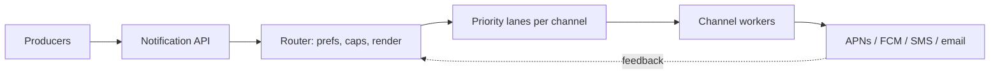
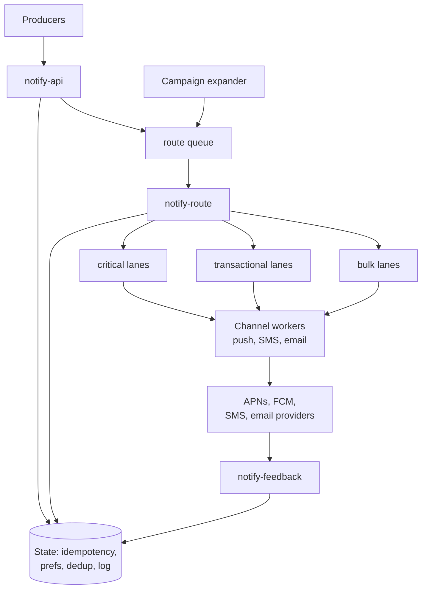
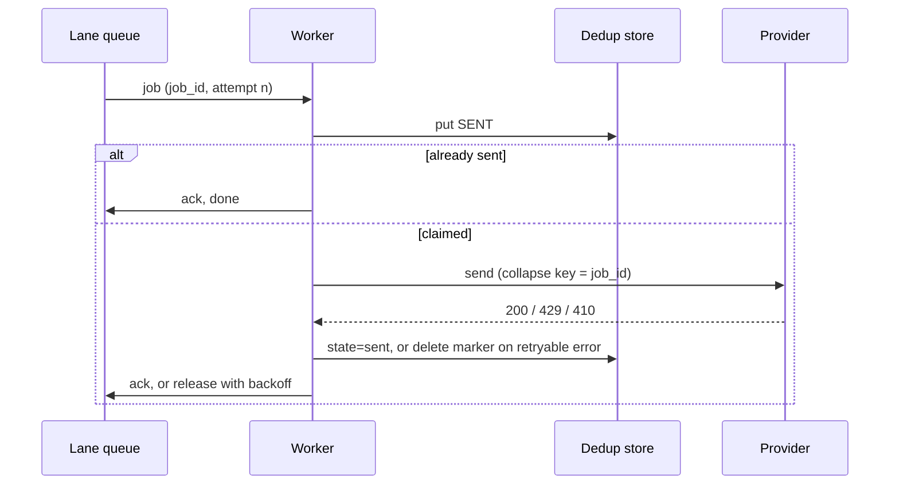

# Notification system

A walkthrough of a multi-channel notification platform: mobile push, SMS and
email, sent on behalf of many internal producers to hundreds of millions of
users. It follows the [interview framework](00-primer.md#interview-framework).
Numbers lean on the [estimation cheat sheet](00-primer.md#estimation-cheat-sheet),
service names on the [AWS-GCP service map](00-primer.md#aws-gcp-service-map),
and the build on the [conventions](00-primer.md#conventions).

## The question

> "Design a notification service. Product teams call it to tell a user
> something, and it delivers by push, SMS or email. It has to handle both a
> password-reset code and a marketing blast to every user."

Common variants:

- "Design a bulk email or campaign system".
- "Design an alerting fan-out for an on-call product".
- "How do you make sure a user never gets the same notification twice?"

## The two-minute answer

Producers call one **notification API** with a template, a recipient and an
idempotency key; the API stores the request and returns at once, so sending is
always asynchronous. A **router** loads the user's preferences and contact
points, applies opt-outs, quiet hours and per-user frequency caps, renders the
template, and writes one job per channel into a **priority lane**: a separate
queue per channel and priority, so a marketing blast can never delay a
password reset. **Channel workers** drain each lane at the rate the downstream
provider allows (APNs and FCM for push, an SMS provider, an email service),
classify each response as retryable or permanent, and retry with backoff into a
dead-letter queue. Every send passes a **dedup check** keyed on notification,
channel and recipient, because every hop is at-least-once and the providers
themselves do not deduplicate. Provider feedback (bounces, complaints, invalid
device tokens) flows back to suppress bad addresses and protect sender
reputation. Bulk campaigns enter through a separate **expander** that pages
through the audience and paces the fan-out, so a 50-million-user blast is a
controlled stream, not a spike.



## Clarify the requirements

Questions to ask, with the assumptions this walkthrough uses.

### Functional

- **Channels.** Push (iOS and Android), SMS and email. An in-app inbox is out
  of scope.
- **Kinds.** *Critical* (one-time codes, security), *transactional* (order
  shipped) and *bulk* (marketing). The kind sets priority and retry budget.
- **Targeting.** One user, a list of users, or a segment (a stored audience
  query). Segments are only for bulk.
- **Templates.** Versioned and localised; producers send variables.
- **Preferences.** Per user, per category, per channel opt-in; quiet hours in
  the user's timezone; a global unsubscribe for marketing.
- **Scheduling.** "Send at 09:00 local time" and "send in 30 minutes".
- **Status.** Per-channel state by query or callback.

### Non-functional

- **Scale.** 100 million users, 50 million daily active.
- **Latency.** Critical: p99 under 5 seconds from API call to provider
  acceptance. Transactional: under 30 seconds. Bulk: minutes to an hour is fine.
- **Delivery semantics.** At-least-once into the system; *effectively once* to
  the user, which means dedup in our own store. True exactly-once to a phone is
  impossible because the providers' own delivery is out of our control.
- **Durability.** An accepted request is never lost.
- **Availability.** 99.95% for the API, so producers can always hand off work.
- **Regions.** One region per cloud.
- **Compliance.** Marketing honours unsubscribe and consent rules; personal
  data (phone, email) is encrypted at rest with CMEK.

Assumption: providers, not our queues, are the bottleneck.

## Back-of-envelope estimates

Every number below is an assumption; the arithmetic uses the
[QPS conversions](00-primer.md#qps-conversions).

### Volume

- 50 million daily active users × 10 notifications per user per day =
  **500 million notifications a day**.
- 500 million / 86,400 s ≈ **5,800 per second** on average.
- Peak at 3× average: **~17,000 per second**.
- Channel split (assumed): push 80%, email 15%, SMS 1%, the rest dropped by
  preferences. That is ~4,600 push/s, ~870 email/s and ~58 SMS/s on average;
  ~14,000, ~2,600 and ~175 at peak.

### The campaign spike

- A marketing blast to all 50 million active users, sent "now" with no pacing,
  in 10 minutes: 50,000,000 / 600 s ≈ **83,000 per second**, on top of the
  normal peak.
- **Decision it drives:** campaigns must be paced. At a 20,000/s campaign
  budget the same blast takes 50,000,000 / 20,000 = 2,500 s, about **42
  minutes**, and leaves headroom for transactional traffic.

### Provider ceilings (the numbers that actually bind)

- **FCM:** a default of 600,000 messages per minute per project, which is
  10,000 per second
  ([Firebase docs](https://firebase.google.com/docs/cloud-messaging/throttling-and-quotas),
  checked 2026-11). Peak push at ~14,000/s, mostly through FCM for Android,
  already exceeds it. **Decision:** request a quota increase, and pace the push
  lanes with a token bucket set below the quota.
- **SMS:** a US short code sends 100 message parts per second; a US toll-free
  number 3 parts per second
  ([AWS End User Messaging SMS docs](https://docs.aws.amazon.com/sms-voice/latest/userguide/sms-limitations-mps.html),
  checked 2026-11). Peak SMS at ~175 messages/s of one or two parts needs
  several short codes or a 10DLC tier. **Decision:** SMS gets dedicated,
  rate-limited lanes.
- **Email:** Amazon SES quotas are per account and per Region, and a sandbox
  account is limited to 200 messages a day at 1 per second
  ([AWS docs](https://docs.aws.amazon.com/ses/latest/dg/manage-sending-quotas.html),
  checked 2026-11). Peak email at ~2,600/s needs a raised production quota.
  **Decision:** the email worker paces to its quota.

### Storage

- **Delivery log.** ~500 bytes per notification and channel: 500 million ×
  500 B = **250 GB a day**, ~7.5 TB for 30 days hot. **Decision:** key-value
  with TTL, archive to object storage.
- **State writes.** Each job writes three times (dedup marker, `sent` update,
  delivery-log upsert): 3 × ~17,000 = **~51,000 writes/s** at peak, plus 50 GB
  of 24-hour dedup keys. That exceeds DynamoDB's default table quota of 40,000
  write units per second, which is adjustable
  ([primer](00-primer.md#throughput-per-instance-and-per-partition)).
  **Decision:** request a quota increase before launch, at 1× scale.
- **Preferences.** 100 million × ~1 KB = **100 GB**, ~17,000 reads/s at peak.
  **Decision:** cache it.

## API and data model

### Producer API

```text
POST /v1/notifications
Idempotency-Key: <producer-generated UUID>
{
  "template": "order_shipped",          // template id; version resolved by router
  "category": "transactional",          // critical | transactional | bulk
  "recipients": [{"user_id": "u_123"}], // or {"segment_id": "seg_9"} for bulk
  "channels": ["push", "email"],        // allowed channels, in preference order
  "variables": {"order_id": "A-77"},
  "send_at": "2026-11-07T09:00:00",     // optional; local time if "tz": "user"
  "expires_at": "2026-11-07T10:00:00",  // drop rather than deliver late
  "callback_url": "https://producer.internal/hooks/notify"
}
→ 202 Accepted {"notification_id": "n_8f3…", "status": "accepted"}

GET /v1/notifications/{id}
→ {"id": "n_8f3…", "channels": {"push": "delivered", "email": "sent"}}

PUT /v1/users/{id}/preferences      // user-facing, through the app backend
POST /v1/unsubscribe?token=…        // one-click unsubscribe target
```

Two fields carry the design:

- **`Idempotency-Key`** makes a producer retry safe: the same key within 24
  hours returns the original `notification_id` and enqueues nothing.
- **`expires_at`** lets a stale message die. An OTP that arrives after it has
  expired is worse than none.

### Internal job (one per notification, channel and recipient)

```json
{
  "job_id": "n_8f3…:push:u_123",
  "notification_id": "n_8f3…",
  "channel": "push",
  "priority": "transactional",
  "recipient": {"user_id": "u_123", "device_tokens": ["…"]},
  "rendered": {"title": "Your order shipped", "body": "A-77 is on its way"},
  "collapse_key": "order:A-77",
  "attempt": 0,
  "expires_at": 1794045600
}
```

The `job_id` is deterministic, so every retry of a job has the same dedup key
and task name. `expires_at` is epoch seconds here and in DynamoDB; Firestore
stores it as a Timestamp, because its TTL policy only acts on a timestamp
field.

### Entities and access patterns

| Entity | Key | Access pattern | Store |
|---|---|---|---|
| Idempotency record | `IDEM#<producer>#<key>` | Conditional put on accept; get on retry | Key-value, 24 h TTL |
| Notification | `NOTIF#<id>` | Put on accept; get by id for status | Key-value, 30-day TTL |
| Delivery attempt | `NOTIF#<id>`, sort `CH#<channel>#<user>` | Upsert per state change; query by notification | Same table |
| Dedup marker | `SENT#<job_id>` | Conditional put before provider call | Key-value, 24 h TTL |
| Preferences | `USER#<id>`, sort `PREF#<category>` | Get per notification (cached); put on change | Key-value, no TTL |
| Contact points | `USER#<id>`, sort `DEV#<token>` / `EMAIL` / `PHONE` | Query by user; delete on invalid token | Same table |
| Suppression | `SUPP#<address-hash>` | Get before email/SMS send; put on bounce or complaint | Same table |

One table with composite keys is enough: every access is by key.

## High-level design



### Request path (accept)

1. A producer calls `POST /v1/notifications` with an idempotency key.
2. `notify-api` writes the idempotency record with a conditional put. If the
   key exists, it returns the stored `notification_id` and stops.
3. It writes the notification record, publishes to the route queue and
   returns `202`. If the publish fails, the producer's retry finds the record
   not yet enqueued and re-publishes; the router dedups. (The transactional
   outbox in the microservices walkthrough is the stricter version.)

### Write path (deliver)

1. `notify-route` consumes the message. For a single user it loads preferences
   and contact points (cache first), drops channels the user opted out of, and
   checks the per-user frequency cap.
2. Quiet hours or `send_at` in the future turn the job into a scheduled one;
   otherwise the router renders the template per channel and locale.
3. It writes one job per channel to the lane for that channel and priority.
4. A channel worker takes a job, checks `expires_at`, writes the dedup marker
   with a conditional put, takes a token from the provider's rate limiter, and
   calls the provider.
5. Success records `sent` and acks; a retryable error releases the job for a
   backed-off retry; a permanent error records `failed`, deletes the token or
   suppresses the address, and acks.
6. `notify-feedback` turns provider events (bounces, complaints, receipts)
   into suppression and delivery-log updates.

### Campaign path

The campaign expander pages through a segment in chunks of 1,000 users,
publishes one route message per chunk at the campaign budget (20,000
recipients a second) and checkpoints its cursor so a crash resumes.

## Deep dives

### Fan-out and prioritisation

**The problem.** One API call can mean one send or 50 million. In a single
queue, a blast ahead of a password reset delays it by the blast's drain time:
42 minutes in the estimate.

**Alternatives considered.**

- **One queue, priority field.** Neither SQS nor Pub/Sub has message priority.
- **One queue per priority, shared consumers polling high first.** Strict
  priority starves bulk, and one slow provider stalls every lane.
- **Lanes: one queue per (channel, priority), each with its own consumers and
  rate budget.** This wins. A full bulk-email lane cannot touch the
  critical-SMS lane's consumers, depth or provider quota.

**How the lanes share a provider quota.** The FCM quota is per project, so all
push lanes draw on one 10,000/s budget. Reserve shares (say critical 1,000/s,
transactional 6,000/s) and give bulk the remainder. The limiter is a token
bucket per (provider, lane) in a shared counter store, in front of the
provider, not our API; the rate limiter walkthrough covers the algorithms.

**Two-stage fan-out.** The expander turns a segment into chunks and the
router turns chunks into jobs. The expander slows when lane depth rises,
instead of piling 50 million jobs into a queue.

**Noisy producers.** One producer can still crowd out another in a lane. SQS
**fair queues** fix that: set a `MessageGroupId` per tenant and SQS favours
quiet tenants when one builds a backlog, with no throughput limit
([AWS docs](https://docs.aws.amazon.com/AWSSimpleQueueService/latest/SQSDeveloperGuide/sqs-fair-queues.html),
checked 2026-11). Use the producer ID as the group. Pub/Sub has no
equivalent; use a per-producer token bucket in the router.

**Expiry beats retry for critical.** An OTP lives five minutes, so its lane
has a short retry budget and checks `expires_at` before every attempt. Bulk
gets a long retry budget and a long expiry.

**Where it breaks.**

- Lanes multiply: 3 channels × 3 priorities = 9 queues, each with a DLQ and
  alarms. Merge critical and transactional for low-volume channels.
- Reserved shares waste quota when critical is idle; let bulk borrow, capped.
- A Cloud Tasks queue dispatches at most 500 tasks a second
  ([Google Cloud docs](https://docs.cloud.google.com/tasks/docs/quotas),
  checked 2026-11), so a 14,000/s push lane on GCP would need about 30 sharded
  queues. Use Cloud Tasks for the low-rate lanes where its built-in rate limit
  helps (SMS, email) and Pub/Sub for high-volume push.

### Retries, idempotency and dedup

**The problem.** Every hop is at-least-once, and none of APNs, FCM, SES or an
SMS provider deduplicates a repeated send. Without our own dedup, a
redelivery is a second buzz on the phone and a second SMS on the bill.

**Three layers of idempotency.**

| Layer | Key | Mechanism | Window |
|---|---|---|---|
| Producer → API | `Idempotency-Key` | Conditional put of `IDEM#…` | 24 h TTL |
| Router → lanes | `job_id` = notification:channel:user | Deterministic job ID; Cloud Tasks rejects a reused task name | Cloud Tasks: up to 24 h after deletion ([docs](https://docs.cloud.google.com/tasks/docs/quotas), checked 2026-11) |
| Worker → provider | `SENT#<job_id>` | Conditional put before the provider call | 24 h TTL |

**Why the queue's own dedup is not enough.**

- SQS FIFO deduplicates only within a 5-minute interval
  ([AWS docs](https://docs.aws.amazon.com/AWSSimpleQueueService/latest/SQSDeveloperGuide/FIFO-queues-exactly-once-processing.html),
  checked 2026-11). A producer retry an hour later is outside it, and FIFO also
  caps a non-high-throughput partition at 300 transactions a second
  ([AWS docs](https://docs.aws.amazon.com/AWSSimpleQueueService/latest/SQSDeveloperGuide/quotas-messages.html),
  checked 2026-11).
- Pub/Sub exactly-once delivery stops redelivery after a successful ack, but
  only within one region, only for pull subscriptions, and publisher retries
  can still create duplicates with different message IDs
  ([Google Cloud docs](https://docs.cloud.google.com/pubsub/docs/exactly-once-delivery),
  checked 2026-11).

So dedup lives in our store, keyed on our own deterministic ID.

**The worker's state machine.**



**The window you cannot close.** If the worker crashes after the provider
accepts and before it records `sent`, a redelivery cannot know whether the
provider has the message. Pick a rule per channel:

- **Push:** resend with the same collapse identifier. APNs merges notifications
  that share an `apns-collapse-id` (at most 64 bytes)
  ([Apple docs](https://developer.apple.com/documentation/usernotifications/sending-notification-requests-to-apns),
  checked 2026-11), and FCM notification messages sent through HTTP v1 are
  collapsible
  ([Firebase docs](https://firebase.google.com/docs/cloud-messaging/customize-messages/set-message-type),
  checked 2026-11). The user sees one notification, updated.
- **SMS:** do not resend while the marker is younger than the provider's
  acceptance timeout. A duplicate SMS costs money and cannot be collapsed; an
  OTP can be re-requested.
- **Email:** resend. A duplicate is cheap; a missing receipt is a ticket.

**Retry classification.**

| Response | Class | Action |
|---|---|---|
| 429, 5xx, timeout | Retryable | Backoff with full jitter; honour `Retry-After` |
| APNs 410 (**verify before relying on**), FCM `UNREGISTERED` (404) | Permanent | Delete the device token ([Firebase docs](https://firebase.google.com/docs/cloud-messaging/manage-tokens), checked 2026-11) |
| FCM `INVALID_ARGUMENT` (400) | Permanent | Check the payload before treating it as a bad token |
| Email hard bounce, complaint | Permanent | Add to suppression; never send again to that address |
| Payload over 4,096 bytes (the APNs and FCM cap) | Permanent | Template bug; alert the owner |

**Dead letters.** After `max_receive_count` deliveries on SQS, or
`max_delivery_attempts` on Pub/Sub (5 to 100, and approximate rather than
exact; [Google Cloud docs](https://docs.cloud.google.com/pubsub/docs/handling-failures),
checked 2026-11), a job goes to the lane's DLQ. It pages for critical lanes
and opens a ticket for bulk. Redrive only after the fix, and only unexpired
jobs.

**Where it breaks.** The dedup store is on the hot path of every send, at
~17,000 conditional writes a second; the job ID spreads evenly. If it is down,
fail *closed* for SMS and *open* for critical push.

### User preferences and rate limits

**The preference model.**

- Per user, per **category** (security, orders, social, marketing), per
  **channel**: on or off. Categories are central, so producers cannot invent
  a way around an opt-out.
- **Critical overrides**: security and OTP ignore quiet hours and channel
  opt-outs for their registered channel.
- **Quiet hours** in the user's timezone delay bulk and non-urgent sends to
  the window's end.
- **Frequency caps**: at most N bulk notifications per user per day.
- **Unsubscribe**: Gmail requires bulk senders to support one-click
  unsubscribe for marketing mail, with a `List-Unsubscribe-Post:
  List-Unsubscribe=One-Click` header and an HTTPS `List-Unsubscribe` URL, and
  to keep the spam rate in Postmaster Tools below 0.30%
  ([Google sender guidelines](https://support.google.com/a/answer/81126),
  checked 2026-11). The unsubscribe endpoint writes the preference directly,
  never through a queue.

**Order of evaluation.** Cheapest and most final first: expired →
suppression → category → channel → quiet hours → frequency cap → render.

**Caching preferences.** Cache each user's preferences for about 60 seconds;
a write deletes the entry. A user who unsubscribes may get one more
notification within the TTL, so marketing sends also check the suppression
record, which bypasses the cache.

**Three different rate limits.** Candidates often blur them.

| Limit | Protects | Where | Mechanism |
|---|---|---|---|
| Per producer | Our system from one team's bug | `notify-api` | Token bucket per producer; `429` back to the producer |
| Per user | The user from us | `notify-route` | Sliding-window counter per user and category |
| Per provider | Our quota and sender reputation | Before each provider call in the worker | Token bucket per (provider, lane), or Cloud Tasks `max_dispatches_per_second` |

**Scheduling.** SQS delays a message by at most 15 minutes
([AWS docs](https://docs.aws.amazon.com/AWSSimpleQueueService/latest/SQSDeveloperGuide/quotas-messages.html),
checked 2026-11), so quiet hours and "09:00 local" need a scheduler on AWS: a
due-minute store with a poller, or EventBridge Scheduler. A Cloud Tasks task
can be scheduled up to 30 days ahead
([Google Cloud docs](https://docs.cloud.google.com/tasks/docs/quotas),
checked 2026-11).

**Where it breaks.** Profile timezones are wrong for travellers; prefer the
device's last-reported one. The frequency-cap counters take ~17,000
increments a second.

## Trade-offs to defend

| Decision | Chosen | Rejected | Why | What would change the answer |
|---|---|---|---|---|
| Sync or async accept | Async: `202` and a queue | Synchronous send inside the API call | Provider latency and outages must not reach producers; retries need a durable buffer | A caller that must know the provider accepted |
| Priority | Separate lanes per channel and priority | One queue with a priority field | Neither SQS nor Pub/Sub has message priority; physical isolation stops a blast from delaying an OTP | Very low volume, where nine queues cost more than they save |
| Dedup | Own store, deterministic job ID, 24 h TTL | SQS FIFO dedup or Pub/Sub exactly-once alone | FIFO's window is 5 minutes and caps throughput; Pub/Sub's is regional and pull-only; neither covers the provider call | A provider that accepts an idempotency key and dedups for you |
| State store | Key-value with TTL (DynamoDB, Firestore) | Relational database | Every access is by key; 17,000 writes/s and automatic expiry suit key-value | Ad-hoc queries, which belong in the warehouse |
| Provider rate limit | Token bucket per (provider, lane) | Rely on provider 429s and retry | Hitting 429 on purpose wastes calls and, for email and SMS, risks reputation | GCP's Cloud Tasks for low-rate lanes, which enforces the rate for you |

## Failure modes and scaling limits

### At 10× (5 billion a day, ~170,000/s peak)

- **First to fail: provider quotas** (FCM 10,000/s per project, ~100 parts/s
  per short code). Only negotiated quotas and more sending numbers help.
- **The state table.** ~510,000 writes a second (three per job) is far past
  the default 40,000; split dedup and the delivery log into separate tables
  and raise each quota.
- **Delivery log.** 2.5 TB a day: keep only final state hot and stream the
  rest to object storage.

### At 100×

- One region and one push project cannot carry it. Split users into cells,
  each with its own queues, workers, state and push credentials (the
  cell-based design of the multi-region walkthrough).

### Blast radius per component

| Component | If it fails | Blast radius | Containment |
|---|---|---|---|
| `notify-api` | Producers cannot hand off | All new notifications | Multiple tasks across zones; producers retry with the same idempotency key |
| One lane | That channel and priority backs up | One channel, one priority | Lanes are separate queues and consumer pools |
| State store | Dedup, preferences and idempotency unavailable | Everything | Fail closed for SMS, open for critical push; on-demand capacity; PITR |
| One provider | That channel stops | One channel | Failover to a second SMS or email provider; push has no alternative to APNs and FCM |

## AWS and GCP mapping

| Component | AWS | Google Cloud | Difference that matters |
|---|---|---|---|
| API and workers | ECS on Fargate (app-services) | Cloud Run (app-services) | Cloud Run's default request-based billing allocates CPU only while a request is being processed ([Google Cloud docs](https://docs.cloud.google.com/run/docs/configuring/billing-settings), checked 2026-11), so GCP workers are pushed to, not pull loops |
| Route queue and push lanes | SQS standard (fair queues per producer) | Pub/Sub, push subscriptions to Cloud Run | SQS has fair queues and a 15-minute maximum delay; Pub/Sub has no per-tenant fairness |
| Rate-limited lanes (SMS, email) | SQS plus a token bucket in the worker | Cloud Tasks with `rate_limits` | Cloud Tasks enforces the dispatch rate and retries for you, capped at 500 dispatches/s per queue |
| State: idempotency, dedup, prefs, log | DynamoDB with TTL | Firestore with a TTL policy | DynamoDB TTL deletes "within a few days" ([AWS docs](https://docs.aws.amazon.com/amazondynamodb/latest/developerguide/TTL.html), checked 2026-11); Firestore "typically within 24 hours", and expired documents still appear in queries until deleted ([Google Cloud docs](https://docs.cloud.google.com/firestore/native/docs/ttl), checked 2026-11). Both need an `expires_at` check in reads |
| Push | Direct to APNs and FCM; or SNS mobile push | Direct to FCM, which relays to APNs for iOS | On GCP the FCM credential is a Google identity; on AWS it is a secret |
| SMS | AWS End User Messaging SMS | A third-party SMS provider | No first-party Google Cloud SMS API for this use (**verify before relying on**). Amazon Pinpoint's engagement features ended on 30 October 2026; SMS lives in End User Messaging ([AWS docs](https://docs.aws.amazon.com/pinpoint/latest/userguide/migrate.html), checked 2026-11) |
| Email | Amazon SES | A third-party email service | Google Cloud blocks outbound TCP 25 to external destinations and recommends SendGrid, Mailgun or Mailjet ([Google Cloud docs](https://docs.cloud.google.com/compute/docs/tutorials/sending-mail), checked 2026-11) |
| Provider feedback | SES events to EventBridge's default bus, then to the feedback queue | The provider's webhooks into `notify-feedback` | SES sends to the default event bus only, best effort and possibly out of order ([AWS docs](https://docs.aws.amazon.com/ses/latest/dg/monitoring-eventbridge.html), checked 2026-11) |

The design-changing difference: on GCP, email and SMS go to third-party
vendors, whose credentials, hostnames and rate limits enter the lane design,
and Cloud Run workers are pushed to rather than pulling.

## Build it here

Snippets are **illustrative**: they show the arguments that matter, are not
applied or tested, and follow the primer's [conventions](00-primer.md#conventions).
Argument names were checked against aws v6.72.0 (the local provider schema) and
google v8.10.0 (the provider's registry docs source), checked 2026-11:
[`aws_dynamodb_table`](https://registry.terraform.io/providers/hashicorp/aws/6.72.0/docs/resources/dynamodb_table),
[`aws_sesv2_configuration_set`](https://registry.terraform.io/providers/hashicorp/aws/6.72.0/docs/resources/sesv2_configuration_set),
[`aws_sesv2_configuration_set_event_destination`](https://registry.terraform.io/providers/hashicorp/aws/6.72.0/docs/resources/sesv2_configuration_set_event_destination),
[`google_firestore_database`](https://registry.terraform.io/providers/hashicorp/google/8.10.0/docs/resources/firestore_database),
[`google_firestore_field`](https://registry.terraform.io/providers/hashicorp/google/8.10.0/docs/resources/firestore_field),
[`google_cloud_tasks_queue`](https://registry.terraform.io/providers/hashicorp/google/8.10.0/docs/resources/cloud_tasks_queue),
[`google_cloud_tasks_queue_iam_member`](https://registry.terraform.io/providers/hashicorp/google/8.10.0/docs/resources/cloud_tasks_queue_iam).

### Where it lives

- **AWS:** the environment's workload account, `aws-workload-<env>` from
  `envs/aws/workload`. Services run in the spoke's `private` tier; DynamoDB is
  reached over the gateway endpoint; provider calls leave through the Transit
  Gateway, Network Firewall and central NAT
  ([VPC-tier placement](00-primer.md#vpc-tier-placement)), so allowlist
  `api.push.apple.com`, `fcm.googleapis.com` and the vendors there. Whether SES
  has an interface endpoint for its API is **verify before relying on**.
- **GCP:** the environment's host project, `gcp-workload-<env>` from
  `envs/gcp/workload`, on the first `private` subnet. Egress is the
  environment's own Cloud NAT, **not** inspected through the hub; with the
  app-services default `PRIVATE_RANGES_ONLY`, provider calls bypass the VPC.
- **Apply order:** the layers up to `aws-network` and `gcp-network-hub`, then
  the workload root with the config and raw resources below.

### Config: the services

Each worker is one app-services entry with its own image repository, runtime
identity and log group, and on AWS its own `<env>-<service>` queue and DLQ.
Every entry also gets an ALB rule; workers only answer health checks.

```yaml
# Illustrative. Keys are real; values are placeholders.
aws:
  workload_environments:
    prod:
      services:
        notify-api:
          desired_count: 3
          path_patterns: ["/v1/notifications", "/v1/notifications/*"]
          health_check_path: /healthz
          enable_autoscaling: true
          task_role_policy_json: |
            {"Version":"2012-10-17","Statement":[
             {"Effect":"Allow","Action":"sqs:SendMessage",
              "Resource":"arn:aws:sqs:<region>:<workload-account-id>:prod-notify-route"},
             {"Effect":"Allow","Action":["kms:GenerateDataKey","kms:Decrypt"],
              "Resource":"<workload_kms_key_arn>"}]}
        notify-route:
          enable_autoscaling: true
          autoscaling_max_capacity: 40
          queue: { enabled: true, visibility_timeout_seconds: 60, max_receive_count: 5 }
        push-critical:
          queue: { enabled: true, visibility_timeout_seconds: 30, max_receive_count: 3 }
        email-bulk:
          queue: { enabled: true, visibility_timeout_seconds: 120, max_receive_count: 8 }
gcp:
  environments:
    prod:
      services:
        notify-route:
          max_instances: 50
        push-critical:
          min_instances: 1 # keep the critical lane warm
        sms-transactional:
          max_instances: 5
          secrets:
            SMS_API_KEY: { secret: sms-provider-api-key }
```

Notes:

- The other lanes (push-transactional, push-bulk, sms-*, email-transactional)
  and `notify-feedback` follow the same shape.
- The module grants a task its own queue only, so `notify-route` needs a
  `task_role_policy_json` like `notify-api`'s for the lane queues, and workers
  one for the DynamoDB table.
- On GCP this design does **not** set `pubsub.enabled`. The app-services
  Pub/Sub option creates a *pull* subscription, which a request-billed Cloud
  Run service cannot drain. Push lanes need raw push subscriptions (gap: no
  module option); SMS and email use Cloud Tasks below. Both count as internal
  sources for an `INGRESS_TRAFFIC_INTERNAL_ONLY` service only when they are in
  the same project or VPC-SC perimeter and call the default `run.app` URL
  ([Google Cloud docs](https://docs.cloud.google.com/run/docs/securing/ingress),
  checked 2026-11).

### AWS: queue encryption and the state table

The app-services module supports CMK encryption of its queues through
`queue_kms_key_arn`, but `envs/aws/workload` does not pass it, so service
queues get SQS-managed encryption today. Once it is set, the module grants
`kms:GenerateDataKey` and `kms:Decrypt` only to services with their own queue;
every cross-queue producer (`notify-api`, `notify-route`) needs them on the
workload key in its `task_role_policy_json`, as `notify-api` shows, or its
sends fail with KMS access denied.

```hcl
# Gap: envs/aws/workload does not wire queue CMEK; add one input to the existing call.
module "app_services" {
  source = "../../../modules/aws/stages/app-services"
  # ... existing inputs unchanged ...
  queue_kms_key_arn = local.kms_key_arn # SSE-KMS on every service queue and DLQ
}
```

The EventBridge rule that feeds SES events into `prod-notify-feedback` then
needs the workload key policy to admit `events.amazonaws.com`, which
`envs/aws/workload/kms.tf` does not do yet (the primer's
[CMEK source](00-primer.md#cmek-source) explains where to add it).

```hcl
# Gap: the repo has no DynamoDB module; raw resource in the landing zone's conventions.
resource "aws_dynamodb_table" "notify_state" {
  name                        = "${local.environment}-notify-state" # <env>-<component>
  billing_mode                = "PAY_PER_REQUEST" # absorbs campaign spikes
  hash_key                    = "pk"
  range_key                   = "sk"
  deletion_protection_enabled = true
  attribute {
    name = "pk"
    type = "S"
  }
  attribute {
    name = "sk"
    type = "S"
  }
  ttl {
    attribute_name = "expires_at" # epoch seconds; reads must still check it
    enabled        = true
  }
  server_side_encryption {
    enabled     = true
    kms_key_arn = local.kms_key_arn # workload CMK
  }
  point_in_time_recovery {
    enabled = true
  }

  tags = { Service = "notify" } # default_tags add the rest
}

# Gap: the repo has no SES module; raw resources in the landing zone's conventions.
resource "aws_sesv2_configuration_set" "notify" {
  configuration_set_name = "${local.environment}-notify"

  reputation_options {
    reputation_metrics_enabled = true # Reputation.BounceRate / ComplaintRate
  }
  suppression_options {
    suppressed_reasons = ["BOUNCE", "COMPLAINT"]
  }

  tags = { Service = "email" }
}

resource "aws_sesv2_configuration_set_event_destination" "notify" {
  configuration_set_name = aws_sesv2_configuration_set.notify.configuration_set_name
  event_destination_name = "to-eventbridge"

  event_destination {
    enabled              = true
    matching_event_types = ["BOUNCE", "COMPLAINT", "DELIVERY", "REJECT", "DELIVERY_DELAY", "SUBSCRIPTION"]
    event_bridge_destination {
      event_bus_arn = "arn:${data.aws_partition.current.partition}:events:${local.aws_region}:${local.workload_account_id}:event-bus/default"
    }
  }
}
```

The sending domain's `aws_sesv2_email_identity` (with 2048-bit DKIM) is
attached to this configuration set; its DKIM records go in the domain's DNS
zone, which this root does not manage.

### GCP: CMEK, state and the rate-limited lanes

```hcl
# Gap: no per-environment workload CMEK exists yet (see the primer's CMEK source);
# this adds one with the existing kms module.
module "workload_cmek" {
  source = "../../../modules/gcp/governance/kms"

  project_id   = local.env_config.host_project_id
  keyring_name = "${local.project_prefix}-${var.environment}-cmek"
  location     = local.env_config.region # Firestore needs the key in the database's location
  labels       = local.labels
  keys = {
    "notify-state" = {
      encrypter_decrypters = [
        "serviceAccount:service-${local.env_config.host_project_number}@gcp-sa-firestore.iam.gserviceaccount.com",
      ]
    }
  }
}

# Gap: the repo has no Firestore module; raw resources in the landing zone's conventions.
resource "google_firestore_database" "notify" {
  project                           = local.env_config.host_project_id
  name                              = "notify-state"
  location_id                       = local.env_config.region
  type                              = "FIRESTORE_NATIVE"
  point_in_time_recovery_enablement = "POINT_IN_TIME_RECOVERY_ENABLED"
  delete_protection_state           = "DELETE_PROTECTION_ENABLED"
  deletion_policy                   = "PREVENT"

  cmek_config {
    kms_key_name = module.workload_cmek.key_ids["notify-state"] # full key ID
  }

  depends_on = [module.workload_cmek] # the service agent's grant must exist first
}

resource "google_firestore_field" "dedup_ttl" {
  project    = local.env_config.host_project_id
  database   = google_firestore_database.notify.name
  collection = "dedup"
  field      = "expires_at" # must hold a Timestamp, not epoch seconds

  ttl_config {}
  index_config {} # an indexed timestamp field can hotspot
}

# Gap: the repo has no Cloud Tasks module; raw resources in the landing zone's conventions.
resource "google_cloud_tasks_queue" "sms_transactional" {
  project  = local.env_config.host_project_id
  name     = "sms-transactional"
  location = local.env_config.region
  rate_limits {
    max_dispatches_per_second = 50 # below the SMS vendor's contracted rate
    max_concurrent_dispatches = 100
  }
  retry_config {
    max_attempts       = 8
    max_retry_duration = "3600s" # an SMS an hour late is not worth sending
    min_backoff        = "2s"
    max_backoff        = "300s"
  }
}

resource "google_cloud_tasks_queue_iam_member" "route_enqueues_sms" {
  project  = local.env_config.host_project_id
  location = local.env_config.region
  name     = google_cloud_tasks_queue.sms_transactional.name
  role     = "roles/cloudtasks.enqueuer"
  member   = "serviceAccount:notify-route-run@${local.env_config.host_project_id}.iam.gserviceaccount.com"
}
```

Notes:

- **Firestore CMEK** can only be set when the database is created, never added
  later ([Google Cloud docs](https://docs.cloud.google.com/firestore/native/docs/cmek),
  checked 2026-11), and the release notes describe it as generally available
  behind an allow-list
  ([release notes](https://docs.cloud.google.com/firestore/docs/release-notes),
  checked 2026-11). Request access before the first apply.
- **Ramp new collections** from 500 operations a second, +50% every 5 minutes
  ([Google Cloud docs](https://docs.cloud.google.com/firestore/native/docs/best-practices),
  checked 2026-11).
- **Pub/Sub CMEK:** the environment stage does not pass app-services'
  `pubsub_kms_key_name`; raw push-lane topics set `kms_key_name` to a
  `workload_cmek` key instead.
- **Dispatch identity.** `notify-route` creates each task with an
  `oidc_token` for a dispatch service account, which needs
  `roles/run.invoker` on the SMS worker and `notify-route-run` needs
  `iam.serviceAccounts.actAs` on it (not shown).
- **Credentials** (APNs key, vendor API keys) live in the secrets service and
  reach workers through the app-services `secrets` map, never the config file.
  `notify-route-run` is the runtime account app-services creates.

## Runbook

### Channel backlog: provider throttling or outage

**When to use:** a lane's oldest message is ageing, usually because a
provider is throttling or failing.

**Detection signal.**

- AWS: `ApproximateAgeOfOldestMessage` on a lane queue above its budget (30 s
  for critical, 5 min for transactional, 1 h for bulk), or a non-empty DLQ,
  which the app-services per-service alarms already watch.
- GCP: Pub/Sub `subscription/oldest_unacked_message_age` on a push lane, or
  Cloud Tasks queue depth on an SMS or email lane.
- Worker logs: a rising share of `429`, `5xx` or timeouts from one provider.

**Triage.**

1. One provider's lanes means the provider; every lane means our router or
   state store.
2. Read the response mix: `429` is quota, `5xx` and timeouts an outage, `403`
   an expired credential.
3. Check the dedup store; a throttled store looks like a slow provider.

```bash
aws sqs get-queue-attributes --queue-url "$LANE_URL" \
  --attribute-names ApproximateNumberOfMessages ApproximateNumberOfMessagesNotVisible
gcloud tasks queues describe sms-transactional --location="$REGION" --project="$PROJECT"
```

**Mitigation.**

1. **Protect critical first.** Pause the campaign expander for the channel;
   on GCP also `gcloud tasks queues pause` the bulk queue.
2. **Quota (`429`).** Set the lane's token bucket just under the provider
   limit and shift reserved share from bulk to critical.
3. **Outage (`5xx`).** Switch SMS or email to the second provider. Push has no
   alternative: let retries back off and expiry drop stale jobs.
4. **Credential.** Rotate the secret through the secrets path; restart workers.
5. **Do not redrive DLQs until the provider has recovered.**

**Verification.** Oldest-message age back under budget, responses mostly
`2xx`, DLQ depth flat; a test device and inbox per channel receive.

**Follow-up.** Redrive unexpired DLQ jobs, critical first. Resume campaigns
at a reduced budget. Review the lane shares, expiries and provider quota.

### Email sending paused or under review

**Detection signal.** The SES `Reputation.BounceRate` or
`Reputation.ComplaintRate` metric rising, or the account status changing.
SES places an account under review at a 5% bounce rate and may pause sending at
10%; for complaints the thresholds are 0.1% and 0.5%. SES emits no EventBridge
event for an account-level pause, so poll `GetAccount` and read
`EnforcementStatus`, not `SendingEnabled`
([AWS docs](https://docs.aws.amazon.com/ses/latest/dg/faqs-enforcement.html),
checked 2026-11).

**Triage.** Find the campaign or producer behind the spike from the
configuration set's events; a stale or bought list is the usual cause.

**Mitigation.** Stop that campaign. Confirm the feedback path suppresses
addresses. The suppression list (bounces and complaints here) never sees
Gmail spam reports, because Gmail sends no complaint data to SES
([AWS docs](https://docs.aws.amazon.com/ses/latest/dg/sending-email-suppression-list.html),
checked 2026-11). If SES pauses sending, move transactional email to a second
provider until it is restored.

**Verification.** The reputation metrics trend down; the account status
returns to healthy.

**Follow-up.** Reply to the SES case with the cause and the fix. Drop
long-unengaged addresses from bulk campaigns.

## Study aids

### Numbers to remember

| Number | Value | Source |
|---|---|---|
| FCM default per project | 600,000 messages/min (10,000/s) | [Firebase](https://firebase.google.com/docs/cloud-messaging/throttling-and-quotas) (checked 2026-11) |
| APNs and FCM payload | 4,096 bytes (APNs VoIP 5,120) | [Apple](https://developer.apple.com/documentation/usernotifications/sending-notification-requests-to-apns), [Firebase](https://firebase.google.com/docs/cloud-messaging/customize-messages/set-message-type) (checked 2026-11) |
| US SMS throughput | Short code 100 MPS, toll-free 3 MPS | [AWS](https://docs.aws.amazon.com/sms-voice/latest/userguide/sms-limitations-mps.html) (checked 2026-11) |
| SES sandbox | 200 messages/day, 1/s | [AWS](https://docs.aws.amazon.com/ses/latest/dg/manage-sending-quotas.html) (checked 2026-11) |
| SES enforcement | Bounce 5% review / 10% pause; complaint 0.1% / 0.5% | [AWS](https://docs.aws.amazon.com/ses/latest/dg/faqs-enforcement.html) (checked 2026-11) |
| Gmail bulk spam rate | Below 0.30%, aim below 0.10% | [Google](https://support.google.com/a/answer/81126) (checked 2026-11) |
| SQS delay / FIFO dedup window | 15 min / 5 min | [AWS](https://docs.aws.amazon.com/AWSSimpleQueueService/latest/SQSDeveloperGuide/quotas-messages.html), [AWS](https://docs.aws.amazon.com/AWSSimpleQueueService/latest/SQSDeveloperGuide/FIFO-queues-exactly-once-processing.html) (checked 2026-11) |
| Cloud Tasks per queue | 500 dispatches/s; schedule up to 30 days; task name reuse blocked up to 24 h | [Google Cloud](https://docs.cloud.google.com/tasks/docs/quotas) (checked 2026-11) |
| This design | 500 M/day, ~5,800/s average, ~17,000/s peak; a 50 M blast at 20,000/s takes ~42 min | Estimates above |

### Likely follow-ups

- **"How do you guarantee exactly-once delivery?"** You don't, to a device:
  at-least-once plus dedup on a deterministic job ID, and a per-channel rule
  for the crash window (collapse for push, miss for SMS, resend for email).
- **"A marketing blast is delaying password resets."** Lanes per priority
  with their own consumers and reserved provider quota, plus a paced expander.
- **"The user unsubscribed but got another email."** A cached preference or
  an already-queued job; workers check suppression again at send time.
- **"How do you clean up device tokens?"** Delete on APNs 410 or FCM
  `UNREGISTERED`, and drop tokens unseen for months; Android registrations
  expire after 270 days of inactivity.
- **"How do you send at 9 a.m. in every user's timezone?"** Bucket users by
  UTC offset and schedule each bucket for its local 09:00. SQS alone cannot
  delay past 15 minutes; Cloud Tasks can schedule 30 days ahead.

### Classic mistakes

- Sending synchronously from the API, so a provider outage becomes a producer
  outage.
- One queue for all priorities.
- Trusting the queue's dedup (FIFO's 5 minutes) to stop duplicate sends.
- Retrying permanent errors: invalid tokens, hard bounces, oversized payloads.
- No expiry, so OTPs arrive after they have stopped working.
- Leaving provider quotas out of the estimate.

### Further reading

- The SES [sending review FAQ](https://docs.aws.amazon.com/ses/latest/dg/faqs-enforcement.html),
  FCM [throttling and quotas](https://firebase.google.com/docs/cloud-messaging/throttling-and-quotas)
  and [Pub/Sub exactly-once delivery](https://docs.cloud.google.com/pubsub/docs/exactly-once-delivery)
  (checked 2026-11).
- In this repo: the primer's [conventions](00-primer.md#conventions).
