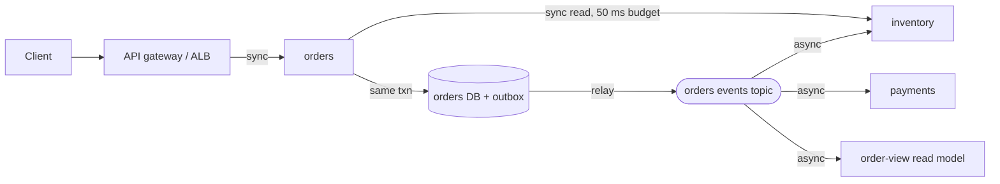
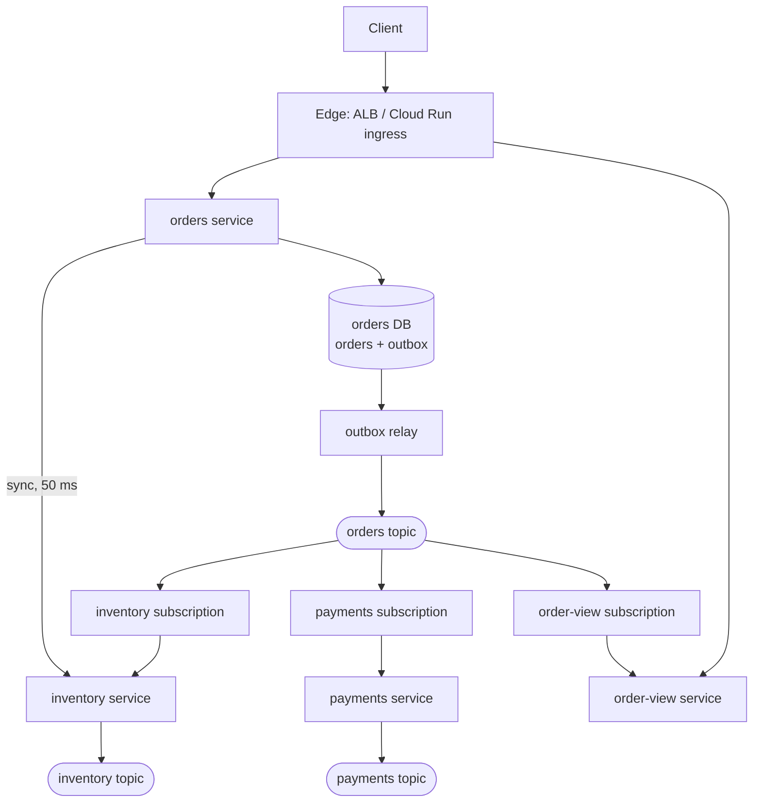
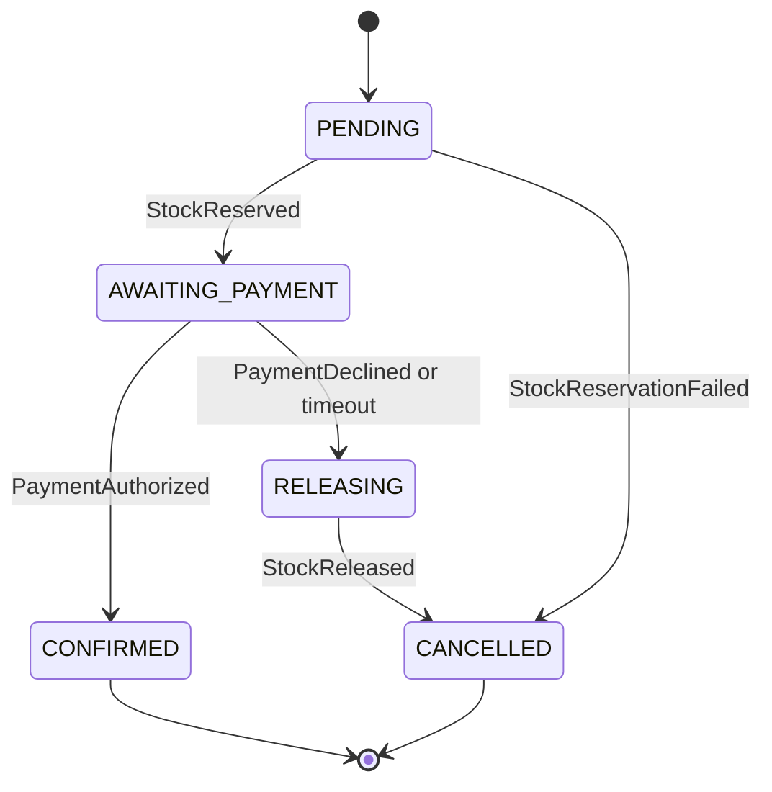

# Microservices with sync and async events

This walkthrough follows the [interview framework](00-primer.md#interview-framework).
It uses the numbers in the [estimation cheat sheet](00-primer.md#estimation-cheat-sheet)
and the conventions in the [primer](00-primer.md#conventions). It defines the
**transactional outbox**, which later walkthroughs cite. The definition is under
[The transactional outbox](#the-transactional-outbox).

## The question

> "Design the backend for an online store as microservices. Some interactions
> are synchronous request/response, and some are asynchronous events. How do
> you decide which is which, and how do you keep data consistent across
> services without distributed transactions?"

Common variants:

- "Split orders, inventory and payments out of a monolith. What talks to what?"
- "How do you publish an event exactly when a row changes?" (the outbox)
- "Payment fails after stock was reserved. Walk me through the saga."
- "How do you evolve an event schema without breaking consumers?"
- "Order history joins five services and is slow. Fix it." (CQRS)

## The two-minute answer

Each service owns its data and is the only writer of its database. A
**synchronous call** is used only when the caller cannot proceed without the
answer right now: reads on the user's critical path, with a strict timeout and
a fallback. Everything else is an **asynchronous domain event**. A service
writes its state change and an event row to an **outbox table in the same
local transaction**, and a relay publishes the outbox to a topic. That gives
"state changed if and only if the event is published" without a distributed
transaction. Multi-step business processes such as placing an order run as a
**saga**: a chain of local transactions with a compensating action for each
step, coordinated by the orders service. Delivery is at-least-once, so every
consumer is **idempotent**: it records each event ID it has processed in the
same transaction as its side effect. Read-heavy views that span services are
**CQRS read models**, projections built from the event stream, so no request
fans out to five services. Events carry a versioned envelope and evolve
additively. On AWS this is ECS on Fargate, Aurora, SNS fanning out to SQS; on
GCP it is Cloud Run, Cloud SQL and Pub/Sub.



## Clarify the requirements

Questions to ask, with the answers assumed here:

| Question | Assumed answer |
|---|---|
| Which services? | orders, inventory, payments, shipping, notify, and an order-view read model. |
| What is synchronous for the user? | Placing an order returns an ID and status within 300 ms p99; confirmation can follow seconds later. |
| Consistency? | Strong inside each service's database, eventual across services. No order is confirmed without reserved stock and an authorised payment. |
| Can we lose events? | No. Duplicates are tolerable if consumers are idempotent. |
| Ordering? | Per order, state must never regress. No global order. |
| Scale? | 5 million orders a day, peak 3× average; reads are 50× writes. |
| Regions? | One region, multi-AZ. Multi-region is the active-active walkthrough. |
| Teams? | One team per service, deploying independently, so schemas must evolve safely. |

Non-functional: 99.95% availability for placing an order, which rules out a
long synchronous chain because serial availabilities multiply
([Availability nines](00-primer.md#availability-nines)); p99 100 ms for
history reads; committed events survive any single AZ or process failure.

## Back-of-envelope estimates

Arithmetic uses the primer's [QPS conversions](00-primer.md#qps-conversions).

**Orders.** 5 million a day is about 58 a second; at 3× peak, design for
**200 orders a second**.

**Events.** About six per order over its life, so **1,200 events a second** at
peak; about three consumers each, so **3,600 deliveries a second**. At 2 KB an
event, that is 2.4 MB/s published: small for any broker.

**Broker quotas: this is the number that bites.** SNS publish throughput is a
soft quota per account and Region, counted in messages, not API calls. It is
30,000 messages a second in us-east-1, but 300 in Regions outside the named
tiers, such as eu-west-2 (London)
([AWS docs](https://docs.aws.amazon.com/general/latest/gr/sns.html), checked 2026-11).
At 1,200 events a second we are 4× over that default in London, and batching
does not help. So: raise the quota before launch.
Pub/Sub's regional publish limit is 200 MB/s even in a small region
([Google Cloud docs](https://docs.cloud.google.com/pubsub/quotas), checked 2026-11),
so 2.4 MB/s is noise there.

**Outbox table.** About 350 inserts a second on average (58 × 6): 30 million
rows, or 60 GB, a day if kept. So published rows are deleted, or day
partitions dropped, after about three days.

**Writes per database.** The orders primary sees a few thousand writes a
second at peak, inside the
[folk rule](00-primer.md#throughput-per-instance-and-per-partition) for one
relational primary. No sharding at this scale.

**Reads.** About 10,000 a second at peak, served by one lookup in a read model
rather than a join across services.

**Sync budget.** 300 ms p99: about 30 ms of gateway and TLS, 50 ms for the
orders transaction, and a hard 50 ms timeout for one read to inventory. That
is room for exactly **one** synchronous hop; three dependencies at 99.9% would
also give only about 99.7% availability. By Little's law, 200 a second × 0.3 s
is 60 requests in flight: AZ spread, not load, sets the replica count.

## API and data model

### Synchronous API

| Endpoint | Caller | Purpose | Notes |
|---|---|---|---|
| `POST /orders` | client | Create an order in `PENDING`. | Requires an `Idempotency-Key` header. Returns `202` with the order ID and `version`. |
| `GET /orders/{id}` | client | Current status of one order. | Served by order-view; falls back to orders for the caller's own just-created order. |
| `GET /customers/{id}/orders` | client | Order history. | order-view only. |
| `GET /inventory/availability?sku=` | orders | Soft stock check before accepting. | 50 ms timeout. On timeout or error, orders accepts and lets the reservation decide. |

The idempotency key is unique on the order row, so a retry returns the
original order.

### Events

Every event uses one envelope:

```json
{
  "event_id": "0f8c6c1e-2a7d-4c43-9a55-1d2b0e7f9a10",
  "type": "OrderPlaced",
  "schema_version": 2,
  "aggregate_type": "order",
  "aggregate_id": "ord_8K2N4",
  "aggregate_version": 1,
  "occurred_at": "2026-11-07T10:15:30.123Z",
  "correlation_id": "req_7Hc1",
  "causation_id": null,
  "payload": { "customer_id": "cus_19", "lines": [{ "sku": "SKU-1", "qty": 2 }], "total_minor": 4598, "currency": "GBP" }
}
```

`event_id` is every consumer's deduplication key; `aggregate_version` rises
by one per change, so consumers can discard stale events; `correlation_id`
traces the saga. `type` and `schema_version` are copied into message
attributes so the broker can filter without parsing the body.

Event types by producer:

| Producer | Events |
|---|---|
| orders | `OrderPlaced`, `StockReservationRequested`, `PaymentRequested`, `StockReleaseRequested`, `OrderConfirmed`, `OrderCancelled` |
| inventory | `StockReserved`, `StockReservationFailed`, `StockReleased` |
| payments | `PaymentAuthorized`, `PaymentDeclined`, `PaymentVoided` |
| shipping | `ShipmentCreated`, `ShipmentDispatched` |

The "requested" events are commands in effect. They travel on the orders
topic, filtered by `type`, so there is one transport pattern: a topic per
producer and a subscription per consumer.

### Key tables

| Table | Owner | Key | Access pattern |
|---|---|---|---|
| `orders` | orders | `order_id`; unique `idempotency_key` | Point read and update by ID; the saga state lives here. |
| `outbox` | orders (and every producer) | `event_id`; index on `(published_at IS NULL, created_at)` | Insert in the business transaction; the relay scans unpublished rows oldest first. |
| `processed_events` | every consumer | `(consumer, event_id)` | Insert in the consumer's transaction; a conflict means "already done". |
| `reservations` | inventory | `(order_id, sku)` | Created by `StockReservationRequested`, deleted by `StockReleaseRequested`. |
| `order_view` | order-view | `order_id`; secondary `(customer_id, created_at)` | Upsert per event if `aggregate_version` is newer; list by customer. |

## High-level design



The payments and inventory topics fan out the same way, to orders and
order-view; those subscriptions are omitted for readability.

### Write path: placing an order

1. The client sends `POST /orders` with an `Idempotency-Key`.
2. orders calls `GET /inventory/availability` with a 50 ms timeout. "No stock"
   rejects at once; a timeout does not, and the reservation decides. The call
   improves UX; it is not on the correctness path.
3. In **one local transaction**, orders inserts the order in `PENDING` with
   `version = 1` and two outbox rows: `OrderPlaced` and
   `StockReservationRequested`. It commits and returns `202` with the order ID.
4. The relay publishes both rows to the orders topic and marks them published.
5. inventory consumes `StockReservationRequested` and, in one transaction,
   reserves stock, records the `event_id` and writes `StockReserved` to its
   outbox.
6. orders consumes `StockReserved`, moves the order to `AWAITING_PAYMENT`, and
   writes `PaymentRequested` to its outbox, in one transaction.
7. payments authorises with the card provider using the order ID as the
   provider's idempotency key, and emits `PaymentAuthorized`.
8. orders moves the order to `CONFIRMED` and emits `OrderConfirmed`. shipping,
   notify and order-view react to it.

### Read path: order history

order-view upserts one denormalised row per order from the events, ignoring
any not newer than the row's `aggregate_version`. History is one indexed
query; no request fans out.

## Deep dives

### Choosing sync vs async per interaction

Ask four questions of every interaction:

1. **Does the caller need the answer to continue right now?** If the user is
   waiting and the next step depends on the result, sync is a candidate. If
   the caller only needs to know the request was accepted, it is async.
2. **Is it a query or a state change in another service?** Queries can be
   sync. A remote state change should be async: a sync call cannot join your
   local transaction, so a crash between the two leaves them inconsistent.
3. **What does the dependency cost?** Every sync hop multiplies availability
   and adds its tail latency. One hop within budget is fine; a chain of three
   is a distributed monolith.
4. **Can the caller degrade if the callee is down?** With a fallback (a cached
   value, accept-and-verify-later) sync is acceptable. Without one, make it
   async so the work queues instead of failing.

| Interaction | Choice | Why |
|---|---|---|
| Client places order | Sync (`202 Accepted`) | The user needs an order ID now; confirmation can follow. |
| orders checks stock | Sync read, 50 ms, fallback | Improves UX; the reservation is the real check. |
| orders reserves stock, requests payment | Async events | Remote state changes; must survive the callee being down. |
| Confirmation email | Async event | Nobody waits on it. |
| Order history | Sync read of a local read model | The query is local; the data arrived async. |

**Hygiene for the sync calls that remain:** a timeout shorter than the
caller's own deadline, with the remaining deadline propagated downstream;
retries only for idempotent requests, with jittered backoff and a retry budget
(say, at most 10% extra requests); a circuit breaker per dependency (the
adapter gateway walkthrough covers breakers in depth); and an idempotency key
on every non-idempotent write.

**Where async hurts.** The user must learn the outcome by polling or a push
channel, one action becomes eight messages (trace by `correlation_id`), and
every queue needs an age alarm.

### The transactional outbox

**The problem: dual writes.** A service that commits to its database and then
publishes to a broker can crash between the two and lose the event. Publishing
first is worse: consumers act on a change whose commit then fails. Two-phase
commit is not available, because SQS, SNS and Pub/Sub do not take part in it.

**The pattern.** Write the event to an `outbox` table **in the same local
transaction** as the state change, so both commit or neither does. A separate
**relay** reads committed outbox rows, publishes them, and marks them
published. The relay can crash after publishing and before marking, so it may
publish a row twice: **the outbox gives at-least-once publishing, never
exactly-once**, and consumers must be idempotent.

```sql
BEGIN;
INSERT INTO orders (order_id, status, version, idempotency_key)
  VALUES ('ord_8K2N4', 'PENDING', 1, 'idem_51');
INSERT INTO outbox (event_id, aggregate_type, aggregate_id, type, payload, created_at)
  VALUES (gen_random_uuid(), 'order', 'ord_8K2N4', 'OrderPlaced', '{}', now());
COMMIT;
```

**Two ways to build the relay.**

| Relay | How it works | Wins | Breaks |
|---|---|---|---|
| **Polling publisher** (chosen) | Selects a batch of unpublished rows oldest first with `FOR UPDATE SKIP LOCKED`, publishes, marks them published, commits. Replicas skip each other's locked rows. | Plain SQL on Aurora or Cloud SQL as they are. | Polling load and interval latency; replicas can reorder one order's events. |
| **Log tailing (CDC)** | A connector such as Debezium reads outbox inserts from the write-ahead log through logical decoding. | Lowest latency, no polling, commit order kept. | Another system to run; a stalled replication slot makes the database retain WAL. |

PostgreSQL documents `SKIP LOCKED` for exactly this, to "avoid lock contention
with multiple consumers accessing a queue-like table"
([PostgreSQL docs](https://www.postgresql.org/docs/current/sql-select.html), checked 2026-11).
CDC needs `rds.logical_replication` on Aurora PostgreSQL
([AWS docs](https://docs.aws.amazon.com/AmazonRDS/latest/AuroraUserGuide/AuroraPostgreSQL.Replication.Logical.Configure.html),
checked 2026-11) or `cloudsql.logical_decoding` on Cloud SQL
([Google Cloud docs](https://docs.cloud.google.com/sql/docs/postgres/replication/configure-logical-replication),
checked 2026-11). A replication slot keeps the WAL it needs even with no
consumer connected, which in extreme cases can shut the database down
([PostgreSQL docs](https://www.postgresql.org/docs/current/logicaldecoding-explanation.html),
checked 2026-11). Debezium's outbox router expects an append-only table with
`id`, `aggregatetype` and `aggregateid` columns
([Debezium docs](https://debezium.io/documentation/reference/stable/transformations/outbox-event-router.html),
checked 2026-11); the table above matches it, so moving to CDC later needs no
schema change.

**Why polling wins here.** At 1,200 events a second, a relay polling every
100 ms in batches of 500 has ample headroom and adds no infrastructure. Move to
CDC when the rate or latency need outgrows polling, or a CDC platform exists.

**Fast without fragile.** Make the relay eager: after commit, the request
handler hands the new event IDs to an in-process publisher that publishes and
marks them at once. The polling loop only sweeps what the eager path missed.
Normal latency is milliseconds, and the sweep keeps the guarantee.

**Where it breaks.** Two relay replicas can reorder one order's events: either
partition the relay by `aggregate_id`, or (as here) make consumers
order-tolerant. Published rows must be deleted or partition-dropped. A broker
throttle just leaves rows unpublished: nothing is lost. A stopped relay stops
every downstream flow while the business keeps committing, which is the
[runbook](#runbook) scenario.

### Sagas: orchestration vs choreography

A saga replaces a distributed transaction with a sequence of local
transactions, each with a **compensating action** that semantically undoes it:
release the stock, void the authorisation. Compensations are business
operations, not rollbacks.

| Style | Wins | Breaks |
|---|---|---|
| **Choreography**: each service reacts to others' events | No coordinator; least coupling for one-step reactions. | The flow is implicit. With compensations, nobody can say what state an order is in. |
| **Orchestration in the owning service** (chosen): orders keeps the saga state in its row and decides each next step | Explicit, testable flow in the service that owns the outcome; no new infrastructure. | orders must run its own timeouts (a sweep for stuck sagas). |
| **Managed engine**: Step Functions or Workflows | Execution history, built-in retries and timeouts. | Another place where state lives; still needs idempotent steps. |

Step Functions Standard workflows run up to one year with exactly-once
execution; Express workflows run up to five minutes, at-least-once when
asynchronous
([AWS docs](https://docs.aws.amazon.com/step-functions/latest/dg/choosing-workflow-type.html),
checked 2026-11). Google Cloud Workflows executions also run up to one year
([Google Cloud docs](https://docs.cloud.google.com/workflows/quotas), checked 2026-11).
Choose an engine when the flow has many steps, long waits or human approvals.



Rules that keep it correct:

- **Each transition is one local transaction:** update the order row, record
  the incoming `event_id`, write the next request to the outbox.
- **Compensations are idempotent.** Releasing released stock is a no-op.
- **Hardest-to-undo comes last.** Reserve stock (cheap to release) before
  authorising payment, and capture payment only at dispatch.
- **Timeouts are events.** A sweep moves orders stuck in `AWAITING_PAYMENT`
  for 15 minutes to `RELEASING`; a late `PaymentAuthorized` for a cancelled
  order triggers a void.
- **Isolation is lost.** Others can see intermediate states, so make them
  explicit (`PENDING`, `AWAITING_PAYMENT`) rather than pretending they are
  invisible.

### Idempotent consumers, schema evolution and CQRS read models

**Idempotent consumers.** SQS standard queues deliver at least once, and AWS
says to design consumers to be idempotent
([AWS docs](https://docs.aws.amazon.com/AWSSimpleQueueService/latest/SQSDeveloperGuide/standard-queues-at-least-once-delivery.html),
checked 2026-11). Pub/Sub's exactly-once delivery covers only pull
subscriptions with same-region subscribers, and a retried publish still arrives
twice under a new message ID
([Google Cloud docs](https://docs.cloud.google.com/pubsub/docs/exactly-once-delivery),
checked 2026-11). SQS FIFO deduplicates only within five minutes
([AWS docs](https://docs.aws.amazon.com/AWSSimpleQueueService/latest/SQSDeveloperGuide/FIFO-queues-exactly-once-processing.html),
checked 2026-11). The outbox can publish twice anyway. No broker setting
removes the need for an idempotent consumer.

In the consumer's own transaction, insert `(consumer, event_id)` into
`processed_events` **and** apply the side effect. A key conflict means the
event was already handled: acknowledge and stop.

```sql
BEGIN;
INSERT INTO processed_events (consumer, event_id) VALUES ('inventory', $1)
  ON CONFLICT DO NOTHING; -- 0 rows inserted: duplicate, so ack and stop
UPDATE stock SET reserved = reserved + $2 WHERE sku = $3 AND available >= $2;
INSERT INTO outbox (event_id, aggregate_type, aggregate_id, type, payload, created_at)
  VALUES (gen_random_uuid(), 'order', $4, 'StockReserved', $5, now());
COMMIT;
```

- **Retention.** Keep `processed_events` longer than any redelivery or replay
  window. SQS retains messages up to 14 days
  ([AWS docs](https://docs.aws.amazon.com/AWSSimpleQueueService/latest/SQSDeveloperGuide/quotas-messages.html),
  checked 2026-11); a Pub/Sub topic can retain up to 31 days
  ([Google Cloud docs](https://docs.cloud.google.com/pubsub/quotas), checked 2026-11).
- **External side effects** (a card authorisation) can't join the
  transaction. Pass the order ID as the provider's idempotency key; the
  payment walkthrough covers that boundary.
- **Order tolerance.** Projections ignore any event whose `aggregate_version`
  is not newer, which makes duplicates and reordering harmless together. So
  this design needs no FIFO queues or ordering keys. Pub/Sub ordering keys
  give per-key order at up to 1 MBps per key, but one redelivery redelivers the
  later messages for that key
  ([Google Cloud docs](https://docs.cloud.google.com/pubsub/docs/ordering),
  checked 2026-11).

**Schema evolution.** Producers and consumers deploy independently, so every
event must be readable by older and newer consumers.

- **Additive only** within a `schema_version`: add optional fields; never
  rename, retype or remove one, or change its meaning.
- **Tolerant readers** ignore unknown fields and default missing ones.
- **A breaking change is a new version,** published alongside the old one
  until every consumer has moved.
- **Enforce it in CI** with a registry and a compatibility check. Pub/Sub
  topic schemas (Avro or Protocol Buffers, up to 20 revisions) reject
  non-conforming messages at publish
  ([Google Cloud docs](https://docs.cloud.google.com/pubsub/docs/schemas),
  checked 2026-11). SNS and SQS validate nothing, so on AWS the check lives
  only in the producer's pipeline.

**CQRS read models.** Command query responsibility segregation separates the
write model from read models. order-view subscribes to the orders, inventory,
payments and shipping events and keeps one denormalised row per order.

- **Wins:** a history page is one indexed query, not a fan-out to four
  services at four p99s, and the read store scales separately.
- **Cost: staleness.** A user who just ordered may not see the order in their
  history. Return the order and its `version` from `POST /orders`, or have
  order-view fall back to orders for the creator's own recent order.
- **Rebuild by replay.** A new projection replays a retained topic or
  backfills from the owners' databases, then joins the live stream at a
  recorded position. Idempotency makes the overlap harmless.
- **Where it breaks:** a projection must never read other services'
  databases. Feed it only events.

## Trade-offs to defend

| Decision | Chosen | Rejected | Why | What would change the answer |
|---|---|---|---|---|
| Interaction default | Async; sync only for critical-path reads | Sync everywhere | Sync hops multiply availability; async queues work instead of failing it. | A read-mostly product with no cross-service writes. |
| Publishing changes | Transactional outbox | Publish after commit; 2PC | No crash window, and brokers don't do 2PC. | A store with a native change stream (DynamoDB Streams, Spanner change streams). |
| Relay | Polling with eager publish | CDC (Debezium) | No new infrastructure; ample headroom. | Tens of thousands of events/s, or an existing CDC platform. |
| Saga | orders as process manager | Choreography; Step Functions / Workflows | Explicit flow, no new state store. | Many steps, long waits, human approvals. |
| Delivery | At-least-once + idempotent consumers | Broker exactly-once, FIFO | Duplicates arrive anyway; FIFO caps throughput. | A side effect that cannot be made idempotent. |
| Ordering | Version-tolerant consumers | FIFO, ordering keys | No throughput ceiling or head-of-line blocking. | Consumers applying deltas (a running balance). |
| Topology | Topic per producer, queue per consumer | Shared bus; point-to-point | Own backlog, retries and DLQ per consumer. | Many event types routed by content: EventBridge or Eventarc. |
| Reads | CQRS read model | Request-time composition | One query per read. | A view that must be strongly consistent. |

## Failure modes and scaling limits

**At ×10 (2,000 orders a second, 12,000 events a second):**

- **The AWS broker quota fails first:** 12,000 messages a second is 40× the
  SNS default in Regions such as London. Raise it early, or move to Kinesis or MSK.
- **The orders primary** reaches tens of thousands of writes a second. Move
  the relay to CDC and plan to shard by `order_id`.
- **The relay** needs parallelism: partition it by `aggregate_id`.

**At ×100:** one relational database per service is past its comfort zone:
shard, or use a distributed store with a change stream, and a partitioned log
(Kafka, Kinesis) keyed by aggregate.

**Blast radius by component:**

| Component | If it fails | Blast radius |
|---|---|---|
| inventory sync read | orders skips the soft check | None to correctness. |
| Outbox relay | Orders stay `PENDING` | Every flow downstream of that producer; no data loss. |
| Broker | Relay retries; outbox grows | All async flows; self-heals on return. |
| One consumer | Its backlog grows | That consumer only. |
| Poison message | Retries, then the DLQ | One event for one consumer. |
| order-view | History stale | Reads only. |
| orders DB | No new orders | The core write path: make it multi-AZ first. |

## AWS and GCP mapping

| Component | AWS | GCP | Difference that matters |
|---|---|---|---|
| Service runtime | ECS on Fargate | Cloud Run | With request-based billing Cloud Run has CPU only during requests ([Google Cloud docs](https://docs.cloud.google.com/run/docs/configuring/billing-settings), checked 2026-11), so a background relay loop needs instance-based billing. Fargate tasks always have CPU. |
| Sync service-to-service | Internal ALB, path routing, security groups | Internal ingress plus `roles/run.invoker` and ID tokens ([Google Cloud docs](https://docs.cloud.google.com/run/docs/authenticating/service-to-service), checked 2026-11) | A Cloud Run caller must route through a VPC to reach an internal-ingress service ([Google Cloud docs](https://docs.cloud.google.com/run/docs/securing/ingress), checked 2026-11). |
| Database per service | Aurora PostgreSQL | Cloud SQL for PostgreSQL | Both support `SKIP LOCKED` and logical decoding. |
| Event topic | SNS standard topic | Pub/Sub topic | SNS messages default to 256 KiB, up to 1 MiB ([AWS docs](https://docs.aws.amazon.com/general/latest/gr/sns.html), checked 2026-11); Pub/Sub allows 10 MB ([Google Cloud docs](https://docs.cloud.google.com/pubsub/quotas), checked 2026-11). |
| Per-consumer backlog | SQS queue subscribed to the topic | Pub/Sub subscription | AWS fan-out takes two services; on GCP the subscription is the queue. |
| Retries and DLQ | `maxReceiveCount`, redrive to a DLQ | `dead_letter_policy`, 5–100 attempts ([Google Cloud docs](https://docs.cloud.google.com/pubsub/docs/handling-failures), checked 2026-11) | Pub/Sub's service agent needs publisher on the DLQ topic and subscriber on the source subscription. |
| Processing time limit | Visibility timeout 30 s default, 12 hours max ([AWS docs](https://docs.aws.amazon.com/AWSSimpleQueueService/latest/SQSDeveloperGuide/quotas-messages.html), checked 2026-11) | Ack deadline 10–600 s ([Google Cloud docs](https://docs.cloud.google.com/pubsub/docs/lease-management), checked 2026-11) | Push subscriptions cannot extend the deadline per message. |
| Content routing (alternative) | EventBridge: 5 targets per rule, PutEvents 10,000/s in us-east-1 ([AWS docs](https://docs.aws.amazon.com/eventbridge/latest/userguide/eb-quota.html), checked 2026-11) | Eventarc | For many event types routed by content. |
| Saga engine (alternative) | Step Functions | Workflows | See the saga deep dive. |
| Schema enforcement | None at the broker | Pub/Sub topic schemas | GCP rejects bad messages at publish; AWS cannot. |

Two differences change the design:

- **Fan-out shape.** AWS needs SNS plus an SQS queue per consumer, a queue
  policy admitting the topic and, under a CMK, a key-policy statement for SNS.
  GCP needs one subscription per consumer.
- **Consumer shape on GCP.** A pull consumer on Cloud Run fights request-based
  billing, so use **push subscriptions**. Internal-ingress Cloud Run accepts
  Pub/Sub push from the same project or VPC-SC perimeter at the default
  `run.app` URL
  ([Google Cloud docs](https://docs.cloud.google.com/run/docs/securing/ingress),
  checked 2026-11). HTTP 102, 200, 201, 202 or 204 acknowledges; any other code
  is a negative acknowledgement
  ([Google Cloud docs](https://docs.cloud.google.com/pubsub/docs/push), checked 2026-11).

## Build it here

### Where it lives

| Part | AWS | GCP |
|---|---|---|
| Services, databases | `aws-workload-<env>` (`envs/aws/workload`) through `modules/aws/stages/app-services` | `gcp-workload-<env>` (`envs/gcp/workload`) through `modules/gcp/stages/app-services` in the environment stage |
| Event fan-out | Raw SNS topic and SQS queues in `envs/aws/workload` | Module topic per producer; raw subscriptions in `envs/gcp/workload` |
| Egress to broker APIs | TGW and inspection in `aws-network` (`envs/aws/network`) | Private Google Access from `private`; not inspected |
| Apply order | `aws-organization` → … → `aws-network` → `aws-workload-<env>` | `gcp-bootstrap` → `gcp-organization` → `gcp-projects` → `gcp-network-hub` → `gcp-workload-<env>` |

Placement follows [VPC-tier placement](00-primer.md#vpc-tier-placement):
services in `private`, databases in `isolated` (AWS) or on Private Service
Access (GCP), brokers in no tier. The AWS hub's central interface endpoints
default to `ec2`, `ssm`, `ssmmessages`, `ec2messages`, `kms`, `logs` and `sts`
([`modules/aws/network/vpc-endpoints/variables.tf`](../../modules/aws/network/vpc-endpoints/variables.tf)),
with no SNS or SQS. Broker calls therefore leave through central inspection,
and a fail-closed production firewall must allow them. The example
`aws.network.egress_domain_allowlist` entry `.amazonaws.com` does; a narrowed
list must keep the Regional `sns.` and `sqs.` hostnames.

### Config

```yaml
# Illustrative. Keys are real (config/landing-zone.schema.json); values are placeholders.
aws:
  workload_environments:
    prod:
      account_key: workload_prod
      vpc_cidr: 10.30.0.0/16
      services:
        orders:
          path_patterns: ["/orders", "/orders/*"]
          enable_autoscaling: true
          autoscaling_max_capacity: 20
          database:
            instance_count: 2
        inventory:
          path_patterns: ["/inventory", "/inventory/*"]
          database: {}
        order-view:
          path_patterns: ["/order-view/*"]
          database: {}
gcp:
  environments:
    prod:
      cidr_block: 10.40.0.0/16
      services:
        orders:
          vpc_egress: ALL_TRAFFIC # reach inventory's internal ingress through the VPC
          min_instances: 2
          database: {}
          pubsub:
            enabled: true # topic "orders": the orders event stream
        inventory:
          invoker_members:
            - serviceAccount:orders-run@HOST_PROJECT_ID.iam.gserviceaccount.com
            - serviceAccount:inventory-push@HOST_PROJECT_ID.iam.gserviceaccount.com
          database: {}
          pubsub:
            enabled: true # also creates the "inventory-dlq" dead-letter topic
        order-view:
          database: {}
```

Gaps in the golden path that this design hits:

- **Broker encryption.** `envs/aws/workload` does not pass
  `queue_kms_key_arn`, so module queues use SQS-managed keys; the GCP
  environment stage does not forward `pubsub_kms_key_name`, so module topics
  use Google-managed keys. On GCP the key would be
  `module.workload_cmek.key_ids["pubsub"]` (see
  [CMEK source](00-primer.md#cmek-source)).
- **Fan-out.** A module service gets one queue (AWS) or one topic and
  subscription (GCP) of its own. Cross-service consumers are raw, below.
- **Relay on Cloud Run.** app-services does not expose instance-based billing
  (`cpu_idle`), so on GCP the relay sweep must be request-triggered until the
  module gains that field. On AWS it is a loop inside the orders tasks.
- **Schemas.** The GCP module's topics take no `schema_settings`.

### AWS: the orders topic and one consumer queue

In `envs/aws/workload`, using `local.environment`, `local.kms_key_arn` and
`module.app_services`. Because the queue uses the workload CMK,
`envs/aws/workload/kms.tf` also needs a statement admitting
`sns.amazonaws.com` to `kms:Decrypt` and `kms:GenerateDataKey*`
([AWS docs](https://docs.aws.amazon.com/sns/latest/dg/sns-enable-encryption-for-topic-sqs-queue-subscriptions.html),
checked 2026-11). Arguments checked against aws v6.72.0
([`aws_sns_topic`](https://registry.terraform.io/providers/hashicorp/aws/6.72.0/docs/resources/sns_topic),
[`aws_sns_topic_subscription`](https://registry.terraform.io/providers/hashicorp/aws/6.72.0/docs/resources/sns_topic_subscription),
[`aws_sqs_queue`](https://registry.terraform.io/providers/hashicorp/aws/6.72.0/docs/resources/sqs_queue),
checked 2026-11).

```hcl
# Gap: the repo has no event fan-out module; raw resources in the landing zone's conventions.
resource "aws_sns_topic" "orders_events" {
  name              = "${local.environment}-orders-events" # <env>-<component>
  kms_master_key_id = local.kms_key_arn
  tags              = { Service = "orders" } # default_tags add the rest
}

resource "aws_sqs_queue" "inventory_orders_dlq" {
  name                      = "${local.environment}-inventory-orders-dlq"
  message_retention_seconds = 1209600 # 14 days, the SQS maximum
  kms_master_key_id         = local.kms_key_arn
  tags                      = { Service = "inventory" }
}

resource "aws_sqs_queue" "inventory_orders" {
  name                       = "${local.environment}-inventory-orders"
  visibility_timeout_seconds = 60
  kms_master_key_id          = local.kms_key_arn
  redrive_policy = jsonencode({
    deadLetterTargetArn = aws_sqs_queue.inventory_orders_dlq.arn
    maxReceiveCount     = 5
  })
  tags = { Service = "inventory" }
}

resource "aws_sqs_queue_policy" "inventory_orders" {
  queue_url = aws_sqs_queue.inventory_orders.id
  policy = jsonencode({
    Version = "2012-10-17"
    Statement = [
      {
        Sid       = "FromOrdersTopicOnly"
        Effect    = "Allow"
        Principal = { Service = "sns.amazonaws.com" }
        Action    = "sqs:SendMessage"
        Resource  = aws_sqs_queue.inventory_orders.arn
        Condition = { ArnEquals = { "aws:SourceArn" = aws_sns_topic.orders_events.arn } }
      },
      {
        Sid       = "DenyInsecureTransport"
        Effect    = "Deny"
        Principal = "*"
        Action    = "sqs:*"
        Resource  = aws_sqs_queue.inventory_orders.arn
        Condition = { Bool = { "aws:SecureTransport" = "false" } }
      },
    ]
  })
}

resource "aws_sns_topic_subscription" "inventory_orders" {
  topic_arn            = aws_sns_topic.orders_events.arn
  protocol             = "sqs"
  endpoint             = aws_sqs_queue.inventory_orders.arn
  raw_message_delivery = true
  filter_policy        = jsonencode({ type = ["StockReservationRequested", "StockReleaseRequested"] })
}

resource "aws_iam_role_policy" "orders_publish" {
  name = "orders-events-publish"
  role = split("/", module.app_services.services["orders"].task_role_arn)[1] # <env>-orders-task
  policy = jsonencode({
    Version = "2012-10-17"
    Statement = [
      { Effect = "Allow", Action = "sns:Publish", Resource = aws_sns_topic.orders_events.arn },
      { Effect = "Allow", Action = ["kms:GenerateDataKey", "kms:Decrypt"], Resource = local.kms_key_arn },
    ]
  })
}
```

The consumer queue is raw because app-services' queue policy only denies
non-TLS access, and a queue has one policy, so it cannot also admit SNS without
a module change. The inventory task role gets a matching inline policy
(`sqs:ReceiveMessage`, `DeleteMessage`, `ChangeMessageVisibility` on this queue,
and `kms:Decrypt`). Both roles already carry the `tfc-apply-boundary` from
app-services. Alarm on the raw DLQ, as app-services does for its own.

### GCP: one consumer subscription on the orders topic

In `envs/gcp/workload`, using `local.env_config`, `local.labels`,
`var.environment` and `module.environment`. Subscriptions and service accounts
are global, so nothing here needs `local.env_config.region`. Arguments checked
against google v8.10.0
([`google_pubsub_subscription`](https://registry.terraform.io/providers/hashicorp/google/8.10.0/docs/resources/pubsub_subscription),
checked 2026-11).

```hcl
# Gap: app-services gives a service one subscription to its own topic; a
# cross-service consumer is a raw push subscription in the landing zone's conventions.
resource "google_service_account" "inventory_push" {
  project      = local.env_config.host_project_id
  account_id   = "inventory-push" # signs push requests to inventory; nothing else
  display_name = "Pub/Sub push to inventory (${var.environment})"
}

resource "google_pubsub_subscription" "inventory_orders" {
  project = local.env_config.host_project_id
  name    = "inventory-orders-sub"
  topic   = module.environment.app_services["orders"].pubsub_topic
  labels  = merge(local.labels, { service = "inventory" })

  ack_deadline_seconds       = 60
  message_retention_duration = "604800s"
  filter                     = "attributes.type = \"StockReservationRequested\" OR attributes.type = \"StockReleaseRequested\""

  push_config {
    push_endpoint = "${module.environment.app_services["inventory"].url}/events/orders"
    oidc_token {
      service_account_email = google_service_account.inventory_push.email
      audience              = module.environment.app_services["inventory"].url
    }
  }

  dead_letter_policy {
    dead_letter_topic     = module.environment.app_services["inventory"].pubsub_dead_letter_topic
    max_delivery_attempts = 5
  }

  retry_policy {
    minimum_backoff = "10s"
    maximum_backoff = "600s"
  }
}

# The service agent acks forwarded dead letters; app-services already lets it publish to inventory-dlq.
resource "google_pubsub_subscription_iam_member" "inventory_orders_agent" {
  project      = local.env_config.host_project_id
  subscription = google_pubsub_subscription.inventory_orders.name
  role         = "roles/pubsub.subscriber"
  member       = "serviceAccount:service-${local.env_config.host_project_number}@gcp-sa-pubsub.iam.gserviceaccount.com"
}
```

`inventory-push` is its own component identity
([Per-component identity](00-primer.md#per-component-identity)) and gets
`roles/run.invoker` on inventory alone, through `invoker_members` above.
Create the subscription after inventory's first revision is ready, or early
pushes fail and back off. **Verify before relying on** whether older projects
also need the Pub/Sub service agent granted Token Creator on `inventory-push`.

## Runbook

### Orders stuck in PENDING: the outbox is not draining

**Detection signal.** Outbox lag, the age of the oldest unpublished outbox row,
emitted by the relay as a custom metric: alert at 60 seconds, page at 5
minutes. Corroborating: orders in `PENDING` for over 2 minutes rise, while
consumer queues go quiet rather than deep.

**Triage.**

1. **Is the relay running?** Check the orders ECS service's tasks and
   `/ecs/<env>/orders` logs, or the orders Cloud Run revision's instances and
   logs.
2. **Is publishing failing?** SNS throttling means the account quota (see the
   [estimates](#back-of-envelope-estimates)); `AuthorizationError` or a KMS
   `AccessDenied` means a policy change. On GCP look for `PERMISSION_DENIED` or
   `RESOURCE_EXHAUSTED`.
3. **Is it blocked in the database?** A long transaction holding outbox row
   locks makes every replica skip those rows.
4. **On AWS, can it reach the broker?** A change to
   `aws.network.egress_domain_allowlist` or the firewall policy in
   `aws-network` can drop SNS calls; the firewall alert logs show it.

**Mitigation.**

1. **Relay down:** restart or scale orders. The sweep resumes from the oldest
   unpublished row; nothing was marked, so nothing is lost.
2. **Throttling:** request the quota increase; meanwhile drain at the quota,
   oldest first. Never skip rows.
3. **Permissions or key policy:** revert the change through the owning
   workspace (`aws-workload-<env>` or `gcp-workload-<env>`) in Terraform Cloud,
   not by hand in the console.
4. **Locks:** terminate the stuck session.
5. Expect a burst of duplicate-safe events downstream; watch consumer DLQs.

**Verification.** Outbox lag under 1 second, no old `PENDING` orders, and
consumer backlogs flowing and then draining.

**Follow-up.** Add a synthetic order that must reach `CONFIRMED` within 30
seconds. Put broker quotas into capacity planning. Game-day a stopped relay.

### A consumer's dead-letter queue is filling

**Detection signal.** `ApproximateNumberOfMessagesVisible` above zero on
`<env>-inventory-orders-dlq`, or `subscription/dead_letter_message_count` on
`inventory-orders-sub`.

**Triage.** One poison event (bad payload, unknown `schema_version`) or every
event (a broken deploy, a dependency down)? Check the consumer's last deploy.

**Mitigation.** Roll back a broken deploy, or fix the consumer for a poison
event. Then redrive: SQS DLQ redrive to the source queue, or replay the
`inventory-dlq-sub` messages. Idempotency makes redrive safe to repeat.

**Verification.** The DLQ is empty and the affected orders have moved on.

**Follow-up.** Add the payload to contract tests; add a schema compatibility
check to the producer's CI if a schema change caused it.

## Study aids

### Numbers to memorise

| Fact | Value |
|---|---|
| Sync hops in a 300 ms p99 budget | One, with a 50 ms timeout |
| Three serial dependencies at 99.9% | About 99.7% |
| SNS publish default | 30,000 messages/s in us-east-1; 300/s in smaller Regions |
| SQS | Visibility 30 s default, 12 h max; retention 4 days default, 14 max; FIFO dedup 5 minutes |
| Pub/Sub | Ack deadline 10–600 s; 5–100 dead-letter attempts; 10 MB messages; topic retention up to 31 days |
| Pub/Sub exactly-once | Pull only, same-region subscribers |
| Step Functions | Standard 1 year, exactly-once; Express 5 minutes |
| This design's peak | 200 orders/s, 1,200 events/s, 3,600 deliveries/s |

### Likely follow-ups

- **"Why not publish after commit?"** A crash between commit and publish loses
  the event. The outbox makes the event part of the commit.
- **"So the outbox is exactly-once?"** No: the relay can publish and crash
  before marking. It is at-least-once and never lost; idempotent consumers
  make it effectively-once.
- **"Why not use the brokers' exactly-once features?"** They don't cover a
  producer publishing twice and they restrict throughput or topology. You need
  idempotent consumers anyway.
- **"Orchestration or choreography?"** Choreography for one-step reactions;
  orchestration once there are compensations, because someone must own the
  order's state.
- **"Payment fails after stock is reserved?"** `RELEASING`, then
  `StockReleaseRequested`, then `CANCELLED` once stock is released. A late
  authorisation is voided.

### Classic mistakes

- A synchronous chain of three or more services on the request path.
- Publishing inside the transaction, or after it without an outbox.
- Treating "exactly-once delivery" as a substitute for idempotency.
- Requiring global ordering, then fighting FIFO limits.
- Sagas without compensations or timeouts.
- Services reading each other's databases.
- Breaking an event schema in place.
- No DLQ alarm.

### Further reading

- [PostgreSQL `SKIP LOCKED`](https://www.postgresql.org/docs/current/sql-select.html)
- [Debezium outbox event router](https://debezium.io/documentation/reference/stable/transformations/outbox-event-router.html)
- [SNS fan-out to SQS](https://docs.aws.amazon.com/sns/latest/dg/sns-sqs-as-subscriber.html)
- [Pub/Sub exactly-once delivery](https://docs.cloud.google.com/pubsub/docs/exactly-once-delivery)
- The primer's [service map](00-primer.md#aws-gcp-service-map).
