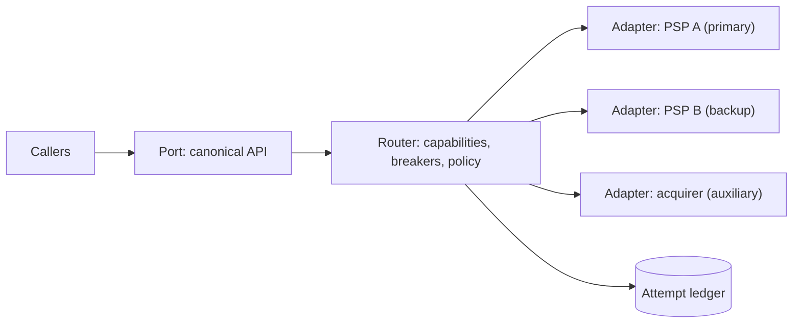
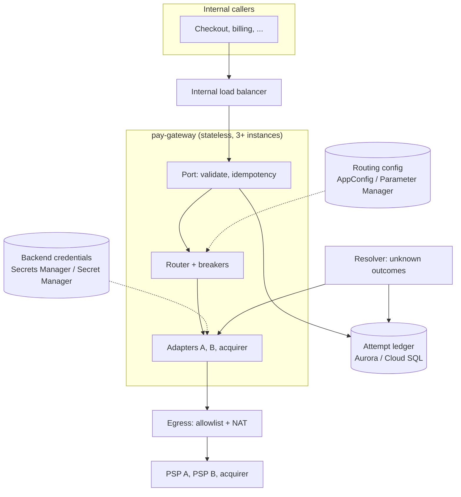
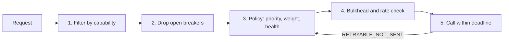

# Adapter gateway over multiple backends

A walkthrough of a gateway that puts one stable interface in front of several
interchangeable backends: a primary, a backup, and auxiliary instances used
only for some requests. The running example is a payment gateway over two
payment service providers (PSPs) and a regional acquirer. The same pattern
covers LLM providers and database replicas, and a table in the deep dives
shows what changes for each. It follows the
[interview framework](00-primer.md#interview-framework). Numbers lean on the
[estimation cheat sheet](00-primer.md#estimation-cheat-sheet), service names
on the [AWS-GCP service map](00-primer.md#aws-gcp-service-map), and the build
on the [conventions](00-primer.md#conventions).

## The question

> "We take card payments through one provider. It went down for two hours last
> quarter. Design a gateway so our services call one API and we can use a
> backup provider, plus a local acquirer for some currencies, without changing
> the callers."

Common variants:

- "Design a gateway over several LLM providers with fallback when one is rate
  limited or down."
- "Route reads across database replicas and writes to the primary, and keep
  working through a failover."

The skeleton is the same: a port, adapters, a router and a failover rule. Only
the failover rule changes, because it depends on whether a call has side
effects.

## The two-minute answer

Callers speak one **canonical API**, the *port*, which never names a backend.
Behind it, one **adapter per backend** translates the port into that backend's
protocol, maps its errors into a shared taxonomy (success, business decline,
safe-to-retry, unknown outcome), and publishes a **capability manifest**: the
operations, currencies, features and limits it supports. A **router** filters
backends by the request's required capabilities, drops those whose **circuit
breaker** is open, and picks one by policy: priority, weight or measured
health. The backup always carries a small share of live traffic, so failover
moves traffic to a path that already works rather than to one nobody has
exercised. Failover follows the side effects. A call that never reached the
backend can go elsewhere at once. A call whose outcome is **unknown** (a
timeout after sending a charge) must be resolved with the same backend,
through its idempotency key and a status lookup, before anything else
happens, or the customer is charged twice. Every later operation on a payment,
such as capture or refund, is pinned to the backend that authorised it. A new
backend is a new adapter plus a configuration change rolled out gradually, with
no client change.



## Clarify the requirements

Questions to ask, with the assumptions this walkthrough uses.

### Functional

- **Operations.** Authorise, capture, refund, void and look up a payment.
  Assume card payments with optional 3-D Secure, captured within 7 days.
- **Backends.** PSP A is the primary and PSP B the backup. Both are full
  service. The acquirer is auxiliary: it supports only BRL and MXN, but at a
  lower fee there. Ask whether the backup must take 100% of traffic. Assume it
  must.
- **Who chooses the backend?** The gateway. Callers may pass a routing hint,
  never a backend name.
- **Card data.** Assume callers send a vault token, never a raw card number,
  keeping the gateway out of the heaviest PCI scope.

### Non-functional

- **Correctness first.** Never charge twice; never retry a business decline
  elsewhere. Availability comes second.
- **Availability.** 99.95% for authorise, 21.9 minutes a month
  ([availability nines](00-primer.md#availability-nines)); one PSP alone does
  not reliably give that.
- **Latency.** The gateway adds at most 10 ms at p99; authorise has a 3 s
  end-to-end budget.
- **Failover time.** Off a failing primary within 30 s, with no human.
- **Region.** One region, multi-AZ.

## Back-of-envelope estimates

PSP latencies here are assumptions, not documented figures: measure your
own and **verify before relying on** them.

### Volume

| Quantity | Arithmetic | Result |
|---|---|---|
| Payment intents | 20 M a day | ~230/s average |
| Peak | 3× average (sale days) | ~700/s |
| Backend calls per intent | authorise + capture + 5% refunds or voids + 10% lookups | ~2.15 |
| Backend calls at peak | 700 × 2.15 | ~1,500/s |

### Concurrency, and why timeouts dominate the sizing

Little's law ([cheat sheet](00-primer.md#throughput-per-instance-and-per-partition)):

- **Healthy.** Authorise at p50 400 ms: 700/s × 0.4 s = **280 calls in
  flight**.
- **Brownout.** The primary stops answering and every call waits for a 10 s
  timeout: 700 × 10 = **7,000 in flight**, 25 times as many. Each in-flight
  call holds a connection, memory and a slot of the instance's concurrency.
- **With a 2.5 s per-attempt deadline and a breaker** that opens within
  seconds: 700 × 2.5 = 1,750 in flight briefly, then back near 280.

That drives three choices: a short deadline, a per-backend concurrency cap (a
bulkhead), and a fast breaker. At 250 concurrent requests per instance
(I/O-bound; Cloud Run allows up to 1,000, per the
[cheat sheet](00-primer.md#throughput-per-instance-and-per-partition)), 280 in flight needs 2 instances and
1,750 needs 7: run at least 3 across zones and cap at about 20.

### Backup capacity and the warm share

The backup must take 700/s alone; provider rate limits are contract terms. At
a steady 5% share it sees 35 calls a second, about 2,100 a minute, so a 1%
error rate shows up as 21 errors a minute: enough signal to know the backup
works before you need it.

### The ledger and the routing config

- About 4 writes per intent (an intent row, ~1.1 attempt rows, their
  updates): 700 × 4 = **2,800 writes/s** at peak, within one relational
  primary ([folk rule](00-primer.md#throughput-per-instance-and-per-partition)).
- 600 bytes × 2.1 rows × 20 M ≈ **25 GB a day**; keep 30 days hot (≈ 750 GB).
- The routing config is a few kilobytes, far below the 2,048 KB AppConfig
  hosted limit ([AWS docs](https://docs.aws.amazon.com/general/latest/gr/appconfig.html),
  checked 2026-11) and 1 MiB per Parameter Manager version
  ([Google Cloud docs](https://docs.cloud.google.com/secret-manager/parameter-manager/docs/overview),
  checked 2026-11).

## API and data model

### The canonical API (what callers see)

```text
POST /v1/payments                 Idempotency-Key: <caller key>
  { amount_minor, currency, payment_token, capture: false,
    requirements: { three_ds: true }, routing_hint: "default" | "cost" }
  -> 201 { payment_id, status: authorized | declined | pending,
           decline_code?, backend_ref }
POST /v1/payments/{id}/capture    Idempotency-Key: <caller key>
POST /v1/payments/{id}/refunds    Idempotency-Key: <caller key>
GET  /v1/payments/{id}
```

`status: pending` means the outcome is unknown and being resolved; the caller
polls or listens for `payment.updated`. `decline_code` is the gateway's own
code; callers never see a backend's raw error.

### The port (what every adapter implements)

```text
capabilities()                       -> Manifest
authorize(req, idem_key, deadline)   -> Outcome
capture(backend_ref, amount, idem_key, deadline)
refund(backend_ref, amount, idem_key, deadline)
lookup(idem_key | backend_ref)       -> Outcome      # required: failover depends on it
probe()                              -> healthy | degraded | down

Outcome = SUCCEEDED | DECLINED(code) | RETRYABLE_NOT_SENT | UNKNOWN
```

### Entities and access patterns

| Entity | Key | Fields | Access pattern |
|---|---|---|---|
| `payment_intent` | `payment_id`; unique `(caller, idempotency_key)` | amount, currency, status, `pinned_backend`, `backend_ref` | Insert on create; read by ID; update status |
| `attempt` | `(payment_id, attempt_no)` | backend, operation, `backend_idem_key`, state (`sent`, `succeeded`, `declined`, `unknown`, `not_sent`), timestamps | Append before each backend call; update after; scan `unknown` older than 30 s for the resolver |
| Routing config | version | manifests, policy, weights, overrides | Polled by every instance; cached in memory |
| Breaker state | per instance, per backend | window counts, state, opened-at | In memory only |

The attempt row is written **before** the backend call, so a crashed
instance's work is findable: a `sent` row with no outcome is unknown.

## High-level design



### Request path (authorise)

1. **Port.** Validate; insert the intent under the caller's idempotency key.
   A repeated key with the same body returns the stored result; with a
   different body, `409`.
2. **Router.** Filter by capability, drop open breakers, pick by policy (see
   [Routing and failover policy](#routing-and-failover-policy)).
3. **Attempt.** Append an `attempt` row in state `sent`, with a backend
   idempotency key derived from `payment_id` and the attempt number.
4. **Adapter.** Call within the per-attempt deadline; map the response to an
   `Outcome`.
5. **Decide.** `SUCCEEDED` or `DECLINED`: record, pin, return.
   `RETRYABLE_NOT_SENT`: try the next candidate once if the 3 s budget allows.
   `UNKNOWN`: `lookup` on the same backend; if still unresolved, return
   `pending` and leave it to the resolver.

### Write path (capture, refund, void)

The router is bypassed: only `pinned_backend` holds the authorisation. If it
is down, the operation waits in the ledger and retries under the same
idempotency key; captures have days of slack.

### Resolver path

A worker (the same image in another mode) scans `unknown` and stale `sent`
attempts, calls `lookup` on the original backend with backoff, and records the
outcome. Only a confirmed `not found` makes the intent eligible for another
backend.

## Deep dives

### Adapter and port contract, with capability negotiation

**The pattern.** Ports and adapters (the hexagonal architecture) applied at
the system's edge. The port is the interface the business needs; an adapter
makes one backend look like the port. The rule that makes it work: **nothing
above the port knows which backend answered.** Leak one backend-specific
field into the canonical API and the next backend needs a client change.

**What the contract must pin down.**

1. **Semantics, not just shape.** "Authorise" means the same on every backend:
   funds reserved, not captured, voidable until a stated time.
2. **An error taxonomy.** Every adapter maps every response into one of four
   outcomes. Routing depends on this classification more than on anything
   else.

   | Outcome | Meaning | Examples | Router may |
   |---|---|---|---|
   | `SUCCEEDED` | Done | 2xx with an approval | Return it |
   | `DECLINED` | The backend worked and said no | Insufficient funds, fraud block | Return it. **Never** try another backend |
   | `RETRYABLE_NOT_SENT` | Provably no side effect | Connection refused, TLS failure before sending, 429, 503 with a documented no-op guarantee | Try the next backend |
   | `UNKNOWN` | Sent, outcome not known | Timeout after sending, connection reset mid-response, 500 | Resolve with the same backend first |

   A decline is not a fault: counting it as one opens breakers on a bad day
   for issuers, and retrying it elsewhere is decline shopping, which card
   schemes and acquirers police (**verify before relying on** your acquirer's
   rules).
3. **Idempotency, end to end.** The caller's key deduplicates at the port; the
   adapter sends a derived key, `payment_id:attempt_no`, so the backend
   deduplicates a retried attempt too. Know each backend's window: Stripe may
   prune keys once they are at least 24 hours old and rejects a reused key
   with different parameters
   ([Stripe docs](https://docs.stripe.com/api/idempotent_requests), checked
   2026-11).
4. **Lookup is mandatory.** Without it an unknown outcome waits for the
   backend's settlement file, a day later. A backend with neither idempotency
   keys nor lookup cannot be a failover target.

**Capability negotiation.** Each adapter publishes a manifest. The router
treats it as hard constraints, checked before any policy runs:

```text
# Illustrative manifest (YAML), served by the adapter and pinned in routing config.
backend: acquirer-latam
port_version: 3
operations: [authorize, capture, refund, void, lookup]
currencies: [BRL, MXN]
features: { three_ds: true, partial_capture: false, incremental_auth: false }
max_amount_minor: 5000000
idempotency: { supported: true, window_hours: 24 }
limits: { authorize_rps: 200 }
```

- **Config can only narrow it.** The adapter declares its manifest in code;
  routing config may disable a currency during an incident, but never claim a
  capability the adapter lacks.
- **No candidate left** (BRL with the acquirer's breaker open and PSP A not
  enabled for BRL): fail fast with `503 no_capable_backend`.
- **Degradation is explicit.** Only if the caller marks a feature optional
  (`three_ds: preferred`) may the router pick a backend without it, and the
  response says so.

**In-process or separate adapter services?** Default to in-process libraries:
no extra hop. Split an adapter out when it needs its own release cadence,
language SDK, scaling or isolation; the port then becomes a gRPC contract.

**Where it breaks.** Lowest-common-denominator ports. A feature only one
backend has (incremental authorisation, say) becomes an optional capability in
the manifest, not a bypass around the port.

### Routing and failover policy

The router runs the same pipeline on every request that is not pinned:



**Step 3: three policies, and the one to use.**

| Policy | How it picks | Strength | Weakness |
|---|---|---|---|
| Priority | First healthy backend in an ordered list | Simple; cost-predictable | Cold backup: failover lands on an untested path |
| Weighted | Random by weight, e.g. 95/5 | Backup stays warm; easy canaries | Fixed weights ignore live health |
| Health-based | Weight scaled by measured success and latency | Leaves a brownout before a breaker trips | Can flap; needs damping |

Use **weighted with a health factor and a floor**: config weights (PSP A 95,
PSP B 5) multiplied by each backend's measured health, never letting the
backup drop below its floor. AWS's Builders' Library makes the case: a
fallback used only in emergencies is rarely exercised and often fails when
needed, while a path that runs continuously becomes failover
([AWS Builders' Library](https://builder.aws.com/content/3EuS9Sakq7L3VLQIF3qzfMfke1Y/avoiding-fallback-in-distributed-systems),
checked 2026-11). Priority alone is the classic mistake.

**Step 2: circuit breakers.** One breaker per backend per operation, held in
each instance's memory.

- **Closed → open** when, in a 10 s window with at least 20 calls, faults
  exceed 50%, or after 5 consecutive faults. Faults are `UNKNOWN`,
  `RETRYABLE_NOT_SENT` and deadline overruns. Declines are not faults.
- **Open** for 30 s, with jitter, then **half-open**: let 1 to 5 probe
  requests through. Close on success, reopen on failure.
- **These numbers mirror** Google Cloud's outlier-detection defaults: 5
  consecutive errors, 30 s base ejection, at most 50% of endpoints ejected
  ([Google Cloud API reference](https://docs.cloud.google.com/java/docs/reference/google-cloud-compute/latest/com.google.cloud.compute.v1.OutlierDetection),
  checked 2026-11). Borrow the "at most half" idea: if every breaker is open,
  the fault is probably ours (egress, DNS, credentials), so fail open to the
  primary and page someone.
- **State stays local.** At ~70/s per instance each one decides within
  seconds; a shared Redis would be one more dependency to fail on the bad day.
  Only the manual override is shared, through the routing config.

**Step 4: bulkheads.** A per-backend concurrency cap per instance and a token
bucket at the contracted rate, so a slow PSP A fills only its own slots.

**Step 5: deadlines and retry budgets.**

- The 3 s budget allows two attempts: 2.5 s for the first, the rest for one
  failover.
- Take the per-attempt timeout from measured latency at a chosen false-timeout
  rate (p99.9 for 0.1%) and retry at one layer only: five layers retrying three
  times multiply load 243-fold, and a token bucket should cap retries
  ([AWS Builders' Library](https://builder.aws.com/content/3EumjoZascWd1oZiEgL8ORlv3qE/timeouts-retries-and-backoff-with-jitter),
  checked 2026-11). Here the budget is 10% of requests: 70 retries a second.
- **Hedging** (send to two, take the first answer) is only for calls without
  side effects. Never hedge an authorise.

**Why not the load balancer?** Load balancers route by health among
*targets*: an ALB's Automatic Target Weights shifts traffic from targets with
anomalous 5xx and connection-error rates, needs the weighted random algorithm
and at least three healthy targets
([AWS docs](https://docs.aws.amazon.com/elasticloadbalancing/latest/application/edit-target-group-attributes.html),
checked 2026-11), and Google backend services have outlier detection. Both
judge HTTP codes, not business outcomes, and front backends in your own
network. A PSP is one external hostname, and the decision needs the taxonomy,
ledger and capabilities. Keep load balancers for the gateway's own instances
and for in-VPC backends such as replicas.

### Failover semantics and consistency during switchover

Failover is safe exactly when the operation's side effects allow it. Work this
out per operation, not per system.

**Payments: at most one charge per intent.**

- **Before the request leaves** (`RETRYABLE_NOT_SENT`): fail over at once.
- **After it leaves** (`UNKNOWN`): the backend may have authorised. Resolve
  first, with `lookup` or a retry under the same idempotency key, which the
  backend deduplicates. Fail over only on a confirmed "no record".
- **The trade.** In a hard outage of PSP A, in-flight intents stay `pending`
  until A recovers or reconciliation runs, while new intents flow to B at once.
  Blind failover would turn every timeout into a possible double charge.
- **If the business insists on finishing in-flight payments now,** send them
  to B and void any authorisation that later appears at A. The customer sees
  the hold until the void lands, so this is an explicit product policy, never
  the default.
- **Pinned operations.** Capture, refund and void go to the authorising
  backend and queue in the ledger while it is down; the hold lasts days.
- **Reconciliation closes the loop.** Each backend's settlement report is
  matched against the ledger; an authorisation the ledger does not know is an
  orphan from an unknown outcome, and is voided or recorded.

**How the three examples differ:**

| | Payments | LLM providers | Database replicas |
|---|---|---|---|
| Side effects of a call | Money moves | None (cost only) | Writes: yes. Reads: none |
| Failover on `UNKNOWN` | No: resolve first | Yes, immediately | Reads: yes. Writes: only through the managed failover |
| Hedging | Never | Yes, for latency-critical calls, at double the cost | Reads: yes |
| Pinning | Later operations on the payment | Provider-side conversation state, prompt caches | Read-your-writes after a write |
| Capability filter | Currency, 3-D Secure, amount | Context window, tool use, modality, data residency | Replica lag below a bound |
| Consistency risk at switchover | Double charge | Different model, different answer | Stale reads |
| Mid-stream failure | Not applicable | Fail over only before the first token; after it, return an error or restart visibly | Not applicable |

- **LLM providers.** A 429 is routine. On Vertex AI's shared pay-as-you-go
  capacity it means temporary contention, and Google recommends backoff, the
  global endpoint, or Provisioned Throughput
  ([Google Cloud docs](https://docs.cloud.google.com/vertex-ai/generative-ai/docs/dynamic-shared-quota),
  checked 2026-11). Bedrock's cross-Region inference profiles route within a
  geography or globally, yet AWS still advises bounded retries and multi-Region
  or multi-model fallback in the application
  ([AWS docs](https://docs.aws.amazon.com/bedrock/latest/userguide/cross-region-inference.html),
  checked 2026-11). Managed routing is one more backend, not a replacement for
  the gateway, and the capability filter stops a smaller-context fallback
  model receiving a prompt it cannot hold.
- **Database replicas.** Writes go to the primary only, and promotion belongs
  to the managed service, never your router (split brain). Aurora replica lag
  is "usually much less than 100 milliseconds", a cluster holds up to 15
  replicas, and the reader endpoint spreads read connections
  ([AWS docs](https://docs.aws.amazon.com/AmazonRDS/latest/AuroraUserGuide/Aurora.Replication.html),
  checked 2026-11). Cloud SQL replicates asynchronously and recommends 10 or
  fewer direct replicas per primary
  ([Google Cloud docs](https://docs.cloud.google.com/sql/docs/postgres/replication),
  checked 2026-11). Read-your-writes needs primary reads briefly after a
  write, or a commit position carried in the session.

### Adding a backend without client changes

Clients never change because they never named a backend. A new backend is a
**gateway code change plus a configuration rollout**:

1. **Write the adapter,** including the error map and `lookup`.
2. **Pass the conformance suite,** run against the provider's sandbox:
   semantics (authorise, then void), taxonomy (a forced timeout classifies as
   `UNKNOWN`), idempotency (same key twice, one charge) and lookup. This
   suite, not the interface, is the real contract.
3. **Ship dark** at weight 0: it probes and reports, and takes no traffic.
4. **Shadow where safe:** mirror LLM calls or replica reads and compare
   offline. **Never shadow a payment.**
5. **Canary through config:** 1%, 5%, 25%. AppConfig deployment strategies
   step linearly or exponentially and roll back if a CloudWatch alarm fires
   during the bake time
   ([AWS docs](https://docs.aws.amazon.com/appconfig/latest/userguide/appconfig-creating-deployment-strategy.html),
   checked 2026-11). Parameter Manager versions configuration but documents no
   rollout engine, so on GCP the pipeline drives the ramp (**verify before
   relying on** newer features).
6. **Promote** it into the failover order only after it has carried real
   traffic.

**Versioning the port.** Additive changes only, with `port_version` in each
manifest; the router never sends a field to an adapter that predates it.

**Where it breaks.** Configuration becomes code: one typo in a weight moves
all traffic. Validate every routing document against a JSON Schema (AppConfig
has a `JSON_SCHEMA` validator) and roll out every change gradually.

## Trade-offs to defend

| Decision | Chosen | Rejected | Why | What would change the answer |
|---|---|---|---|---|
| Where routing lives | In the gateway, in code that knows the port | DNS or load-balancer failover | External APIs sit behind one hostname; routing needs business outcomes, the ledger and capabilities | In-VPC replicas: the load balancer or managed reader endpoint |
| Backup posture | Warm: always 5% of live traffic | Cold standby used only in failover | An unexercised path fails when needed | A backup too costly to use at 5%: continuous synthetic transactions instead |
| Unknown outcome | Resolve with the same backend, then fail over | Fail over immediately | Blind failover can double charge | Calls with no side effects (LLM, reads): fail over or hedge immediately |
| Breaker state | Local per instance | Shared in Redis | Enough traffic per instance; no extra dependency on the bad day | Too little traffic per instance to decide alone |
| Adapter packaging | In-process libraries | One service per adapter | No extra hop; one deploy | A vendor SDK needs isolation, its own language or scaling |
| Gateway shape | One central gateway service | A client library with routing in every caller | One place for credentials, breakers and the ledger; callers stay simple | A hop too many: a sidecar, ledger still central |

## Failure modes and scaling limits

### At 10× (7,000 intents/s peak)

- **First to fail: backend quotas.** No single PSP contract may allow 7,000
  authorisations a second. Split the baseline (say 60/40) and negotiate burst
  limits, rather than sizing one backup for 100%.
- **The ledger.** ~28,000 writes a second exceeds one relational primary.
  Partition by `payment_id`, or move to a key-value store with conditional
  writes (DynamoDB, Spanner); every access is by key.
- **The gateway** is stateless and scales out.

### At 100×

- Split merchants into cells, each with its own gateway, ledger and provider
  accounts, so a bad config or throttled account hits one cell (the
  multi-region walkthrough's cell-based design).

### Blast radius per component

| Component | If it fails | Blast radius | Containment |
|---|---|---|---|
| One backend | Faults or timeouts | New intents briefly; in-flight intents go `pending` | Breaker opens; warm backup takes over; resolver finishes in-flight intents |
| Routing config store | No new versions | None at first: last good version cached | Baked-in default; alarm on config age |
| Bad routing config | Traffic sent to the wrong backend or none | Everything | Schema validation; gradual rollout; alarm-driven rollback |
| Attempt ledger | Cannot record attempts | All new payments | Fail closed: no ledger, no charge; multi-AZ |
| Egress (firewall, NAT) | No backend reachable | Everything; looks like every backend failing | All-breakers-open pages a human |

## AWS and GCP mapping

| Component | AWS | Google Cloud | Difference that matters |
|---|---|---|---|
| Gateway compute | ECS on Fargate (app-services) | Cloud Run (app-services) | Cloud Run's request timeout defaults to 5 minutes and can be raised to 60 ([Google Cloud docs](https://docs.cloud.google.com/run/docs/configuring/request-timeout), checked 2026-11); set it near the 3 s budget so stuck calls are cut |
| Internal entry | Internal ALB in the `private` tier | Cloud Run with internal ingress | The ALB's idle timeout defaults to 60 s ([AWS docs](https://docs.aws.amazon.com/elasticloadbalancing/latest/application/edit-load-balancer-attributes.html), checked 2026-11); raise it for streamed LLM responses |
| Routing config | AWS AppConfig: validators, gradual rollout, alarm rollback | Parameter Manager: versioned, regional, CMEK, references to secrets | AppConfig ships the canary and rollback; on GCP the pipeline does the ramp |
| Attempt ledger | Aurora PostgreSQL (app-services `database`) | Cloud SQL PostgreSQL (app-services `database`) | Same model on both |
| Egress to external backends | Transit Gateway → Network Firewall domain allowlist → central NAT gateway with fixed Elastic IPs | The environment's Cloud NAT; **not inspected** through the hub | AWS gives a stable, allowlistable source IP and SNI filtering. GCP NAT in the default `AUTO_ONLY` mode can add or remove addresses, so you cannot predict the next one; allowlisting needs manual allocation ([Google Cloud docs](https://docs.cloud.google.com/nat/docs/ports-and-addresses), checked 2026-11) |
| Managed LLM backends | Amazon Bedrock with cross-Region inference profiles | Vertex AI with the global endpoint or Provisioned Throughput | One more adapter each |

The design-changing difference: AWS egress already filters by SNI and leaves
from fixed addresses a PSP can allowlist. GCP needs `ALL_TRAFFIC` egress and
manual NAT addresses for that, and domain filtering is an addition (see
[inspected egress](00-primer.md#inspected-egress)).

## Build it here

Snippets are **illustrative**: they show the arguments that matter, are not
applied or tested, and follow the primer's [conventions](00-primer.md#conventions).
Argument names were checked against the aws v6.72.0 and google v8.10.0
provider docs sources (checked 2026-11):
[`aws_appconfig_application`](https://registry.terraform.io/providers/hashicorp/aws/6.72.0/docs/resources/appconfig_application),
[`aws_appconfig_environment`](https://registry.terraform.io/providers/hashicorp/aws/6.72.0/docs/resources/appconfig_environment),
[`aws_appconfig_configuration_profile`](https://registry.terraform.io/providers/hashicorp/aws/6.72.0/docs/resources/appconfig_configuration_profile),
[`aws_appconfig_deployment_strategy`](https://registry.terraform.io/providers/hashicorp/aws/6.72.0/docs/resources/appconfig_deployment_strategy),
[`google_parameter_manager_regional_parameter`](https://registry.terraform.io/providers/hashicorp/google/8.10.0/docs/resources/parameter_manager_regional_parameter).

### Where it lives

- **AWS:** the environment's workload account, workspace `aws-workload-<env>`
  from `envs/aws/workload`. The gateway runs in the spoke's `private` tier and
  the ledger in `isolated`
  ([VPC-tier placement](00-primer.md#vpc-tier-placement)). Calls to PSPs leave
  through the Transit Gateway, Network Firewall and central NAT, so the PSP
  hostnames go in `aws.network.egress_domain_allowlist`, applied by
  `aws-network` (`envs/aws/network`). In production a non-empty allowlist is
  required unless explicitly waived.
- **GCP:** the environment's host project, workspace `gcp-workload-<env>` from
  `envs/gcp/workload`, on the first `private` subnet. Egress is the
  environment's own Cloud NAT, not inspected.
- **Apply order:** `aws-network` before `aws-workload-<env>`;
  `gcp-network-hub` before `gcp-workload-<env>`. Later routing changes are
  config rollouts, not applies.

### Config: the gateway and its ledger

One app-services entry per cloud gives the gateway its image repository,
runtime identity, logs, alarms, and a PostgreSQL ledger. The resolver is the
same image run with a different command; it is not shown.

```yaml
# Illustrative. Keys are real; values are placeholders.
aws:
  network:
    egress_domain_allowlist:
      - api.psp-a.example
      - api.psp-b.example
      - api.acquirer-latam.example
      - appconfigdata.<region>.amazonaws.com # no interface endpoint by default
  workload_environments:
    prod:
      services:
        pay-gateway:
          desired_count: 3
          path_patterns: ["/v1/payments", "/v1/payments/*"]
          health_check_path: /healthz
          enable_autoscaling: true
          autoscaling_min_capacity: 3
          autoscaling_max_capacity: 20
          environment:
            ROUTING_CONFIG: "prod-pay-gateway/prod/routing" # application/environment/profile names
          secrets:
            PSP_A_API_KEY: "arn:aws:secretsmanager:<region>:<workload-account-id>:secret:prod/pay-gateway/psp-a"
            PSP_B_API_KEY: "arn:aws:secretsmanager:<region>:<workload-account-id>:secret:prod/pay-gateway/psp-b"
          task_role_policy_json: |
            {"Version":"2012-10-17","Statement":[
             {"Effect":"Allow","Action":["appconfig:StartConfigurationSession","appconfig:GetLatestConfiguration"],
              "Resource":"arn:aws:appconfig:<region>:<workload-account-id>:application/<app-id>/*"},
             {"Effect":"Allow","Action":"kms:Decrypt","Resource":"<workload_kms_key_arn>"}]}
          database:
            instance_count: 2 # writer + reader in another AZ
            deletion_protection: true
gcp:
  environments:
    prod:
      services:
        pay-gateway:
          min_instances: 3
          max_instances: 20
          concurrency: 250 # I/O-bound; see the estimates
          timeout: "10s" # cut stuck calls; the app enforces 3 s
          vpc_egress: ALL_TRAFFIC # PSP calls through the VPC and Cloud NAT
          env_vars:
            ROUTING_PARAMETER: "projects/<host-project-id>/locations/<region>/parameters/pay-gateway-routing"
          secrets:
            PSP_A_API_KEY: { secret: psp-a-api-key }
            PSP_B_API_KEY: { secret: psp-b-api-key }
          database:
            enable_high_availability: true
            enable_point_in_time_recovery: true
            encryption_key_name: "projects/<host-project-id>/locations/<region>/keyRings/<prefix>-prod-cmek/cryptoKeys/pay-gateway-db"
```

Notes:

- app-services injects only the writer endpoint (`DB_HOST`). Fine here; a
  replica-routing design needs the Aurora reader endpoint wired too (gap).
- The network hub's interface endpoints default to `ec2`, `ssm`,
  `ssmmessages`, `ec2messages`, `kms`, `logs` and `sts`, and the stage does
  not expose that list (gap). So AppConfig and Secrets Manager traffic needs
  the allowlist; whether your estate already has it is **verify before relying
  on**.
- `net-spoke` exposes `nat.ip_allocate_option` but passes no reserved
  addresses to the NAT module's `nat_ips`, so GCP cannot meet a PSP's
  source-IP allowlist today (gap).

### AWS: the routing configuration with alarm rollback

```hcl
# Gap: the repo has no AppConfig module; raw resources in the landing zone's conventions.
resource "aws_appconfig_application" "pay_gateway" {
  name = "${local.environment}-pay-gateway" # <env>-<component>
  tags = { Service = "pay-gateway" }       # default_tags add the rest
}

resource "aws_appconfig_configuration_profile" "routing" {
  application_id     = aws_appconfig_application.pay_gateway.id
  name               = "routing"
  location_uri       = "hosted"
  type               = "AWS.Freeform"
  kms_key_identifier = local.kms_key_arn # workload CMK

  validator {
    type    = "JSON_SCHEMA"
    content = file("${path.module}/schemas/pay-gateway-routing.json")
  }
  tags = { Service = "pay-gateway" }
}

resource "aws_appconfig_deployment_strategy" "routing_canary" {
  name                           = "${local.environment}-pay-gateway-canary"
  deployment_duration_in_minutes = 20
  growth_type                    = "LINEAR"
  growth_factor                  = 20
  final_bake_time_in_minutes     = 10
  replicate_to                   = "NONE"
  tags                           = { Service = "pay-gateway" }
}

resource "aws_appconfig_environment" "this" {
  application_id = aws_appconfig_application.pay_gateway.id
  name           = local.environment

  monitor {
    alarm_arn      = aws_cloudwatch_metric_alarm.backend_fault_rate.arn # gateway-emitted metric
    alarm_role_arn = aws_iam_role.appconfig_monitor.arn                 # carries tfc-apply-boundary
  }
  tags = { Service = "pay-gateway" }
}
```

Notes:

- Not shown: the alarm on the gateway's per-backend fault metric, and the
  monitor role, which carries `tfc-apply-boundary` like every role this root
  creates ([per-component identity](00-primer.md#per-component-identity)).
- Retrieval of a configuration encrypted with a customer-managed key needs
  `kms:Decrypt` on that key for the reading role, which the task policy above
  grants. Whether AppConfig itself needs a key-policy statement beyond the
  account-root delegation in `envs/aws/workload/kms.tf` is **verify before
  relying on**.
- Versions are created by the routing pipeline, not by Terraform, so a weight
  change never needs an apply.

### GCP: CMEK and the routing parameter

```hcl
# Gap: no per-environment workload CMEK exists yet (see the primer's CMEK source);
# this adds one with the existing kms module.
module "workload_cmek" {
  source = "../../../modules/gcp/governance/kms"

  project_id   = local.env_config.host_project_id
  keyring_name = "${local.project_prefix}-${var.environment}-cmek"
  location     = local.env_config.region
  labels       = local.labels
  keys = {
    "pay-gateway-routing" = {
      encrypter_decrypters = ["serviceAccount:service-${local.env_config.host_project_number}@gcp-sa-pm.iam.gserviceaccount.com"]
    }
    "pay-gateway-db" = {
      encrypter_decrypters = ["serviceAccount:service-${local.env_config.host_project_number}@gcp-sa-cloud-sql.iam.gserviceaccount.com"]
    }
  }
}

# Gap: the repo has no Parameter Manager module; raw resources in the landing zone's conventions.
resource "google_parameter_manager_regional_parameter" "routing" {
  project      = local.env_config.host_project_id
  parameter_id = "pay-gateway-routing"
  location     = local.env_config.region # the key must be in the same location
  format       = "JSON"
  kms_key      = module.workload_cmek.key_ids["pay-gateway-routing"]
  labels       = merge(local.labels, { service = "pay-gateway" })
}

# Parameter Manager has no resource-level IAM: a project grant narrowed by a condition.
resource "google_project_iam_member" "pay_gateway_routing" {
  project = local.env_config.host_project_id
  role    = "roles/parametermanager.parameterAccessor"
  member  = "serviceAccount:pay-gateway-run@${local.env_config.host_project_id}.iam.gserviceaccount.com"

  condition {
    title      = "pay-gateway-routing-only"
    expression = "resource.name.startsWith(\"${google_parameter_manager_regional_parameter.routing.id}\")"
  }
}
```

Notes:

- The Parameter Manager service agent,
  `service-<project-number>@gcp-sa-pm.iam.gserviceaccount.com`, needs
  Encrypter/Decrypter on a key in the parameter's location, or version
  creation is rejected
  ([Google Cloud docs](https://docs.cloud.google.com/secret-manager/parameter-manager/docs/cmek),
  checked 2026-11). It must exist before the grant (**verify before relying
  on** how your project provisions it).
- Parameter Manager has no resource-level IAM
  ([Google Cloud docs](https://docs.cloud.google.com/secret-manager/parameter-manager/docs/access-control),
  checked 2026-11), and the docs do not say whether a `resource.name`
  condition is honoured (**verify before relying on**). Without it, the
  runtime account `pay-gateway-run` (created by app-services) reads every
  parameter in the project.

## Runbook

### Primary backend brownout or outage

**When to use:** the primary's fault rate or latency rises, breakers open,
and traffic is moving to the backup.

**Detection signal.**

- Per-backend fault rate (declines excluded) above 5% for 2 minutes, or p99
  above the per-attempt deadline.
- The primary's breaker `open` on more than half the instances.
- A rising count of `pending` intents waiting for the resolver.

**Triage.**

1. **One backend or all?** One means the provider. All means us: egress, DNS,
   the allowlist, credentials or the ledger. Check Network Firewall drop logs
   (AWS) or Cloud NAT logs (GCP).
2. **Read the fault mix.** `RETRYABLE_NOT_SENT` fails over cleanly; `UNKNOWN`
   builds the pending backlog; 401 or 403 is a credential, not an outage.
3. **Check the backup's headroom** against its contracted limit.

**Mitigation.**

1. **Let the breakers work.** Do not restart instances; that resets them.
2. **Pin the decision:** push a routing override with the primary at weight 0.
   In an emergency use `AppConfig.AllAtOnce` on AWS or a new parameter version
   on GCP.
3. **If the backup nears its limit,** shed `routing_hint: cost` traffic and
   move eligible currencies to the auxiliary.
4. **Do not drain the pending backlog to the backup.** Only intents the
   primary confirms `not found` may go elsewhere.

**Verification.** Authorise success back at baseline, the backup's fault rate
flat, and the pending count falling to zero once the primary answers lookups.

**Follow-up.** Restore the primary through a canary (1%, 5%, base weight).
Reconcile both backends' settlement files and void orphans. Review breaker
thresholds, the warm share, and the backup's contracted limit.

### A routing change sends traffic to the wrong place

**Detection signal.** A step change in traffic shares or
`no_capable_backend` errors that lines up with a config deployment.
**Triage.** Diff the deployed and previous versions. **Mitigation.** Stop the
AppConfig deployment (it rolls back if the monitor alarm fired), or point GCP
instances at the previous parameter version. **Verification.** Shares match
the intended weights. **Follow-up.** Add the schema rule that would have caught
it.

## Study aids

### Numbers to remember

| Number | Value | Source |
|---|---|---|
| This design | 20 M intents/day, ~230/s average, ~700/s peak, ~1,500 backend calls/s | Estimates above |
| Brownout in-flight | 700/s × 10 s timeout = 7,000; with a 2.5 s deadline, 1,750 | Little's law |
| Warm backup share | 5% = 35/s, ~2,100 calls/min of live signal | Estimates above |
| Retry amplification | 3 retries at each of 5 layers = 243× | [AWS Builders' Library](https://builder.aws.com/content/3EumjoZascWd1oZiEgL8ORlv3qE/timeouts-retries-and-backoff-with-jitter) (checked 2026-11) |
| Outlier detection defaults (Google Cloud) | 5 consecutive errors, 30 s base ejection, 50% max ejected, 1 s sweep | [Google Cloud](https://docs.cloud.google.com/java/docs/reference/google-cloud-compute/latest/com.google.cloud.compute.v1.OutlierDetection) (checked 2026-11) |
| ALB Automatic Target Weights | Needs ≥ 3 healthy targets and the weighted random algorithm | [AWS](https://docs.aws.amazon.com/elasticloadbalancing/latest/application/edit-target-group-attributes.html) (checked 2026-11) |
| Aurora replicas | Up to 15; lag usually well under 100 ms | [AWS](https://docs.aws.amazon.com/AmazonRDS/latest/AuroraUserGuide/Aurora.Replication.html) (checked 2026-11) |

### Likely follow-ups

- **"The primary timed out. Why not just send it to the backup?"** Because
  the primary may have charged. Resolve with the same backend's idempotency
  key and `lookup` first; fail over only on a confirmed `not found`.
- **"How fast is failover?"** New requests: seconds (the breaker). In-flight
  unknowns: when the primary answers lookups, or at reconciliation.
- **"Why keep 5% on the backup?"** An unexercised path is a latent failure;
  5% proves credentials, adapter and limits every minute.
- **"A card was declined at A. Try B?"** No. A decline is the backend working.
  Retrying elsewhere is decline shopping, and it counts as a fault nowhere.
- **"How do you add a fourth provider?"** Conformance-tested adapter at
  weight 0, then a config ramp with alarm rollback. No caller changes.
- **"How does this change for LLMs?"** No side effects, so fail over and hedge
  freely, before the first streamed token, filtered on context window.

### Classic mistakes

- Failing over on a timeout for a call with side effects.
- Counting business declines as faults, which opens breakers on normal days.
- A cold backup that has not taken a real request in months.
- Retrying at every layer instead of one, with no budget.
- Letting backend-specific fields leak into the canonical API.
- Routing capture or refund anywhere but the authorising backend.
- Promoting replicas from your own router (split brain).

### Further reading

- AWS Builders' Library:
  [Avoiding fallback in distributed systems](https://builder.aws.com/content/3EuS9Sakq7L3VLQIF3qzfMfke1Y/avoiding-fallback-in-distributed-systems)
  and
  [Timeouts, retries and backoff with jitter](https://builder.aws.com/content/3EumjoZascWd1oZiEgL8ORlv3qE/timeouts-retries-and-backoff-with-jitter)
  (checked 2026-11).
- In this repo: the primer's [conventions](00-primer.md#conventions).
