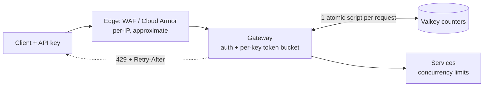
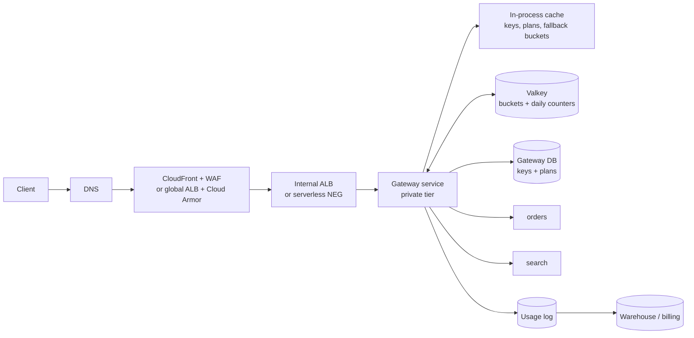

# Rate limiter and API gateway

This walkthrough follows the [interview framework](00-primer.md#interview-framework).
It uses the numbers in the [estimation cheat sheet](00-primer.md#estimation-cheat-sheet)
and the conventions in the [primer](00-primer.md#conventions).

## The question

> "Design a rate limiter for our public API. Each customer has an API key and a
> plan that allows a certain number of requests per second and per day. Where
> does it run, how does it count across many gateway instances, and what does
> the client see when it is limited?"

Common variants:

- "Design an API gateway." (Rate limiting is the deep dive the interviewer is after.)
- "Implement a rate limiter class, then make it distributed."
- "Token bucket or sliding window? Defend it."
- "Our Redis counter is a hot key for our biggest customer. Fix it."
- "Should rate limiting live in the WAF, the gateway or the service?"

## The two-minute answer

Rate limiting runs in **three layers, each with a different job**. The **edge**
(AWS WAF on CloudFront, or Cloud Armor on Google's global load balancer) drops
floods per IP address; it is approximate by design, so it never enforces plans.
The **gateway**, a stateless service in the private tier, authenticates the API
key and enforces the plan's **token buckets** and daily quota. The counters
live in a shared **Valkey** store (ElastiCache Serverless or Memorystore),
updated by one atomic script per request, so every gateway instance sees the
same count. The **services** protect themselves with concurrency limits and load
shedding, not quotas. A limited client gets `429` with `Retry-After`. If the
store fails, the gateway **fails open** to local per-instance buckets, so a
limiter outage never becomes an API outage.



## Clarify the requirements

Questions to ask, with the answers assumed here:

| Question | Assumed answer |
|---|---|
| Who is limited, by what key? | Each API key, per route class (`read`, `write`, `expensive`). Anonymous traffic only per IP. |
| Plans? | Free: 10 req/s, burst 20, 10,000/day. Pro: 100 req/s, burst 200, 1 million/day. Enterprise: negotiated, up to 5,000 req/s. |
| How exact? | Per-second limits within ±10% are fine. Daily quotas are billing-relevant: no customer may be charged for, or blocked by, more than they used. |
| Traffic? | 50,000 API keys, 20,000 active at peak; 20,000 req/s average, 3× peak. |
| Latency budget? | The gateway adds at most 10 ms p99, of which the limiter gets 2 ms. |
| Availability? | 99.95% for the API. The limiter must not lower it. |
| Regions? | One region, multi-AZ. Multi-region limits are a follow-up. |
| Does the gateway do more than limit? | Yes: API-key auth, routing, request-size limits, headers. Not response caching or transformation. |

Non-functional: limits change without a deploy, and every 429 is observable
per key and rule.

## Back-of-envelope estimates

Arithmetic uses the primer's [QPS conversions](00-primer.md#qps-conversions)
and [throughput rules of thumb](00-primer.md#throughput-per-instance-and-per-partition).

**Request rate.** 20,000 req/s average, 3× peak: design for **60,000 req/s**.
The average is about 1.7 billion requests a day.

**Gateway compute.** Assume 2,000 simple proxied requests per vCPU per second,
a folk rule (**verify before relying on** it with a load test). 60,000 / 2,000
is 30 vCPU; with 50% headroom, 45 vCPU, about 23 Fargate tasks or Cloud Run
instances of 2 vCPU. By Little's law, a 5 ms gateway time puts only
60,000 × 0.005 = 300 requests in flight, so CPU, not concurrency, sizes it.

**Counter store operations.** One atomic script per request: 60,000 script
calls a second. ElastiCache Serverless meters ECPUs: 1 ECPU per KB for a simple
GET or SET, and proportionally more for commands that use more vCPU time
([AWS docs](https://docs.aws.amazon.com/AmazonElastiCache/latest/dg/WhatIs.corecomponents.html),
checked 2026-11). A short Lua script is not priced in the docs; assume 3 ECPUs
(**verify before relying on** it by reading the `ElastiCacheProcessingUnits`
metric). That is **180,000 ECPU/s at peak**.

**Counter store cost.** The ElastiCache docs give $1.224 an hour for a
100,000 ECPU/s minimum in us-east-1
([AWS docs](https://docs.aws.amazon.com/AmazonElastiCache/latest/dg/Scaling-serverless.html),
checked 2026-11): about $0.0034 per million ECPUs. At an average of 60,000
ECPU/s (a third of peak), 60,000 × 2.6 million seconds ≈ 156 billion ECPUs, or
**about $530 a month** for compute.

**Hot key.** The largest enterprise key at 5,000 req/s is 5,000 × 3 = 15,000
ECPU/s on one key, so on one slot. ElastiCache Serverless supports at most
30,000 ECPU/s per slot (same source). One tenant at half a slot's ceiling is
the scaling limit to plan for.

**Memory.** Token bucket state is two numbers per key: about 150 bytes with key
name and overhead (**verify before relying on** for your encoding). 50,000
keys × 3 route classes × 150 B ≈ **22 MB**, plus daily counters of the same
order. A sliding-window *log* for comparison: 60,000 req/s × a 60 s window = 3.6
million sorted-set members × ~80 B ≈ **290 MB**, plus a write per request.

**Latency.** A round trip inside a datacenter is ~500 µs
([Latency numbers](00-primer.md#latency-numbers)); ElastiCache Serverless for
Valkey states sub-millisecond p50 reads (Scaling page above). The 2 ms budget
holds one round trip with room for the tail; a read-then-write design doubles
it and races.

**Edge.** The per-IP rule sits well above honest clients: 6,000 requests per
60 s (100 req/s) per IP, to absorb floods.

What the numbers decide: one atomic script per decision; a token bucket, not a
log; and a serverless store where the per-slot ceiling, not the total, is the
limit to watch.

## API and data model

### Client-facing contract

Every response carries the current limit state. A limited request gets:

```http
HTTP/1.1 429 Too Many Requests
Retry-After: 2
RateLimit-Policy: "rate";q=100;w=1, "daily";q=1000000;w=86400
RateLimit: "rate";r=0;t=2
Content-Type: application/problem+json

{"type": "https://api.example.com/errors/rate-limited", "title": "Rate limit exceeded",
 "status": 429, "detail": "Key ak_9f3... exceeded 100 req/s on route class write."}
```

- `429` is defined in [RFC 6585](https://www.rfc-editor.org/rfc/rfc6585#section-4)
  and `Retry-After` in [RFC 9110](https://www.rfc-editor.org/rfc/rfc9110#section-10.2.3).
- `RateLimit` and `RateLimit-Policy` come from the IETF httpapi draft, still an
  Internet-Draft at version 11
  ([IETF Datatracker](https://datatracker.ietf.org/doc/draft-ietf-httpapi-ratelimit-headers/),
  checked 2026-11). Pin the draft version you implement.
- An exhausted daily quota is also `429`, with `Retry-After` at the reset.

### Management API (internal)

`PUT /v1/plans/{plan_id}` changes a plan's limits; `PUT /v1/keys/{key_id}/overrides`
sets a negotiated per-key limit; `GET /v1/keys/{key_id}/usage?day=` serves
billing and support.

### Entities and access patterns

| Entity | Fields | Store | Access pattern |
|---|---|---|---|
| `api_key` | `key_hash`, `tenant_id`, `plan_id`, `status`, `overrides` | Relational (the gateway's own database) | Read on every request, so cached in the gateway for 60 s; written rarely. |
| `plan` | `plan_id`, `limits[]`: `{route_class, rate, burst, daily}` | Same | Cached with the key. |
| `route_class` map | path and method → `read`, `write`, `expensive`, and cost | Gateway config, deployed with it | In memory. |
| Bucket | `rl:{<key_id>}:<route_class>` → hash `{tokens, ts}` | Valkey | One script per request. TTL = time to refill. |
| Daily counter | `q:{<key_id>}:<yyyymmdd>` → integer | Valkey | `INCRBY` in the same script; TTL 48 h. |
| Usage event | `{key_id, route_class, ts, status}` | Log stream to the warehouse | Billing reconciliation. |

The braces are a cluster **hash tag**: all of one API key's keys land in one
slot, so one script can update the bucket and the daily counter atomically. The
price is the hot-key problem in deep dive 2.

## High-level design



### Request path

1. **Edge.** The WAF or Cloud Armor rule counts requests per client IP. Over
   6,000 a minute, the edge answers `429` itself. Managed WAF rules run here too.
2. **Gateway: authenticate.** Hash the `x-api-key` header and look it up in the
   in-process cache (60 s TTL; on a miss, the gateway DB). Unknown or revoked:
   `401`, which is cheap and charged to the IP at the edge.
3. **Gateway: classify.** Map path and method to a route class and its token
   cost (`expensive` routes cost 10 tokens).
4. **Gateway: decide.** Run the token-bucket script against
   `rl:{key}:<class>` and `q:{key}:<day>`. One round trip returns allowed or
   not, tokens left and the time until the next token.
5. **Allowed:** proxy to the service with a deadline, add the `RateLimit`
   headers to the response, and emit a usage event.
6. **Denied:** return `429` with `Retry-After`, without calling the service.
   Emit a sampled `limited` event.

### Write path: changing a limit

The management API updates the plan row and publishes a cache invalidation;
the 60 s TTL is the fallback. Existing buckets keep their tokens and refill at
the new rate, so a change never resets a customer's allowance.

## Deep dives

### The algorithms: token bucket vs sliding window

Five algorithms come up. Know what each stores and where it is wrong.

| Algorithm | State per key | Allows bursts? | Weakness |
|---|---|---|---|
| Fixed window counter | 1 integer per window | Yes, 2× at the boundary | A client can send the full limit at 00:59 and again at 01:00. |
| Sliding window log | 1 entry per request in the window | No | Memory and work grow with traffic (290 MB at our peak). |
| Sliding window counter | 2 integers (this and the previous window) | Slightly | Approximates by weighting the previous window; error is small for smooth traffic. |
| Token bucket | Tokens and last-refill time | Yes, up to `burst` | Two parameters to explain to customers. |
| Leaky bucket (as a meter, or GCRA) | One timestamp (the theoretical arrival time) | Up to a tolerance | Same behaviour as a token bucket; harder to explain. |

**The winner is the token bucket**, for four reasons:

- **It matches how plans are sold.** "100 requests a second, bursts of 200" is a
  rate and a burst, which are exactly its two parameters.
- **Constant state and work.** Two numbers per key and one script per request,
  whatever the traffic.
- **Cost-weighted requests are natural.** An `expensive` call takes 10 tokens.
  A log or window counter counts requests, not cost.
- **It is the industry default.** API Gateway throttles with a token bucket:
  rate is the refill per second, burst the capacity
  ([AWS docs](https://docs.aws.amazon.com/apigateway/latest/developerguide/api-gateway-request-throttling.html),
  checked 2026-11).

The **sliding window counter** is right for "N per minute, no bursts" limits
such as login attempts. The **fixed window** is right for the daily quota: a
day boundary is a business fact.

The script, run atomically by Valkey:

```lua
-- KEYS[1] bucket, KEYS[2] daily counter; ARGV: rate/s, burst, cost, daily limit
local t = server.call('TIME')
local now = tonumber(t[1]) * 1000 + math.floor(tonumber(t[2]) / 1000)
local rate, burst = tonumber(ARGV[1]), tonumber(ARGV[2])
local cost, daily = tonumber(ARGV[3]), tonumber(ARGV[4])
local b = server.call('HMGET', KEYS[1], 'tokens', 'ts')
local tokens = math.min(burst, (tonumber(b[1]) or burst) + (now - (tonumber(b[2]) or now)) * rate / 1000)
local used = tonumber(server.call('GET', KEYS[2]) or '0')
if used + cost > daily then
  return {-1, daily - used, 0} -- quota spent: the gateway sets Retry-After to the reset
end
if tokens < cost then
  return {0, math.floor(tokens), math.ceil((cost - tokens) * 1000 / rate)}
end
server.call('HSET', KEYS[1], 'tokens', tokens - cost, 'ts', now)
server.call('PEXPIRE', KEYS[1], math.ceil(burst * 1000 / rate) + 1000)
server.call('INCRBY', KEYS[2], cost)
server.call('EXPIRE', KEYS[2], 172800)
return {1, math.floor(tokens - cost), 0}
```

Why it is shaped like this:

- **Atomic.** Valkey guarantees a script's atomic execution, and requires every
  key a script touches to be passed in `KEYS`
  ([Valkey docs](https://valkey.io/topics/eval-intro/), checked 2026-11). No
  lost update, no lock.
- **One clock.** The script reads the server's `TIME`, not the gateway's clock,
  so gateway clock skew cannot mint tokens. Valkey replicates script *effects*,
  not the script ([Valkey docs](https://valkey.io/topics/lua-api/), checked
  2026-11), so replicas see the computed values. `server.call` is Valkey's name;
  `redis.call` remains as a compatible alias (same source).
- **Self-cleaning.** The TTL is a full refill time; an expired bucket comes back
  full, which is the same answer.
- **Two kinds of denial.** `0` is a rate denial with the milliseconds until
  enough tokens refill. `-1` is a spent daily quota: the gateway computes
  `Retry-After` as the seconds to the next UTC midnight, never 0.
- **Where it breaks:** every request for a key hits one slot (next deep dive).

### Distributed counters and their consistency

The gateway runs as 20+ instances. A limit of 100 req/s must hold across all of
them. Four options:

| Option | Accuracy | Latency per request | Failure behaviour |
|---|---|---|---|
| **A. Local buckets only**, each instance enforcing `limit / N` | Poor. Load balancing is not perfectly even, and N changes with autoscaling. | None | No shared dependency. |
| **B. Central store, one atomic script per request** | Exact up to the store's consistency | One round trip | The store is on the request path. |
| **C. Local buckets with leased tokens** from the central store | Within one lease per instance | Usually none; one round trip per lease | Degrades to A. |
| **D. Local counting with periodic async sync** (gossip or batched `INCRBY`) | Over-admits by up to N × sync interval × rate | None | No shared dependency. |

**The winner is B, with C for the few hottest keys.**

- **B is the default:** exact, simple, and one round trip fits the 2 ms budget.
- **C is for hot keys.** An instance takes a lease of, say, 50 tokens with one
  script call and spends them locally. A 5,000 req/s tenant then costs 100
  store calls a second instead of 5,000. The error is bounded: at most one
  unspent lease per instance, 20 × 50 = 1,000 tokens, which is 0.2 s of that
  tenant's rate. Unused tokens expire with the lease, which under-admits: the
  safe side.
- **D** is fine for abuse control and wrong for plans.

**Consistency of the store itself.**

- **Replication is asynchronous** (**verify before relying on** each service's
  failover guarantees). A failover may lose the last writes, handing back a few
  requests' worth of tokens. Accept it; a limiter should not pay for
  synchronous replication.
- **Reads go to the primary.** ElastiCache Serverless raises its per-slot
  ceiling from 30,000 to 90,000 ECPU/s only with read-from-replica
  ([AWS docs](https://docs.aws.amazon.com/AmazonElastiCache/latest/dg/Scaling-serverless.html),
  checked 2026-11), and a script that writes cannot run on a replica.
- **Daily quotas need a second record.** The Valkey counter enforces; billing
  uses the usage log, so a lost counter never mis-bills. It can grant at most
  one extra day's allowance: write that decision down.

**The hot-key fix, in order of preference:**

1. **Lease tokens (option C)** for keys above, say, 1,000 req/s.
2. **Split the bucket.** Give a 5,000 req/s tenant 4 sub-buckets of 1,250 req/s,
   keyed `rl:{key#0..3}:class` so they land in different slots, chosen by
   hashing the request ID. Uneven hashing gives an early 429; one retry on
   another sub-bucket fixes most of it. The daily counter is then a separate
   call, because the script's keys must share a slot.
3. **Pre-scale the store.** ElastiCache Serverless doubles its request rate
   every 2–3 minutes, and a pre-scaling minimum takes up to 60 minutes to apply
   (same source): set it an hour before a known launch.

**Failure: fail open or fail closed?** If the store is unreachable or slower
than 2 ms, the gateway **fails open to local buckets** (option A, with
`limit / N`). Plans are approximately enforced and the API stays up. A route
class marked `fail_closed` (an expensive export, say) returns `503` with
`Retry-After` instead. The edge rule still stops floods. Alert on time spent
failed open.

### Where it runs: edge, gateway or service

Each layer knows different things and errs differently.

| Layer | Knows | Accuracy | Cost of a rejected request | Job |
|---|---|---|---|---|
| **Edge** (AWS WAF, Cloud Armor) | IP, headers, path, country, TLS fingerprint | Approximate, delayed | Almost none: never reaches you | Floods, scrapers, credential stuffing |
| **Gateway** (this design) | Authenticated key, plan, route class, cost | Exact to the store | One gateway hop | Plans, quotas, fairness between tenants |
| **Service** | Its own concurrency, queue depth, dependencies | Exact, local | Some work done | Self-protection: load shedding, bulkheads |

**Why the edge cannot enforce plans.**

- **AWS WAF.** Rate-based rules accept a limit of at least 10 over an evaluation
  window of 60, 120, 300 or 600 seconds
  ([AWS docs](https://docs.aws.amazon.com/waf/latest/developerguide/waf-rule-statement-type-rate-based-high-level-settings.html),
  checked 2026-11). They are not meant for precise limiting: traffic can exceed
  the limit for up to several minutes, usually under 30 seconds, and changing a
  rule's settings resets its counts
  ([AWS docs](https://docs.aws.amazon.com/waf/latest/developerguide/waf-rule-statement-type-rate-based-caveats.html),
  checked 2026-11).
- **Cloud Armor.** `throttle` and `rate_based_ban` count over 10 to 3,600
  seconds, on up to three keys. Thresholds apply independently in each backend
  region, are approximate, and are recommended for abuse mitigation, not strict
  quotas
  ([Google Cloud docs](https://docs.cloud.google.com/armor/docs/rate-limiting-overview),
  checked 2026-11).
- Both can key on an `x-api-key` header but cannot tell a valid key from a
  random one: an attacker rotating keys gets a fresh bucket each time.

**Why not a managed API gateway product for the plans?**

- **Amazon API Gateway REST APIs** offer usage plans with per-key throttling and
  quotas, but throttles and quotas are best-effort targets, not guaranteed
  ceilings
  ([AWS docs](https://docs.aws.amazon.com/apigateway/latest/developerguide/api-gateway-request-throttling.html),
  checked 2026-11). All APIs in an account share 10,000 req/s per Region with a
  burst of 5,000 by default, adjustable, and only 2,500 in some Regions
  ([AWS docs](https://docs.aws.amazon.com/apigateway/latest/developerguide/limits.html),
  checked 2026-11): our peak needs a sixfold increase first.
- **HTTP APIs** are cheaper but have no API keys, no per-client rate limiting
  and no WAF integration
  ([AWS docs](https://docs.aws.amazon.com/apigateway/latest/developerguide/http-api-vs-rest.html),
  checked 2026-11). This repo's
  [`modules/aws/network/api-gateway`](../../modules/aws/network/api-gateway/)
  builds an HTTP API, so it cannot be the plan enforcer.
- **Apigee** has SpikeArrest for surges and Quota for business contracts; with
  `UseEffectiveCount` set, SpikeArrest counts are synchronized across a region
  ([Google Cloud docs](https://docs.cloud.google.com/apigee/docs/api-platform/reference/policies/spike-arrest-policy),
  checked 2026-11). Choose it when you also want a developer portal and
  monetisation.
- **Google Cloud API Gateway** applies quotas per consumer project identified
  by the API key, in units such as `1/min/{project}`
  ([Cloud Endpoints docs](https://docs.cloud.google.com/endpoints/docs/openapi/quotas-configure),
  checked 2026-11). That fits Google-project consumers, not 50,000 external keys;
  **verify before relying on** it for that use.

**Why services still limit.** The gateway does not know that `search` is slow
right now. Each service caps its concurrency and sheds load with `503` and
`Retry-After` when its queue grows. That is load shedding, not rate limiting:
it protects the service from the sum of customers who are each within plan.

**Where it breaks.** The edge rule must sit far above any plan, or a corporate
NAT with many honest users behind one IP is blocked. Exempt known partner
ranges with a higher-priority allow rule.

## Trade-offs to defend

| Decision | Chosen | Rejected | Why | What would change the answer |
|---|---|---|---|---|
| Algorithm for plans | Token bucket | Fixed window; sliding log | Rate plus burst matches plans; constant state; cost-weighted. | Limits sold as "N per minute, no bursts": sliding window counter. |
| Daily quota | Fixed window counter + usage log | Token bucket with a day-long refill | A day boundary is a business fact; billing needs an auditable record. | Rolling 24-hour quotas. |
| Plan enforcement point | Own gateway service | API Gateway usage plans; Apigee | Exact counts, one round trip, no account-wide throttle to raise. | Need for a developer portal, monetisation or partner onboarding: Apigee. |
| Counter store | Serverless Valkey, one atomic script | DynamoDB / Firestore conditional writes | Sub-millisecond, atomic multi-key scripts. | No in-VPC cache allowed; a per-minute granularity where a database is fast enough. |
| Distribution | Central store; leased tokens for hot keys | Local only; async sync | Exact for most keys, bounded error for hot ones. | Multi-region with one global limit: per-region shares plus async reconciliation. |
| Store failure | Fail open to local buckets | Fail closed | The limiter must not lower API availability. | Routes whose overuse costs real money: mark them fail-closed. |
| Edge rule | Per-IP, 100 req/s, approximate | No edge rule; plan limits at the edge | Floods stop before they cost compute. | All traffic authenticated by mTLS from known partners. |
| Response | `429`, `Retry-After`, draft `RateLimit` headers | Silent queueing; `503` | Clients can back off correctly. | Internal callers on a queue: delay instead of rejecting. |

## Failure modes and scaling limits

**At ×10 (600,000 req/s):**

- **Hot slots fail first.** The 5,000 req/s tenant becomes 50,000 req/s =
  150,000 ECPU/s on one slot, five times the 30,000 ceiling. Leasing (C) and
  split buckets must already be in place.
- **The store total** reaches 1.8 million ECPU/s, about $5,300 a month for
  compute; leasing for every key above 100 req/s cuts it sharply.
- **The gateway fleet** grows to ~450 vCPU; pool store connections per instance.
- **The edge** is unaffected; it scales with the CDN or global load balancer.

**At ×100:** a single region stops being the design. Move to regional cells,
each with its own gateway fleet and counter store, and route a tenant to a home
cell. Global limits become per-cell shares with async reconciliation (option D
between cells, B within one).

**Blast radius by component:**

| Component | If it fails | Blast radius |
|---|---|---|
| Edge rule misconfigured | Honest IPs blocked at the edge | Everyone behind those IPs; fast to revert. |
| Gateway fleet | No API at all | Total. Run multi-AZ with a minimum count; it is stateless. |
| Counter store | Fail open to local buckets | Plans approximately enforced; no API outage. |
| Gateway DB | Keys served from cache for 60 s, then new keys fail | New or changed keys only, after the TTL. Extend the TTL during an outage. |
| Policy bug (limit set to 0) | Every key on the plan gets 429 | One plan; caught by a canary key per plan. |
| One service | Its own 503s | That service's routes only; others unaffected. |

## AWS and GCP mapping

| Component | AWS | GCP | Difference that matters |
|---|---|---|---|
| Edge rate rule | AWS WAF rate-based rule on CloudFront | Cloud Armor `throttle` / `rate_based_ban` on the global external Application Load Balancer | WAF windows are 60–600 s; Cloud Armor 10–3,600 s and enforced per region (sources in deep dive 3). |
| Edge key types | IP, forwarded IP, or custom keys (header, cookie, path, JA3/JA4, ASN, others) | Up to 3 of IP, header, cookie, path, SNI, region, JA3/JA4, ASN, others | Neither validates the API key it counts. |
| Gateway runtime | ECS on Fargate behind the internal ALB | Cloud Run behind a serverless NEG | Cloud Run caps concurrency per instance at 1,000 ([Throughput](00-primer.md#throughput-per-instance-and-per-partition)); Fargate has no such knob, so the gateway sets its own. |
| Counter store | ElastiCache Serverless for Valkey | Memorystore for Valkey | ElastiCache Serverless scales shards automatically and meters ECPUs; Memorystore is sized by node type and shard count. |
| Store networking | VPC endpoint in your subnets ([AWS docs](https://docs.aws.amazon.com/AmazonElastiCache/latest/dg/WhatIs.corecomponents.html), checked 2026-11) | Private Service Connect through a service connection policy, the only supported method ([Google Cloud docs](https://docs.cloud.google.com/memorystore/docs/valkey/networking), checked 2026-11) | GCP needs a policy in the host project before the instance exists. |
| Store encryption | Workload CMK (`kms_key_id`) | CMEK at creation only; the key must be in the instance's region ([Google Cloud docs](https://docs.cloud.google.com/memorystore/docs/valkey/about-cmek), checked 2026-11) | GCP cannot add CMEK later: decide before the first apply. |
| Store authentication | Security groups; optional RBAC user group | IAM auth with `roles/memorystore.dbConnectionUser`, token via `AUTH` ([Google Cloud docs](https://docs.cloud.google.com/memorystore/docs/valkey/about-iam-auth), checked 2026-11) | GCP gives per-identity access; AWS relies on network placement unless you add users. |
| Managed alternative | API Gateway REST usage plans | Apigee SpikeArrest + Quota | Both trade exactness or cost for a portal and less code. |
| Gateway DB | Aurora PostgreSQL (app-services) | Cloud SQL (app-services) | No difference to the design. |

Two differences change the design:

- **Cloud Armor counts per region.** Backends in three regions let an IP send
  up to three times the edge threshold. Anything exact belongs in the gateway.
- **Memorystore CMEK and networking are creation-time decisions.** The service
  connection policy and the key grant must exist before the instance, so they
  go in the same apply, ordered by `depends_on`.

## Build it here

### Where it lives

| Part | AWS | GCP |
|---|---|---|
| Edge | `module.app_edge` in `aws-workload-<env>` (`envs/aws/workload`), with `app_ingress_mode = cloudfront_vpc_origin` | Public ingress (`modules/gcp/network/app-ingress`) and the environment Cloud Armor policy in `gcp-workload-<env>` (`envs/gcp/workload`) |
| Gateway and backends | `modules/aws/stages/app-services` services | `modules/gcp/stages/app-services` services |
| Counter store | Raw ElastiCache Serverless in `envs/aws/workload`, `isolated` tier | Raw Memorystore in `envs/gcp/workload`, PSC into the `database` tier |
| Apply order | `aws-organization` → … → `aws-network` → `aws-workload-<env>` | `gcp-bootstrap` → `gcp-organization` → `gcp-projects` → `gcp-network-hub` → `gcp-workload-<env>` |

Placement follows [VPC-tier placement](00-primer.md#vpc-tier-placement): the
gateway in `private`, the counter store in `isolated` (AWS) or behind PSC in the
`database` tier (GCP). On GCP, `ALL_TRAFFIC` sends the gateway's internet-bound
traffic, if any, through the environment's Cloud NAT, which is not inspected
through the hub.

### Config

```yaml
# Illustrative. Keys are real (config/landing-zone.schema.json); values are placeholders.
aws:
  workload:
    app_ingress_mode: cloudfront_vpc_origin # internal ALB behind CloudFront + WAF
  workload_environments:
    prod:
      account_key: workload_prod
      services:
        gateway:
          path_patterns: ["/*"] # catch-all, auto priority 1000+
          enable_autoscaling: true
          autoscaling_max_capacity: 40
          database: {} # keys and plans
        orders:
          host_headers: ["orders.internal.example"] # only the gateway sends this Host
          priority: 10
gcp:
  workload:
    public_ingress:
      prod:
        gateway:
          domains: [api.example.com]
  environments:
    prod:
      services:
        gateway:
          vpc_egress: ALL_TRAFFIC # reach the PSC endpoint and internal backends
          max_instances: 60
          runtime_project_roles: ["roles/memorystore.dbConnectionUser"]
          database: {}
        orders:
          invoker_members:
            - serviceAccount:gateway-run@HOST_PROJECT_ID.iam.gserviceaccount.com
```

Notes:

- AWS: CloudFront forwards every viewer header except `Host`
  (`Managed-AllViewerExceptHostHeader` in `envs/aws/workload/main.tf`), so only
  the gateway, calling the ALB directly, matches the `orders` host rule.
- GCP: `public_ingress` switches `gateway` to
  `INGRESS_TRAFFIC_INTERNAL_LOAD_BALANCER` behind the environment Cloud Armor
  policy; `orders` stays internal.
- `runtime_project_roles` grants project-wide. Narrower is a conditional
  project grant, as [Per-component identity](00-primer.md#per-component-identity)
  describes for Cloud SQL.

### AWS: edge rate rule and the counter store

In `envs/aws/workload`, using `local.environment`, `local.kms_key_arn`,
`module.aws_workload`, `module.app_services` and `module.app_edge`.
`aws_wafv2_web_acl_rule` (provider 6.37.0+) requires `lifecycle { ignore_changes = [rule] }`
on the web ACL
([provider docs](https://github.com/hashicorp/terraform-provider-aws/blob/v6.72.0/website/docs/r/wafv2_web_acl_rule.html.markdown),
checked 2026-11). `modules/aws/security/edge-security` lacks it: add that line
first, or the two resources fight.

```hcl
# Gap: edge-security has no rate-based rule; raw rule on its CloudFront web ACL.
resource "aws_wafv2_web_acl_rule" "per_ip_rate" {
  provider    = aws.us_east_1 # CloudFront-scoped ACLs live in us-east-1
  name        = "per-ip-rate"
  priority    = 0 # before the managed rule groups
  web_acl_arn = module.app_edge[0].web_acl_arn
  action {
    block {
      custom_response { response_code = 429 }
    }
  }
  statement {
    rate_based_statement {
      aggregate_key_type    = "IP"
      limit                 = 6000
      evaluation_window_sec = 60
    }
  }
  visibility_config {
    cloudwatch_metrics_enabled = true
    metric_name                = "per-ip-rate"
    sampled_requests_enabled   = true
  }
}

# Gap: the repo has no ElastiCache module; raw resources in the landing zone's conventions.
resource "aws_security_group" "ratelimit" {
  name        = "${local.environment}-ratelimit-db" # data-store pattern <env>-<component>-db
  description = "ratelimit Valkey; reachable only from the gateway"
  vpc_id      = module.aws_workload.vpc_id
  tags        = { Name = "${local.environment}-ratelimit-db", Service = "ratelimit" }
}
resource "aws_vpc_security_group_ingress_rule" "ratelimit_from_gateway" {
  security_group_id            = aws_security_group.ratelimit.id
  referenced_security_group_id = module.app_services.services["gateway"].security_group_id
  ip_protocol                  = "tcp"
  from_port                    = 6379
  to_port                      = 6380 # 6380 serves READONLY replica reads
}
resource "aws_vpc_security_group_egress_rule" "gateway_to_ratelimit" {
  security_group_id            = module.app_services.services["gateway"].security_group_id
  referenced_security_group_id = aws_security_group.ratelimit.id
  ip_protocol                  = "tcp"
  from_port                    = 6379
  to_port                      = 6380
}
resource "aws_elasticache_serverless_cache" "ratelimit" {
  name                 = "${local.environment}-ratelimit"
  engine               = "valkey"
  major_engine_version = "8"
  kms_key_id           = local.kms_key_arn # workload CMK
  subnet_ids           = module.aws_workload.subnet_ids_by_tier["isolated"]
  security_group_ids   = [aws_security_group.ratelimit.id]
  cache_usage_limits {
    ecpu_per_second { maximum = 500000 } # cost ceiling: throttles, so alarm at 75%
  }
  tags = { Service = "ratelimit" }
}
```

- The workload CMK delegates to IAM, so ElastiCache uses it through the
  caller's permissions and grants, as RDS does (`envs/aws/workload/kms.tf`).
  **Verify before relying on** the apply role holding `kms:CreateGrant`.
- Argument names are checked against aws 6.72.0; port 6380 and engine version
  `"8"` are **verify before relying on**.

### GCP: edge rate rule and the counter store

In `envs/gcp/workload`, using `local.env_config`, `local.project_prefix`,
`local.labels`, `var.environment` and `module.environment`.

```hcl
# Gap: no per-environment workload CMEK exists yet; this adds one with the kms module.
module "workload_cmek" {
  source       = "../../../modules/gcp/governance/kms"
  project_id   = local.env_config.host_project_id
  keyring_name = "${local.project_prefix}-${var.environment}-cmek"
  location     = local.env_config.region
  labels       = local.labels
  keys = {
    "ratelimit" = {
      encrypter_decrypters = [
        "serviceAccount:service-${local.env_config.host_project_number}@gcp-sa-memorystore.iam.gserviceaccount.com",
      ]
    }
  }
}

# Gap: the environment stage does not forward cloud-armor custom_rules; raw rule on its policy.
resource "google_compute_security_policy_rule" "per_ip_rate" {
  project         = local.env_config.host_project_id
  security_policy = basename(module.environment.security_policy_id) # policy name
  priority        = 900 # before the module's Log4Shell (999) and OWASP rules
  action          = "throttle"
  match {
    versioned_expr = "SRC_IPS_V1"
    config { src_ip_ranges = ["*"] }
  }
  rate_limit_options {
    exceed_action  = "deny(429)"
    enforce_on_key = "IP"
    rate_limit_threshold {
      count        = 6000
      interval_sec = 60
    }
  }
}

# Gap: the repo has no Memorystore module or service connection policy.
resource "google_network_connectivity_service_connection_policy" "memorystore" {
  project       = local.env_config.host_project_id
  name          = "memorystore-${local.env_config.region}"
  location      = local.env_config.region
  service_class = "gcp-memorystore"
  network       = module.environment.network_id
  psc_config {
    subnetworks = [values(module.environment.subnets.database)[0].id]
  }
}
resource "google_memorystore_instance" "ratelimit" {
  project                     = local.env_config.host_project_id
  instance_id                 = "ratelimit"
  location                    = local.env_config.region
  mode                        = "CLUSTER"
  shard_count                 = 3
  replica_count               = 1
  authorization_mode          = "IAM_AUTH"
  transit_encryption_mode     = "SERVER_AUTHENTICATION"
  kms_key                     = module.workload_cmek.key_ids["ratelimit"]
  deletion_protection_enabled = true
  labels                      = merge(local.labels, { service = "ratelimit" })
  desired_auto_created_endpoints {
    network    = module.environment.network_id
    project_id = local.env_config.host_project_id
  }
  depends_on = [google_network_connectivity_service_connection_policy.memorystore, module.workload_cmek]
}
```

- Argument names are checked against google 8.10.0
  ([`google_memorystore_instance`](https://registry.terraform.io/providers/hashicorp/google/8.10.0/docs/resources/memorystore_instance),
  [`google_compute_security_policy_rule`](https://registry.terraform.io/providers/hashicorp/google/8.10.0/docs/resources/compute_security_policy_rule),
  [`google_network_connectivity_service_connection_policy`](https://registry.terraform.io/providers/hashicorp/google/8.10.0/docs/resources/network_connectivity_service_connection_policy),
  checked 2026-11).
- The rule attaches to the existing policy as a separate rule resource, as
  `modules/gcp/network/cloud-armor` attaches its OWASP rules.
- The tiered firewall already admits compute → database on 6379 (the default
  `database_ports`). Whether those rules govern traffic to a PSC endpoint, and
  which ports a cluster-mode instance uses beyond 6379, are **verify before
  relying on**.
- Shard count is illustrative; choose `node_type` and shards by load test.

## Runbook

### Legitimate clients are getting 429s

**Detection signal.** 429 ratio per plan above 2× its 7-day median for 10
minutes, or a plan's canary key getting a 429. Split by source: the edge rule
(CloudWatch metric `per-ip-rate`, or Cloud Armor rule logs) or the gateway's
`limited` events.

**Triage.**

1. **Edge or gateway?** An edge 429 has no gateway log line. If the edge, check
   whether the blocked IPs are a customer's NAT or a partner range.
2. **One key, one plan, or everyone?** One key at its limit is the system
   working; show the customer their usage. One plan: check the last plan change
   in the management API audit log. Everyone: suspect a gateway deploy.
3. **Is it a split bucket?** A hot key on split buckets (deep dive 2) gives
   early 429s when its requests hash unevenly.
4. **Rule out the store.** A throttled or slow store sends the gateway into
   fail-open, which gives *fewer* 429s, not more; that is the next runbook.

**Mitigation.**

1. **Edge false positive:** add the range to a higher-priority allow rule
   through `aws-workload-<env>` or `gcp-workload-<env>` in Terraform Cloud.
   Changing an AWS rate rule resets its counts, which is acceptable here.
2. **Bad plan change:** revert it through the management API; caches expire
   within 60 s or on the invalidation message.
3. **Split bucket:** move the key to leased tokens, or raise its override
   temporarily.

**Verification.** 429 ratio per plan at baseline and the canary keys passing.

**Follow-up.** Check every plan change against current usage and warn if it
would limit more than 1% of active keys. Review the edge threshold against the
largest customer NAT.

### The counter store is down and the gateway is failed open

**Detection signal.** The gateway's `limiter_fail_open` gauge above zero for 1
minute, store connection errors in gateway logs, or ElastiCache or Memorystore
health events.

**Triage.** Network (a security group, firewall or PSC change) or the store
itself (failover, maintenance, throttling at a configured `ecpu_per_second`
maximum)? Check the workload workspace's last applies, then the store's events
and its ECPU or per-shard CPU metrics.

**Mitigation.** Leave the gateway failed open; local buckets enforce
`limit / N`. Revoke any key abusing the window; revocation does not need the
store. Revert a network change, or raise `ecpu_per_second.maximum` or the
Memorystore shard count, through the workspace. If the store is lost,
recreate it: buckets refill on first use, and daily counters reload from the
usage log's current-day totals.

**Verification.** `limiter_fail_open` at zero, store p99 under 1 ms, and 429
ratios per plan back at baseline.

**Follow-up.** Record time failed open against the limiter's error budget.
Game-day a store failover every quarter.

## Study aids

### Numbers to memorise

| Fact | Value |
|---|---|
| AWS WAF rate rule | Minimum limit 10; window 60, 120, 300 or 600 s; detection usually under 30 s |
| Cloud Armor rate rule | Interval 10–3,600 s; throttle threshold up to 1,000,000; up to 3 keys; per region |
| API Gateway account default | 10,000 req/s, burst 5,000 per Region (2,500 in some Regions) |
| ElastiCache Serverless | 30,000 ECPU/s per slot; 1 ECPU per KB for simple commands; doubles every 2–3 min |
| Memorystore CMEK | At creation only; key in the same region |
| This design | 60,000 req/s peak; 180,000 ECPU/s; ~22 MB of bucket state; 2 ms limiter budget |
| Token bucket | Rate = refill per second; burst = bucket capacity |

### Likely follow-ups

- **"Why not just use the WAF?"** It is approximate and delayed, and it cannot
  tell a valid key from a random one. It stops floods; plans need the gateway.
- **"Two gateway instances read the same count and both allow. How do you
  stop it?"** Do the read and the write in one atomic script on the store. No
  locks, one round trip.
- **"The store is down."** Fail open to local `limit / N` buckets, keep the edge
  rule, page if it lasts. Fail closed only for routes where overuse costs money.
- **"Your biggest customer is a hot key."** Lease tokens in batches, then split
  the bucket across slots.
- **"Make it multi-region."** Give each region a share of the global limit and
  reconcile shares asynchronously, or home each tenant to one region. A
  synchronous global counter puts a cross-region round trip on every request.
- **"Whose clock?"** The store's `TIME`, inside the script.

### Classic mistakes

- GET then SET in two round trips, with a race between them.
- Enforcing plans at the edge and calling the approximate result exact.
- Failing closed, turning a cache outage into an API outage.
- One global key for a tenant with no plan for its slot ceiling.
- Limiting authenticated traffic by IP alone, blocking whole offices.
- Returning 429 without `Retry-After`, so clients retry immediately.
- Billing from the enforcement counter instead of a durable usage log.

### Further reading

- [AWS WAF rate-based rule statement](https://docs.aws.amazon.com/waf/latest/developerguide/waf-rule-statement-type-rate-based.html)
- [Cloud Armor rate limiting overview](https://docs.cloud.google.com/armor/docs/rate-limiting-overview)
- [API Gateway request throttling](https://docs.aws.amazon.com/apigateway/latest/developerguide/api-gateway-request-throttling.html)
- [Valkey scripting](https://valkey.io/topics/eval-intro/)
- [IETF RateLimit header fields draft](https://datatracker.ietf.org/doc/draft-ietf-httpapi-ratelimit-headers/)
- The primer's [service map](00-primer.md#aws-gcp-service-map) and
  [VPC-tier placement](00-primer.md#vpc-tier-placement).
