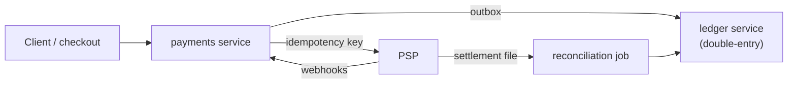
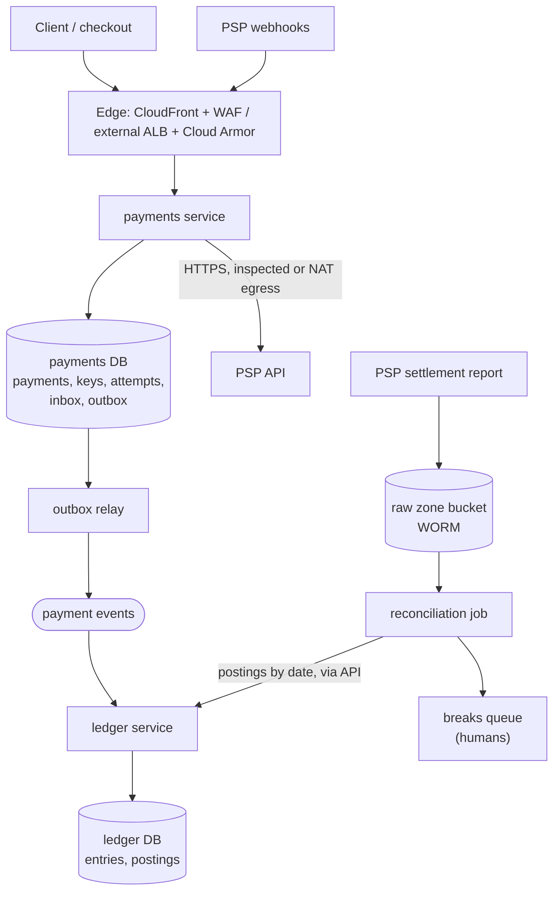
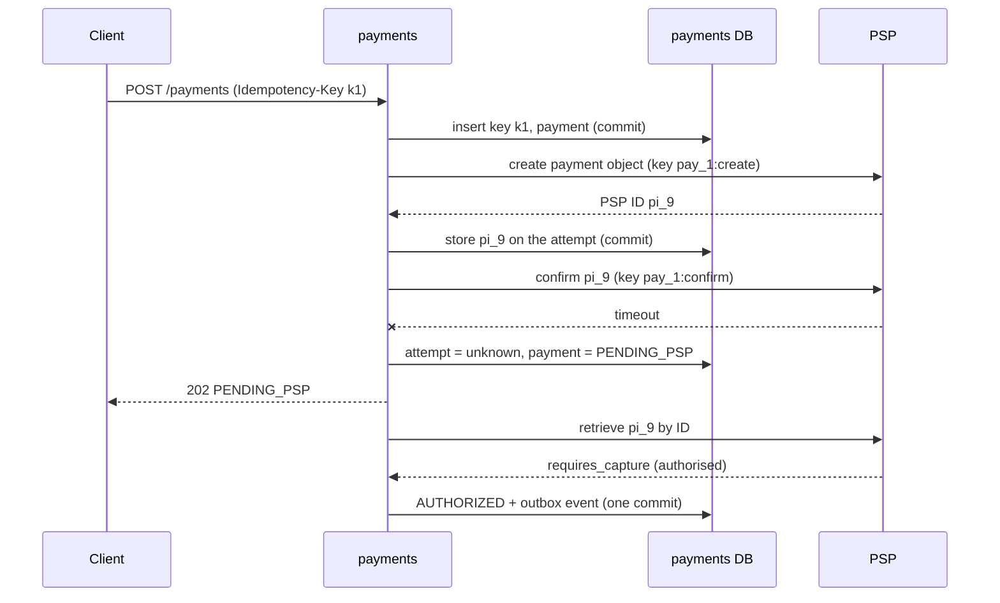

# Payment system and ledger

This walkthrough follows the [interview framework](00-primer.md#interview-framework).
It uses the numbers in the [estimation cheat sheet](00-primer.md#estimation-cheat-sheet)
and the conventions in the [primer](00-primer.md#conventions). It reuses the
**transactional outbox** defined in the [microservices walkthrough](03-microservices-sync-async.md), under
[The transactional outbox](03-microservices-sync-async.md#the-transactional-outbox),
and does not re-explain it.

## The question

> "Design the payment system for an online marketplace. Customers pay by card
> through an external payment service provider (PSP). We need to charge them
> exactly once, record every movement of money in a ledger, and prove at the
> end of each day that our books match the provider's."

Common variants:

- "The client times out and retries a payment. How do you not charge twice?"
- "Design a double-entry ledger. What invariants does it enforce?"
- "Where is exactly-once real in this system, and where is it a lie?"

## The two-minute answer

A **payments service** accepts `POST /payments` with a client-supplied
**idempotency key**, and records the key and the payment in one transaction
before anything else, so a retry finds the existing payment. It calls the PSP
with **its own** idempotency key, derived from the payment ID, so its retries
cannot double-charge. A timed-out PSP call is **unknown**, resolved by asking
the PSP, never by charging again. The PSP's default rate limits bind at
launch, so request an increase weeks ahead. Every
movement of money becomes an entry in an append-only **double-entry ledger**:
postings sum to zero per currency, and corrections are reversing entries,
never updates. The payment change and its ledger event commit together through
a transactional outbox, and PSP webhooks are deduplicated hints to re-read the
payment. Every day a **reconciliation** job matches the ledger against the
PSP's settlement report and the bank statement, and queues every mismatch for a
human. On AWS this is ECS on Fargate and Aurora PostgreSQL; on GCP,
Cloud Run and Cloud SQL for PostgreSQL.



## Clarify the requirements

Questions to ask, with the answers assumed here:

| Question | Assumed answer |
|---|---|
| Who processes cards? | An external PSP. Card numbers never touch our systems: the checkout page uses the PSP's hosted fields and we only see tokens. |
| Which flows? | Authorise, capture, refund, and the PSP's settlement to our bank account. Payouts to sellers exist but are out of scope beyond their ledger entries. |
| Scale? | 5 million payments a day; peaks of 5× average during sales. |
| Latency? | `POST /payments` p99 under 3 seconds, dominated by the PSP. |
| Correctness? | No double charge, no lost capture, and a ledger that balances at every commit. Money is never a float. |
| Currencies? | Several, each in integer minor units. No FX inside a journal entry. |
| Audit? | Every movement traceable to a request, PSP event and settlement line, for years. |
| Regions? | One region, multi-AZ. Multi-region is the [active-active walkthrough](16-multi-region-active-active.md). |

Non-functional: 99.95% availability for accepting payments; RPO zero within
the region (synchronous cross-zone replication); RTO of minutes; CMEK on all
money data.

Keeping card numbers out of our systems keeps the PCI DSS scope small;
**verify before relying on** any scope claim with your assessor.

## Back-of-envelope estimates

Arithmetic uses the primer's [QPS conversions](00-primer.md#qps-conversions).

**Payments.** 5 million a day is about 58 a second. At 5× peak that is about
300 a second; design for **500 payments a second**.

**PSP calls.** Create, confirm and capture (three per payment): about **1,500 PSP
calls a second** at peak, 500 a second on each endpoint. Assume a PSP p99 of
2 s (**verify before relying on** for your PSP). Little's law at p99 gives an
upper bound of **3,000 calls in flight**, which sizes connection pools and
task count, not CPU.

**PSP limits bind at 1×.** Stripe's live-mode defaults are 100 requests a
second per account, 25 a second per endpoint and 50 concurrent requests, and a
large increase needs at least 6 weeks' notice
([Stripe docs](https://docs.stripe.com/rate-limits), checked 2026-11). Even
the average of about 175 calls a second exceeds them. Request about 2,000 a second,
600 per endpoint and 3,000 concurrent before launch (headroom for resolver and
webhook re-reads), enforce them with a client-side token bucket and
concurrency cap, and coalesce re-reads per payment.

**Ledger postings.** A payment produces about four journal entries over its
life (capture, PSP fee, settlement, seller payable) with two or three postings
each: call it **10 postings per payment**. That is 50 million postings a day,
about 580 a second on average and **5,000 a second at design peak**. At about
250 bytes a row including indexes, that is about 12.5 GB a day, or about
4.6 TB a year. Two decisions follow:

- 5,000 inserts a second is inside the
  [folk rule](00-primer.md#throughput-per-instance-and-per-partition) for one
  relational primary, so **one PostgreSQL primary, no sharding**, at this scale.
- Multi-terabyte growth means **monthly partitions**, with old ones exported
  to the raw zone and detached.

**Payments DB writes.** About 15 row writes per payment: about **7,500 a
second** at peak, still inside one primary.

**Hot accounts.** Every payment posts to the PSP clearing account. One
balance row updated in place would serialise 5,000 postings a second on a lock
that sustains perhaps a few hundred (**verify before relying on**). So hot
balances are **derived**, never updated.

**Idempotency records.** 5 million keys a day at about 2 KB each (the request
hash and the stored response) is 10 GB a day. Kept 72 hours: about 30 GB.

**Webhooks.** About three events per payment: about 175 a second on average.
PSP retries after an outage arrive in a burst; plan for **10×**, about 1,750 a
second.

**Reconciliation.** About 5 million settlement lines at 300 bytes: **1.5 GB a
day**, minutes in a batch.

## API and data model

### Synchronous API

| Endpoint | Purpose | Notes |
|---|---|---|
| `POST /payments` | Create and authorise a payment. | Requires `Idempotency-Key`. Returns `201` with the payment, or the stored response on a retry. |
| `POST /payments/{id}/capture` | Capture an authorised payment. | Idempotency key required; the amount may be partial. |
| `POST /payments/{id}/refunds` | Refund all or part of a capture. | Idempotency key required. |
| `GET /payments/{id}` | Current status. | No key: reads are idempotent. |
| `POST /webhooks/psp` | PSP event delivery. | Signature-verified; returns `200` fast after a durable insert. |
| `GET /ledger/accounts/{id}/balance` | Balance as of now or a timestamp. | Internal only. |

Key handling follows the IETF
[Idempotency-Key header draft](https://datatracker.ietf.org/doc/draft-ietf-httpapi-idempotency-key-header/),
which is still an Internet-Draft (revision 08, October 2026; checked 2026-11).
Its revision 07 recommends `400` when a required key is missing, `409` while
the original request is still in progress, and `422` when a key is reused
with a different payload
([draft section 2.7](https://www.ietf.org/archive/id/draft-ietf-httpapi-idempotency-key-header-07.html),
checked 2026-11).

### Events

payments writes `PaymentAuthorized`, `PaymentCaptured`, `PaymentRefunded`,
`PaymentFailed` and `PspFeeCharged` to its outbox (envelope as in the
[microservices walkthrough](03-microservices-sync-async.md#events)); the ledger
turns each into one journal entry.

### Key tables

| Table | Owner | Key | Access pattern |
|---|---|---|---|
| `idempotency_keys` | payments | `(merchant_id, key)` | Insert-or-read at the start of every write request; expire after 72 hours. |
| `payments` | payments | `payment_id`; unique `(merchant_id, idempotency_key)` | Point read and state transition by ID. |
| `psp_attempts` | payments | `(payment_id, operation)`; unique `psp_idempotency_key` | One row per call to the PSP, with its outcome: `succeeded`, `failed` or `unknown`. |
| `psp_events` | payments | `psp_event_id` | Inbox: insert on webhook receipt; a key conflict is a duplicate. |
| `accounts` | ledger | `account_id` | Chart of accounts: type (asset, liability, revenue, expense), currency, `hot` flag. |
| `journal_entries` | ledger | `entry_id`; unique `source_event_id` | Append-only; one per business event. |
| `postings` | ledger | `(entry_id, line, created_at)`; index `(account_id, created_at)` | Append-only, partitioned by month on `created_at`, which the key must include; balances are sums. |
| `balance_snapshots` | ledger | `(account_id, currency, as_of)` | Checkpoints at a horizon so a balance is snapshot + later postings. |
| `settlement_lines` | recon | `(psp, psp_reference)` | Loaded from the raw zone; matched against postings. |
| `recon_breaks` | recon | `break_id` | Open mismatches with category, amount and owner. |

Amounts are `bigint` minor units plus an ISO 4217 currency code. A float never
holds money.

## High-level design



### Write path: a card payment

1. The client sends `POST /payments` with `Idempotency-Key: k1`, an amount and
   a PSP payment-method token.
2. payments inserts `(merchant, k1)` into `idempotency_keys` with the request
   hash and status `in_progress`, and the payment row in `CREATED`, **in one
   transaction**. A key conflict means a retry: return the stored response,
   `409` if still in progress, or `422` if the request hash differs.
3. payments creates the PSP's payment object (a Stripe PaymentIntent, say)
   with key `payment_id:create`, which moves no money, and commits its **PSP
   ID** on `psp_attempts`. This is the **recovery point**.
4. payments confirms that object by its PSP ID with key `payment_id:confirm`.
   In one transaction it records the outcome, moves the payment to
   `AUTHORIZED` (or `FAILED`), writes `PaymentAuthorized` to the outbox and
   stores the response on the idempotency key. It returns `201`.
5. On a timeout or `5xx` the attempt is `unknown`, the payment `PENDING_PSP`,
   and the client gets `202`. A resolver **retrieves the object by its stored
   PSP ID** until the outcome is known.
6. The relay publishes the event; the ledger writes a balanced entry,
   deduplicated by `source_event_id`. Capture and refund work the same way.

### Read path: balance

The latest `balance_snapshots` row plus the postings with `created_at` at or
after its `as_of`. Snapshots are written every few minutes at a safe horizon
(see the ledger deep dive), so a read sums minutes of postings, not years.

Webhooks are verified, stored in `psp_events` and acknowledged, as the
exactly-once deep dive describes.

## Deep dives

### Idempotency keys

There are **three** idempotency boundaries, and each needs its own key.

| Boundary | Key | Who enforces it | Window |
|---|---|---|---|
| Client → payments | `Idempotency-Key` header, scoped per merchant | Our `idempotency_keys` table | 72 hours (our choice) |
| payments → PSP | `payment_id:operation`, stored on `psp_attempts` | The PSP | The PSP's window |
| PSP → payments (webhooks) | `psp_event_id` | Our `psp_events` inbox | As long as the inbox is kept |

**Client to us.** The key row and the payment row commit together. Store a hash of the request body and reject a reused
key with a different body (`422`). Scope keys per merchant. Return the
**stored** response on a retry, declines included.

**Us to the PSP.** Stripe replays the stored result of the first request with
a key, **including `500` errors**, rejects reuse with different parameters,
accepts keys up to 255 characters, and may prune a key after 24 hours
([Stripe docs](https://docs.stripe.com/api/idempotent_requests), checked 2026-11).
Three rules follow:

- **Derive the PSP key deterministically** from the payment ID and the
  operation, so a restarted process recomputes it.
- **A key does not resolve an unknown.** A retry after a `5xx` replays the
  stored `500`, and a key past its window starts a new request. So the
  money-moving call acts on a PSP object created first, whose ID we store; the
  resolver reads that object by ID. A PaymentIntent tracks one payment to
  `succeeded`, and a failed attempt returns it to `requires_payment_method`
  for a retry on the same object
  ([Stripe docs](https://docs.stripe.com/payments/paymentintents/lifecycle),
  checked 2026-11).
- **Never resolve by search.** Stripe says not to use search for
  read-after-write: data is normally searchable in under a minute and can lag
  during an outage ([Stripe docs](https://docs.stripe.com/search), checked
  2026-11). A search miss followed by a re-send under a new key is a double
  charge. Create a new object only after cancelling the old one.

**Concurrency and crashes.** Concurrent retries race on the unique
constraint; the loser gets `409`. A request that dies holding `in_progress`
leaves a lease (`locked_until`); after it expires, a retry resumes from the
last committed phase.

### Double-entry ledger invariants

The ledger records **every movement of money as a journal entry with two or
more postings**. Each posting debits or credits one account. In this design a
posting is a signed amount: debits positive, credits negative.

The invariants, in the order an interviewer usually asks:

1. **Balanced entries.** For every journal entry, the postings sum to zero
   **per currency**. A cross-currency movement is two entries through an FX
   account, each balanced in its own currency.
2. **Append-only.** Postings and entries are never updated or deleted. A
   mistake is corrected by a **reversing entry** and a new correct entry, so
   history is never rewritten.
3. **Integer minor units.** `bigint` amounts and a currency code. Rounding
   happens once, at the edge, by an explicit rule.
4. **Traceability.** Every entry carries a unique `source_event_id`, which
   also makes the consumer idempotent.
5. **Derived balances.** A balance is the sum of postings; snapshots are a
   cache that the nightly check recomputes from postings and compares.
6. **Global zero.** All postings in a currency sum to zero: a cheap nightly
   check.

A capture of 100.00 GBP with a 1.50 fee, as two entries:

| Entry | Account | Amount (minor units) |
|---|---|---|
| capture | `psp_clearing` (asset) | +10000 |
| capture | `seller_payable` (liability) | −9000 |
| capture | `platform_revenue` (revenue) | −1000 |
| fee | `psp_fees` (expense) | +150 |
| fee | `psp_clearing` (asset) | −150 |

When the PSP settles, a third entry moves 9,850 from `psp_clearing` to
`bank_operating`. Once everything has settled, `psp_clearing` returns to zero,
and that is what reconciliation checks.

**Enforcing it in PostgreSQL.**

- **Balanced:** insert an entry and its postings in one transaction, and add a
  `DEFERRABLE INITIALLY DEFERRED` constraint trigger on `postings` that checks
  the entry's sum per currency at commit. An unbalanced entry cannot commit.
- **Append-only:** the application's database role gets `INSERT` and `SELECT`
  only; `UPDATE`, `DELETE` and `TRUNCATE` are revoked. A trigger that raises on
  update or delete is a second line.
- **Non-negative accounts** (a seller cannot be paid out more than they are
  owed): lock the account row with `SELECT … FOR UPDATE`, then sum the
  balance. That is safe only at Read Committed, PostgreSQL's default, where
  each statement takes a new snapshot and so sees postings committed before
  the lock was granted. At Repeatable Read or Serializable the snapshot is
  older, and transactions failing with SQLSTATE `40001` must be retried
  ([PostgreSQL docs](https://www.postgresql.org/docs/current/transaction-iso.html),
  checked 2026-11).

**Snapshots must not miss a late commit.** `created_at` is `now()`, the
transaction's start, so a transaction can start before a snapshot's `as_of` and
commit after it is computed, missing every later balance. So writers run with PostgreSQL 17's
`transaction_timeout` (30 s here), and a snapshot covers only postings older
than a 5-minute horizon, by which time every such transaction has committed or
aborted ([PostgreSQL docs](https://www.postgresql.org/docs/17/runtime-config-client.html),
checked 2026-11). An entry's lines share one transaction, so one
`created_at`, and the key still identifies a line.

```sql
CREATE TABLE postings (
  entry_id   bigint      NOT NULL,
  line       smallint    NOT NULL,
  account_id bigint      NOT NULL,
  currency   char(3)     NOT NULL,
  amount     bigint      NOT NULL,               -- minor units, debit positive
  created_at timestamptz NOT NULL DEFAULT now(), -- transaction start
  PRIMARY KEY (entry_id, line, created_at)       -- must include the partition key
) PARTITION BY RANGE (created_at);

-- Every few minutes: extend each account's latest snapshot up to the horizon.
INSERT INTO balance_snapshots (account_id, currency, as_of, balance)
SELECT a.account_id, a.currency, h.horizon,
       coalesce(s.balance, 0) + coalesce((
         SELECT sum(p.amount) FROM postings p
         WHERE p.account_id = a.account_id AND p.currency = a.currency
           AND p.created_at >= coalesce(s.as_of, '-infinity')
           AND p.created_at <  h.horizon), 0)
FROM accounts a
CROSS JOIN (SELECT now() - interval '5 minutes' AS horizon) h
LEFT JOIN LATERAL (
  SELECT as_of, balance FROM balance_snapshots b
  WHERE b.account_id = a.account_id AND b.currency = a.currency
  ORDER BY as_of DESC LIMIT 1) s ON true;
```

**The hot-account fix.** `psp_clearing` takes a posting from almost every
payment:

| Option | Wins | Breaks |
|---|---|---|
| Balance column updated per posting | Simple reads. | One row lock serialises every payment: the hot-row ceiling from the estimates. |
| **Derived balance plus snapshots** (chosen for hot accounts) | Inserts never contend. | Reads cost a snapshot plus a range sum; no overdraft check, fine for the platform's own accounts. |
| Split a hot account into N sub-accounts | Spreads lock contention. | Reporting must sum the sub-accounts. |

**Where it breaks.** Past one primary's insert ceiling, shard by account
group, and entries that span shards need a two-phase pattern of their own.

### Reconciliation with external providers

Reconciliation proves what the ledger believes against the **PSP** and the
**bank**, and catches every bug the rest missed.

**Three-way match.**

1. **Ledger to PSP transactions.** Each capture, refund and fee posting
   against the settlement report, matched on PSP reference (carried on the
   journal entry) and amount.
2. **PSP payout to bank.** Each payout batch in the settlement report against
   the credit on the bank statement.
3. **Clearing equals expected settlement.** `psp_clearing` must equal
   unsettled captures net of fees and refunds: the PSP's next net payout.

**Flow.** The PSP's report lands in the **raw zone** as received, with
retention locked ([Data zones](00-primer.md#data-zones)), so any run can be
repeated. The job loads `settlement_lines`, matches, and opens breaks.

**Break categories.** Each has an owner and an action:

| Break | Usual cause | Action |
|---|---|---|
| In PSP, not in ledger | A webhook or event was lost, or a capture outcome stayed `unknown` | Resolve the attempt from the PSP; the ledger then posts it. Never post straight from the file without the payment record. |
| In ledger, not in PSP | Timing (settles tomorrow), or we recorded a capture that failed | Age it: within the settlement window it is timing; after it, investigate. |
| Amount mismatch | Fees, FX, partial capture, rounding | Post an adjustment entry to a named account, with the break ID. |
| Duplicate at PSP | A double charge: two PSP charges for one payment | Refund one, post the refund, and treat it as an incident. |

**Timing.** Settlement lags capture by days, so a break counts only once
older than the settlement delay. Unmatched money sits in a **suspense
account**.

**Where it breaks.** Silent format changes and partial files: schema-check
and verify trailer totals on arrival.

### Exactly-once boundaries

Exactly-once is real only **inside one database transaction**. Everywhere
else it is at-least-once with idempotency.

| Hop | Delivery | What makes it effectively-once |
|---|---|---|
| Client → payments | At-least-once (clients retry) | Client idempotency key, stored with the payment in one transaction |
| payments → PSP | At-least-once, and the outcome can be **unknown** | Deterministic keys; resolve unknowns by reading the stored PSP ID |
| PSP → payments (webhooks) | At-least-once, unordered | `psp_events` inbox keyed by event ID; webhooks only trigger a re-read |
| payments → ledger | At-least-once (the outbox publishes at least once) | Outbox for atomic publish ([see the outbox](03-microservices-sync-async.md#the-transactional-outbox)); unique `source_event_id` on entries |
| PSP report → reconciliation | Re-runnable | Immutable raw file; matching is a pure function of inputs |



**The unknown outcome is the core idea.** Treating a timeout as failure
invites a double charge; treating it as success loses money.

**Webhooks are hints, not commands.** Stripe retries undelivered events for up
to three days in live mode, does not guarantee order, may send duplicates, and
asks for a `2xx` before complex work. It signs with HMAC-SHA256 over a
timestamp and the body, and its libraries reject timestamps older than 5
minutes by default
([Stripe docs](https://docs.stripe.com/webhooks), checked 2026-11). So verify,
store and acknowledge; then re-read the payment and apply only forward
transitions.

## Trade-offs to defend

| Decision | Chosen | Rejected | Why | What would change the answer |
|---|---|---|---|---|
| Ledger store | PostgreSQL (Aurora / Cloud SQL), one primary | [DynamoDB transactions](https://docs.aws.amazon.com/amazondynamodb/latest/developerguide/transaction-apis.html); [Spanner](https://docs.cloud.google.com/spanner/docs/true-time-external-consistency) (checked 2026-11) | Constraints, triggers and SQL audits; 5,000 postings/s fits one primary. | Multi-region active writes (Spanner), or ×100 volume. |
| Balances | Derived from postings plus snapshots | Balance column per account | No hot-row contention; balances are recomputable. | An account that needs an overdraft check at high write rate: split it. |
| Corrections | Reversing entries | Updating postings | History is evidence. | Nothing: not negotiable. |
| PSP timeout | `unknown` state plus resolver | Treat as failure | Cannot double-charge or lose money. | Nothing realistic; even a reliable status API needs the state. |
| Payments → ledger | Outbox, async consumer | Sync ledger call | The event commits with the payment; no extra hop. | The response must show the new ledger balance. |
| Webhooks | Inbox, ack fast, re-read the PSP | Apply the payload | Unordered duplicates cannot regress state. | A PSP sending ordered, versioned snapshots. |
| Reconciliation | Daily three-way batch, suspense account | Real-time matching | Settlement arrives daily; batch is easy to re-run. | Streaming settlement and intra-day treasury needs. |

## Failure modes and scaling limits

**At ×10 (5,000 payments a second, 50,000 postings a second):**

- **The ledger primary fails first:** 50,000 inserts a second is past one
  primary's comfort zone. Batch inserts, then shard by account group.
- **PSP limits:** 15,000 calls a second and up to 30,000 in flight, 150 times
  Stripe's default rate. That needs a negotiated limit or a second PSP.
- **Idempotency table:** 300 GB at 72 hours; partition by day.

**At ×100:** a sharded or distributed ledger (Spanner, or PostgreSQL shards by
account group), a second PSP behind the adapter gateway, and reconciliation as
a warehouse job.

**Blast radius by component:**

| Component | If it fails | Blast radius |
|---|---|---|
| PSP API | Attempts go `unknown`; payments `PENDING_PSP` | New payments stall; no money is lost. The runbook below. |
| payments DB | No new payments | The whole write path. Multi-AZ first. |
| Outbox relay or broker | Ledger falls behind | Ledger lag only; payments continue. |
| ledger DB | Ledger consumer backs up | Balances and payouts stall; payments continue. |
| Webhook receiver | PSP retries for days | Status lags; the resolver still polls. |
| Reconciliation job | Not matched today | Detection delayed; re-run from the raw file. |
| KMS key disabled | Encrypted stores stop serving | Everything that key encrypts: a Cloud SQL instance suspends while its key is disabled ([Google Cloud docs](https://docs.cloud.google.com/sql/docs/postgres/cmek), checked 2026-11). |

**Database failover.** Aurora replicates synchronously to six storage nodes
across Availability Zones, and a failover to a replica typically completes in
under 60 seconds, often under 30
([AWS docs](https://docs.aws.amazon.com/AmazonRDS/latest/AuroraUserGuide/Concepts.AuroraHighAvailability.html),
checked 2026-11). Cloud SQL high availability writes synchronously to disks in
two zones and fails over in about sixty seconds
([Google Cloud docs](https://docs.cloud.google.com/sql/docs/postgres/high-availability),
checked 2026-11). In-flight requests fail and are retried with the same keys.

## AWS and GCP mapping

| Component | AWS | GCP | Difference that matters |
|---|---|---|---|
| Services | ECS on Fargate | Cloud Run | The relay and resolver are background loops: Cloud Run needs instance-based billing. |
| Ledger and payments DBs | Aurora PostgreSQL | Cloud SQL for PostgreSQL | Aurora backup retention is 1–35 days, default 1 ([AWS docs](https://docs.aws.amazon.com/AmazonRDS/latest/AuroraUserGuide/Aurora.Managing.Backups.html), checked 2026-11). Cloud SQL point-in-time log retention is 1–7 days on Enterprise and 1–35 on Enterprise Plus ([Google Cloud docs](https://docs.cloud.google.com/sql/docs/postgres/backup-recovery/configure-pitr), checked 2026-11). |
| CMEK on the DB | Workload CMK, set by app-services | Cloud SQL CMEK, **creation time only** | Cloud SQL cannot add or change CMEK on an existing instance, and the key ring must be in the instance's region ([Google Cloud docs](https://docs.cloud.google.com/sql/docs/postgres/cmek), checked 2026-11). |
| Raw zone (settlement files) | S3 with Object Lock | Cloud Storage with a locked retention policy | S3 compliance mode stops even the root user deleting a locked version, and needs versioning ([AWS docs](https://docs.aws.amazon.com/AmazonS3/latest/userguide/object-lock.html), checked 2026-11). A locked GCS policy can never be removed or shortened, up to 100 years ([Google Cloud docs](https://docs.cloud.google.com/storage/docs/bucket-lock), checked 2026-11). |
| Public webhook ingress | CloudFront VPC origin to the internal ALB, with WAF | External Application Load Balancer per exposed service, with Cloud Armor | AWS exposes the **shared** ALB; GCP exposes **one service**. See Build it here. |
| Egress to the PSP | TGW → Network Firewall → central NAT, domain allowlist | Per-environment Cloud NAT, not inspected | AWS can allowlist the PSP's hostname; GCP needs an addition such as Cloud NGFW or Secure Web Proxy for that. |
| Reconciliation runtime | ECS service with a daily loop under an advisory lock | Cloud Run job | GCP has a job runtime in app-services; AWS app-services has none. |

## Build it here

### Where it lives

| Part | AWS | GCP |
|---|---|---|
| payments, ledger, recon | `aws-workload-prod` (`envs/aws/workload`) through [`modules/aws/stages/app-services`](../../modules/aws/stages/app-services/) | `gcp-workload-prod` (`envs/gcp/workload`) through [`modules/gcp/stages/app-services`](../../modules/gcp/stages/app-services/) in the environment stage |
| Databases | Aurora per service via [`modules/aws/data/rds-aurora`](../../modules/aws/data/rds-aurora/), isolated tier, workload CMK | Cloud SQL per service via [`modules/gcp/data/cloud-sql`](../../modules/gcp/data/cloud-sql/), Private Service Access, `workload_cmek` |
| Settlement raw zone | Raw S3 bucket in `envs/aws/workload` | Raw Cloud Storage bucket in `envs/gcp/workload` |
| Egress allowlist | `aws-network` (`envs/aws/network`) | None: Cloud NAT |
| Apply order | `aws-organization` → `aws-security` → `aws-network` → … → `aws-workload-prod` | `gcp-bootstrap` → `gcp-organization` → `gcp-projects` → `gcp-network-hub` → `gcp-workload-prod` (twice; see below) |

Placement follows [VPC-tier placement](00-primer.md#vpc-tier-placement) ([#14](14-n-tier-network.md)).
To keep the PCI-relevant blast radius and IAM apart from other
workloads, give payments a dedicated environment (an account added per
[Adding an AWS account](../../docs/runbooks/aws-add-account.md), and a GCP
project); the snippets use `prod` for brevity. The
reconciliation job reads ledger postings through the ledger service's API, not
its database: each service stays the only reader and writer of its own store.

### Config

```yaml
# Illustrative. Keys are real (config/landing-zone.schema.json); values are placeholders.
aws:
  workload:
    app_ingress_mode: cloudfront_vpc_origin # public HTTPS for PSP webhooks; see the gap below
  network:
    stateful_default_actions: ["aws:drop_established", "aws:alert_established"] # fail closed, log drops
    egress_domain_allowlist: # org-wide: append to the existing list, never replace it
      - .amazonaws.com
      - api.stripe.com # the PSP API
  workload_environments:
    prod:
      account_key: workload_prod
      vpc_cidr: 10.30.0.0/16
      is_production: true
      services:
        payments:
          path_patterns: ["/payments", "/payments/*", "/webhooks/psp"]
          autoscaling_max_capacity: 30
          enable_autoscaling: true
          secrets:
            PSP_API_KEY: arn:aws:secretsmanager:REGION:ACCOUNT_ID:secret:prod/psp-api-key
            PSP_WEBHOOK_SECRET: arn:aws:secretsmanager:REGION:ACCOUNT_ID:secret:prod/psp-webhook
          database:
            backup_retention_period: 35
        ledger:
          path_patterns: ["/ledger/*"]
          database:
            enable_serverless_v2: false # steady 5,000 inserts/s; provisioned
            instance_class: db.r6g.xlarge
            backup_retention_period: 35
        recon:
          path_patterns: ["/recon/*"]
          database: {}
gcp:
  workload:
    public_ingress:
      prod:
        payments:
          domains: [pay.my-org.example.com]
  environments:
    prod:
      cidr_block: 10.40.0.0/16
      region: europe-west2
      services:
        payments:
          vpc_egress: ALL_TRAFFIC # PSP calls leave through Cloud NAT
          min_instances: 2
          secrets:
            PSP_API_KEY: { secret: psp-api-key }
          database:
            enable_high_availability: true
            encryption_key_name: projects/HOST_PROJECT_ID/locations/europe-west2/keyRings/my-org-prod-cmek/cryptoKeys/payments-db
        ledger:
          min_instances: 2
          invoker_members:
            - serviceAccount:payments-run@HOST_PROJECT_ID.iam.gserviceaccount.com
            - serviceAccount:recon-run@HOST_PROJECT_ID.iam.gserviceaccount.com
          database:
            enable_high_availability: true
            encryption_key_name: projects/HOST_PROJECT_ID/locations/europe-west2/keyRings/my-org-prod-cmek/cryptoKeys/ledger-db
        recon:
          runtime: cloud-run-job
          timeout: 3600s
          database:
            encryption_key_name: projects/HOST_PROJECT_ID/locations/europe-west2/keyRings/my-org-prod-cmek/cryptoKeys/recon-db
```

Gaps in the golden path that this design hits:

- **AWS public ingress is all-or-nothing.** `app_ingress_mode` exposes the
  shared ALB, `/ledger/*` and `/recon/*` included, so add a WAF rule allowing
  only `/payments*` and `/webhooks/psp`.
- **Database roles.** AWS app-services hands over the Aurora master secret;
  the append-only role must come from a schema migration on both clouds.
- **GCP CMEK ordering.** Cloud SQL takes CMEK only at creation, and YAML
  cannot reference `module.workload_cmek`: apply the key ring below first, then
  add the `database` blocks. The Cloud SQL service identity must exist too:
  `gcloud beta services identity create --service=sqladmin.googleapis.com`
  ([Google Cloud docs](https://docs.cloud.google.com/sql/docs/postgres/configure-cmek),
  checked 2026-11).
- **Scheduling.** The GCP `recon` job needs a raw Cloud Scheduler trigger; on
  AWS, `recon`'s own daily loop takes `pg_try_advisory_lock` so one task runs.
- **PITR window on GCP.** `edition` defaults to `ENTERPRISE` (7 days of
  logs); `ENTERPRISE_PLUS` (up to 35) needs an Enterprise Plus `tier`
  (**verify before relying on** the tier name).

### AWS: the settlement raw zone

In `envs/aws/workload`, using `local.environment`, `local.landing_zone_name`,
`local.kms_key_arn` and `module.app_services`. S3 encrypts through the
caller's IAM permissions, so the workload key policy needs no new statement
([CMEK source](00-primer.md#cmek-source)). Arguments checked against aws
v6.72.0
([`aws_s3_bucket`](https://registry.terraform.io/providers/hashicorp/aws/6.72.0/docs/resources/s3_bucket),
[`aws_s3_bucket_object_lock_configuration`](https://registry.terraform.io/providers/hashicorp/aws/6.72.0/docs/resources/s3_bucket_object_lock_configuration),
[`aws_s3_bucket_server_side_encryption_configuration`](https://registry.terraform.io/providers/hashicorp/aws/6.72.0/docs/resources/s3_bucket_server_side_encryption_configuration),
checked 2026-11).

```hcl
# Gap: the repo has no S3 raw-zone module; raw resources in the landing zone's conventions.
resource "aws_s3_bucket" "settlements_raw" {
  bucket              = "${local.landing_zone_name}-${local.environment}-settlements-raw" # org.name must be lowercase
  object_lock_enabled = true # versioning is enabled with it; set at creation only
  tags                = { Service = "recon" }
}

resource "aws_s3_bucket_object_lock_configuration" "settlements_raw" {
  bucket = aws_s3_bucket.settlements_raw.id
  rule {
    default_retention {
      mode  = "COMPLIANCE" # no principal, root included, can delete early
      years = 7            # set by your regulator, not by this example
    }
  }
}

resource "aws_s3_bucket_server_side_encryption_configuration" "settlements_raw" {
  bucket = aws_s3_bucket.settlements_raw.id
  rule {
    apply_server_side_encryption_by_default {
      sse_algorithm     = "aws:kms"
      kms_master_key_id = local.kms_key_arn
    }
    bucket_key_enabled = true
  }
}

resource "aws_s3_bucket_public_access_block" "settlements_raw" {
  bucket                  = aws_s3_bucket.settlements_raw.id
  block_public_acls       = true
  block_public_policy     = true
  ignore_public_acls      = true
  restrict_public_buckets = true
}

resource "aws_iam_role_policy" "recon_settlements" {
  name = "recon-settlements-raw"
  role = split("/", module.app_services.services["recon"].task_role_arn)[1] # <env>-recon-task
  policy = jsonencode({
    Version = "2012-10-17"
    Statement = [
      { Effect = "Allow", Action = ["s3:PutObject", "s3:GetObject"], Resource = "${aws_s3_bucket.settlements_raw.arn}/*" },
      { Effect = "Allow", Action = "s3:ListBucket", Resource = aws_s3_bucket.settlements_raw.arn },
      { Effect = "Allow", Action = ["kms:GenerateDataKey", "kms:Decrypt"], Resource = local.kms_key_arn },
    ]
  })
}
```

Test in `GOVERNANCE` mode first.

### GCP: workload CMEK and the settlement raw zone

In `envs/gcp/workload`, using `local.env_config`, `local.project_prefix`,
`local.labels`, `var.environment` and `module.environment`. The key ring and
bucket are regional, so both use `local.env_config.region`. Arguments checked
against google v8.10.0
([`google_storage_bucket`](https://registry.terraform.io/providers/hashicorp/google/8.10.0/docs/resources/storage_bucket),
[`google_storage_bucket_iam_member`](https://registry.terraform.io/providers/hashicorp/google/8.10.0/docs/resources/storage_bucket_iam),
checked 2026-11).

```hcl
# Gap: no per-environment workload CMEK exists yet (see CMEK source);
# this adds one with the existing kms module. Apply it before any database.
module "workload_cmek" {
  source = "../../../modules/gcp/governance/kms"

  project_id   = local.env_config.host_project_id
  keyring_name = "${local.project_prefix}-${var.environment}-cmek"
  location     = local.env_config.region # Cloud SQL and the bucket need a same-region key
  labels       = local.labels
  keys = merge(
    { for k in ["payments-db", "ledger-db", "recon-db"] : k => {
      encrypter_decrypters = ["serviceAccount:service-${local.env_config.host_project_number}@gcp-sa-cloud-sql.iam.gserviceaccount.com"]
    } },
    { "settlements" = {
      encrypter_decrypters = ["serviceAccount:service-${local.env_config.host_project_number}@gs-project-accounts.iam.gserviceaccount.com"]
    } },
  )
}

# Gap: the repo has no locked raw-zone bucket module; raw resource in the landing zone's conventions.
resource "google_storage_bucket" "settlements_raw" {
  project                     = local.env_config.host_project_id
  name                        = "${local.project_prefix}-${var.environment}-settlements-raw"
  location                    = local.env_config.region
  uniform_bucket_level_access = true
  public_access_prevention    = "enforced"
  labels                      = merge(local.labels, { service = "recon" })

  encryption {
    default_kms_key_name = module.workload_cmek.key_ids["settlements"]
  }

  retention_policy {
    retention_period = 220898160 # 7 years in seconds; set by your regulator
    is_locked        = false     # lock only after testing: it is irreversible
  }
}

resource "google_storage_bucket_iam_member" "recon_writer" {
  bucket = google_storage_bucket.settlements_raw.name
  role   = "roles/storage.objectCreator"
  member = "serviceAccount:${module.environment.app_services["recon"].runtime_service_account}"
}
```

The Cloud SQL service agent holds Encrypter/Decrypter on the three database
keys, and the Cloud Storage service agent on `settlements`; the key ring must
match the bucket's location
([Google Cloud docs](https://docs.cloud.google.com/storage/docs/encryption/using-customer-managed-keys),
checked 2026-11). `recon-run` also needs `roles/storage.objectViewer`, on the bucket, not the
project ([Per-component identity](00-primer.md#per-component-identity)).

## Runbook

### Payments stuck in PENDING_PSP: the PSP is timing out

**Detection signal.** The rate of `psp_attempts` that end `unknown`, emitted
by payments as a metric: alert above 1% for 5 minutes, page above 5%.
Corroborating: the count of payments in `PENDING_PSP` older than 5 minutes,
PSP call p99 latency, and the PSP's status page.

**Triage.**

1. **PSP or us?** Compare with the PSP's status page. Check egress: on AWS, Network Firewall alert logs in `aws-network` for drops to
   the PSP hostname after an `aws.network.egress_domain_allowlist` change; on
   GCP, Cloud NAT errors or port exhaustion.
2. **One operation or all?** One failing points at the PSP; all failing points
   at us (rotated secret, TLS, DNS).
3. **Is the resolver keeping up** once the PSP recovers?

**Mitigation.**

1. **Never** mark unknown attempts failed in bulk or ask clients to pay
   again: that turns an outage into double charges.
2. Shed load: `503` with `Retry-After` once in-flight PSP calls reach the
   agreed concurrency cap.
3. With a second PSP behind the adapter gateway, route **new** payments to it.
   Unknown attempts stay with their original PSP.
4. Egress regression: revert through the owning workspace (`aws-network`) in
   Terraform Cloud, not by hand.
5. After recovery, the resolver drains unknowns oldest first within the PSP's
   rate limits, retrieving each object by its stored PSP ID. Never search and
   re-send.

**Verification.** The `unknown` rate is near zero, nothing is in
`PENDING_PSP` past 5 minutes, and reconciliation shows no missing or duplicate
charges for the window.

**Follow-up.** Reconcile the incident window early, and game-day a PSP
blackhole in staging.

### The ledger does not balance, or reconciliation breaks spike

**Detection signal.** The nightly global-zero check (sum of postings per
currency is not zero), or reconciliation breaks above their normal daily count.

**Triage.** Global zero failing means an unbalanced entry got in: did a
migration drop the deferred trigger? A break spike usually means lost events
or a changed report format.

**Mitigation.** Freeze payouts. Fix forward with reversing and correcting
entries that cite the break ID; never edit postings. Re-run reconciliation from
the raw file.

**Verification.** Global zero holds, `psp_clearing` equals unsettled captures
net of fees and refunds, and the break count is back to baseline.

**Follow-up.** Add the case to the invariant tests, and a CI schema check for
the trigger.

## Study aids

### Numbers to memorise

| Fact | Value |
|---|---|
| This design's peak | 500 payments/s, 1,500 PSP calls/s, 5,000 postings/s |
| Stripe live defaults | 100 req/s, 25 req/s per endpoint, 50 concurrent; 6 weeks' notice for a large increase |
| Ledger growth | ~12.5 GB/day, ~4.6 TB/year |
| Stripe idempotency | Keys up to 255 characters; prunable after 24 hours; replays stored `500`s |
| Stripe webhooks | Retries for up to 3 days live; unordered; signature tolerance 5 minutes |
| IETF Idempotency-Key draft | `400` missing, `409` in progress, `422` payload mismatch |
| Aurora | 6 storage nodes across AZs; failover usually under 60 s; backups 1–35 days |
| Cloud SQL | HA failover about 60 s; PITR logs 7 days (Enterprise), 35 (Enterprise Plus); CMEK at creation only |

### Likely follow-ups

- **"How do you guarantee exactly-once charging?"** You get effectively-once:
  deterministic PSP keys, a PSP object whose ID is stored before money moves,
  and an `unknown` state resolved by reading that ID.
- **"Why double-entry?"** Money cannot appear or vanish, zero-sum entries give
  a cheap global check, and the postings are the audit trail.
- **"Why not keep a balance column?"** Hot accounts serialise every payment on
  one row lock. Derive balances; snapshot at a safe horizon.

### Classic mistakes

- Floats for money.
- A random PSP idempotency key per retry.
- Treating a timeout as a failure and letting the client pay again.
- Updating or deleting ledger rows.
- Applying webhook payloads directly, in arrival order.
- Snapshotting balances up to "now", which drops late commits.

### Further reading

- [Stripe idempotent requests](https://docs.stripe.com/api/idempotent_requests)
  and [rate limits](https://docs.stripe.com/rate-limits)
- [PostgreSQL transaction isolation](https://www.postgresql.org/docs/current/transaction-iso.html)
- The [transactional outbox](03-microservices-sync-async.md#the-transactional-outbox)
  and the primer's [service map](00-primer.md#aws-gcp-service-map).
