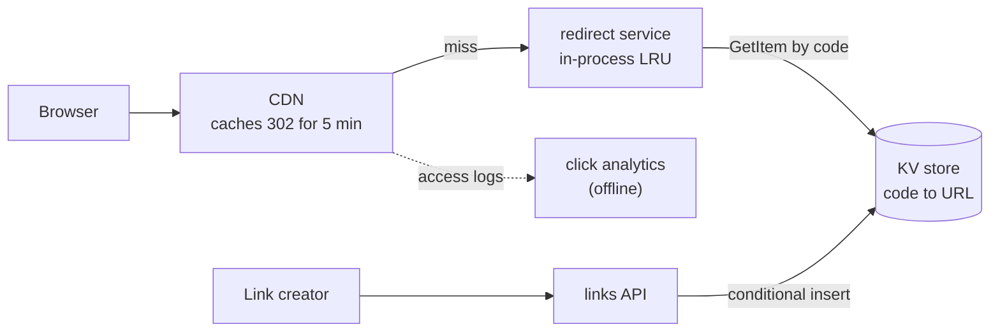
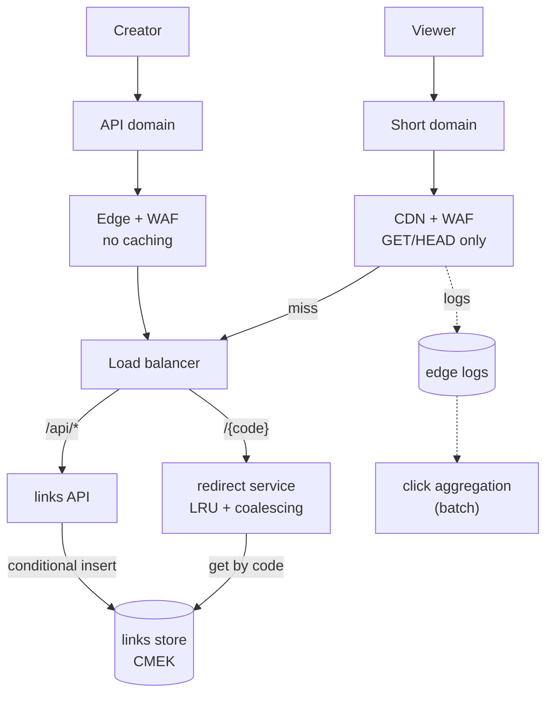

# URL shortener / key-value lookup

This walkthrough follows the [interview framework](00-primer.md#interview-framework),
the [estimation cheat sheet](00-primer.md#estimation-cheat-sheet) and the
[conventions](00-primer.md#conventions). It is the classic read-heavy
key-value question: one tiny write, then thousands of reads of the same key.

## The question

> "Design a URL shortener like bit.ly. A user submits a long URL and gets a
> short one back. Anyone who opens the short URL is redirected to the long one.
> It has to handle a lot of traffic."

Common variants: "How do you generate codes, and what if two collide?", "One
link goes viral at 50,000 clicks a second: what breaks?", and "301 or 302?"

## The two-minute answer

Two paths with very different shapes. The **write path** is a small API that
validates the long URL, draws a **random 7-character base62 code** from a
cryptographic source, and stores it with a **conditional insert** that fails if
the code exists, retrying on the rare collision. The **read path** is a
stateless redirect service that looks the code up in a **key-value store**
partitioned by code and answers **302 with `Cache-Control: s-maxage=300`**, so
the **CDN** absorbs repeat clicks while a link can still be edited or taken
down within minutes. Each redirect instance also keeps an **in-process cache
with request coalescing**, so a viral link costs the store about one read per
instance per minute: a single key lives on a single partition, which has a hard
read ceiling. Random codes spread evenly and cannot be enumerated. Clicks are
counted from edge logs, never written per redirect. On AWS this is CloudFront, ECS on Fargate and DynamoDB; on GCP it is
Cloud CDN, Cloud Run and Firestore.



## Clarify the requirements

Questions to ask, with the answers assumed here:

| Question | Assumed answer |
|---|---|
| Scale? | 10 million new links a day; 1 billion redirects a day. Peak 3× average. |
| Custom aliases? | Yes, for signed-in users, 4–30 characters. |
| Expiry? | Optional per link; default never. |
| Can a link be edited or taken down? | Yes. Abuse takedowns must stop redirects within 5 minutes. |
| Analytics? | Click counts per link, approximate, visible within an hour. |
| Same long URL twice? | Two short links, each with its own owner, expiry and stats. |
| Retention? | 5 years. |
| Regions? | One region, multi-AZ, behind a global CDN. Multi-region is the active-active walkthrough. |

Non-functional:

- Redirect p99 under 50 ms at the origin and 99.99% available; link creation
  99.9%.
- A created link resolves immediately for its creator: read-your-writes.
- Codes must not be guessable in sequence: a private link must not be one
  increment away from a public one.

## Back-of-envelope estimates

Arithmetic uses the primer's [QPS conversions](00-primer.md#qps-conversions).

**Writes.** 10 million a day is about 116 a second; at 3× peak, **350 creates
a second**.

**Reads.** 1 billion a day is about 11,600 a second; at 3× peak, **35,000
redirects a second**. A viral link adds a single key at **50,000 a second** for
minutes. The read-to-write ratio is 100:1.

**Storage.** A record (code, a 200-byte average URL, owner, timestamps, status,
overhead) is about 500 bytes. 10 million a day × 365 × 5 years = 18.25 billion
links × 500 B ≈ **9.1 TB**. A keys-only
owner index adds about 135 B per item (keys plus 100 B of index overhead,
[AWS docs](https://docs.aws.amazon.com/amazondynamodb/latest/developerguide/GSI.html),
checked 2026-11), about **2.5 TB** more. Every item is under 1 KB, so each
write is one write unit.

**Code space.** 62⁷ ≈ 3.52 × 10¹². After 5 years, 18.25 billion codes fill
0.52% of it, so a random draw collides with probability 0.0052 at worst. Without
the conditional insert, the birthday bound makes silent overwrites certain:
n²/2S = (1.8 × 10¹⁰)² / (7 × 10¹²) ≈ 5 × 10⁷ expected colliding pairs. **This
number is why the insert must be conditional.** The collision rate reaches 5%
at 176 billion codes, 48 years away at this rate.

**Bandwidth.** 35,000 redirects × about 400 B of headers = 14 MB/s. Not the
constraint.

**Origin compute.** Plan **1,000 redirects a second per 1-vCPU instance**, a
conservative point inside the primer's
[folk rule](00-primer.md#throughput-per-instance-and-per-partition)
(**verify before relying on** it with a load test).

| Case | Origin load at peak | Instances needed | With one of three zones lost |
|---|---|---|---|
| CDN warm (assume 60% edge hit ratio; **verify before relying on** it with your own logs) | 35,000 × 0.4 = 14,000/s | 14 | 7 per zone across 2 zones, so **21** in total |
| CDN cold (new distribution, purge, edge outage) | 35,000/s | 35 | 18 per zone across 2 zones, so **54** in total |

So: **minimum 21 instances, maximum 60** (54 plus headroom). The minimum
carries a warm peak after losing a zone with no rescheduling; the maximum
carries a cold peak after losing a zone. Little's law gives only 140 requests in
flight (14,000/s × 10 ms), so CPU sets the count.

**Store reads.** Assume the in-process cache catches half the origin traffic
(**verify before relying on** it). Warm: 14,000 × 0.5 = **7,000 reads a
second**. Worst case, a deploy empties every in-process cache while the CDN is
cold: **35,000 reads a second**. On DynamoDB an eventually consistent read of
an item up to 4 KB costs half a read unit
([AWS docs](https://docs.aws.amazon.com/amazondynamodb/latest/developerguide/on-demand-capacity-mode.html),
checked 2026-11). If 5% of requests are for unknown codes, each costing an
eventually consistent read plus a strongly consistent retry (1.5 units), the
worst case is 33,250 × 0.5 + 1,750 × 1.5 ≈ **19,250 read units a second**.

That is under the 40,000-per-table default quota
([AWS docs](https://docs.aws.amazon.com/amazondynamodb/latest/developerguide/ServiceQuotas.html),
checked 2026-11), but above what a **new** on-demand table serves at once:
4,000 writes and 12,000 reads a second, then up to double its previous peak
([AWS docs](https://docs.aws.amazon.com/amazondynamodb/latest/developerguide/on-demand-capacity-mode.html),
checked 2026-11). So the table is **pre-warmed** to 20,000 read units.

**Store writes: count every path.**

| Write path | Units each | Peak rate | Write units/s |
|---|---|---|---|
| Create with idempotency key: a two-item transaction, 2 units per item ([AWS docs](https://docs.aws.amazon.com/amazondynamodb/latest/developerguide/transaction-apis.html), checked 2026-11) | 4 | 350 | 1,400 |
| Owner-index entry for each new link ([AWS docs](https://docs.aws.amazon.com/amazondynamodb/latest/developerguide/GSI.html), checked 2026-11) | 1 | 350 | 350 |
| Collision retries: a canceled transaction still consumes its units ([AWS docs](https://docs.aws.amazon.com/amazondynamodb/latest/developerguide/transaction-apis.html), checked 2026-11) | 4 | 2 (0.52% of 350) | 8 |
| User edits, disables and deletes, plus their index entries | 2 | 20 | 40 |
| TTL expiry: free on the table ([AWS docs](https://docs.aws.amazon.com/amazondynamodb/latest/developerguide/howitworks-ttl.html), checked 2026-11); index removals counted as 1 to be safe | 1 | 25 | 25 |
| **Per-click counters** | — | **0: never written** | 0 |
| **Total** | | | **about 1,825** |

That fits inside a new table's 4,000 writes a second. The row that is not
there matters most: a click counter on the link item would add 35,000 writes a
second, and 50,000 a second on one viral item, against a per-partition ceiling
of 1,000 write units
([Throughput per partition](00-primer.md#throughput-per-instance-and-per-partition)).

## API and data model

### Endpoints

| Method and path | Purpose | Notes |
|---|---|---|
| `POST /api/links` | Create a link | Body `{url, alias?, expires_at?}`; header `Idempotency-Key`. Returns `201 {code, short_url}`, `200` on a replay, `409` if the alias is taken. |
| `GET /api/links?cursor=` | List my links | Owner index, newest first. |
| `PATCH /api/links/{code}` | Change destination, expiry or status | Owner or abuse team only. |
| `GET /{code}` | Redirect | `302 Location: <url>`; `404` for unknown, expired or disabled. |

Codes match `^[0-9A-Za-z]{4,30}$`, so `/_health` and `/api/...` never collide
with a code; a reserved list (`api`, `admin`, offensive words) blocks the rest.

The redirect response:

```text
HTTP/1.1 302 Found
Location: https://example.com/a/very/long/path?with=params
Cache-Control: public, max-age=0, s-maxage=300
```

`s-maxage` is for the CDN and `max-age=0` for the browser, so every click
reaches the edge and is logged. A link expiring sooner gets the seconds
remaining.

### Data model

One table or database, keyed by code. On DynamoDB the partition key is `pk`; on
Firestore it is the document ID in collection `links`.

| Attribute | DynamoDB type | Firestore type | Notes |
|---|---|---|---|
| `pk` / document ID | String | Document ID | The code. |
| `url` | String | String | The destination, up to 2,048 characters. |
| `owner` | String | String | Owner index partition key. |
| `created_at` | Number (epoch ms) | Timestamp | Owner index sort key. |
| `expires_at` / `expire_at` | **Number, epoch seconds** | **Timestamp** | The TTL attribute. DynamoDB ignores a TTL attribute that is not a Number in epoch seconds ([AWS docs](https://docs.aws.amazon.com/amazondynamodb/latest/developerguide/howitworks-ttl.html), checked 2026-11); Firestore needs a date-and-time value ([Google Cloud docs](https://docs.cloud.google.com/firestore/native/docs/ttl), checked 2026-11). |
| `status` | String | String | `active` or `disabled`. |

Idempotency records live beside the links: DynamoDB items with `pk =
"idem#<owner>#<key>"`, or Firestore documents in collection `idempotency`. They
hold the code, a request-body hash and a 24-hour expiry, and no `owner`, so
they stay out of the owner index.

**Access patterns:** get by code (every redirect), conditional insert by code
(every create), list by owner, newest first, and update by code (edits and
takedowns). No scans, no joins.

## High-level design



### Read path: a redirect

1. The viewer opens `https://s.example/Ab3xY9q`. The CDN keys its cache on the
   path alone, so tracking parameters and cookies do not split the cache.
2. **Edge hit:** the CDN returns the cached 302. **Edge miss:** the load
   balancer routes `/*` to the redirect service.
3. The service checks its in-process LRU. On a miss, a **single-flight** guard
   sends one request per code per instance to the store; concurrent requests
   for that code wait for its result.
4. It reads with an eventually consistent `GetItem`. If nothing comes back, it
   retries once strongly consistent before answering 404: read-your-writes for
   the creator, at extra cost only on misses.
5. It returns the 302, or a 404 with `s-maxage=30`, and caches the item in
   process for 60 seconds, or a miss for 5 seconds.

### Write path: creating a link

1. The links API authenticates the caller and applies a per-owner limit of 200
   creates a second (see [Sharding and hot keys](#sharding-and-hot-keys)).
2. It validates the URL: `http(s)`, at most 2,048 characters, not blocklisted,
   not the short domain itself.
3. It draws a code and writes the link and its idempotency record in **one
   conditional transaction** (pseudo-code under [ID generation](#id-generation)).
4. It returns 201. An asynchronous malware scan of the destination can set
   `status = disabled`.

### Takedown path

An abuse report sets `status = disabled` with a conditional update (check
that it matched one item), then invalidates the code's path on the CDN. Without invalidation the worst case is
the 5-minute `s-maxage` plus the 60-second in-process TTL. CloudFront's first
1,000 invalidation paths a month are free
([AWS docs](https://docs.aws.amazon.com/AmazonCloudFront/latest/DeveloperGuide/PayingForInvalidation.html),
checked 2026-11), so the short TTL is the main control and invalidation is for
urgent cases.

## Deep dives

### ID generation

| Approach | How | Strength | Why not |
|---|---|---|---|
| Hash of the URL | SHA-256, base62, truncated to 7 | Same URL, same code | Truncation collides anyway, so you still need a check; merges users' links, breaking per-owner expiry and stats. |
| Global counter + base62 | One sequence (`INCR`) | No collisions, shortest codes | Enumerable (`Ab3xY9q` + 1 is someone else's link); a single point of failure; hotspots range-partitioned stores. |
| Counter ranges + scramble | Instances lease 1,000 IDs, then apply a keyed permutation | No collisions, not trivially enumerable | Aliases still need a conditional insert, plus a counter and a permutation secret. |
| Snowflake-style 64-bit IDs | Timestamp + worker + sequence | No coordination | 11 characters, time-ordered, so range hotspots. |
| **Random + conditional insert** | 7 symbols from a CSPRNG; insert only if free | Not enumerable, no coordination, uniform spread | A retry on 0.5% of creates at worst. |

**Why random wins.** Aliases already need "insert only if free", so random
codes add no component, and collisions stay under 1% for 5 years. Random codes are uniform, so they suit
hash-partitioned and range-partitioned stores alike; Firestore explicitly warns
that monotonically increasing IDs cause hotspots
([Google Cloud docs](https://docs.cloud.google.com/firestore/native/docs/best-practices),
checked 2026-11).

**Drawing a code without bias.** Read random bytes and keep only values below
248, which is 4 × 62. Map each kept byte to `byte % 62`. A plain `byte % 62` on
all 256 values over-weights the first 8 symbols.

**Create, DynamoDB version.** The duplicate handling uses the per-action
cancellation reasons that DynamoDB returns in request order
([AWS docs](https://docs.aws.amazon.com/amazondynamodb/latest/developerguide/transaction-apis.html),
checked 2026-11):

```text
create_link(owner, url, idem_key, alias = null, expires_at = null):
  idem_pk = "idem#" + owner + "#" + idem_key
  for attempt in 1..5:
    code = alias if alias != null else random_code(7)
    try:
      TransactWriteItems([
        Put(links, {pk: code, url, owner, created_at: now_ms(), expires_at, status: "active"},
            ConditionExpression: "attribute_not_exists(pk)"),
        Put(links, {pk: idem_pk, code, body_hash: sha256(url, alias, expires_at),
                    expires_at: now_s() + 86400},
            ConditionExpression: "attribute_not_exists(pk) OR expires_at < :now_s"),
      ])
      return 201, code
    except TransactionCanceledException as e:
      reasons = e.CancellationReasons            # [link put, idempotency put]
      if reasons[1].Code == "ConditionalCheckFailed":
        prior = GetItem(links, idem_pk, ConsistentRead: true)
        if prior.body_hash != sha256(url, alias, expires_at):
          return 422                             # key reused with a different body
        return 200, prior.code                   # replay: the first call succeeded
      if reasons[0].Code == "ConditionalCheckFailed":
        if alias != null: return 409             # alias taken
        continue                                 # random collision: draw again
      retry_with_backoff_or_fail()               # TransactionConflict, throttling
  return 503
```

Points that make it correct:

- The idempotency condition admits an **expired but not yet deleted** record,
  because TTL deletion can lag by days
  ([AWS docs](https://docs.aws.amazon.com/amazondynamodb/latest/developerguide/howitworks-ttl.html),
  checked 2026-11).
- The link condition does **not** admit an expired link. Codes are never
  reused, because a stale cached copy would send old clicks to a new owner.
- Without an `Idempotency-Key` it is one `PutItem` with
  `attribute_not_exists(pk)`.

**Firestore version.** A transaction reads `idempotency/<owner>:<key>` and
`links/<code>` first (Firestore transactions read before they write). An
unexpired idempotency document returns its code; an existing link means draw
again; otherwise write both. The client library retries on contention.

**Where it breaks.** Seven characters last 48 years at this rate but only 4.8
years at ×10, so code length is a config value that can grow to 8 without a
migration. If codes are printed and retyped, use base58 (no `0`, `O`, `I`, `l`).

### Cache tiers and CDN

| Tier | Holds | TTL | Invalidated by | Job |
|---|---|---|---|---|
| CDN edge | The 302 response | `s-maxage=300` | Expiry, or a path invalidation for takedowns | Absorb repeat clicks near the viewer. |
| In-process LRU per instance | Code to item, about 100,000 entries | 60 s; misses 5 s | Expiry only | Absorb the viral key and the cold-CDN case. |
| Store | Every link | Forever or `expires_at` | — | Source of truth. |

**301 or 302.** A 301 is heuristically cacheable: browsers may keep it with no
explicit freshness at all
([RFC 9110, section 15.4.2](https://www.rfc-editor.org/rfc/rfc9110.html#name-301-moved-permanently),
checked 2026-11). So a 301 cannot be revoked from browsers that saw it, and their
repeat clicks are never counted. A 302 is cached only with the freshness you
set.
307 works too, but CloudFront caches 307 and 308 only when the origin sends
`Cache-Control`
([AWS docs](https://docs.aws.amazon.com/AmazonCloudFront/latest/DeveloperGuide/http-3xx-status-codes.html),
checked 2026-11), so it gains nothing.

**Will the CDN cache it?**

- **CloudFront** caches 3xx responses according to the cache policy and the
  response headers
  ([AWS docs](https://docs.aws.amazon.com/AmazonCloudFront/latest/DeveloperGuide/http-3xx-status-codes.html),
  checked 2026-11). Avoid the managed `CachingOptimized` policy, whose minimum
  TTL of 1 second overrides `no-store`, and `UseOriginCacheControlHeaders`,
  which puts every cookie in the cache key
  ([AWS docs](https://docs.aws.amazon.com/AmazonCloudFront/latest/DeveloperGuide/using-managed-cache-policies.html),
  checked 2026-11). Use a custom policy with min and default TTL 0 and only the
  path in the key. 404s are cached for at least the 10-second default error
  caching minimum TTL
  ([AWS docs](https://docs.aws.amazon.com/AmazonCloudFront/latest/DeveloperGuide/HTTPStatusCodes.html),
  checked 2026-11), which blunts scanners.
- **Cloud CDN** caches 301, 302, 307, 308 and 404 when the response is to a
  `GET` and carries freshness information, uses `s-maxage` over `max-age`, and
  never caches a response with `Set-Cookie`
  ([Google Cloud docs](https://docs.cloud.google.com/cdn/docs/caching),
  checked 2026-11). `USE_ORIGIN_HEADERS` is the right cache mode. The default,
  `CACHE_ALL_STATIC`, also caches responses with valid directives; **verify
  before relying on** a 302 being cached there.

**Why not a shared cache tier (Redis or Valkey, DAX)?** A shared cache puts
the viral key on one shard, the same problem one level up.
DAX also cannot use a customer managed key
([AWS docs](https://docs.aws.amazon.com/amazondynamodb/latest/developerguide/encryption.usagenotes.html),
checked 2026-11), which conflicts with this landing zone's
[CMEK rule](00-primer.md#cmek-source). Add one only when measured store read
cost dominates the bill.

**Where it breaks.** An edit takes up to 6 minutes to show everywhere: the
price of the edge hit ratio. A full purge or new distribution is the cold-CDN
row in the estimates, so invalidate paths, never everything. A deploy empties
every LRU, so roll out in batches.

### Sharding and hot keys

**How the store shards.** DynamoDB hashes the partition key to place items, and
each partition serves at most 3,000 read units and 1,000 write units a second
([Throughput per partition](00-primer.md#throughput-per-instance-and-per-partition)).
Firestore splits by key **range**; random IDs spread there too, but it asks new
collections to start at 500 operations a
second and grow by 50% every 5 minutes, and it caps writes at 500 a second
when an index covers a sequentially increasing field
([Google Cloud docs](https://docs.cloud.google.com/firestore/native/docs/best-practices),
checked 2026-11). Three consequences:

- On Firestore, `created_at` and `expire_at` get **no single-field indexes**;
  "list my links" uses a composite `owner, created_at` index instead.
- On Firestore, launch is a **ramp**: from 500 to 35,000 operations a second
  at +50% every 5 minutes takes 11 steps, about 55 minutes.
- On DynamoDB, the launch control is **warm throughput**: pre-warm the table so
  it takes the cold-cache peak on day one
  ([AWS docs](https://docs.aws.amazon.com/amazondynamodb/latest/developerguide/warm-throughput.html),
  checked 2026-11).

**Read hot key: the viral link.** One code at 50,000 a second is one item on
one partition. At half a unit per eventually consistent read, a partition
serves 6,000 reads a second of one item, and adaptive capacity cannot split a
single item. **Unprotected, a viral link throttles at about 12% of its
demand.** The defence is layered:

1. The CDN serves it from the edge, so origin sees about one fetch per edge
   cache per 5 minutes.
2. In-process LRU plus single-flight means at most one store read per instance
   per 60 seconds: 60 instances is 1 read a second.
3. Only if both are cold at once, for example a purge-all during a deploy,
   does the store see the burst. That is the runbook below.

Firestore documents no per-document read ceiling, only a warning against high
read rates to lexicographically close documents
([Google Cloud docs](https://docs.cloud.google.com/firestore/native/docs/best-practices),
checked 2026-11), so **verify before relying on** any number.

**Write hot keys.** By design there are none on link items. The one write-side
hot spot is the **owner index**. On DynamoDB, one owner's links share an index
partition, and if the index cannot absorb a write **the base-table write is
throttled too**
([AWS docs](https://docs.aws.amazon.com/amazondynamodb/latest/developerguide/GSI.html),
checked 2026-11). Hence the 200-a-second per-owner limit, well under the 1,000-unit
ceiling; a customer who needs more gets a sharded index key (`owner#0` to
`owner#9`, queried in parallel).

**Click analytics without hot writes.** Count clicks from edge logs in a batch
job keyed by code and minute. For real-time counts, aggregate in a stream and
write one row per code per minute, not 50,000 writes a second.

## Trade-offs to defend

| Decision | Chosen | Rejected | Why | What would change the answer |
|---|---|---|---|---|
| Code generation | Random 7-char base62 + conditional insert | Counter, hash, Snowflake | Not enumerable, no coordinator, uniform spread; aliases need the same check anyway. | Shortest possible codes at very high volume: counter ranges with a keyed permutation. |
| Redirect status | 302 with `s-maxage=300, max-age=0` | 301 | Revocable, countable, still edge-cached. | Links that never change and need no stats, such as internal docs. |
| Store | DynamoDB / Firestore | Relational primary; Bigtable | Single-key lookups at this rate with no sharding work. | 100+ TB with scans: Bigtable. Rich querying: relational plus this KV. |
| Cache tiers | CDN + in-process LRU | Shared Redis or Valkey, DAX | The in-process tier solves the hot key; a shared tier moves it. DAX has no CMK. | Store read cost dominates at ×10. |
| Read consistency | Eventual, then strong on a miss | Always strong | Half the cost on the 95% path; read-your-writes kept. | A store whose reads are strong by default (Firestore): just read. |
| Analytics | Edge logs, batch | Counter per click | Per-click writes are the hottest key in the system. | Real-time counts: stream aggregation per minute. |
| Expiry | Store TTL + check on read | TTL alone | TTL deletion lags hours to days. | Nothing: the read-time check is always required. |

## Failure modes and scaling limits

**At ×10 (350,000 redirects a second, 3,500 creates a second):**

- **Store reads fail first, in the cold case.** About 190,000 read units a
  second, well over the 40,000-per-table default. Raise the quota, pre-warm,
  and add a shared cache only if measurement shows it pays.
- **Origin instances.** The cold-CDN-plus-zone-loss case needs about 540 vCPU;
  **verify before relying on** your account's Fargate or Cloud Run quotas.
- **Code space.** 182 billion codes in 5 years puts collisions at 5%. Move to
  8 characters (62⁸ ≈ 2.2 × 10¹⁴).
- **Writes** reach about 18,000 units a second: under the table quota but past
  a new table's 4,000, so pre-warm writes too.

**At ×100:** split the keyspace into **cells** by code prefix, each with its
own store and fleet, and go multi-region with a code prefix per region so two
regions never mint the same code.

**Blast radius by component:**

| Component | If it fails | Blast radius |
|---|---|---|
| CDN | Every request goes to origin | Origin sized for it (the cold row); latency rises. |
| Redirect service | 5xx on edge misses | Cached links keep working for up to 5 minutes. |
| Store throttling | Edge misses fail | Unpopular and new links first; viral links are cached. |
| Store or key unavailable | All edge misses fail | All but cached links. On DynamoDB a disabled CMK makes the table inaccessible ([AWS docs](https://docs.aws.amazon.com/amazondynamodb/latest/developerguide/encryption.howitworks.html), checked 2026-11). |

## AWS and GCP mapping

| Component | AWS | GCP | Difference that matters |
|---|---|---|---|
| Edge cache | CloudFront, custom cache policy | Cloud CDN on the external Application Load Balancer | CloudFront honours `s-maxage` through the policy; Cloud CDN through its cache mode. |
| Origin to private compute | CloudFront VPC origin to an internal ALB | Serverless NEG to Cloud Run with internal-and-load-balancer ingress | No public origin on either. |
| Redirect and API runtime | ECS on Fargate | Cloud Run | Cloud Run spreads instances across zones for you ([Google Cloud blog](https://cloud.google.com/blog/topics/developers-practitioners/how-to-build-highly-available-multi-regional-services-with-cloud-run), checked 2026-11). |
| Key-value store | DynamoDB, on demand | Firestore Native, Standard edition | Hash partitions and pre-warming versus range splits and a 500/50/5 ramp. Firestore reads are strong by default: no retry on a miss. |
| TTL attribute | Number, epoch seconds; deleted within a few days; free | Timestamp; typically deleted within 24 hours; billed as a delete ([Google Cloud docs](https://docs.cloud.google.com/firestore/native/docs/ttl), checked 2026-11) | Check expiry on read on both. |
| CMEK | Can be switched on an existing table | Only at database creation ([Google Cloud docs](https://docs.cloud.google.com/firestore/native/docs/cmek), checked 2026-11) | Get the Firestore key right on day one. |
| Per-store access control | IAM on the table ARN | Project-level role with an IAM condition on the database name ([Google Cloud docs](https://docs.cloud.google.com/firestore/native/docs/manage-databases), checked 2026-11) | Without the condition, a Firestore role covers every database in the project. |

## Build it here

### Where it lives

| Part | AWS | GCP |
|---|---|---|
| redirect and links-api services | `aws-workload-<env>` (`envs/aws/workload`) through app-services | `gcp-workload-<env>` (`envs/gcp/workload`) through app-services in the environment stage |
| Edge | A second `edge-security` instance for the short domain, beside the root's existing `app_edge` | `gcp.workload.public_ingress` with `enable_cdn` |
| Links store | Raw DynamoDB table in `envs/aws/workload` | Raw Firestore database in `envs/gcp/workload`, in the host project |
| Apply order | `aws-organization` → … → `aws-network` → `aws-workload-<env>` | `gcp-bootstrap` → `gcp-organization` → `gcp-projects` → `gcp-network-hub` → `gcp-workload-<env>` |

Per [VPC-tier placement](00-primer.md#vpc-tier-placement), services sit in
`private`; the serverless store is in no tier. On AWS the spoke's DynamoDB **gateway endpoint** keeps table
traffic off the Transit Gateway and the inspection firewall
([`modules/aws/stages/workload/main.tf:120`](../../modules/aws/stages/workload/main.tf)).
On GCP, Cloud Run with the default `PRIVATE_RANGES_ONLY` egress reaches
Firestore over Google's network, not through the VPC or Cloud NAT.

### Config

```yaml
# Illustrative. Keys are real (config/landing-zone.schema.json); values are placeholders.
aws:
  workload:
    app_ingress_mode: cloudfront_vpc_origin # internal ALB behind a CloudFront VPC origin
  workload_environments:
    prod:
      services:
        redirect:
          path_patterns: ["/*"]
          priority: 999 # evaluated last: everything that is not /api/*
          health_check_path: /_health # "_" is outside the code alphabet
          enable_autoscaling: true
          autoscaling_min_capacity: 21 # warm peak with one AZ lost
          autoscaling_max_capacity: 60 # cold-CDN peak with one AZ lost
          task_role_policy_json: >-
            {"Version":"2012-10-17","Statement":[
            {"Effect":"Allow","Action":"dynamodb:GetItem","Resource":"arn:aws:dynamodb:REGION:ACCOUNT_ID:table/prod-links"},
            {"Effect":"Allow","Action":["kms:Decrypt","kms:DescribeKey"],"Resource":"WORKLOAD_KMS_KEY_ARN",
             "Condition":{"StringEquals":{"kms:ViaService":"dynamodb.REGION.amazonaws.com"}}}]}
        links-api:
          path_patterns: ["/api/*"]
          priority: 10
          health_check_path: /api/_health # task role: as redirect, plus PutItem, UpdateItem, Query on table and index
gcp:
  environments:
    prod:
      services:
        redirect: { min_instances: 21, max_instances: 60 }
  workload:
    public_ingress:
      prod:
        redirect: { domains: [s.example.com], enable_cdn: true }
        links-api: { domains: [links.example.com] }
```

Notes on the grants:

- **KMS for callers.** DynamoDB decrypts with the table key on behalf of the
  principal accessing the table, so that principal needs `kms:Decrypt` on the
  CMK ([AWS docs](https://docs.aws.amazon.com/amazondynamodb/latest/developerguide/encryption.usagenotes.html),
  checked 2026-11). The workload key policy delegates to account IAM, so the
  task-role statements are enough; `kms:ViaService` stops the roles using the
  key directly. Transactions need only `PutItem`; there is no separate
  transaction permission.
- **GCP.** Exposed services switch to load-balancer ingress with
  unauthenticated invocation
  ([`envs/gcp/workload/variables.tf`](../../envs/gcp/workload/variables.tf));
  Firestore grants are raw, below.

Gaps in the golden path that this design hits:

- **One cache policy per distribution.** `envs/aws/workload` pins the shared
  `app_edge` to `CachingDisabled`; switching it would start edge-caching any
  other service that sends `Cache-Control`. So the short domain gets its own
  distribution.
- **No CDN policy input on GCP.** `app-ingress` exposes `enable_cdn` but no
  cache mode or cache key policy, so Cloud CDN uses its defaults and query
  strings stay in the cache key.
- **No edge access logs.** `edge-security` configures WAF logs but not
  CloudFront access logs, which the click pipeline needs.

### AWS: the links table, cache policy and short-domain edge

In `envs/aws/workload`, using `local.environment`, `local.kms_key_arn`,
`local.app_vpc_origin` and `module.app_services`. Arguments checked against aws
v6.72.0
([`aws_dynamodb_table`](https://registry.terraform.io/providers/hashicorp/aws/6.72.0/docs/resources/dynamodb_table),
[`aws_cloudfront_cache_policy`](https://registry.terraform.io/providers/hashicorp/aws/6.72.0/docs/resources/cloudfront_cache_policy),
checked 2026-11). The GSI uses `key_schema`, because `hash_key` inside a GSI is
deprecated in 6.x.

```hcl
# Gap: the repo has no DynamoDB module; raw resources in the landing zone's conventions.
resource "aws_dynamodb_table" "links" {
  name                        = "${local.environment}-links" # <env>-<component>
  billing_mode                = "PAY_PER_REQUEST"
  hash_key                    = "pk"
  deletion_protection_enabled = true

  attribute {
    name = "pk"
    type = "S"
  }
  attribute {
    name = "owner"
    type = "S"
  }
  attribute {
    name = "created_at"
    type = "N"
  }

  global_secondary_index {
    name            = "by-owner"
    projection_type = "KEYS_ONLY"
    key_schema {
      attribute_name = "owner"
      key_type       = "HASH"
    }
    key_schema {
      attribute_name = "created_at"
      key_type       = "RANGE"
    }
  }

  ttl {
    enabled        = true
    attribute_name = "expires_at" # Number, epoch seconds
  }
  server_side_encryption {
    enabled     = true
    kms_key_arn = local.kms_key_arn # workload CMK
  }
  warm_throughput {
    read_units_per_second  = 20000 # cold-cache peak, about 19,250 read units
    write_units_per_second = 4000
  }

  tags = { Service = "links" } # default_tags add the rest
}

# Gap: edge-security takes a cache policy ID but creates none.
resource "aws_cloudfront_cache_policy" "short_redirects" {
  provider    = aws.us_east_1
  name        = "${local.environment}-short-redirects"
  min_ttl     = 0 # honour no-store
  default_ttl = 0 # cache nothing without explicit freshness
  max_ttl     = 3600

  parameters_in_cache_key_and_forwarded_to_origin {
    cookies_config {
      cookie_behavior = "none"
    }
    headers_config {
      header_behavior = "none"
    }
    query_strings_config {
      query_string_behavior = "none" # utm_* must not split the cache
    }
  }
}

module "short_edge" {
  source = "../../../modules/aws/security/edge-security"
  count  = local.apps_enabled && local.app_vpc_origin ? 1 : 0 # mirrors app_edge

  providers = {
    aws           = aws
    aws.us_east_1 = aws.us_east_1
  }

  name_prefix        = "${local.environment}-short"
  enable_edge        = local.app_vpc_origin
  enable_vpc_origin  = local.app_vpc_origin
  vpc_origin_arn     = local.app_vpc_origin ? module.app_services.alb_arn : ""
  origin_domain_name = module.app_services.alb_dns_name
  domain_name        = "s.example.com" # placeholder short domain
  allowed_methods    = ["GET", "HEAD"] # redirects only; the API stays on app_edge
  cache_policy_id    = aws_cloudfront_cache_policy.short_redirects.id
  tags               = { Service = "redirect" }
}
```

Notes:

- With no origin request policy CloudFront forwards only the path, so the API
  is unusable through the short domain.
- A second VPC origin on the same ALB as `app_edge` is assumed to be allowed;
  **verify before relying on** it.
- Add `ReadThrottleEvents` and `WriteThrottleEvents` alarms on the table and
  index; app-services does not create them.

### GCP: the Firestore database, key, indexes and grants

In `envs/gcp/workload`, using `local.env_config`, `local.project_prefix`,
`local.labels`, `var.environment` and `module.environment`. A regional
Firestore database needs its key ring and key in the same location
([Google Cloud docs](https://docs.cloud.google.com/firestore/native/docs/use-cmek),
checked 2026-11), so both use `local.env_config.region`. Arguments checked
against google v8.10.0
([`google_firestore_database`](https://registry.terraform.io/providers/hashicorp/google/8.10.0/docs/resources/firestore_database),
[`google_firestore_field`](https://registry.terraform.io/providers/hashicorp/google/8.10.0/docs/resources/firestore_field),
checked 2026-11).

```hcl
# Gap: no per-environment workload CMEK exists yet (see CMEK source).
module "workload_cmek" {
  source       = "../../../modules/gcp/governance/kms"
  project_id   = local.env_config.host_project_id
  keyring_name = "${local.project_prefix}-${var.environment}-cmek"
  location     = local.env_config.region
  labels       = local.labels
  keys = {
    "firestore" = {
      encrypter_decrypters = ["serviceAccount:service-${local.env_config.host_project_number}@gcp-sa-firestore.iam.gserviceaccount.com"]
    }
  }
}

# Gap: the repo has no Firestore module; raw resources in the landing zone's conventions.
resource "google_firestore_database" "links" {
  project                           = local.env_config.host_project_id
  name                              = "links"
  location_id                       = local.env_config.region
  type                              = "FIRESTORE_NATIVE"
  database_edition                  = "STANDARD"
  point_in_time_recovery_enablement = "POINT_IN_TIME_RECOVERY_ENABLED"
  delete_protection_state           = "DELETE_PROTECTION_ENABLED"
  deletion_policy                   = "PREVENT"

  cmek_config {
    kms_key_name = module.workload_cmek.key_ids["firestore"] # only settable at creation
  }
}

resource "google_firestore_field" "links_expire_at" {
  project    = local.env_config.host_project_id
  database   = google_firestore_database.links.name
  collection = "links"
  field      = "expire_at"
  index_config {} # no single-field index: avoids the 500 writes/s sequential cap
  ttl_config {}   # TTL on a Timestamp field
}

# Firestore has no database-level IAM: grant on the project, conditioned on this database.
resource "google_project_iam_member" "links_firestore" {
  for_each = { "redirect" = "roles/datastore.viewer", "links-api" = "roles/datastore.user" }
  project  = local.env_config.host_project_id
  role     = each.value
  member   = "serviceAccount:${module.environment.app_services[each.key].runtime_service_account}"

  condition {
    title      = "links-db-only"
    expression = "resource.name == \"projects/${local.env_config.host_project_id}/databases/links\""
  }
}
```

Notes:

- **Prerequisites outside this snippet.** Enable `firestore.googleapis.com` on
  the host project (gap: it is not in the host project's API list; adding it
  through `gcp-projects` avoids giving the workload identity service-enable
  rights, which is **verify before relying on**). Create the Firestore service
  agent once per host project with
  `gcloud beta services identity create --service=firestore.googleapis.com`,
  because `google_project_service_identity` is google-beta only. The CMEK guide
  also says to request access to the feature first; **verify before relying
  on** that still being required
  ([Google Cloud docs](https://docs.cloud.google.com/firestore/native/docs/use-cmek),
  checked 2026-11).
- `google_firestore_database` takes no labels, so `default_labels` do not reach
  it. Omitted for length: the same `google_firestore_field` for
  `idempotency/expire_at`, one with only `index_config {}` for
  `links/created_at`, and the composite index `owner ASC, created_at DESC` (a
  `google_firestore_index`).
- The console does not enforce the `resource.name` condition; client libraries
  do.

## Runbook

### Redirect errors: the store is throttling

**Detection signal.** Origin 5xx rate on redirect over 1% for 2 minutes:
the ALB target 5xx alarm from app-services or the Cloud Run error-ratio
alert. Corroborating: DynamoDB `ReadThrottleEvents` above zero, or
`RESOURCE_EXHAUSTED` and `DEADLINE_EXCEEDED` errors in the redirect service's
logs on GCP. Edge 5xx rises only for links that are not cached.

**Triage.**

1. **One key or many?** CloudWatch Contributor Insights on the table, or Key
   Visualizer on GCP, lists the most-accessed keys. One key at thousands of
   reads a second got past both cache tiers.
2. **Why did it get past?** Look for a recent deploy (every LRU empty), a CDN
   purge, or a change that disabled single-flight or added a header to the
   cache key. Compare the edge hit ratio with yesterday's.
3. **Capacity, not a key?** Many keys throttled at once, with consumed read
   units near the warm-throughput or table quota, is a cold-start surge. On
   Firestore, check whether traffic grew faster than 50% per 5 minutes.
4. **The encryption key?** `KMSAccessDeniedException` or
   `KMSDisabledException` on AWS, `FAILED_PRECONDITION` on GCP, means a key or
   grant change, not load.

**Mitigation.**

1. **Hot key:** restart nothing (a restart empties the LRU). Raise the code's
   `s-maxage` with a per-code override if the service supports one.
2. **Deploy-caused:** pause the rollout or roll back the task definition or
   revision; the surviving warm instances absorb traffic.
3. **Cold-start surge:** raise warm throughput on DynamoDB (it applies without
   downtime). On Firestore, shed load to the CDN by serving the last known
   redirect from the LRU with a longer `s-maxage`.
4. **Key problem:** revert the KMS change through the owning workspace in
   Terraform Cloud, not the console. A DynamoDB table whose key stays
   inaccessible for 7 days is archived
   ([AWS docs](https://docs.aws.amazon.com/amazondynamodb/latest/developerguide/encryption.howitworks.html),
   checked 2026-11).

**Verification.** Throttle events at zero for 15 minutes, origin 5xx under
0.1%, edge hit ratio back to normal.

**Follow-up.** Load-test one key at 50,000 a second with the CDN bypassed and
confirm about one store read per instance a minute. Add a synthetic
create-and-redirect check every minute.
Make batched rollouts the default.

## Study aids

### Numbers to memorise

| Fact | Value |
|---|---|
| 62⁷ / 62⁸ | 3.5 × 10¹² / 2.2 × 10¹⁴ |
| DynamoDB partition | 3,000 read units, 1,000 write units a second; one item cannot exceed it |
| DynamoDB new on-demand table | 4,000 writes and 12,000 reads a second, then 2× previous peak |
| DynamoDB transaction | 2 units per item, charged even when canceled |
| Firestore launch ramp | 500 ops/s, +50% every 5 minutes |
| Firestore sequential index cap | 500 writes/s |
| TTL | DynamoDB: Number epoch seconds, days of lag, free; Firestore: Timestamp, ~24 h, billed |

### Likely follow-ups

- **"Why not hash the URL?"** Truncated hashes collide anyway, so you still
  need the check, and merging users' links breaks per-owner settings.
- **"Why not a counter?"** Enumerable codes and a single point of failure. If
  short codes are worth it, lease ranges and scramble with a keyed permutation.
- **"How do you take down a link?"** Disable it, then invalidate its path. The
  short TTL bounds the worst case at about 6 minutes.
- **"Go multi-region."** Replicate the store (DynamoDB global tables or a
  Firestore multi-region location), and give each region its own code prefix
  so concurrent creates cannot collide.

### Classic mistakes

- A 301, then discovering you cannot revoke or count.
- An unconditional `PutItem`, or a "check then insert" race.
- A click counter on the link item, or store TTL as the expiry check.
- Cookies or query strings in the cache key; origin sized only for a warm CDN.

For the service equivalents behind this design, see the primer's
[service map](00-primer.md#aws-gcp-service-map).
