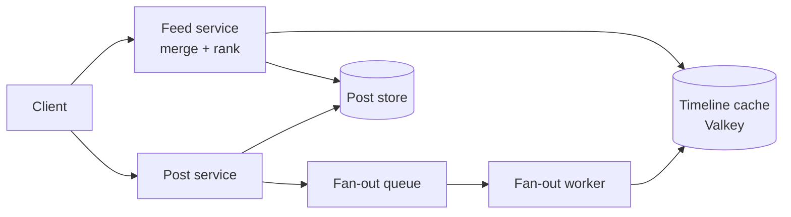
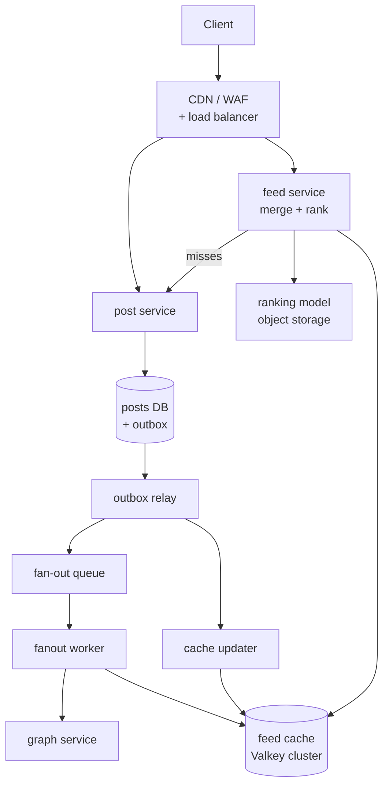

# News feed / timeline

Part of the [system design library](README.md). The framework, the estimation
numbers and the landing-zone conventions live in the [primer](00-primer.md);
this walkthrough links to them rather than restating them.

## The question

> "Design the home timeline for a social network like Twitter or Instagram.
> Users follow other users, post short messages, and open the app to see a
> feed of posts from the people they follow."

Variants: "Design Facebook's News Feed" leans on ranking; "Design the Twitter
timeline" leans on fan-out; "How would you show a post from someone with 50
million followers?" is the hybrid deep dive on its own. A B2B activity feed is
the same shape at a smaller scale.

## The two-minute answer

A feed is a read-heavy problem. Reads outnumber posts by about 50 to 1, so the
work belongs on the write side. When someone posts, an asynchronous **fan-out
worker** pushes the post ID into a short, precomputed **home timeline** for
each active follower. The timeline is a capped sorted set in a sharded
Valkey cluster. Reading the feed is then a single range read plus a hydration
step that fetches post bodies from a post cache. This is **fan-out on write**.
It breaks for accounts with millions of followers, so the design is
**hybrid**. Authors above a follower threshold are not fanned out. Their recent
posts sit in one per-author list, and the feed service merges them in at read
time, which is **fan-out on read** for celebrities only. **Ranking** is a
second stage at read time: a lightweight model rescores a few hundred
candidates once per session and caches the ranked list. If the ranker fails,
the feed falls back to chronological order. **Caches hold IDs in lists and
truth in objects.** Edits and deletes change one versioned post object, and
hydration filters the result, so nothing has to chase a post through millions
of timelines. On both clouds this runs as stateless containers in a workload
account or project, with a relational post store and a managed Valkey cluster.



## Clarify the requirements

Questions to ask, with the answers this walkthrough assumes:

| Question | Assumption |
|---|---|
| How many users? | 200 million monthly active, 50 million daily active. |
| How much do they post and read? | 10 million posts a day. Each daily user opens the feed 10 times a day. |
| How many follows? | 150 followees on average. Follower counts are heavily skewed: a few accounts have millions. |
| Ranked or chronological? | Ranked by default, with a chronological fallback and a "latest" toggle. |
| How fresh? | A post appears in an active follower's feed within 5 seconds at p99. |
| Read latency? | First page in under 300 ms at p99, server-side. |
| Consistency? | Eventual for the feed. Read-your-own-writes for the author's own post. |
| Deletes and privacy? | A deleted or hidden post must never render after the delete returns. |
| Media? | Out of scope (see the [video walkthrough](09-video-upload-streaming.md)). |
| Social graph? | An existing graph service pages "followers of X" and "followees of Y". |
| Regions? | One region, three zones. |

Functional: publish, edit and delete a post; read the home feed with a
cursor; read an author's profile timeline. Non-functional: survive a zone loss
with no feed outage, and degrade rather than fail: a stale or chronological
feed beats an error page.

## Back-of-envelope estimates

Every number below follows from the assumptions above. The
[primer's cheat sheet](00-primer.md#estimation-cheat-sheet) holds the
conversions.

### Request rates

- **Posts.** 10 million a day ÷ 86,400 s ≈ 116/s; at a 3× peak, **350
  posts/s**.
- **Feed page reads.** 50 million × 10 = 500 million a day ≈ 5,800/s; at a 3×
  peak, **18,000/s**.
- **Ranked sessions.** About 3 sessions per user per day: 150 million a day
  ≈ 1,700/s, so **5,200/s** at peak. The ranker runs once per session, not per
  page (see [Ranking pipeline placement](#ranking-pipeline-placement)).

### Fan-out write amplification

- Push only to followers active in the last 7 days, assumed to be half of
  them: 150 × 0.5 = 75 timeline inserts per post.
- 10 million posts × 75 = 750 million inserts a day ≈ 8,700/s, so **26,000
  inserts/s** at peak.
- Without the celebrity cut, one post from a 50-million-follower account would
  be 25 million inserts, about 16 minutes of the whole system's peak insert
  budget. That is the case for the hybrid.

### Memory for the timeline cache

- A timeline holds the newest **120** entries. That keeps each sorted set in
  Valkey's compact listpack encoding, whose defaults are 128 entries and
  64-byte members; compact encodings use up to 10 times less memory
  ([Valkey docs](https://valkey.io/topics/memory-optimization/), checked
  2026-11). A larger set converts to a skiplist and costs several times more
  per entry.
- One entry is a 16-byte binary member (post ID and author ID), with the post
  timestamp as the score. Budget about 32 bytes per entry including listpack
  overhead (**verify before relying on**: measure with `MEMORY USAGE`).
- 120 × 32 B ≈ 3.8 KB, plus about 100 B of key overhead ≈ **4 KB per user**.
- Materialise timelines for users active in the last 7 days, assumed 80
  million: 80 M × 4 KB = **320 GB**.
- Add the post-object cache for 48 hours (20 M posts × 1 KB = 20 GB), ranked
  session lists (5,200/s × 600 s TTL = 3.1 M lists × 500 IDs × 8 B ≈ 12.5 GB),
  and celebrity author lists and followee sets (about 4 GB). The total is
  **about 360 GB**.

### Cluster sizing

- **AWS.** A `cache.r7g.2xlarge` node has 52.82 GiB
  ([AWS docs](https://docs.aws.amazon.com/AmazonElastiCache/latest/dg/CacheNodes.SupportedTypes.html),
  checked 2026-11). ElastiCache reserves 25% by default
  ([AWS docs](https://docs.aws.amazon.com/AmazonElastiCache/latest/dg/redis-memory-management.html),
  checked 2026-11), leaving about 39.6 GiB ≈ 42.5 GB of data per shard.
- **GCP.** A Memorystore for Valkey `highmem-xlarge` node has 46.4 GB of
  default writable keyspace, and the largest documented instance has 250
  primary nodes
  ([Google Cloud docs](https://docs.cloud.google.com/memorystore/docs/valkey/instance-node-specification),
  checked 2026-11).
- **Shard count.** Target at most 60% full: 360 GB ÷ 0.6 = 600 GB ÷ 42.5 GB ≈
  14.1, rounded up to **16 shards** with one replica each, 32 nodes. Each
  shard holds 22.5 GB: 53% of maxmemory on AWS, 48% of writable keyspace on
  GCP. ElastiCache allows 90 nodes per cluster by default
  ([AWS docs](https://docs.aws.amazon.com/AmazonElastiCache/latest/dg/quota-limits.html),
  checked 2026-11).
- **Operations per second at peak.**
  - Feed pages: 18,000 × (1 own range + 5 celebrity ranges +
    1 ranked-list read + 20 post reads) ≈ 486,000.
  - Fan-out: 26,000 × 3 (ZADD, trim, EXPIRE, pipelined) = 78,000.
  - Ranked-list writes and post-cache fills: about 6,000.
  - Total: about **570,000 ops/s**, or 36,000 per primary across 16, about a
    third of the primer's folk figure of 100,000 per shard (a rule of thumb:
    **verify before relying on**).
- **Zone loss.** Replicas sit in other zones, so a zone loss promotes them:
  16 primaries remain at unchanged load. Replica reads never count toward
  capacity.

### Compute and storage

- **Feed service.** At 18,000 pages/s and an assumed 300 pages/s per vCPU, it
  needs 60 vCPU. The ranker adds 5,200 sessions/s × 500 candidates × 20 µs =
  52 vCPU. Both per-vCPU figures are assumptions to load-test (**verify before
  relying on**). The total is **112 vCPU at peak**.
  - Run 48 tasks of 4 vCPU (192 vCPU), 16 per zone: 58% utilisation at peak.
  - After a zone loss, 32 tasks (128 vCPU) remain: 88%. Tight, but it holds
    while autoscaling replaces the lost tasks.
- **Post store.** 10 GB a day, about 3.65 TB a year. Partition posts by month:
  an Aurora PostgreSQL table caps at 32 TiB, and the cluster volume at 128 TiB
  for the module's default engine version 16.6 (256 TiB from 16.9)
  ([AWS docs](https://docs.aws.amazon.com/AmazonRDS/latest/AuroraUserGuide/CHAP_Limits.html),
  checked 2026-11). A dedicated-core Cloud SQL instance holds up to 64 TB
  ([Google Cloud docs](https://docs.cloud.google.com/sql/docs/quotas),
  checked 2026-11), about 17 years at this rate.
- **Post store reads.** Hydration asks for 18,000 × 20 = 360,000 posts/s. At a
  99% hit rate, 3,600/s reach the database as primary-key reads: one or two
  readers. A cold cache sends all 360,000: the [runbook](#runbook) scenario.
- **Post store writes.** An insert plus an outbox row per post: 700 rows/s.
- **Fan-out queue.** Messages chunked to 1,000 followers: about 700/s at peak,
  far inside SQS and Pub/Sub limits
  ([primer throughput table](00-primer.md#throughput-per-instance-and-per-partition)).

**What the numbers decide.** Reads dominate, so precompute. The cache
dominates cost, so cap timelines and materialise only active users. Writes are
small, so the golden-path relational store is enough.

## API and data model

### Endpoints

| Method and path | Purpose | Notes |
|---|---|---|
| `POST /v1/posts` | Publish | Idempotency key header; returns `post_id`. |
| `PATCH /v1/posts/{id}` | Edit | Body plus `expected_version`; returns the new version. |
| `DELETE /v1/posts/{id}` | Delete | Soft delete; the post never renders after this returns. |
| `GET /v1/feed?cursor=…&mode=ranked\|latest` | Home feed | 20 items per page; opaque cursor. |
| `GET /v1/users/{id}/posts?cursor=…` | Profile timeline | Served from the post store by `(author_id, post_id)`. |

The cursor encodes a session ID and offset (ranked) or the last `post_id`
(latest), never a page number, so new posts do not shift pages.

### Events

`PostCreated`, `PostUpdated` and `PostDeleted` go into a transactional outbox
(as in the [microservices walkthrough](03-microservices-sync-async.md#the-transactional-outbox)) with
`{event_id, post_id, author_id, version, created_at}`. The fan-out worker
consumes `PostCreated`; a cache updater consumes all three.

### Entities and access patterns

| Entity | Store | Key | Access pattern |
|---|---|---|---|
| `posts` | Aurora PostgreSQL or Cloud SQL | `post_id`; index `(author_id, post_id DESC)` | Hydration point reads; author ranges for profiles and rebuilds. |
| Home timeline | Valkey sorted set `tl:{user_id}` | Member: 16-byte `post_id‖author_id`; score: post timestamp | `ZREVRANGE 0 119`; `ZADD` and trim on fan-out. |
| Author list (celebrities) | Valkey sorted set `au:{author_id}` | Same shape | Merged at read time. |
| Post object | Valkey hash `post:{post_id}` | Fields `v` (version), `body`, `deleted` | Hydration; versioned writes. |
| Ranked session | Valkey string `rs:{session_id}` | Packed list of 500 IDs | Pages 2..n. |

`post_id` is Snowflake-style (timestamp high bits, then generator ID and
sequence), so ID order is time order with no coordination.

## High-level design



### Write path: publishing a post

1. `post` inserts the row and a `PostCreated` outbox row in one transaction,
   then writes the post object to the cache (a versioned write, below).
2. The relay publishes the event to the fan-out queue.
3. `fanout` checks the author's celebrity flag. If set, it adds the post to
   `au:{author_id}` and stops.
4. Otherwise it pages followers 1,000 at a time, drops those inactive for 7
   days, and per shard pipelines `ZADD tl:{u}`,
   `ZREMRANGEBYRANK tl:{u} 0 -121` (keep the newest 120) and
   `EXPIRE tl:{u} 691200` (8 days).
5. The author's own timeline is a fan-out target too, which gives
   read-your-own-writes across devices.

### Read path: opening the feed

1. `feed` reads `tl:{user}`. On a miss (a returning inactive user), `post`
   rebuilds it with one query over the user's followees.
2. It runs `ZREVRANGE` on `au:{author}` for up to 50 celebrity followees, by
   affinity.
3. It merges about 300–500 IDs, ranks them (or orders by time) and stores the
   result as `rs:{session}`.
4. It hydrates the first 20 from `post:{id}`, one pipeline per shard; misses
   go to `post`'s batch read on a database reader. Tombstoned posts are
   dropped and the next IDs fill the page.
5. Pages 2..n read the next 20 IDs from `rs:{session}`.

## Deep dives

### Fan-out on write vs on read, and the hybrid

| Approach | Write cost | Read cost | Breaks when |
|---|---|---|---|
| **Fan-out on read** (pull) | One insert | 150 followee range reads, merge, sort per page | 18,000 pages/s means 2.7 million author reads/s, recomputed every time. |
| **Fan-out on write** (push) | One insert per active follower | One range read | An author with millions of followers: one post is minutes of the cluster's insert budget, delivered late. |
| **Hybrid** (chosen) | Push for normal authors; one insert for celebrities | One range read plus about 5 celebrity ranges | A reader who follows thousands of celebrities. Cap the merge. |

**Why the hybrid wins.** Push cost scales with follower count, pull cost with
followee count, and follower graphs are heavy-tailed. Pushing for the many and
pulling for the few bounds both: 26,000 inserts/s at peak, instead of 25
million for one celebrity post.

**Choosing the threshold.** Set it on write amplification, not fame. "Above
10,000 active followers, do not push" bounds any post at 10 chunk messages and
10,000 inserts. Make it a per-author flag computed daily, with hysteresis so
an author near the line does not flip-flop. When an author crosses upward, the
read-side merge covers them at once, and their old pushed entries age out of
the 120-entry timelines.

**Active-only fan-out.** Users not seen in 7 days get no inserts. Their
timelines expire (8-day TTL), and the first read after they return rebuilds
one: an indexed query over `(author_id, post_id DESC)` for their 150
followees, about 260/s at peak if 5% of sessions are returning users. Always
pipeline inserts per shard, never one round trip per follower.

**Where it breaks.**

- During a live event `au:{author}` becomes a hot key; a 2–5 second
  in-process cache in `feed` absorbs it.
- A reader with 2,000 celebrity followees gets the top 50 by affinity; the
  rest appear through exploration slots or "latest" mode.
- Valkey cluster cannot `ZUNIONSTORE` across hash slots, and one hash tag for
  every author would make a hot shard. Merge in the application.

### Ranking pipeline placement

The question is not which model. It is **where in the pipeline ranking
runs**, because that sets latency, cost and freshness.

| Placement | How | Wins | Breaks |
|---|---|---|---|
| At write time, in fan-out | Store a ranking score as the sorted-set score | Free reads | Scores freeze at insert. Later engagement never re-orders the feed, and nothing depends on the reader's session. |
| At read time, per page | Score all candidates on every request | Freshest | 18,000 pages/s × 500 candidates = 9 million scorings/s inside the 300 ms budget. |
| **Two-stage, per session** (chosen) | Candidates from timelines plus celebrity lists; a light model scores them once per session; the ranked list is cached 10 minutes | 5,200 ranker calls/s instead of 18,000; stable pages within a session | Engagement during a session does not reorder it, which is acceptable. |

**The stages.**

1. **Candidate generation.** The hybrid fan-out: about 120 pushed IDs, the
   celebrity IDs, and a few exploration candidates. Cap at 500.
2. **Feature fetch.** Author affinity, post age, engagement counts and recent
   interactions, precomputed by a streaming job into `feat:` keys in the same
   cluster, fetched with one pipeline per shard.
3. **Scoring.** A gradient-boosted model in-process in `feed`, loaded from
   object storage at start-up and hot-swapped. No network hop; the cost is the
   52 vCPU in the estimates.
4. **Re-ranking rules.** At most 2 posts in a row per author, freshness
   boosts, policy filters (hidden, muted, blocked). Cache as `rs:{session}`.

**Training stays offline.** Impression and engagement logs land in the raw
zone ([data zones](00-primer.md#data-zones)); a daily job trains, validates
and shadow-scores the next model before promotion.

**The fallback is part of the design.** The ranker has a 50 ms budget. On a
timeout, a model load failure or a feature miss storm, `feed` returns the
candidates in chronological order and flags the response. A chronological
feed is a correct feed; game-day it.

**Where it breaks.** An out-of-process ranker (a GPU model behind SageMaker or
Vertex AI) moves the 50 ms budget onto the network and adds a dependency whose
outage you must absorb. Do that only when the model outgrows a CPU, and keep
the chronological fallback.

### Cache invalidation

Five caches can go stale: timelines, post objects, celebrity lists, ranked
session lists and followee sets. The rule that keeps this tractable:

> **IDs in lists, truth in objects.** Lists (timelines, author lists, ranked
> sessions) hold only IDs and may be stale. Every rendered post passes through
> its post object, the only place whose staleness matters, and the object is
> versioned.

**Edit.** Update the row and write an outbox event in one transaction. Zero
rows returned means not found, not the author, already deleted, or a stale
`expected_version`; the request fails and nothing is published:

```sql
BEGIN;
WITH upd AS (
  UPDATE posts
     SET body = $3, version = version + 1, edited_at = now()
   WHERE post_id = $1 AND author_id = $2 AND version = $4 AND deleted_at IS NULL
  RETURNING post_id, version
)
INSERT INTO outbox (id, aggregatetype, aggregateid, type, payload, created_at)
SELECT gen_random_uuid(), 'post', post_id::text, 'PostUpdated',
       jsonb_build_object('post_id', post_id, 'version', version), now()
  FROM upd
RETURNING aggregateid;
COMMIT;
-- The application checks the returned row count: 0 => 404 or 409, nothing was changed.
```

`id`, `aggregatetype`, `aggregateid`, `type` and `payload` are the Debezium
outbox event router's default column names, as in the [microservices
walkthrough](03-microservices-sync-async.md#the-transactional-outbox); `created_at` is an extra column for the polling relay. A later
move to CDC needs no remapping.

**The race to avoid.** Delete-on-write has a known race. Reader A misses,
reads the old row from a lagging replica, and writes the old value into the
cache *after* the writer's delete. The cache holds stale data until TTL. The
fix is **versioned writes**: every cache write, from the writer, the cache
updater or a reader's fill, goes through one script that refuses to go
backwards:

```lua
-- KEYS[1] = post:{id}; ARGV[1] = version; ARGV[2] = deleted (0|1);
-- ARGV[3] = serialized body ("" for a tombstone); ARGV[4] = TTL seconds
local cur = redis.call('HGET', KEYS[1], 'v')
if cur and tonumber(cur) >= tonumber(ARGV[1]) then
  return 0 -- the cache already holds this version or a newer one
end
redis.call('HSET', KEYS[1], 'v', ARGV[1], 'deleted', ARGV[2], 'body', ARGV[3])
redis.call('EXPIRE', KEYS[1], ARGV[4])
return 1
```

The writer applies the new version right after commit. The cache updater
applies it again from the outbox event, covering a writer that crashed between
commit and cache write. A reader's fill from a lagging replica carries an
older version and is rejected. The script touches one key, so it is safe in
cluster mode.

**Delete.** A soft delete that bumps the version, then a **tombstone**
(`deleted = 1`) through the same script with a 48-hour TTL, longer than any
replica lag or ranked-session lifetime. Timelines are **not** scrubbed:
hydration sees the tombstone and drops the ID. Scrubbing millions of
timelines would be a second fan-out for no visible gain. For a legal takedown
the tombstone guarantees non-display; the row purge follows in the database.

**Unfollow, block, mute.** Members carry the author ID, so a cleanup job
`ZREM`s that author's entries from the 120-entry timeline. Until then,
hydration filters on the reader's block and mute set.

**Followee sets and stampedes.** Followee and celebrity sets carry a 10-minute
TTL and are deleted on follow or unfollow; a missed delete costs at most 10
minutes. When a hot post's object expires, coalesce misses (one flight per key
per process) and jitter TTLs. The whole-cache version is the
[runbook](#runbook).

**Where it breaks.** The guarantee is that a deleted post never renders, not
that a list never contains it. Clients that cache rendered posts offline need
a tombstone sync on next open.

## Trade-offs to defend

| Decision | Chosen | Rejected | Why | What would change the answer |
|---|---|---|---|---|
| Fan-out model | Hybrid: push below 10,000 active followers | Pure push; pure pull | Bounds write amplification and read fan-in on a heavy-tailed graph | No celebrities (an enterprise feed): pure push. |
| Timeline store | Capped Valkey sorted sets, rebuildable | DynamoDB or Bigtable rows | Sub-millisecond range reads; loss costs a rebuild, not data | Durable, unbounded timelines. |
| Timeline length | 120 entries, under the listpack limit | 800 entries | About 4 KB per user | Measured deep scrolling justifies the memory. |
| Post store | Aurora PostgreSQL or Cloud SQL | DynamoDB or Bigtable | 700 rows/s fits one primary; golden-path module | Over about 10,000 writes/s, or multi-region writes. |
| Ranking placement | Two-stage, per session, in-process | At fan-out; per page; remote server | 5,200 calls/s, no network hop, stable pages | A GPU model, or a live re-rank on every pull. |
| Invalidation | Versioned objects plus tombstones | Delete-on-write; scrubbing timelines | No stale-fill race; O(1) deletes | A regulator demanding removal from every derived store. |
| Queue | SQS standard or Pub/Sub | FIFO or ordered delivery | Score is post time, and a repeated `ZADD` is a no-op | None at this scale. |

## Failure modes and scaling limits

### What fails first as load grows

| Load | First to fail | Why | Fix |
|---|---|---|---|
| ×10 (180,000 pages/s) | Cache: 5.7 million ops/s and 3.6 TB | 16 shards hold about 680 GB at 100% | About 160 shards, 320 nodes. ElastiCache allows up to 500 node groups ([AWS docs](https://docs.aws.amazon.com/AmazonElastiCache/latest/dg/ParameterGroups.Engine.html), checked 2026-11) but needs quota increases past 90 nodes per cluster and 300 per Region; Memorystore sizes to 250 shards. Split timelines and post objects into separate clusters. |
| ×10 | Post store reads at 1% miss: 36,000/s | One writer, a few readers | More readers, or post objects in DynamoDB or Bigtable. |
| ×10 | Ranker CPU: 520 vCPU | Linear in sessions × candidates | Fewer candidates; distil the model. |
| ×100 | Everything regional | One region | Per-region timelines from a replicated post stream. |

### Blast radius

| Component | If it fails | Users see | Contained by |
|---|---|---|---|
| One cache shard primary | Failover to its replica in seconds | 1/16 of feeds briefly rebuild or go chronological | Multi-AZ replicas; timeouts plus fallback in `feed` |
| Whole cache cluster | Every read misses | A rebuild storm on the post store | The [runbook](#runbook): shed, then warm |
| Fan-out queue, worker or graph service | No new inserts | Stale feeds; new posts only on profiles | Backlog drains after recovery; `ZADD` is idempotent |
| Ranker | Timeouts | A chronological feed | The built-in fallback |
| Post store writer | Posting fails; reads unaffected | "Try again" on publish | Aurora or Cloud SQL HA failover |

The cache is "just a cache" until it is gone; then the post store gets 100
times its normal reads. Give it its own capacity plan.

## AWS and GCP mapping

| Component | AWS | GCP | Difference that matters |
|---|---|---|---|
| Edge | CloudFront + WAF to an internal ALB | External Application Load Balancer + Cloud Armor | Placement per [VPC-tier placement](00-primer.md#vpc-tier-placement). |
| `post`, `feed`, `fanout` | ECS Fargate via app-services | Cloud Run via app-services | Request-billed Cloud Run cannot drain a pull subscription, so `fanout` takes pushes on GCP. |
| Post store | Aurora PostgreSQL | Cloud SQL for PostgreSQL | Aurora's volume grows to 128 or 256 TiB by version; dedicated-core Cloud SQL to 64 TB. |
| Fan-out queue | SQS standard queue | Pub/Sub topic plus push subscription | SQS is pull. Pub/Sub can push to Cloud Run with OIDC. |
| Timeline cache | ElastiCache for Valkey, cluster mode | Memorystore for Valkey, cluster mode | ElastiCache sits in your subnets behind a security group. Memorystore is reached through PSC endpoints created by a service connection policy ([Google Cloud docs](https://docs.cloud.google.com/memorystore/docs/valkey/networking), checked 2026-11). |
| Cache auth | RBAC user group with IAM auth: 15-minute tokens, connections dropped after 12 hours ([AWS docs](https://docs.aws.amazon.com/AmazonElastiCache/latest/dg/auth-iam.html), checked 2026-11) | `IAM_AUTH` with `roles/memorystore.dbConnectionUser`, 1-hour tokens, throttled new connections ([Google Cloud docs](https://docs.cloud.google.com/memorystore/docs/valkey/about-iam-auth), checked 2026-11) | Use long-lived pooled connections on both. |
| Cache CMEK | `kms_key_id` with the workload CMK through a KMS grant ([AWS docs](https://docs.aws.amazon.com/AmazonElastiCache/latest/dg/at-rest-encryption.html), checked 2026-11) | `kms_key`; the `gcp-sa-memorystore` service agent needs Encrypter/Decrypter, key in the instance's region ([Google Cloud docs](https://docs.cloud.google.com/memorystore/docs/valkey/use-cmek), checked 2026-11) | Both are creation-time only. |

## Build it here

### Where it lives

| Part | AWS | GCP |
|---|---|---|
| `post`, `feed`, `fanout`, posts DB, fan-out queue | `aws-workload-<env>` (`envs/aws/workload`) through `modules/aws/stages/app-services` | `gcp-workload-<env>` (`envs/gcp/workload`) through `modules/gcp/stages/app-services` in the environment stage |
| Timeline cache | Raw ElastiCache in `envs/aws/workload`, `isolated` tier | Raw Memorystore in `envs/gcp/workload`, host project, PSC endpoints in the `database` subnet |
| CMEK | `local.kms_key_arn` (`workload_kms_key_arn`) | New `module "workload_cmek"` per the [CMEK source](00-primer.md#cmek-source) convention |
| Egress | TGW and inspection in `aws-network` | Per-environment Cloud NAT, not inspected through the hub |
| Apply order | `aws-organization` → … → `aws-network` → `aws-workload-<env>` | `gcp-bootstrap` → `gcp-organization` → `gcp-projects` → `gcp-network-hub` → `gcp-workload-<env>` |

Per [VPC-tier placement](00-primer.md#vpc-tier-placement) ([#14](14-n-tier-network.md)),
cache traffic stays in the VPC: on AWS from the `private`
tier to the `isolated` tier; on GCP from Cloud Run's Direct VPC egress to a
private range, which the app-services default `PRIVATE_RANGES_ONLY` already
routes into the VPC.

### Config

```yaml
# Illustrative. Keys are real (config/landing-zone.schema.json); values are placeholders.
aws:
  workload_environments:
    prod:
      account_key: workload_prod
      vpc_cidr: 10.30.0.0/16
      services:
        post:
          desired_count: 3
          database:
            instance_count: 2 # writer + reader for hydration misses
          task_role_policy_json: >-
            {"Version":"2012-10-17","Statement":[{"Effect":"Allow","Action":"sqs:SendMessage",
            "Resource":"arn:aws:sqs:REGION:ACCOUNT_ID:prod-fanout"}]}
        feed:
          cpu: 4096
          memory: 8192
          desired_count: 48
          enable_autoscaling: true
          autoscaling_min_capacity: 48
          autoscaling_max_capacity: 72
        fanout:
          queue:
            enabled: true # prod-fanout and prod-fanout-dlq
            visibility_timeout_seconds: 60
gcp:
  environments:
    prod:
      cidr_block: 10.40.0.0/16
      services:
        post:
          database:
            enable_high_availability: true
          pubsub:
            enabled: true # topic "post" carries PostCreated
          runtime_project_roles: ["roles/memorystore.dbConnectionUser"]
        feed:
          cpu: "4"
          memory: 8Gi
          min_instances: 48
          max_instances: 96
          runtime_project_roles: ["roles/memorystore.dbConnectionUser"]
        fanout:
          runtime_project_roles: ["roles/memorystore.dbConnectionUser"]
```

Gaps in the golden path that this design hits:

- **Queue CMEK.** `envs/aws/workload` does not pass `queue_kms_key_arn`, so
  `prod-fanout` uses SQS-managed encryption and `post` needs no KMS grant to
  send. Once the root passes the key, add `kms:GenerateDataKey` on the
  workload CMK to `post`'s policy.
- **Queue-driven scaling.** app-services scales ECS on CPU only
  (`ECSServiceAverageCPUUtilization`). `fanout` should scale on the age of the
  oldest message: a raw target-tracking policy.
- **Cross-service reads.** Each module service owns its database, so `feed`
  reads misses through `post`'s internal batch API.
- **GCP fan-out delivery.** The module's pull subscription is consumable only
  by `post-run`. `fanout` needs a raw push subscription on topic `post`, with
  `expiration_policy { ttl = "" }` and a dead-letter topic, as in the
  [microservices walkthrough](03-microservices-sync-async.md#gcp-one-consumer-subscription-on-the-orders-topic).
- **Project-wide cache role.** `roles/memorystore.dbConnectionUser` is
  project-wide; narrow it with an IAM condition if other caches share the
  project.

### AWS: the feed cache

In `envs/aws/workload`, using `local.environment`, `local.kms_key_arn`,
`module.aws_workload` and `module.app_services`. The app-services security
groups allow egress on 443 and 5432 only, so each client service gets a 6379
egress rule. Arguments checked against aws v6.72.0
([`aws_elasticache_replication_group`](https://registry.terraform.io/providers/hashicorp/aws/6.72.0/docs/resources/elasticache_replication_group),
checked 2026-11).

```hcl
# Gap: the repo has no ElastiCache module; raw resources in the landing zone's conventions.
locals {
  feed_cache_name    = "${local.environment}-feed-cache" # <env>-<component>
  feed_cache_clients = toset(["post", "feed", "fanout"])
}

resource "aws_elasticache_subnet_group" "feed_cache" {
  name       = local.feed_cache_name
  subnet_ids = module.aws_workload.subnet_ids_by_tier["isolated"] # stateful store: no route off the VPC
  tags       = { Service = "feed-cache" }
}

resource "aws_security_group" "feed_cache" {
  name        = "${local.feed_cache_name}-db"
  description = "feed-cache: 6379 from post, feed and fanout only; no egress"
  vpc_id      = module.aws_workload.vpc_id
  tags        = { Name = "${local.feed_cache_name}-db", Service = "feed-cache" }
}

resource "aws_vpc_security_group_ingress_rule" "feed_cache_from_svc" {
  for_each                     = local.feed_cache_clients
  security_group_id            = aws_security_group.feed_cache.id
  referenced_security_group_id = module.app_services.services[each.key].security_group_id
  ip_protocol                  = "tcp"
  from_port                    = 6379
  to_port                      = 6379
}

resource "aws_vpc_security_group_egress_rule" "svc_to_feed_cache" {
  for_each                     = local.feed_cache_clients
  security_group_id            = module.app_services.services[each.key].security_group_id
  referenced_security_group_id = aws_security_group.feed_cache.id
  ip_protocol                  = "tcp"
  from_port                    = 6379
  to_port                      = 6379
}

resource "aws_elasticache_replication_group" "feed_cache" {
  replication_group_id       = local.feed_cache_name
  description                = "Home timelines, post objects, ranked sessions: rebuildable"
  engine                     = "valkey"
  engine_version             = "9.0"
  node_type                  = "cache.r7g.2xlarge"
  cluster_mode               = "enabled"
  parameter_group_name       = "default.valkey9.cluster.on" # every key carries a TTL
  num_node_groups            = 16
  replicas_per_node_group    = 1
  automatic_failover_enabled = true
  multi_az_enabled           = true
  subnet_group_name          = aws_elasticache_subnet_group.feed_cache.name
  security_group_ids         = [aws_security_group.feed_cache.id]
  at_rest_encryption_enabled = true
  kms_key_id                 = local.kms_key_arn # workload CMK through a KMS grant
  transit_encryption_enabled = true
  snapshot_retention_limit   = 0 # a cache rebuilt from the post store: no backups
  tags                       = { Service = "feed-cache" }
}
```

`default.valkey9.cluster.on` is the documented default group for Valkey 9.x
in cluster mode; the parameter table gives `maxmemory-policy` a default of
`volatile-lru`
([AWS docs](https://docs.aws.amazon.com/AmazonElastiCache/latest/dg/ParameterGroups.Engine.html),
checked 2026-11), so TTL-carrying keys are evictable (**verify before relying
on** it for valkey9). For production, add an IAM-auth RBAC user group
(`user_group_ids`) and `elasticache:Connect` in each `task_role_policy_json`.

### GCP: the feed cache

In `envs/gcp/workload`, using `local.env_config`, `local.project_prefix`,
`local.labels`, `var.environment` and `module.environment`; the region is
`local.env_config.region`. Arguments checked against google v8.10.0
([`google_memorystore_instance`](https://registry.terraform.io/providers/hashicorp/google/8.10.0/docs/resources/memorystore_instance),
[`google_network_connectivity_service_connection_policy`](https://registry.terraform.io/providers/hashicorp/google/8.10.0/docs/resources/network_connectivity_service_connection_policy),
checked 2026-11).

```hcl
# Gap: no per-environment workload CMEK exists yet (see the primer's CMEK source);
# this adds one with the existing kms module.
module "workload_cmek" {
  source = "../../../modules/gcp/governance/kms"

  project_id   = local.env_config.host_project_id
  keyring_name = "${local.project_prefix}-${var.environment}-cmek"
  location     = local.env_config.region # Memorystore needs the key in the instance's region
  labels       = local.labels
  keys = {
    "feed-cache" = {
      encrypter_decrypters = [
        "serviceAccount:service-${local.env_config.host_project_number}@gcp-sa-memorystore.iam.gserviceaccount.com",
      ]
    }
  }
}

# Gap: the repo has no Memorystore or service-connection-policy module; raw resources in the landing zone's conventions.
# One per network, region and service class: create once per environment; reuse it if it exists.
resource "google_network_connectivity_service_connection_policy" "memorystore" {
  project       = local.env_config.host_project_id # Shared VPC: the policy lives in the host project
  name          = "memorystore-${local.env_config.region}"
  location      = local.env_config.region
  service_class = "gcp-memorystore"
  network       = module.environment.network_id
  labels        = local.labels
  psc_config {
    subnetworks = [values(module.environment.subnets.database)[0].id] # PSC endpoint IPs from the database tier
  }
}

resource "google_memorystore_instance" "feed_cache" {
  project                     = local.env_config.host_project_id
  instance_id                 = "feed-cache" # <component>; the project scopes the environment
  location                    = local.env_config.region
  mode                        = "CLUSTER"
  shard_count                 = 16
  replica_count               = 1
  node_type                   = "HIGHMEM_XLARGE"
  authorization_mode          = "IAM_AUTH"
  transit_encryption_mode     = "SERVER_AUTHENTICATION"
  kms_key                     = module.workload_cmek.key_ids["feed-cache"] # full key ID
  deletion_protection_enabled = true
  labels                      = merge(local.labels, { service = "feed-cache" })

  zone_distribution_config {
    mode = "MULTI_ZONE"
  }

  desired_auto_created_endpoints {
    network    = module.environment.network_id
    project_id = local.env_config.host_project_id
  }

  depends_on = [google_network_connectivity_service_connection_policy.memorystore, module.workload_cmek]
}
```

Notes:

- One policy can exist per project, network, region and service class, and the
  Network Admin creates it in the Shared VPC host project
  ([Google Cloud docs](https://docs.cloud.google.com/memorystore/docs/valkey/networking),
  checked 2026-11). If another Memorystore instance already has one, reuse it.
- The same page says client firewalls must allow port 6379 **and** the data
  node ports 11000–13047 that cluster discovery returns. The `database_ports`
  default in [`modules/gcp/network/tiered-vpc`](../../modules/gcp/network/tiered-vpc/)
  includes 6379 but not 11000–13047, so add that range to the tier rules. Whether VPC ingress
  rules apply to PSC endpoint addresses at all: **verify before relying on**.
- Whether the `gcp-sa-memorystore` agent exists before first use is not
  documented; if the key grant fails, create it first (**verify before
  relying on**).
- `engine_version` is omitted, so it takes the documented default, Valkey 9.1
  ([Google Cloud docs](https://docs.cloud.google.com/memorystore/docs/valkey/supported-versions),
  checked 2026-11). The default eviction policy is `volatile-lru`
  ([Google Cloud docs](https://docs.cloud.google.com/memorystore/docs/valkey/supported-instance-configurations),
  checked 2026-11), which suits keys that all carry TTLs.

## Runbook

### Feed cache lost or flushed: rebuild storm on the post store

**Detection signal.**

- Feed p99 over 300 ms and a cache hit rate below 90% (ElastiCache
  `CacheHitRate`; Memorystore keyspace and connection metrics).
- At the same time, post-store reader CPU over 80% or connections at the
  limit.
- Responses that `feed` tags "chronological fallback" or "rebuilt" exceed 5%.

**Triage.**

1. **Scope.** One shard (a failover; the cluster events show it) or the whole
   cluster (a replacement, a flush, or a deploy that changed key names)? A
   key-prefix change after a deploy looks exactly like a flush.
2. **Is the post store saturating?** Compare reader CPU and the primary-key
   read rate with the 3,600/s baseline.
3. **Is it auth?** IAM-auth failures (an expired role, a changed policy, a
   removed `roles/memorystore.dbConnectionUser`) also look like 100% misses.
   Check the clients' connection error logs.

**Mitigation.**

1. **Protect the post store first.** Turn on the `feed` degrade flag and cap
   rebuilds per task (for example 5/s). Users over the cap get a
   chronological feed or a "catching up" state.
2. **Bad deploy:** roll back `feed`; with keys intact, hits recover in
   seconds.
3. **Auth:** revert the IAM change through the owning workspace
   (`aws-workload-<env>` or `gcp-workload-<env>`) in Terraform Cloud.
4. **True data loss:** warm post objects first, then timelines of users online
   now. Raise the rebuild cap in steps while reader CPU stays under 70%; add a
   temporary reader if warm-up will exceed about 30 minutes.
5. **Do not pause fan-out.** `ZADD` on a missing key creates a timeline
   holding only new entries, so rebuild logic must treat a short, recent
   timeline without a "rebuilt" flag field as incomplete and backfill it.

**Verification.** Hit rate over 99%, feed p99 under 300 ms, reader CPU at
baseline, fallback responses under 0.1%.

**Follow-up.** Game-day a cache flush in non-production; alarm on hit rate,
not only node health; keep the rebuild limiter permanent; consider a separate
cluster for post objects.

## Study aids

### Numbers to memorise

| Number | Value |
|---|---|
| Read-to-post ratio | About 50:1 (18,000 pages/s vs 350 posts/s at peak) |
| Peak fan-out inserts | 26,000/s, at 75 active followers per post |
| Timeline cap | 120 entries, under Valkey's 128-entry listpack default |
| Memory per materialised user | About 4 KB; 80 M users ≈ 320 GB |
| Cache cluster | 16 shards × (primary + replica), about 22.5 GB and 36,000 ops/s per primary |
| Celebrity threshold | 10,000 active followers |
| Ranker calls | 5,200/s (per session), 500 candidates, 50 ms budget |
| Hydration misses | 3,600/s at a 99% hit rate; 360,000/s cold |

### Likely follow-ups

- **"How does a celebrity's new post reach me?"** It is not pushed. It goes
  into that author's list, and my feed request merges the newest entries from
  my top 50 celebrity followees at read time.
- **"I follow someone and open my feed at once?"** The follow handler kicks an
  async backfill of up to 20 of their recent posts into my timeline. Cheaper:
  treat them as a pull author for the next hour.
- **"Why not store post bodies in the timeline?"** Edits and deletes would
  chase every copy; IDs keep each post's truth in one versioned object.
- **"How do you paginate a ranked feed?"** An offset into the per-session
  ranked list; new posts show as a banner, not a reshuffle.
- **"Exactly-once fan-out?"** Not needed: delivery is at-least-once, and a
  repeated `ZADD` with the same member and score is a no-op.
- **"Fan-out is lagging. What do you check?"** Oldest-message age on the queue
  or subscription: a slow graph service, a misflagged celebrity, or a filling
  DLQ. Scale `fanout`, re-flag the author, or redrive.

### Classic mistakes

- Pure fan-out on write, with no celebrity story.
- Unbounded timelines that fall out of compact encoding.
- Fanning out to followers inactive for a year.
- Delete-on-write without versions (the stale-fill race).
- Ranking on every page request.
- No cold-start plan for the cache.

### Further reading

- [Valkey: memory optimization](https://valkey.io/topics/memory-optimization/) (checked 2026-11)
- [ElastiCache: choosing your node size](https://docs.aws.amazon.com/AmazonElastiCache/latest/dg/CacheNodes.SelectSize.html) (checked 2026-11)
- [Memorystore for Valkey: networking](https://docs.cloud.google.com/memorystore/docs/valkey/networking) (checked 2026-11)
- [Primer: conventions](00-primer.md#conventions) and
  [VPC-tier placement](00-primer.md#vpc-tier-placement)
