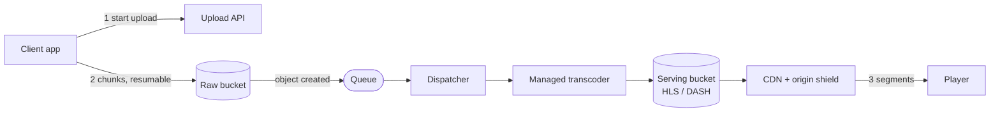
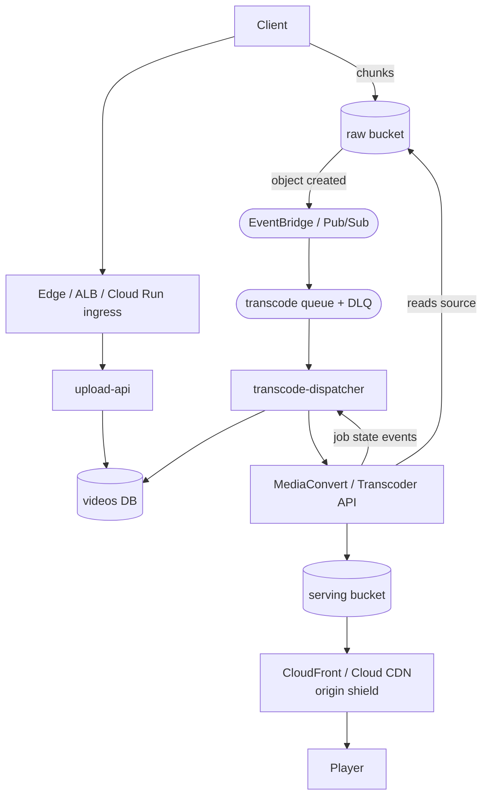

# Video upload and streaming

This walkthrough follows the [interview framework](00-primer.md#interview-framework),
the [estimation cheat sheet](00-primer.md#estimation-cheat-sheet) and the
[conventions](00-primer.md#conventions). Buckets use the
[data zones](00-primer.md#data-zones) names: uploads land in **raw**, playable
renditions in **serving**.

## The question

> "Design a video platform. Users upload videos from phones and browsers, and
> other users watch them on any device and network. Walk me through upload,
> processing and playback, and tell me what it costs."

Common variants:

- "Uploads keep failing on mobile networks. Fix it." (resumable upload)
- "Design the transcoding pipeline. How do you scale it and retry it?"
- "How does adaptive bitrate work, and where does the CDN fit?"
- "Your CDN bill is the biggest line item. What do you do?"
- "Design YouTube": the same core, plus recommendations you can leave out.

## The two-minute answer

Bytes never pass through our servers. The client asks the upload API for a
**resumable upload**: an S3 multipart upload with presigned part URLs, or a
Cloud Storage resumable session. It sends the file in chunks straight to a
**raw** bucket and resumes from the last confirmed chunk after a dropped
connection. The object-created event goes onto a **queue**; a dispatcher
claims the video once in the database and submits one job to a **managed
transcoder** (MediaConvert or the Transcoder API). The job writes an **adaptive
bitrate ladder**, five renditions of 6-second segments with HLS and DASH
manifests, to a **serving** bucket under a versioned path. The player picks a
rendition per segment from its measured bandwidth. A **CDN** serves the
immutable segments from a private bucket behind signed cookies, with long TTLs
and an origin shield, so a popular video is fetched from storage about once.
CDN egress and transcode minutes dominate cost, so the levers are hit ratio
and transcoding only what will be watched.



## Clarify the requirements

Questions to ask, with the answers assumed here:

| Question | Assumed answer |
|---|---|
| What kind of content? | User-generated video on demand. Live streaming is out of scope. |
| Upload volume? | 100,000 uploads a day, average 5 minutes, about 10 Mbps source (1080p phone video). Maximum 4 hours or 50 GB. |
| Viewing volume? | 20 million views a day, average 4 minutes watched. |
| Devices? | iOS, Android, web and smart TVs, so HLS and DASH both. |
| Time to playable? | A short video is watchable within a few minutes of upload; the full ladder can follow. |
| Who can watch? | Public, unlisted and private videos. Private needs per-viewer authorisation. DRM is out of scope. |
| Regions and durability? | One home region; viewers worldwide via CDN. Sources are never lost; renditions can be regenerated. |

Non-functional: playback starts within 2 seconds at p95 on broadband; upload
API 99.9%.

## Back-of-envelope estimates

Arithmetic uses the primer's [QPS conversions](00-primer.md#qps-conversions) and
[storage units](00-primer.md#storage-and-bandwidth-units). Peak is 3× average.

**Uploads.** 100,000 a day is 1.2 a second; design for **3.5 a second** at
peak. One source is 300 s × 10 Mbps = 3,000 Mb = **375 MB**. Daily ingest is
37.5 TB, an average of 3.5 Gbps and about 10 Gbps at peak, so nothing of ours
proxies it.

**Upload time decides the protocol.** 375 MB takes 5 minutes on a 10 Mbps
uplink and 25 minutes on a 2 Mbps mobile uplink. A 25-minute single request
will not survive a train tunnel, so resumable upload is required.

**Parts.** S3 parts are 5 MiB to 5 GiB, at most 10,000 per upload, and an object
may be up to 48.8 TiB
([AWS docs](https://docs.aws.amazon.com/AmazonS3/latest/userguide/qfacts.html), checked 2026-11).
With 16 MiB parts a 375 MB file is 23 parts, and 10,000 parts cover 160 GiB:
ample for our 50 GB cap.

**Transcoding.** 100,000 × 5 minutes is **500,000 content minutes a day**. A
five-rung ladder (three SD, two HD) is 2.5 million output minutes a day.
Assume a job runs at about real time (**verify before relying on**; it depends
on codec, passes and acceleration). By Little's law, 3.5 jobs a second × 300 s
is **about 1,050 concurrent jobs** at peak, 350 on average.

**Transcoder quotas: the number that bites.**

- MediaConvert allows 1,000 concurrent jobs per account outside us-east-1,
  us-west-2 and eu-west-1 (2,000 there), not adjustable; 250 per on-demand
  queue in eu-west-2 (London); new queues default to 100; CreateJob is limited
  to 5 a second, adjustable
  ([AWS docs](https://docs.aws.amazon.com/general/latest/gr/mediaconvert.html), checked 2026-11).
  In London 1,050 is just over the account cap: four queues of 250, and the
  queue in front of the dispatcher absorbs the excess.
- The Transcoder API defaults to **20 concurrent jobs** per region and 100
  create or delete calls a minute
  ([Google Cloud docs](https://docs.cloud.google.com/transcoder/quotas), checked 2026-11).
  20 jobs of 300 s is 0.07 jobs a second, about 5,800 a day: under 6% of our
  volume. Raise both quotas before launch, or run the encoders yourself.

**Storage.** The ladder below averages about 11.5 Mbps across all rungs, so the
renditions of one 5-minute video are about 431 MB. With the source, that is
about 806 MB per video, **81 TB a day, about 2.4 PB a month**, compounding.

**Objects written.** 6-second segments are 50 per rendition, so about 256
objects per video with playlists: 25.6 million a day, an average of 300 writes
a second and about 900 at peak. A new Cloud Storage bucket starts at about
1,000 writes a second
([Throughput table](00-primer.md#throughput-per-instance-and-per-partition)),
so this is close to the edge (see [Adaptive bitrate](#adaptive-bitrate-and-the-cdn)).

**Viewing.** 20 million views × 240 s is 4.8 billion viewing seconds a day:
**56,000 concurrent viewers** on average, **167,000** at peak. At an average
delivered 3 Mbps, that is 167 Gbps average and **500 Gbps at peak**: 1.8 PB a
day, about 54 PB a month. One segment request per 6 s per viewer is 28,000
requests a second at peak.

**CDN quotas.** A CloudFront distribution defaults to 150 Gbps and 250,000
requests a second
([AWS docs](https://docs.aws.amazon.com/AmazonCloudFront/latest/DeveloperGuide/cloudfront-limits.html), checked 2026-11):
bandwidth is 3× over, so raise it before launch.

**Origin.** At a 95% hit ratio, origin sees 5%: 25 Gbps and 1,400 GETs a second
at peak, well under S3's 5,500 GETs a second per prefix. Each SSE-KMS GET
without an S3 Bucket Key is a KMS `Decrypt` (see [Cost](#cost)).

## API and data model

### Upload API

| Endpoint | Purpose | Notes |
|---|---|---|
| `POST /v1/videos` | Create a video in `UPLOADING` and start the upload. | Body: title, size, content type, SHA-256. Returns `video_id` and either an S3 `upload_id` with a part size, or a Cloud Storage session URI. Requires an `Idempotency-Key`. |
| `POST /v1/videos/{id}/parts` | AWS only: presign a batch of part numbers. | Returns URLs valid for 15 minutes. |
| `GET /v1/videos/{id}/upload` | Resume: which parts or bytes are stored? | Calls S3 `ListParts`, or tells the client to query its session. |
| `POST /v1/videos/{id}/complete` | AWS only: finish the multipart upload. | Body: part numbers and ETags. Retrying returns the same result. |
| `GET /v1/videos/{id}` | Status and, when `READY`, the manifest URL. | |
| `POST /v1/videos/{id}/playback` | Authorise a viewer. | Sets signed cookies scoped to `/v/{id}/`, valid for 2 hours. |

### Events

`VideoUploaded {video_id, bucket, key, etag_or_generation, size}` comes from the
storage event; `TranscodeCompleted` and `TranscodeFailed {video_id, job_id,
outputs[]}` from the transcoder. The dispatcher emits `VideoReady` or
`VideoFailed` for notifications and search.

### Key tables and object layout

| Table or prefix | Key | Access pattern |
|---|---|---|
| `videos` | `video_id`; index `(owner_id, created_at)` | Point read by ID; status changes by conditional update. |
| `upload_sessions` | `video_id` | Provider upload ID or session URI, part size, `expires_at`. Session URIs are bearer credentials: encrypt the column. |
| `transcode_jobs` | `(video_id, version)` | Provider job ID, profile, attempt, status. |
| `raw: sources/{video_id}/source` | One object per upload | Written once by the client. |
| `serving: v/{video_id}/{version}/…` | `master.m3u8`, `manifest.mpd`, `{rung}/seg_00001.m4s` | Immutable. A re-encode writes a new `version`, never overwrites. |

`videos.status` moves `UPLOADING → PROCESSING → READY`, or to `FAILED` or
`BLOCKED`. About 4 status writes a second at peak fits the app-services
relational store (Aurora or Cloud SQL).

## High-level design



### Write path: upload to playable

1. `POST /v1/videos`: upload-api inserts the row in `UPLOADING`, starts the
   multipart upload or resumable session, and returns its handle.
2. The client uploads chunks directly to the raw bucket and resumes after any
   failure.
3. On AWS the client calls `complete`; on GCP the last chunk finalises the
   object. Storage emits an object-created event onto the queue.
4. The dispatcher claims the video with a conditional update and submits one
   job with all five renditions and both manifests.
5. The transcoder writes `v/{id}/{version}/…` and emits a completion event;
   the dispatcher marks the video `READY`.

### Read path: playback

The player gets signed cookies and the manifest URL from
`POST /v1/videos/{id}/playback`, then fetches playlists and segments from the
CDN. Misses go to a regional cache, then the origin shield, then the bucket.

## Deep dives

### Resumable upload

**Alternatives.**

| Option | Wins | Breaks |
|---|---|---|
| Proxy through the API | Simple auth; inspect bytes inline. | 10 Gbps of ingest through our fleet; a restart loses the upload. |
| One presigned PUT | Simplest client. | No resume. S3 suggests multipart from about 100 MB. |
| **S3 multipart, presigned parts** (chosen on AWS) | Parallel, resumable per part, bytes bypass us. | More client logic; abandoned uploads leave billable parts. |
| **Cloud Storage resumable session** (chosen on GCP) | One URI, offset-based resume, no completion call. | Sequential chunks; the URI is a bearer credential. |
| tus server (open protocol) | Cloud-neutral clients. | We run the byte path again. |

**How resume works on AWS.** The client keeps `video_id`, `upload_id` and the
ETag of each acknowledged part. After a failure the resume endpoint calls
`ListParts`, and the client re-sends only missing parts. Upload 4–8 parts in
parallel; a 16 MiB part on 2 Mbps takes about 67 seconds, the most a drop can
lose. Send a checksum with each part; SigV4 presigned URLs support CRC32C,
SHA-256 and others
([AWS docs](https://docs.aws.amazon.com/AmazonS3/latest/userguide/using-presigned-url.html), checked 2026-11).

**Two AWS traps.**

- **Presigned URLs die with the signer's credentials.** A URL signed by a role
  expires when the role session does; ECS task credentials typically rotate
  every 1–6 hours
  ([AWS docs](https://docs.aws.amazon.com/AmazonS3/latest/userguide/using-presigned-url.html), checked 2026-11).
  Sign short-lived URLs in batches on demand.
- **SSE-KMS multipart needs both KMS actions.** The requester needs
  `kms:GenerateDataKey` for `CreateMultipartUpload` and `kms:Decrypt` for
  `UploadPart`
  ([AWS docs](https://docs.aws.amazon.com/AmazonS3/latest/userguide/mpuoverview.html), checked 2026-11).
  upload-api's task role signs, so it needs both.

**How resume works on GCP.** upload-api creates the session with the object's
final name and returns the URI. The client sends chunks that are multiples of
256 KiB, at least 8 MiB recommended. After an error it sends an empty `PUT`
with `Content-Range: bytes */<size>`; a `308` with a `Range` header says how
far Cloud Storage got. The session URI lets anyone upload without further
authentication and expires after one week
([Google Cloud docs](https://docs.cloud.google.com/storage/docs/performing-resumable-uploads),
[resumable uploads](https://docs.cloud.google.com/storage/docs/resumable-uploads),
checked 2026-11). Treat it as a secret: never logged, encrypted at rest.

**Abandoned uploads cost money.** S3 keeps incomplete multipart parts until
the upload is completed or aborted. A lifecycle rule with
`AbortIncompleteMultipartUpload` removes them after N days
([AWS docs](https://docs.aws.amazon.com/AmazonS3/latest/userguide/mpu-abort-incomplete-mpu-lifecycle-config.html), checked 2026-11).
Cloud Storage has the same lifecycle action for incomplete multipart uploads
([Google Cloud docs](https://docs.cloud.google.com/storage/docs/lifecycle), checked 2026-11).
Whether bytes of an expired, never-finalised resumable session are billed is
not documented; **verify before relying on** it.

**Where it breaks.** Browser uploads need CORS on the raw bucket. On GCP, VPC
Service Controls blocks signed-URL access to a perimeter's buckets from outside
by network origin, unless an access level or ingress rule admits it
([Google Cloud docs](https://docs.cloud.google.com/vpc-service-controls/docs/supported-products), checked 2026-11);
see [Build it here](#build-it-here).

### The transcoding pipeline

**Shape.** Storage event → queue → dispatcher → transcoder → completion event.
The queue is the buffer: it absorbs peaks above the concurrency quota and
gives retries and a DLQ.

**Exactly-once claim, at-least-once events.** S3 event notifications are
designed to be delivered at least once
([AWS docs](https://docs.aws.amazon.com/AmazonS3/latest/userguide/EventNotifications.html), checked 2026-11),
and Cloud Storage guarantees at-least-once delivery to Pub/Sub, possibly with
different message IDs for one event
([Google Cloud docs](https://docs.cloud.google.com/storage/docs/pubsub-notifications), checked 2026-11).
So the dispatcher claims each upload with a conditional update and checks
that it matched a row:

```sql
BEGIN;
UPDATE videos
   SET status = 'PROCESSING', source_etag = $2, version = version + 1, updated_at = now()
 WHERE video_id = $1 AND status = 'UPLOADING'
RETURNING version;
-- App: no row => duplicate event or already claimed. ROLLBACK, acknowledge, stop.
-- $3 = the version returned above.
INSERT INTO transcode_jobs (video_id, version, status, attempt) VALUES ($1, $3, 'SUBMITTING', 1);
COMMIT;
-- Then submit the job; store the provider job ID with
-- UPDATE transcode_jobs SET provider_job_id = $4, status = 'SUBMITTED'
--  WHERE video_id = $1 AND version = $3 AND status = 'SUBMITTING';  (expect 1 row)
```

A crash between `COMMIT` and submission leaves a `SUBMITTING` row with no job
ID; a sweep resubmits rows older than 5 minutes. MediaConvert's
`clientRequestToken` returns the original job if reused, but only within one
minute
([AWS docs](https://docs.aws.amazon.com/mediaconvert/latest/apireference/jobs.html), checked 2026-11),
so use `"{video_id}:{version}"` as the token and still expect rare duplicate
jobs after longer gaps. A duplicate writes the same versioned path, so it
wastes money but not correctness.

**One job, not one per rendition.** All five renditions go in one job with one
output group per format. That keeps CreateJob at one call per upload, under
the 5-a-second MediaConvert default, and a Transcoder API job prices each
elementary stream once even when HLS and DASH both package it
([Google Cloud docs](https://cloud.google.com/transcoder/pricing), checked 2026-11).

**Fast start, then full ladder.** Submit a cheap first job (360p and 720p),
mark the video `READY` when it lands, and write the full ladder later as a new
`version`. That doubles CreateJob calls to 7 a second at peak, so raise the
quota or run the second job only for videos that get views (see [Cost](#cost)).

**Managed or self-run encoders.**

| Option | Wins | Breaks |
|---|---|---|
| **Managed transcoder** (chosen) | No encoder fleet; per-minute billing; completion events; automated ABR on MediaConvert. | Quotas (20 concurrent jobs on Transcoder by default); per-minute list prices. |
| FFmpeg on containers (GKE Autopilot, ECS) | Full control, spot capacity; repo has [`modules/gcp/compute/gke-autopilot`](../../modules/gcp/compute/gke-autopilot/). | We own codec bugs, scaling, retries and packaging. |

**Failure handling.** Probe input first and mark corrupt files `FAILED` without
retrying. Retry transient failures 3 times with backoff, then dead-letter.
Moderation and thumbnails consume `VideoReady` separately.

**Where it breaks.** Concurrency quotas, as estimated. The job state event is
also at-least-once, so `READY` is a conditional update from `PROCESSING` for
the matching `version`. A job stuck in `SUBMITTED` usually means a full queue,
which is the [runbook](#runbook) scenario.

### Adaptive bitrate and the CDN

**How ABR works.** The source is encoded into a **ladder** of renditions, each
cut into short segments that start on a keyframe. A **multivariant playlist**
(HLS) or **MPD** (DASH) lists the renditions with their bandwidths. The player
measures throughput and buffer level and picks the rendition for each next
segment. ABR is client logic over static files, so a CDN serves all of it.

**Segment and ladder choices.** Apple's HLS authoring spec says the target
segment duration should be 6 seconds, keyframes every 2 seconds, and each
segment must start with an IDR frame
([Apple docs](https://developer.apple.com/documentation/http-live-streaming/hls-authoring-specification-for-apple-devices), checked 2026-11).
Shorter segments switch sooner but mean more requests and objects. Our rungs
come from Apple's example H.264 ladder:

| Rung | Resolution | Bitrate |
|---|---|---|
| 1 | 416 × 234 | 145 kbps |
| 2 | 640 × 360 | 365 kbps |
| 3 | 960 × 540 | 2,000 kbps |
| 4 | 1280 × 720 | 3,000 kbps |
| 5 | 1920 × 1080 | 6,000 kbps |

Package as **CMAF**: fragmented MP4 segments that HLS and DASH share.
MediaConvert's automated ABR fits 3 to 15 renditions to the content, dropping
those that add bitrate without quality, but bills at the professional 2-pass
rate
([AWS docs](https://docs.aws.amazon.com/mediaconvert/latest/ug/auto-abr.html), checked 2026-11).

**Fewer objects.** A rendition can be one fMP4 file per rung with byte-range
entries in the playlist, cutting 256 objects per video to about 6. Cloud CDN caches byte ranges of
objects up to 100 GiB when the origin supports ranges
([Google Cloud docs](https://docs.cloud.google.com/cdn/docs/caching), checked 2026-11),
and CloudFront caches GET responses up to 50 GB
([AWS docs](https://docs.aws.amazon.com/AmazonCloudFront/latest/DeveloperGuide/cloudfront-limits.html), checked 2026-11).

**CDN design.**

- **Immutable paths, long TTLs.** Everything under `v/{id}/{version}/` never
  changes, so cache for days and never invalidate. A re-encode is a new path.
- **Cache key: path only.** No query strings or cookies. Segments are already
  compressed, so CloudFront's managed
  `CachingOptimizedForUncompressedObjects` policy fits
  ([AWS docs](https://docs.aws.amazon.com/AmazonCloudFront/latest/DeveloperGuide/using-managed-cache-policies.html), checked 2026-11).
- **Private origin.** CloudFront reaches the S3 bucket through **origin access
  control**, which supports SSE-KMS where the legacy OAI does not; the KMS key
  policy must admit `cloudfront.amazonaws.com` for that distribution
  ([AWS docs](https://docs.aws.amazon.com/AmazonCloudFront/latest/DeveloperGuide/private-content-restricting-access-to-s3.html), checked 2026-11).
  Cloud CDN reads a private backend bucket as
  `service-<number>@cloud-cdn-fill.iam.gserviceaccount.com`, which needs
  `roles/storage.objectViewer`, and only exists after the first signed key is
  added
  ([Google Cloud docs](https://docs.cloud.google.com/cdn/docs/using-signed-cookies), checked 2026-11).
- **Signed cookies, not signed URLs.** One HLS session is hundreds of segment
  URLs, so authorise a path prefix once. CloudFront uses trusted key groups (up
  to 4 per cache behaviour, 5 keys each)
  ([AWS docs](https://docs.aws.amazon.com/AmazonCloudFront/latest/DeveloperGuide/private-content-trusted-signers.html), checked 2026-11);
  Cloud CDN cookies carry a `URLPrefix`, and a backend has at most 3 keys
  ([Google Cloud docs](https://docs.cloud.google.com/cdn/docs/using-signed-cookies), checked 2026-11).
  End the prefix with `/`: it is a text match.
- **Origin shield.** All regional caches fetch through one shield region, and
  concurrent misses for one object collapse into as few as one origin request
  ([AWS docs](https://docs.aws.amazon.com/AmazonCloudFront/latest/DeveloperGuide/origin-shield.html), checked 2026-11).
  Cloud CDN coalesces concurrent fills per edge by default
  ([Google Cloud docs](https://docs.cloud.google.com/cdn/docs/caching), checked 2026-11).

**Where it breaks.** The cold long tail misses on every view. Removing a key
before cookies signed with it expire gives players 403s mid-session.

### Cost

Monthly at our scale, at list prices before discounts.

**Transcoding: 15 million content minutes a month.**

- **Transcoder API:** $0.015 a minute for SD and $0.030 for HD output
  ([Google Cloud docs](https://cloud.google.com/transcoder/pricing), checked 2026-11).
  Our ladder costs 3 × $0.015 + 2 × $0.030 = $0.105 per content minute:
  **about $1.6 million a month**.
- **MediaConvert:** billed in normalised minutes; basic-tier AVC is 1× at SD
  and 2× at HD, at $0.0075, then $0.0053, then $0.0038 per normalised minute
  in US East (Ohio) as volume rises
  ([AWS pricing](https://aws.amazon.com/mediaconvert/pricing/), checked 2026-11).
  Our ladder is 7 normalised minutes per content minute, 105 million a month:
  **about $0.4–0.8 million**, depending on which tier most minutes land in.

**Delivery: 54 PB a month.** CloudFront's US price falls from $0.085 per GB
after the free first TB to $0.020 per GB above 5 PB a month, and origin fetches
from AWS origins are free
([AWS pricing](https://aws.amazon.com/cloudfront/pricing/pay-as-you-go/), checked 2026-11).
Summing the tiers gives **about $1.1 million a month** ($0.021 per GB blended).
Cloud CDN charges $0.02–$0.20 per GiB of cache egress plus $0.01–$0.04 of
cache fill
([Google Cloud pricing](https://cloud.google.com/cdn/pricing), checked 2026-11):
the same order of magnitude.

**Levers, biggest first.**

1. **Transcode for demand.** Most user videos get few views (check your data).
   Encode 360p and 720p on upload ($0.045 a minute on Transcoder, 57% less)
   and the full ladder after, say, 100 views.
2. **Cache hit ratio.** Origin shield, path-only keys, immutable paths.
3. **Codec for the head.** HEVC or AV1 cut bitrate but need the professional
   tier; spend it only on the videos that carry most egress.
4. **Storage classes.** Move sources to S3 Standard-IA (30-day minimum, 128 KB
   minimum billable size) or Nearline (30-day minimum) after 30 days
   ([AWS docs](https://docs.aws.amazon.com/AmazonS3/latest/userguide/storage-class-intro.html),
   [Google Cloud docs](https://docs.cloud.google.com/storage/docs/storage-classes),
   checked 2026-11). Intelligent-Tiering ignores objects under 128 KB, and a
   6-second 145 kbps segment is about 109 KB.
5. **KMS calls.** S3 Bucket Keys cut SSE-KMS request costs by up to 99%
   ([AWS docs](https://docs.aws.amazon.com/AmazonS3/latest/userguide/bucket-key.html), checked 2026-11),
   and keep segment reads well under the KMS symmetric request quota of 10,000
   to 100,000 a second per Region
   ([AWS docs](https://docs.aws.amazon.com/kms/latest/developerguide/requests-per-second.html), checked 2026-11).
6. **Commit.** Both CDNs discount committed volume.

## Trade-offs to defend

| Decision | Chosen | Rejected | Why | What would change the answer |
|---|---|---|---|---|
| Upload path | Direct to storage, resumable | Proxy through API | 10 Gbps of ingest never touches our fleet; per-part resume. | Inline scanning required before bytes are stored. |
| Pipeline trigger | Storage event → queue → dispatcher | Transcode from the upload API | Buffers peaks over quota, retries, DLQ; no lost uploads. | Very low volume: call the transcoder inline. |
| Encoders | Managed transcoder | FFmpeg on GKE/ECS | No fleet to run; events and packaging included. | Quota ceilings, or transcode spend past the cost of a team. |
| Jobs per upload | One job, all rungs | One job per rendition | One CreateJob call; streams priced once. | Very long sources: chunked parallel encode. |
| Ladder | Fast start + full ladder on demand | Full ladder for every upload | Most spend is on videos nobody watches. | A catalogue where every title is watched (licensed content). |
| Access control | Signed cookies on a path prefix | Signed URLs per segment | One authorisation per playback session. | Single-file downloads. |
| Origin protection | Origin shield + coalescing | Edge caches only | One origin fetch per object for a viral video. | Single-region audience. |

## Failure modes and scaling limits

**At ×10 (1 million uploads, 200 million views a day):**

- **Transcoder concurrency fails first:** about 10,000 jobs, ten times
  MediaConvert's fixed London account cap. Spread across Regions or self-run
  encoders; transcode-on-demand becomes mandatory.
- **CDN bandwidth** reaches 5 Tbps: negotiated commitments, or multi-CDN with
  the shield as the common origin.
- **Object writes** reach 9,000 a second, too many for one Cloud Storage
  bucket unless renditions are byte-range single files.

**At ×100:** a dedicated encoding fleet with per-title ladders, regional
processing, and deleting top rungs of long-unwatched videos.

**Blast radius by component:**

| Component | If it fails | Blast radius |
|---|---|---|
| upload-api | No new uploads start | Uploads only; in-flight chunks keep going to storage. |
| Queue, dispatcher or transcoder | Videos stay `PROCESSING` | New content only; events wait in the queue. |
| Serving bucket | Misses fail | Cold videos; hot ones serve from cache. |
| CDN signing key | 403 on new sessions | All private playback: the most visible failure. |
| videos DB | No status or playback authorisation | Everything except already-authorised sessions. |

## AWS and GCP mapping

| Component | AWS | GCP | Difference that matters |
|---|---|---|---|
| Upload API, dispatcher | ECS on Fargate | Cloud Run | A request-billed Cloud Run service cannot pull a queue in the background; use a push subscription. |
| Raw and serving storage | S3 | Cloud Storage | S3 resumes by part; Cloud Storage by byte offset in one session. Maximum object 48.8 TiB versus 5 TiB ([Google Cloud docs](https://docs.cloud.google.com/storage/quotas), checked 2026-11). |
| Upload event | S3 → EventBridge → SQS | Pub/Sub notification on the bucket | GCS notifications need the Cloud Storage service agent to hold `roles/pubsub.publisher` on the topic ([Google Cloud docs](https://docs.cloud.google.com/storage/docs/reporting-changes), checked 2026-11). |
| Transcoder | Elemental MediaConvert, with an IAM role passed per job | Transcoder API, through service agent `gcp-sa-transcoder` | 1,000–2,000 versus 20 concurrent jobs by default. The Transcoder agent can reach every bucket in the project by default; narrow it to per-bucket Storage Object Admin ([Google Cloud docs](https://cloud.google.com/transcoder/docs/access-control), checked 2026-11). |
| CDN and edge auth | CloudFront + Origin Shield; key-group signed cookies | Cloud CDN on a backend bucket; HMAC-signed cookies | CloudFront reads S3 through OAC with RSA or ECDSA keys; Cloud CDN reads through its fill account with shared secrets. |

Two differences change the design:

- **Transcoder quota.** On GCP, plan the quota increase or a self-run fleet
  from day one; on AWS, plan queues and Regions around a non-adjustable
  account cap.
- **Data perimeter.** VPC Service Controls blocks internet access to
  perimeter buckets by network origin. On AWS the bucket policy and OAC carry
  the boundary.

## Build it here

### Where it lives

| Part | AWS | GCP |
|---|---|---|
| upload-api, transcode-dispatcher, videos DB | `aws-workload-<env>` (`envs/aws/workload`) through app-services | `gcp-workload-<env>` (`envs/gcp/workload`) through app-services in the environment stage |
| Buckets, events, transcoder, CDN | Raw resources in `envs/aws/workload` | Raw resources in `envs/gcp/workload` |
| Egress to transcoder APIs | TGW and inspection in `aws-network` | Private Google Access; not inspected |
| Apply order | `aws-organization` → … → `aws-network` → `aws-workload-<env>` | `gcp-bootstrap` → `gcp-organization` → `gcp-projects` → `gcp-network-hub` → `gcp-workload-<env>` |

Services sit in `private`, the database in `isolated` (AWS) or on Private
Service Access (GCP), per [VPC-tier placement](00-primer.md#vpc-tier-placement);
buckets, queues and transcoders are in no tier. The AWS hub's central endpoints
omit MediaConvert, so `mediaconvert.<region>.amazonaws.com` must pass
`aws.network.egress_domain_allowlist`; S3 uses the spoke's gateway endpoint.

**GCP perimeter.** The environment perimeter protects only the host project,
restricts `storage.googleapis.com`, and starts in dry-run. Before enforcing it,
move the media buckets into a `gcp.environments.<env>.service_teams` project,
or internet uploads will fail; **verify before relying on** how Cloud CDN fill
is evaluated. The org policy `iam.allowedPolicyMemberDomains` can also block
the `cloud-cdn-fill` grant; Google says to allowlist the organization that owns
that account
([Google Cloud docs](https://docs.cloud.google.com/cdn/docs/using-signed-cookies), checked 2026-11),
which is a `gcp-organization` change.

### Config

```yaml
# Illustrative. Keys are real (config/landing-zone.schema.json); values are placeholders.
aws:
  workload_environments:
    prod:
      account_key: workload_prod
      vpc_cidr: 10.30.0.0/16
      services:
        upload-api:
          path_patterns: ["/v1/videos", "/v1/videos/*"]
          database: {}
          task_role_policy_json: >-
            {"Version":"2012-10-17","Statement":[
            {"Effect":"Allow","Action":["s3:PutObject","s3:AbortMultipartUpload","s3:ListMultipartUploadParts"],"Resource":"arn:aws:s3:::prod-media-raw/sources/*"},
            {"Effect":"Allow","Action":["kms:GenerateDataKey","kms:Decrypt"],"Resource":"WORKLOAD_KMS_KEY_ARN"}]}
gcp:
  environments:
    prod:
      cidr_block: 10.40.0.0/16
      services:
        transcode-dispatcher:
          max_instances: 20 # caps in-flight Transcoder submissions
          runtime_project_roles: ["roles/transcoder.admin"]
          pubsub:
            enabled: true # topic "transcode-dispatcher" receives the bucket notifications
```

The other services follow the same shape. The AWS dispatcher's policy grants
the transcode queue, `mediaconvert:CreateJob`, `iam:PassRole` on the
MediaConvert role and `kms:Decrypt`. `roles/transcoder.admin` is project-wide;
**verify before relying on** a narrower role.

### AWS: buckets, the upload event and the transcode queue

In `envs/aws/workload`, using `local.environment`, `local.aws_region` and
`local.kms_key_arn`. Wiring that is not shown:

- `envs/aws/workload/kms.tf` gains two key-policy statements: one admitting
  `events.amazonaws.com` to `kms:Decrypt` and `kms:GenerateDataKey` for the
  encrypted queue
  ([AWS docs](https://docs.aws.amazon.com/AWSSimpleQueueService/latest/SQSDeveloperGuide/sqs-key-management.html), checked 2026-11),
  and one admitting `cloudfront.amazonaws.com` on the distribution's ARN.
- A queue policy admits `events.amazonaws.com` only with `aws:SourceArn`
  equal to the rule's ARN, as in the microservices walkthrough.
- A raw-bucket lifecycle rule aborts incomplete multipart uploads after 7
  days and moves `sources/` to `STANDARD_IA` after 30.
- The MediaConvert role `<env>-transcode-mediaconvert` (trusts
  `mediaconvert.amazonaws.com`, carries the `tfc-apply-boundary`) reads raw,
  writes serving, and holds the two KMS actions
  ([AWS docs](https://docs.aws.amazon.com/mediaconvert/latest/ug/granting-permissions-for-mediaconvert-to-access-encrypted-s3-buckets.html), checked 2026-11).

Arguments checked against aws v6.72.0
([`aws_media_convert_queue`](https://registry.terraform.io/providers/hashicorp/aws/6.72.0/docs/resources/media_convert_queue),
[`aws_cloudfront_distribution`](https://registry.terraform.io/providers/hashicorp/aws/6.72.0/docs/resources/cloudfront_distribution),
checked 2026-11).

```hcl
# Gap: the repo has no media pipeline module; raw resources in the landing zone's conventions.
resource "aws_s3_bucket" "media" {
  for_each = toset(["raw", "serving"])
  bucket   = "${local.environment}-media-${each.key}" # <env>-<dataset>-<zone>; add <prefix>- on collision
  tags     = { Service = "media" }
}

resource "aws_s3_bucket_server_side_encryption_configuration" "media" {
  for_each = aws_s3_bucket.media
  bucket   = each.value.id
  rule {
    apply_server_side_encryption_by_default {
      sse_algorithm     = "aws:kms"
      kms_master_key_id = local.kms_key_arn
    }
    bucket_key_enabled = true # far fewer KMS calls per segment read
  }
}

resource "aws_s3_bucket_notification" "media_raw" {
  bucket      = aws_s3_bucket.media["raw"].id
  eventbridge = true
}

resource "aws_cloudwatch_event_rule" "media_uploaded" {
  name = "${local.environment}-media-uploaded"
  event_pattern = jsonencode({
    source        = ["aws.s3"]
    "detail-type" = ["Object Created"]
    detail        = { bucket = { name = [aws_s3_bucket.media["raw"].id] }, object = { key = [{ prefix = "sources/" }] } }
  })
}

resource "aws_sqs_queue" "transcode" {
  name                       = "${local.environment}-transcode"
  visibility_timeout_seconds = 120
  kms_master_key_id          = local.kms_key_arn
  redrive_policy = jsonencode({
    deadLetterTargetArn = aws_sqs_queue.transcode_dlq.arn # same shape, 14-day retention
    maxReceiveCount     = 5
  })
  tags = { Service = "transcode" }
}

resource "aws_cloudwatch_event_target" "transcode" {
  rule = aws_cloudwatch_event_rule.media_uploaded.name
  arn  = aws_sqs_queue.transcode.arn
}

resource "aws_media_convert_queue" "transcode" {
  name            = "${local.environment}-transcode"
  pricing_plan    = "ON_DEMAND"
  concurrent_jobs = 250 # eu-west-2 per-queue maximum; add queues up to the account cap
  tags            = { Service = "transcode" }
}
```

### AWS: the CDN in front of the serving bucket

The repo's [`modules/aws/security/edge-security`](../../modules/aws/security/edge-security/)
fronts a custom or VPC origin only, so the S3 origin with OAC is raw. Attach its
style of CloudFront Web ACL through `web_acl_id`.

```hcl
# Gap: edge-security has no S3 origin with OAC; raw resources in the landing zone's conventions.
resource "aws_cloudfront_origin_access_control" "media" {
  name                              = "${local.environment}-media-serving"
  origin_access_control_origin_type = "s3"
  signing_behavior                  = "always"
  signing_protocol                  = "sigv4"
}

resource "aws_cloudfront_distribution" "media" {
  enabled = true
  origin {
    origin_id                = "serving"
    domain_name              = aws_s3_bucket.media["serving"].bucket_regional_domain_name
    origin_access_control_id = aws_cloudfront_origin_access_control.media.id
    origin_shield {
      enabled              = true
      origin_shield_region = local.aws_region # must be an Origin Shield Region; eu-west-2 is
    }
  }
  default_cache_behavior {
    target_origin_id       = "serving"
    viewer_protocol_policy = "redirect-to-https"
    allowed_methods        = ["GET", "HEAD"]
    cached_methods         = ["GET", "HEAD"]
    cache_policy_id        = "b2884449-e4de-46a7-ac36-70bc7f1ddd6d" # Managed-CachingOptimizedForUncompressedObjects
    trusted_key_groups     = [aws_cloudfront_key_group.media.id]     # signed cookies required
  }
  restrictions {
    geo_restriction { restriction_type = "none" }
  }
  viewer_certificate { cloudfront_default_certificate = true } # ACM cert for a custom domain
  tags = { Service = "media" }
}
```

The serving bucket's policy admits `cloudfront.amazonaws.com` to
`s3:GetObject` with `AWS:SourceArn` set to this distribution. The key group
holds the public key; the private key stays in Secrets Manager for upload-api.

### GCP: buckets, the upload notification and the CDN backend

In `envs/gcp/workload`, using `local.env_config`, `local.project_prefix`,
`local.labels`, `var.environment` and `module.environment`. Add a `"media"` key
to the `workload_cmek` module from the primer's
[canonical snippet](00-primer.md#gcp-canonical-snippet), granting the Cloud
Storage service agent, `service-<number>@gs-project-accounts.iam.gserviceaccount.com`.
That module is itself the repo's gap: there is no per-environment workload CMEK
yet. `local.env_config.region` must be a Transcoder API location
([Google Cloud docs](https://docs.cloud.google.com/transcoder/docs/locations), checked 2026-11).
Arguments checked against google v8.10.0
([`google_storage_notification`](https://registry.terraform.io/providers/hashicorp/google/8.10.0/docs/resources/storage_notification),
[`google_compute_backend_bucket`](https://registry.terraform.io/providers/hashicorp/google/8.10.0/docs/resources/compute_backend_bucket),
checked 2026-11).

```hcl
# Gap: modules/gcp/cloud-storage has no CORS or multipart-abort rule; raw buckets in the landing zone's conventions.
resource "google_storage_bucket" "media" {
  for_each                    = toset(["raw", "serving"])
  project                     = local.env_config.host_project_id
  name                        = "${local.project_prefix}-${var.environment}-media-${each.key}"
  location                    = local.env_config.region
  uniform_bucket_level_access = true
  public_access_prevention    = "enforced"
  labels                      = merge(local.labels, { service = "media" })
  encryption {
    default_kms_key_name = module.workload_cmek.key_ids["media"]
  }
  # raw also needs a cors block (PUT from the app origin; expose Range and Location).
  depends_on = [module.workload_cmek] # the service agent's key grant must exist first
}

resource "google_storage_notification" "media_raw" {
  bucket             = google_storage_bucket.media["raw"].name
  topic              = module.environment.app_services["transcode-dispatcher"].pubsub_topic
  payload_format     = "JSON_API_V1"
  event_types        = ["OBJECT_FINALIZE"]
  object_name_prefix = "sources/"
}

resource "google_compute_backend_bucket" "media" {
  project     = local.env_config.host_project_id
  name        = "media-serving"
  bucket_name = google_storage_bucket.media["serving"].name
  enable_cdn  = true
  cdn_policy {
    cache_mode  = "CACHE_ALL_STATIC"
    default_ttl = 86400
  }
}
```

Wiring that is not shown:

- The Cloud Storage service agent needs `roles/pubsub.publisher` on the topic
  before the notification is created.
- The module's subscription is pull, which request-billed Cloud Run cannot
  drain: add a push subscription to the dispatcher, as the microservices
  walkthrough does. Answering `429` at the Transcoder quota makes Pub/Sub back off.
- Add the signed-cookie key out-of-band from Secret Manager, because
  `google_compute_backend_bucket_signed_url_key` stores `key_value` in state.
  Then grant the fill account `roles/storage.objectViewer` on serving.
- [`modules/gcp/network/cdn`](../../modules/gcp/network/cdn/) builds the load
  balancer but takes only backend services, so a backend bucket needs a module
  change or a raw URL map.

## Runbook

### Videos stuck in PROCESSING: the transcode backlog is growing

**Detection signal.** Age of the oldest message on the transcode queue
(`ApproximateAgeOfOldestMessage`, or the subscription's
`oldest_unacked_message_age`): alert at 10 minutes, page at 30. Corroborating:
the count of videos in `PROCESSING` for over 30 minutes rises; MediaConvert
jobs sit in `SUBMITTED` instead of `PROGRESSING`, which AWS says usually means
the queue is at its concurrent-job limit
([AWS docs](https://docs.aws.amazon.com/mediaconvert/latest/ug/working-with-on-demand-queues.html), checked 2026-11).

**Triage.**

1. **Volume or failure?** Rising uploads with healthy completions is capacity;
   flat uploads with falling completions is failure.
2. **At quota?** MediaConvert concurrent jobs per queue and account; on GCP,
   `RESOURCE_EXHAUSTED` in dispatcher logs.
3. **Is the dispatcher consuming?** Its tasks or instances, errors, and
   CreateJob throttling.
4. **Are jobs failing?** `AccessDenied` on S3 or KMS means a policy change;
   one input failing repeatedly is a poison video.

**Mitigation.**

1. **Capacity:** raise `concurrent_jobs` up to the per-queue quota through
   `aws-workload-<env>`, add queues with queue hopping (`hopDestinations` in
   the job), or request the Transcoder increase. Run only fast-start rungs
   until the backlog clears.
2. **Dispatcher down:** restart or scale it; messages wait in the queue.
3. **Permissions:** revert through the owning workspace in Terraform Cloud,
   not in the console.
4. **Poison input:** mark it `FAILED` and let it dead-letter.

**Verification.** Queue age under 2 minutes, the `PROCESSING` count at
baseline, and a test upload reaching `READY`.

**Follow-up.** Alert at 70% of the transcoder quota, plan quotas against the
upload forecast, and game-day a full queue.

### Playback returns 403 after a key rotation

**Detection:** CDN 4xx rate on segment paths jumps. **Triage:** were the
public key or HMAC key removed before cookies signed with it expired?
**Mitigation:** restore the old key; signing continues with the new one.
**Verification and follow-up:** the 403 rate returns to baseline; gate key
removal on "cookie lifetime has passed".

## Study aids

### Numbers to memorise

| Fact | Value |
|---|---|
| S3 multipart | Parts 5 MiB–5 GiB, 10,000 parts, objects up to 48.8 TiB |
| Cloud Storage resumable | Chunks in multiples of 256 KiB (8 MiB+ recommended); session lasts 1 week; objects up to 5 TiB |
| HLS (Apple) | 6-second segments, keyframe every 2 s |
| MediaConvert | 1,000 or 2,000 concurrent jobs per account; CreateJob 5 a second |
| Transcoder API | 20 concurrent jobs; 100 mutations a minute |
| CloudFront distribution | 150 Gbps, 250,000 requests a second; caches up to 50 GB per object |
| This design's peak | 3.5 uploads/s, ~1,050 concurrent jobs, 500 Gbps egress |

### Likely follow-ups

- **"Why not upload through your API?"** 10 Gbps through your fleet, and every
  restart loses progress. Storage takes the bytes; you issue the permission.
- **"How does the player choose quality?"** From measured throughput and
  buffer, per segment. The server only hosts files.
- **"A video goes viral. What breaks?"** Nothing at origin: immutable cached
  segments, and the shield collapses misses. The CDN quota and bill grow.
- **"How do you stop hot-linking?"** Short-lived signed cookies scoped to the
  video's path prefix.
- **"How do you cut cost?"** Transcode what gets watched, raise the hit ratio,
  better codecs on the head, tier storage.

### Classic mistakes

- Proxying uploads through application servers.
- Overwriting segments in place, then fighting CDN invalidation.
- Signing every segment URL instead of a cookie for the prefix.
- Transcoding the full ladder for every upload.
- Treating storage events as exactly-once.
- Ignoring transcoder concurrency quotas until launch.

### Further reading

- [Apple HLS authoring specification](https://developer.apple.com/documentation/http-live-streaming/hls-authoring-specification-for-apple-devices)
- [S3 multipart upload overview](https://docs.aws.amazon.com/AmazonS3/latest/userguide/mpuoverview.html)
- [Cloud Storage resumable uploads](https://docs.cloud.google.com/storage/docs/resumable-uploads)
- [CloudFront Origin Shield](https://docs.aws.amazon.com/AmazonCloudFront/latest/DeveloperGuide/origin-shield.html)
- The primer's [service map](00-primer.md#aws-gcp-service-map).
