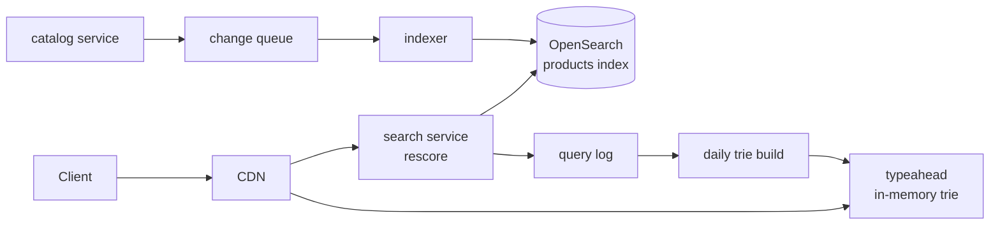
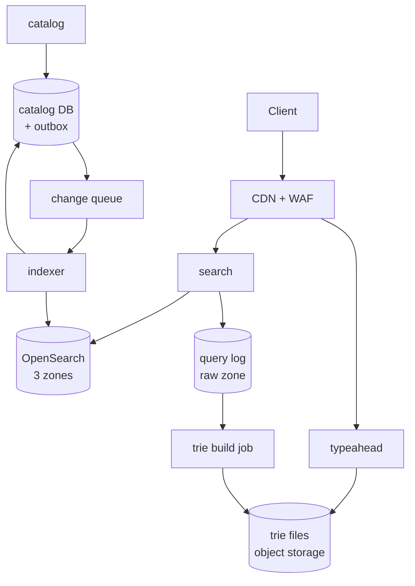

# Search and typeahead

Part of the [system design library](README.md). The framework, the estimation
numbers and the landing-zone conventions live in the [primer](00-primer.md);
this walkthrough links to them rather than restating them.

## The question

> "Design search for an e-commerce marketplace: a search box that suggests
> completions as the user types, and a results page with filters, ranked by
> relevance. Sellers change prices and stock all day."

Variants: "Design Google-style autocomplete" is the typeahead deep dive alone.
"Design search for Twitter" makes freshness the hard part. An enterprise
document search adds per-user permissions at a smaller scale.

## The two-minute answer

Search is two systems sharing a query log. **Search** is an inverted index
in OpenSearch, built from the catalog database. The catalog writes a change
event through a transactional outbox; an **indexer** reads the latest row,
builds the full document and bulk-writes it with the row's version as an
**external version**, so retries and reordering cannot put an older document
back. A 5-second refresh makes a change searchable within 10 seconds. Queries
fan out to every shard, each shard scores with BM25 plus business signals, and
the search service rescores the top 100 with a learned model. **Typeahead**
does not touch the engine on the hot path. A daily job turns the query log into
a **trie of top-10 completions per prefix**, ships it as a file, and every
typeahead instance holds it in memory and answers in microseconds. Responses
are not personalised on the server, so the CDN caches the short prefixes that
carry most of the traffic. The engine answers only the long tail the trie
misses. On AWS the index is a managed OpenSearch Service domain; Google Cloud
has no managed OpenSearch, so the same engine runs on the environment's GKE
Autopilot cluster.



## Clarify the requirements

Questions to ask, with the answers this walkthrough assumes:

| Question | Assumption |
|---|---|
| How big is the catalog? | 100 million products, about 2 KB of searchable text and attributes each. |
| How many users? | 20 million daily active, 5 searches each a day. |
| How chatty is typeahead? | 5 suggestion requests per search after a 100 ms client debounce. |
| How fresh? | Price and stock changes visible in results within 10 s at p99. New products within 1 minute. Suggestions refresh daily, trending ones within 15 minutes. |
| Latency? | Results p99 under 200 ms server-side. Suggestions p99 under 50 ms server-side, about 100 ms on the device. |
| Filters and facets? | Yes: category, brand, price range, rating, in-stock. |
| Personalised? | Results lightly, by category affinity. Suggestions not on the server; the client merges the user's recent searches. |
| Languages? | One language and one region to start. |

Functional: suggest, search with filters, facets and a cursor, and reflect
catalog changes. Non-functional: survive a zone loss with no outage, and
degrade rather than fail. Results seconds stale beat an error page, because the
cart re-checks price and stock against the catalog.

## Back-of-envelope estimates

The [primer's cheat sheet](00-primer.md#estimation-cheat-sheet) holds the
conversions.

### Request rates

- **Searches.** 20 million × 5 = 100 million a day ≈ 1,160/s; at a 3× peak,
  **3,500/s**.
- **Suggestions.** 5 per search: 500 million a day ≈ 5,800/s; at peak
  **17,500/s**. If the CDN answers half (short prefixes repeat heavily; an
  assumption to measure), the origin sees **about 9,000/s**.
- **Catalog changes.** 5% of products change a day: 5 million ≈ 60/s, but
  nightly seller price feeds burst to **2,000 changes/s**.

### Index size and shards

- **Source.** 100 million × 2 KB = 200 GB. Index overhead is usually about 10%
  of the source
  ([AWS docs](https://docs.aws.amazon.com/opensearch-service/latest/developerguide/bp-storage.html),
  checked 2026-11), so about **220 GB of primary data**.
- **Primary shards.** AWS advises 10–30 GiB per shard where search latency
  matters
  ([AWS docs](https://docs.aws.amazon.com/opensearch-service/latest/developerguide/bp-sharding.html),
  checked 2026-11). 220 ÷ 20 = 11, rounded to **12 primaries** of about 18 GB.
  Two replicas make three copies, one per zone: 36 shard copies, two on each of
  the 18 nodes below.
- **Disk.** The AWS minimum-storage formula, source × copies × 1.45, gives
  200 × 3 × 1.45 = 870 GB. A blue/green reindex holds two indexes at once, so
  plan 1.75 TB: about 100 GB per node across 18 nodes, so provision 200 GB.

### Search compute

- **Fan-out.** A search touches one copy of every primary: 3,500 × 12 =
  **42,000 shard-queries/s**.
- **CPU.** At an assumed 2 ms of CPU per shard-query with filters and facets
  (**verify before relying on**: it depends on the query and must be
  load-tested), that is 84 busy vCPU.
- **Nodes.** `r7g.4xlarge.search` has 16 vCPU and 128 GiB
  ([AWS docs](https://docs.aws.amazon.com/ec2/latest/instancetypes/mo.html),
  checked 2026-11). Multi-AZ with Standby keeps one zone's nodes idle as
  standby
  ([AWS docs](https://docs.aws.amazon.com/opensearch-service/latest/developerguide/managedomains-multiaz.html),
  checked 2026-11), so 18 data nodes (6 per zone) give 12 serving nodes and
  192 vCPU: **44% at peak**.
- **Zone loss.** The standby zone activates in under a minute and no data
  moves, so serving capacity stays at 12 nodes.
- **Memory.** Two shard copies per node is about 37 GB. Java heap is capped at
  50% of memory and 32 GiB by default
  ([AWS docs](https://docs.aws.amazon.com/opensearch-service/latest/developerguide/limits.html),
  checked 2026-11), which leaves about 90 GiB of page cache: the whole local
  index stays in memory.
- **Cross-check.** AWS's starting point of 1.5 vCPU per shard
  ([AWS docs](https://docs.aws.amazon.com/opensearch-service/latest/developerguide/bp.html),
  checked 2026-11) gives only 3 vCPU per node: query rate sizes this cluster.

### Indexing, typeahead and services

- **Indexing.** 2,000 docs/s × 3 copies = 6,000 document writes/s. The 4 MB/s
  of source is about one bulk request a second at the 3–5 MiB AWS suggests
  ([AWS docs](https://docs.aws.amazon.com/opensearch-service/latest/developerguide/bp.html),
  checked 2026-11).
- **Full reindex.** 100 million documents at an assumed throttled 20,000
  docs/s is about 1.4 hours.
- **Trie.** Keep queries seen at least 5 times in 30 days: assume 5 million,
  18 characters on average, about 30 million prefix nodes. A node holding ten
  4-byte query IDs plus child links is about 80 bytes: **about 2.4 GB**. Hot
  swap needs two copies, so 8 GiB per instance.
- **typeahead tasks.** 9,000 req/s at an assumed 2,000 per vCPU (the lookup is
  microseconds; HTTP dominates) is 4.5 vCPU. Run 6 tasks of 2 vCPU across
  three zones: 38%; 56% after a zone loss; 73% if the CDN fails open.
- **search tasks.** 3,500 req/s at an assumed 200 per vCPU (rescoring and
  hydration) is 17.5 vCPU. Run 18 tasks of 2 vCPU: 49%; 73% after a zone loss.

**What the numbers decide.** The index fits in memory, so CPU sets latency,
and CPU scales with query rate × shard count: keep shards few, and add nodes
for throughput. Writes are tiny, so freshness is a pipeline problem, not a
capacity one. Suggestions are five times the search rate and repetitive, so
they must not reach the engine.

## API and data model

### Endpoints

| Method and path | Purpose | Notes |
|---|---|---|
| `GET /v1/suggest?q=iph&lang=en` | Completions | Up to 10; `Cache-Control: public, max-age=300`; no cookies in the cache key. |
| `GET /v1/search?q=…&filters=…&cursor=…` | Results and facets | 24 per page; opaque cursor. |
| `POST /v1/events/click` | Click logging | Feeds ranking. |

The cursor wraps OpenSearch `search_after` values. A plain `from` + `size`
stops at 10,000 results by default (`index.max_result_window`,
[OpenSearch docs](https://docs.opensearch.org/latest/install-and-configure/configuring-opensearch/index-settings/),
checked 2026-11).

### Events

The catalog writes `ProductChanged {event_id, product_id, version,
changed_at}` to a transactional outbox in the same transaction as the row (as
in the microservices walkthrough). The event carries no body: the indexer reads
the current row. Search writes a `QueryLogged {query, normalized, result_count,
clicked_ids, ts}` record to the raw zone
([data zones](00-primer.md#data-zones)).

### Entities and access patterns

| Entity | Store | Key | Access pattern |
|---|---|---|---|
| `products` | Aurora PostgreSQL or Cloud SQL (catalog) | `product_id`; `version bigint` bumped on every change | Point reads by the indexer; source of truth for the cart. |
| `products` alias → `products_v{n}` | OpenSearch | `_id` = `product_id`; `_version` = row `version` | `bool` query with filters, aggregations for facets, `search_after`. |
| Suggestion trie | File in object storage, loaded into memory | Normalised prefix | Top 10 query IDs per node. |
| Trending delta | Small file, rebuilt every 15 minutes | Prefix | Merged over the daily trie. |
| Query log | Raw zone, partitioned by hour | `ts` | Daily and 15-minute aggregation jobs. |

The document is denormalised: title, brand, category path, attributes, price,
in-stock flag, rating, sales rank and `deleted`. Mappings use `dynamic:
strict`, which AWS recommends for search workloads so a stray field cannot
change the mapping
([AWS docs](https://docs.aws.amazon.com/opensearch-service/latest/developerguide/bp.html),
checked 2026-11).

## High-level design



### Write path: a seller changes a price

1. `catalog` updates the row, bumps `version`, and inserts the outbox row in
   one transaction.
2. The relay publishes `ProductChanged` to the change queue (SQS standard or
   Pub/Sub, no ordering).
3. `indexer` collects up to 1 second or 5 MiB of events, deduplicates by
   `product_id`, and batch-reads the current rows from a catalog reader.
4. It builds each document and sends one `_bulk` request with
   `version_type=external` and `version` = the row's version.
5. A version conflict (409) means a newer document is already indexed: success,
   acknowledge it. Other item failures go back to the queue.
6. The next refresh (every 5 s) makes the change searchable.

### Read path: typing, then searching

1. Each debounced keystroke calls `/v1/suggest`. The CDN answers repeats; a
   miss reaches `typeahead`, which returns the prefix node's stored top 10,
   merged with the trending delta. The client adds the user's recent searches.
2. Fewer than 3 trie results for a prefix of 4 or more characters triggers a
   fallback: a `search_as_you_type` query on product titles, with a 30 ms
   budget.
3. Submitting calls `/v1/search`. `search` sends one query to the `products`
   alias; the coordinating node fans out to one copy of each of the 12 shards,
   merges the top 100 and computes facets.
4. `search` rescores the 100, applies business rules, returns the first 24
   and logs the query.

## Deep dives

### Indexing pipeline and freshness

Freshness is the sum of four delays: commit to event, event to indexer,
indexer to bulk, bulk to refresh. Bound each one and make every step safe to
retry.

| Source of change events | How | Wins | Breaks |
|---|---|---|---|
| Dual write from `catalog` to the index | Service writes DB, then index | Simplest | A crash between the two writes loses the update for good. |
| Periodic batch scan (`updated_at > last`) | Poll every minute | No moving parts | Minutes of lag; deletes are invisible; clock skew drops rows. |
| **Outbox or CDC to a queue** (chosen) | Event in the same transaction | No lost updates; seconds of lag | Needs a relay; events can repeat or reorder. |

**Events as notifications, rows as truth.** The event says only "product X
changed". The indexer re-reads the row, so ten changes to one product become
one document, and a late event is harmless: the row it reads is current.

**External versions make writes idempotent.** With `version_type=external`,
OpenSearch indexes a document only if its version is strictly greater than the
stored one
([OpenSearch docs](https://docs.opensearch.org/latest/api-reference/document-apis/index-document/),
checked 2026-11). Two indexer workers racing on the same product, a redelivered
message or a replay from last week all converge on the highest version, with
no ordered queue. The version must come from the database (a `bigint` bumped in
the same `UPDATE`), never from the indexer's clock.

**Deletes are soft.** A hard delete keeps its version only for
`index.gc_deletes`, 60 seconds by default
([OpenSearch docs](https://docs.opensearch.org/latest/api-reference/document-apis/delete-document/),
checked 2026-11). After that, a delayed index request carrying an older version
would resurrect the product. So a delete is an index call with `deleted: true`
at the next version, every query filters on it, and the blue/green rebuild
drops tombstones.

**Refresh is the dial.** A refresh makes buffered writes searchable. The
OpenSearch default is 1 s, but an index that has had no search for 30 s stops
refreshing until the next search, unless the interval is set explicitly
([OpenSearch docs](https://docs.opensearch.org/latest/install-and-configure/configuring-opensearch/index-settings/),
checked 2026-11). AWS recommends 30 s or more for indexing throughput
([AWS docs](https://docs.aws.amazon.com/opensearch-service/latest/developerguide/bp.html),
checked 2026-11). At 60 writes/s throughput does not matter, so set **5 s
explicitly**. The budget: relay 1 s + queue 1 s + indexer batch 1 s +
refresh 5 s = 8 s, inside the 10 s target.

**Blue/green rebuilds.** Mapping changes need a new index. Load
`products_v{n+1}` from a catalog snapshot while the indexer writes to both,
then swap the read alias in one atomic `_aliases` request
([OpenSearch docs](https://docs.opensearch.org/latest/im-plugin/index-alias/),
checked 2026-11). External versions make the snapshot load and the live stream
commute: the higher version wins whichever arrives second.

**Where it breaks.**

- A price feed that rewrites 20 million rows makes a 3-hour backlog at
  2,000/s. Give feeds their own lower-priority queue so seller edits are not
  stuck behind them.
- A field that changes every second, such as a live stock count, should not be
  indexed at all. Index a coarse `in_stock` flag and hydrate the exact
  price and stock for the 24 returned products from a cache at response time.

### Trie vs search engine

Typeahead's shape: one short prefix, ten answers, five requests per search,
a 50 ms budget.

| Approach | How | Wins | Breaks |
|---|---|---|---|
| Prefix query on the index (`match_phrase_prefix`) | Expand the last term at query time | No new system | Expensive on short prefixes; 17,500/s of fan-out on top of search. |
| Edge n-grams or `search_as_you_type` field | Index every prefix of every term | Matches inside titles, respects filters | Index grows; still a 12-shard fan-out per keystroke. |
| Completion suggester | A `completion` field kept in memory for fast prefix lookups ([OpenSearch docs](https://docs.opensearch.org/latest/search-plugins/searching-data/autocomplete/), checked 2026-11) | Fast, weighted | Prefix-only; weights are frozen at index time; lives inside the search cluster. |
| **Precomputed trie in the service** (chosen) | Top 10 per prefix, built offline from the query log | Microseconds, no shared dependency, CDN-cacheable | Long-tail and brand-new terms; memory per instance. |

**Why the trie wins.** Suggestions should be what people *search for*, not
what products are *called*: "iphone 15 case" is a query, not a title, and the
query log already ranks it. Precomputing the top 10 at every node turns a
lookup into a walk of at most 20 characters with no scoring. Each instance
holds the whole structure, so typeahead scales with stateless tasks and never
competes with search for engine CPU.

**Building it.** A daily job aggregates 30 days of `QueryLogged` with an
exponential decay (a 7-day half-life), normalises case and whitespace, drops
queries below 5 occurrences or that returned zero results, and removes
blocklisted terms. It then builds the trie bottom-up, keeping each node's ten
highest-scoring completions, and writes a versioned file. Instances poll for a
new version, load it beside the old one and swap a pointer. A 15-minute job
writes a small trending delta (queries whose last-hour rate is ten times their
daily rate), merged at lookup.

**The engine still has a job.** The long-tail fallback (read path, step 2)
covers new products and rare models at a small fraction of traffic.

**Caching.** Because the server never personalises, a suggestion response is
the same for everyone. CloudFront includes only the query strings the cache
policy names in the cache key
([AWS docs](https://docs.aws.amazon.com/AmazonCloudFront/latest/DeveloperGuide/controlling-the-cache-key.html),
checked 2026-11), so name `q` and `lang`. Cloud CDN includes the whole query
string by default
([Google Cloud docs](https://docs.cloud.google.com/cdn/docs/caching),
checked 2026-11). There are only 18,278 prefixes of one to three letters.

**Where it breaks.** A trie per locale multiplies memory: at tens of
locales, shard it by first character across instance groups. Offensive
completions need a build-time blocklist and a lookup-time kill switch that
does not wait for the next build.

### Sharding and ranking

**Document partitioning.** Each shard holds whole documents and its own
inverted index, so every query visits every shard (scatter-gather).
Partitioning by term would send a query only to the shards owning its terms,
but multi-term queries then intersect across shards and each write touches
many shards. The cost of document partitioning is fan-out, so data size sets
the shard count and copies supply throughput.

**Choosing the count.** AWS's guide is 10–30 GiB per shard for search,
25 shards or fewer per GiB of heap, and a shard count that is a multiple of
the data node count
([AWS docs](https://docs.aws.amazon.com/opensearch-service/latest/developerguide/bp.html),
checked 2026-11). Our 12 primaries are not a multiple of 18 nodes, but the 36
copies are exactly 2 per node, which is what the rule protects. The primary count is fixed at creation
(`index.number_of_shards` is a final setting,
[OpenSearch docs](https://docs.opensearch.org/latest/install-and-configure/configuring-opensearch/index-settings/),
checked 2026-11), so growth means a blue/green reindex with more shards. Plan
it when shards pass about 30 GB.

**Routing.** A custom `routing` value sends a document and its queries to one
shard
([OpenSearch docs](https://docs.opensearch.org/latest/api-reference/search-apis/search/),
checked 2026-11). It removes fan-out when every query has the key (a tenant in
a multi-tenant document search). For marketplace search it is wrong: queries
span sellers, and routing by seller makes a large seller a hot shard.

**Ranking in two phases.**

1. **On the shards.** A `bool` query: filters (category, in-stock, not
   deleted) in filter context, which is cached and not scored; BM25 on title,
   brand and attributes with field boosts; a `function_score` adding log sales
   rank and rating. Each shard returns its top hits, and the coordinator
   merges the global top 100.
2. **In a rescore window.** A learned model reorders the top 100. The Learning
   to Rank plugin runs XGBoost or RankLib models as a `rescore` query inside
   OpenSearch
   ([AWS docs](https://docs.aws.amazon.com/opensearch-service/latest/developerguide/learning-to-rank.html),
   checked 2026-11). Training stays offline, from click logs in the raw zone.
   Then `search` applies light personalisation (category affinity) and
   business rules: diversity by seller, sponsored slots, pinned results.

Cheap scoring touches every match; expensive scoring touches 100.

**Score skew across shards.** By default each shard scores with its own term
statistics. `dfs_query_then_fetch` collects global statistics first, at the
cost of an extra round trip
([OpenSearch docs](https://docs.opensearch.org/latest/api-reference/search-apis/search/),
checked 2026-11). With 100 million randomly spread documents, per-shard
statistics converge, so keep the default; skew shows in small or routed
indexes.

**Where it breaks.** A query matching 30 million products makes every shard
score millions of documents: cap work per shard with `terminate_after` on
broad category browses, and serve the top category pages from a cache. A
learned model that leans on popularity starves new products of clicks: reserve
exploration slots.

## Trade-offs to defend

| Decision | Chosen | Rejected | Why | What would change the answer |
|---|---|---|---|---|
| Change capture | Outbox events as notifications; indexer re-reads the row | Dual writes; batch scans; full documents in events | No lost updates; bursts collapse; late events harmless | A CDC stack already in place (same design, Debezium as relay). |
| Ordering | External versions, unordered queue | FIFO queue or ordering keys | Correct under retries and replays without ordering limits | An engine without external versions. |
| Refresh | 5 s, explicit | 1 s default; 30 s recommendation | 8 s budget; trivial write rate | Write-heavy index (logs): 30 s or more. |
| Typeahead | Precomputed trie in the service, engine for the long tail | Completion suggester; edge n-grams | Microseconds, CDN-cacheable, isolates engine CPU | Suggestions that must respect filters or permissions. |
| Shards | 12 primaries × 3 copies, about 18 GB each | Many small shards; custom routing | Fewer shard-queries per search; even spread | A tenant key on every query. |
| Ranking | BM25 + function score on shards, LTR rescore of 100 | Model on every match; no learning | Cost bounded by window | A dense-vector retrieval stage (hybrid search). |
| Engine on GCP | OpenSearch on the env GKE Autopilot cluster | Vertex AI Search; Elastic from the Marketplace | Same engine and pipeline on both clouds; repo module exists | No team to run stateful clusters: take the managed product. |

## Failure modes and scaling limits

### What fails first as load grows

| Load | First to fail | Why | Fix |
|---|---|---|---|
| ×10 searches (35,000/s) | Search CPU: 840 busy vCPU | Linear in queries × shards | About 1,900 serving vCPU at 44%: 120 serving nodes, 180 data nodes. The default limit is 80 nodes per instance family, raisable to 400 for Graviton on OpenSearch 2.17+ ([AWS docs](https://docs.aws.amazon.com/opensearch-service/latest/developerguide/limits.html), checked 2026-11). A result cache for head queries. |
| ×10 catalog (1 billion products) | Shard size: 2.2 TB primary | 12 shards of 180 GB | Reindex to about 96 shards; the 65 GiB per-shard cap on standby domains forces it anyway. |
| ×10 price feeds | Indexing backlog | Bulk throughput and merges compete with search | Separate feed queue, throttled indexer, larger refresh during feeds. |
| ×100 | One region, one cluster | Fan-out and cluster state | Cluster per region or catalog segment, federated by the search service. |

### Blast radius

| Component | If it fails | Users see | Contained by |
|---|---|---|---|
| One data node | Its shard copies fail over | Nothing; brief latency | Copies in other zones |
| A zone | Standby zone activates in under a minute | A brief latency blip | Multi-AZ with Standby |
| Whole search cluster | No results | Search unavailable; suggestions still work | Category browse from a cache; the runbook |
| Indexer or queue | No new writes | Stale prices; cart re-checks | Queue retention, external versions on catch-up |
| typeahead | No suggestions | Plain search box | CDN serves cached prefixes |
| Trie build | Yesterday's suggestions | Nothing visible | Instances keep the last good file |

## AWS and GCP mapping

| Component | AWS | GCP | Difference that matters |
|---|---|---|---|
| Search engine | Amazon OpenSearch Service, VPC domain, Multi-AZ with Standby | Self-run OpenSearch on GKE Autopilot | A managed domain against a stateful set you operate: upgrades, snapshots and node failure are yours on GCP. |
| Managed alternative | OpenSearch Serverless | Vertex AI Search, being renamed Agent Search ([Google Cloud docs](https://docs.cloud.google.com/generative-ai-app-builder/docs/introduction), checked 2026-11) | Vertex AI Search owns ranking; you trade control for no cluster. |
| `catalog`, `search`, `typeahead` | ECS Fargate via app-services | Cloud Run via app-services | Same golden path. |
| `indexer` | ECS Fargate, long-polling its SQS queue | A Deployment on the GKE cluster, streaming pull | Request-billed Cloud Run is a poor pull consumer, and the indexer sits beside the engine anyway. |
| Change queue | SQS standard | Pub/Sub topic and pull subscription | Neither needs ordering. |
| Trie files | S3 | Cloud Storage | Both CMEK-encrypted. |
| CDN | CloudFront | Cloud CDN | CloudFront caches only named query strings. |
| Engine CMEK | `encrypt_at_rest` with the workload CMK through a grant ([AWS docs](https://docs.aws.amazon.com/opensearch-service/latest/developerguide/encryption-at-rest.html), checked 2026-11) | StorageClass `disk-encryption-kms-key`; the Compute Engine service agent needs Encrypter/Decrypter, key in the cluster's region ([Google Cloud docs](https://docs.cloud.google.com/kubernetes-engine/docs/how-to/using-cmek), checked 2026-11) | Both are set at creation. |

On GCP, size pods as on AWS: 18 of 16 vCPU over three zones. Google's
Elasticsearch-on-GKE tutorial supports Autopilot but raises `vm.max_map_count`
with a privileged DaemonSet
([Google Cloud docs](https://docs.cloud.google.com/kubernetes-engine/docs/tutorials/deploy-elasticsearch),
checked 2026-11). Whether that runs on Autopilot, or OpenSearch needs
`node.store.allow_mmap: false`: **verify before relying on**.

## Build it here

### Where it lives

| Part | AWS | GCP |
|---|---|---|
| `catalog`, `search`, `typeahead`, catalog DB | `aws-workload-<env>` (`envs/aws/workload`) through app-services | `gcp-workload-<env>` (`envs/gcp/workload`) through app-services |
| `indexer` | app-services service with its own queue | Deployment on the env cluster `<env>-apps` |
| Search engine | Raw OpenSearch domain in `envs/aws/workload`, `isolated` tier | OpenSearch on `<env>-apps`, enabled by `enable_gke_autopilot` |
| CMEK | `local.kms_key_arn` (`workload_kms_key_arn`) | New `module "workload_cmek"` per the [CMEK source](00-primer.md#cmek-source) convention |
| Apply order | `aws-organization` → … → `aws-network` → `aws-workload-<env>` | `gcp-bootstrap` → `gcp-organization` → `gcp-projects` → `gcp-network-hub` → `gcp-workload-<env>` |

The domain's network interfaces sit in the `isolated` tier, per
[VPC-tier placement](00-primer.md#vpc-tier-placement). GCP departs from it:
the module's single cluster runs in the first `private` subnet, not
`database`, because that tier denies all egress and GKE nodes need egress to
the control plane, Google APIs and image pulls. The compensating control is a
Kubernetes NetworkPolicy that admits 9200 only from `indexer`, `search` and
`typeahead`. Egress from the indexer is per-environment Cloud NAT, not
inspected through the hub.

### Config

```yaml
# Illustrative. Keys are real (config/landing-zone.schema.json); values are placeholders.
aws:
  workload_environments:
    prod:
      services:
        catalog:
          database:
            instance_count: 2 # writer + reader for the indexer
          task_role_policy_json: >-
            {"Version":"2012-10-17","Statement":[{"Effect":"Allow","Action":"sqs:SendMessage",
            "Resource":"arn:aws:sqs:REGION:ACCOUNT_ID:prod-indexer"}]}
        indexer:
          queue:
            enabled: true # prod-indexer and prod-indexer-dlq
        typeahead:
          cpu: 2048
          memory: 8192 # two tries during a hot swap
          desired_count: 6
gcp:
  environments:
    prod:
      services:
        catalog:
          pubsub:
            enabled: true # topic "catalog" carries ProductChanged
        typeahead:
          cpu: "2"
          memory: 8Gi
          min_instances: 6
        trie-build:
          runtime: cloud-run-job
          cpu: "4"
          memory: 16Gi
```

In the `gcp-workload-prod` workspace, also set the Terraform variable
`enable_gke_autopilot = true` (it is not a config key), which creates the
private cluster `prod-apps`. Size `search` (18 tasks of 2 vCPU) in the same
service maps.

Gaps this design hits:

- **Indexer database access.** Each app-services service owns its database,
  so the indexer reads rows through `catalog`'s internal batch API.
- **Scheduling.** app-services has no scheduled tasks on AWS, and the GCP
  `cloud-run-job` needs a raw Cloud Scheduler trigger.
- **Queue CMEK.** `envs/aws/workload` does not pass `queue_kms_key_arn`, so
  `prod-indexer` uses SQS-managed encryption.
- **GCP firewall.** The tier baseline has no rule from `compute` to `compute`,
  so Cloud Run cannot reach the OpenSearch internal load balancer until you add
  one on port 9200.

### AWS: the OpenSearch domain

In `envs/aws/workload`, using `local.environment`, `local.kms_key_arn`,
`module.aws_workload` and `module.app_services`. A VPC domain needs the
`AWSServiceRoleForAmazonOpenSearchService` service-linked role to exist first
([AWS docs](https://docs.aws.amazon.com/opensearch-service/latest/developerguide/vpc.html),
checked 2026-11). Arguments checked against aws v6.72.0
([`aws_opensearch_domain`](https://registry.terraform.io/providers/hashicorp/aws/6.72.0/docs/resources/opensearch_domain),
[`aws_opensearch_domain_policy`](https://registry.terraform.io/providers/hashicorp/aws/6.72.0/docs/resources/opensearch_domain_policy),
checked 2026-11).

```hcl
# Gap: the repo has no OpenSearch module; raw resources in the landing zone's conventions.
locals {
  search_name = "${local.environment}-search-engine" # <env>-<component>
}

resource "aws_security_group" "search" {
  name        = "${local.search_name}-db"
  description = "search: 443 from search, indexer and typeahead only"
  vpc_id      = module.aws_workload.vpc_id
  tags        = { Name = "${local.search_name}-db", Service = "search-engine" }
}

resource "aws_vpc_security_group_ingress_rule" "search_from_svc" {
  for_each                     = toset(["search", "indexer", "typeahead"])
  security_group_id            = aws_security_group.search.id
  referenced_security_group_id = module.app_services.services[each.key].security_group_id
  ip_protocol                  = "tcp"
  from_port                    = 443
  to_port                      = 443
}

resource "aws_opensearch_domain" "search" {
  domain_name    = local.search_name
  engine_version = "OpenSearch_3.3"

  cluster_config {
    instance_type                 = "r7g.4xlarge.search"
    instance_count                = 18 # 6 per zone; one zone is standby
    dedicated_master_enabled      = true
    dedicated_master_type         = "m7g.large.search"
    dedicated_master_count        = 3
    zone_awareness_enabled        = true
    multi_az_with_standby_enabled = true
    zone_awareness_config { availability_zone_count = 3 }
  }

  ebs_options {
    ebs_enabled = true
    volume_type = "gp3"
    volume_size = 200
    throughput  = 250
  }

  vpc_options {
    subnet_ids         = module.aws_workload.subnet_ids_by_tier["isolated"] # one per zone
    security_group_ids = [aws_security_group.search.id]
  }

  encrypt_at_rest {
    enabled    = true
    kms_key_id = local.kms_key_arn # workload CMK through a KMS grant
  }

  node_to_node_encryption { enabled = true }
  domain_endpoint_options { enforce_https = true }

  tags = { Service = "search-engine" }
}

resource "aws_opensearch_domain_policy" "search" {
  domain_name = aws_opensearch_domain.search.domain_name
  access_policies = jsonencode({
    Version = "2012-10-17"
    Statement = [
      {
        Effect    = "Allow" # query paths only: POST /_bulk is also ESHttpPost
        Principal = { AWS = [for s in ["search", "typeahead"] : module.app_services.services[s].task_role_arn] }
        Action    = ["es:ESHttpGet", "es:ESHttpPost"]
        Resource  = "${aws_opensearch_domain.search.arn}/products/_search"
      },
      {
        Effect    = "Allow"
        Principal = { AWS = module.app_services.services["indexer"].task_role_arn }
        Action    = ["es:ESHttpGet", "es:ESHttpPost", "es:ESHttpPut", "es:ESHttpDelete"]
        Resource  = "${aws_opensearch_domain.search.arn}/*"
      },
    ]
  })
}
```

A master with 8 GB of RAM covers 30 data nodes on OpenSearch 2.17 and later
([AWS docs](https://docs.aws.amazon.com/opensearch-service/latest/developerguide/managedomains-dedicatedmasternodes.html),
checked 2026-11). Each isolated subnet needs ceil(18 ÷ 3) × 3 = 18 free IP
addresses. The service security groups already allow HTTPS egress.

### GCP: CMEK and the indexer's subscription

In `envs/gcp/workload`, using `local.env_config`, `local.project_prefix`,
`local.labels` and `var.environment`. OpenSearch itself is Kubernetes
manifests (operator, StatefulSet, a StorageClass with
`disk-encryption-kms-key` set to the key below), outside Terraform here.
Arguments checked against google v8.10.0
([`google_pubsub_subscription`](https://registry.terraform.io/providers/hashicorp/google/8.10.0/docs/resources/pubsub_subscription),
checked 2026-11).

```hcl
# Gap: no per-environment workload CMEK exists yet (see the primer's CMEK source);
# this adds one with the existing kms module.
module "workload_cmek" {
  source = "../../../modules/gcp/governance/kms"

  project_id   = local.env_config.host_project_id
  keyring_name = "${local.project_prefix}-${var.environment}-cmek"
  location     = local.env_config.region # same region as the regional cluster
  labels       = local.labels
  keys = {
    "search-engine" = {
      encrypter_decrypters = [
        "serviceAccount:service-${local.env_config.host_project_number}@compute-system.iam.gserviceaccount.com",
      ]
    }
  }
}

# Gap: the module's subscription on "catalog" is consumable only by catalog-run; raw resources.

resource "google_pubsub_subscription" "indexer" {
  project              = local.env_config.host_project_id
  name                 = "indexer"
  topic                = "projects/${local.env_config.host_project_id}/topics/catalog"
  ack_deadline_seconds = 60
  labels               = merge(local.labels, { service = "indexer" })

  expiration_policy { ttl = "" } # never expire

  dead_letter_policy {
    dead_letter_topic     = "projects/${local.env_config.host_project_id}/topics/catalog-dlq"
    max_delivery_attempts = 10
  }
}

resource "google_pubsub_subscription_iam_member" "indexer" {
  for_each = {
    # The indexer pod's Kubernetes service account (namespace search, name indexer):
    indexer = "principal://iam.googleapis.com/projects/${local.env_config.host_project_number}/locations/global/workloadIdentityPools/${local.env_config.host_project_id}.svc.id.goog/subject/ns/search/sa/indexer"
    agent   = "serviceAccount:service-${local.env_config.host_project_number}@gcp-sa-pubsub.iam.gserviceaccount.com"
  }
  project      = local.env_config.host_project_id
  subscription = google_pubsub_subscription.indexer.name
  role         = "roles/pubsub.subscriber"
  member       = each.value
}
```

Notes:

- The Compute Engine service agent needs the key grant even when nodes use a
  custom service account
  ([Google Cloud docs](https://docs.cloud.google.com/kubernetes-engine/docs/how-to/using-cmek),
  checked 2026-11).
- Pub/Sub accepts Workload Identity Federation principals with no known
  limitations
  ([Google Cloud docs](https://docs.cloud.google.com/iam/docs/federated-identity-supported-services),
  checked 2026-11). So the pod's Kubernetes service account is granted
  directly, with no Google service account.
- Dead-lettering needs the Pub/Sub service agent as subscriber on the source
  subscription and publisher on the dead-letter topic
  ([Google Cloud docs](https://docs.cloud.google.com/pubsub/docs/handling-failures),
  checked 2026-11). app-services already grants the publisher role on
  `catalog-dlq`.
- The module's own `catalog-sub` still retains every event for 7 days unread.

## Runbook

### Search cluster overloaded: latency, rejections or a red index

**Detection signal.**

- `search` p99 over 200 ms or a 5xx rate over 1% for 5 minutes.
- OpenSearch `ThreadpoolSearchRejected` rising, `CPUUtilization` at 80% or
  more for 15 minutes, or `JVMMemoryPressure` at 95%: AWS's recommended alarms
  ([AWS docs](https://docs.aws.amazon.com/opensearch-service/latest/developerguide/cloudwatch-alarms.html),
  checked 2026-11).
- `ClusterStatus.red` or `ClusterStatus.yellow` (on GKE: the `_cluster/health`
  status from the exporter).

**Triage.**

1. **Red or yellow?** Red means a primary shard is unassigned: some products
   are missing from results. Yellow means a replica is missing: results are
   complete but capacity is lower. `GET _cluster/allocation/explain` names the
   reason (disk watermark, node loss, a failed recovery).
2. **Traffic or cost?** Compare the query rate with the 3,500/s plan. A normal
   rate with high CPU points at a query change: check the search slow log for
   a new expensive pattern (a wildcard, a huge aggregation, a deep page).
3. **Is indexing competing?** A price feed or a reindex in progress shows as a
   rising indexing rate and merge activity next to the search CPU.

**Mitigation.**

1. **Protect search over freshness.** Pause or throttle the indexer (scale it
   to zero; events wait in the queue) and stop any reindex.
2. **Shed expensive work.** Turn on the `search` degrade flag: no facets on
   broad queries, `terminate_after` on category browses, the rescore window
   cut from 100 to 24.
3. **Bad deploy.** Roll back the `search` service or the query template.
4. **Red index.** If a primary cannot recover, restore that index from the
   latest snapshot, or rebuild `products_v{n+1}` from the catalog and swap the
   alias. External versions make the replayed queue safe afterwards.
5. **Capacity.** Add data nodes in multiples of three (a blue/green change on
   AWS, so start it early) through `aws-workload-<env>` in Terraform Cloud; on
   GKE, scale the StatefulSet.

**Verification.** p99 under 200 ms, no search rejections for 15 minutes,
status green, and indexer lag (oldest queue message) back under 10 seconds
after resuming at a throttled rate.

**Follow-up.** Alarm on queue age, not only cluster health; load-test the
slow-log offender; keep the degrade flag; give feeds their own queue.

## Study aids

### Numbers to memorise

| Number | Value |
|---|---|
| Searches at peak | 3,500/s; suggestions 17,500/s, about 9,000/s past the CDN |
| Index | 100 M docs, 220 GB primary, 12 shards of about 18 GB, 3 copies |
| Shard guidance | 10–30 GiB for search; at most 25 shards per GiB of heap |
| Fan-out | 42,000 shard-queries/s; 84 busy vCPU at an assumed 2 ms each |
| Cluster | 18 × `r7g.4xlarge.search`, 12 serving, 44% at peak |
| Freshness budget | 1 + 1 + 1 + 5 s refresh = 8 s, under a 10 s target |
| Trie | 5 M queries, about 30 M nodes, about 2.4 GB |
| Deleted-version memory | `index.gc_deletes` = 60 s |

### Likely follow-ups

- **"Why not just use the completion suggester?"** It lives in the search
  cluster and adds a fan-out per keystroke at five times the search rate. The
  trie is per instance, cacheable, and ranks by what people search.
- **"How do you stop a stale update overwriting a newer one?"** External
  versions from a database counter; OpenSearch rejects anything not strictly
  newer.
- **"How do you change a mapping with no downtime?"** Build a new index,
  dual-write, then swap the alias atomically.
- **"Search shows a wrong price."** Results are a hint; the cart reads the
  catalog. If it matters, hydrate price at response time.
- **"How do you paginate deep results?"** `search_after` with a sort
  tiebreaker, never `from` past 10,000.

### Classic mistakes

- Sending every keystroke to the search engine.
- Dual writes from the service to the database and the index.
- Hard deletes with external versions (resurrection after 60 s).
- Hundreds of tiny shards.
- Running the learned model over every match instead of a window.
- Personalising the suggestion response, which kills the CDN hit rate.

### Further reading

- [OpenSearch Service: operational best practices](https://docs.aws.amazon.com/opensearch-service/latest/developerguide/bp.html) (checked 2026-11)
- [OpenSearch Service: Multi-AZ with Standby](https://docs.aws.amazon.com/opensearch-service/latest/developerguide/managedomains-multiaz.html) (checked 2026-11)
- [OpenSearch: autocomplete](https://docs.opensearch.org/latest/search-plugins/searching-data/autocomplete/) (checked 2026-11)
- [Primer: conventions](00-primer.md#conventions) and
  [VPC-tier placement](00-primer.md#vpc-tier-placement)
