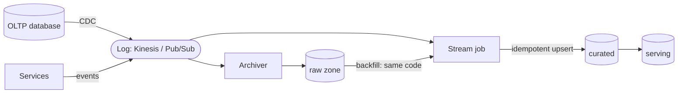
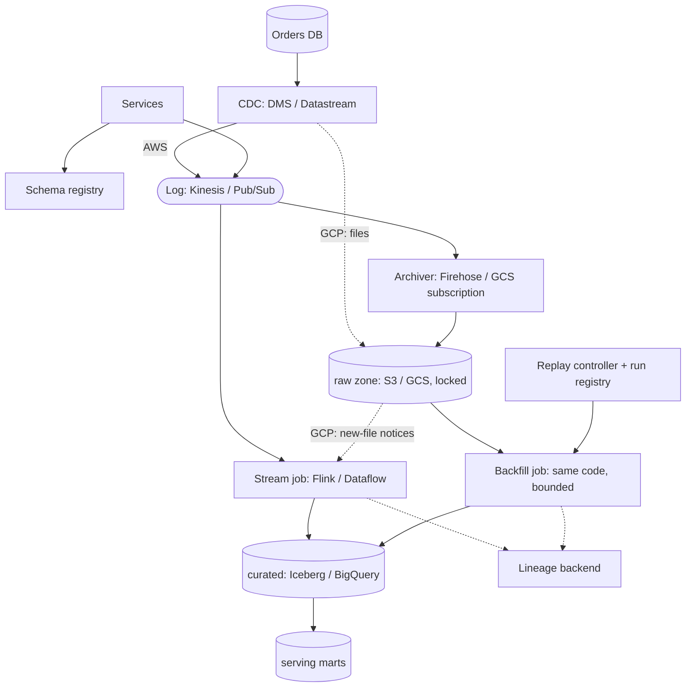

# ETL for batch and streaming, with lineage and replay

Part of the [system design library](README.md). The framework, the estimation
numbers and the landing-zone conventions live in the [primer](00-primer.md).
This walkthrough lands data in the primer's [data zones](00-primer.md#data-zones)
(raw, curated, serving) and uses those names without redefining them. It
reuses the [transactional outbox](03-microservices-sync-async.md#the-transactional-outbox)
by name.

## The question

> "Design a data pipeline that ingests changes from our operational databases
> and events from our services. Analysts want fresh dashboards within minutes,
> finance wants correct daily numbers, and when a bug corrupts a table we need
> to rebuild it. Show us lineage: which jobs produced which tables, from what."

Common variants:

- "Lambda or Kappa architecture? Defend it."
- "How do you get changes out of Postgres without hammering it?" (CDC)
- "A transform had a bug for three days. How do you backfill?"
- "Events arrive two days late from mobile clients. What happens to yesterday's totals?"
- "A source team renamed a column. What breaks?"

## The two-minute answer

Every source lands first in an **append-only log**: database changes through
**log-based CDC** (reading the write-ahead log, not polling tables), and
service events published directly. An **archiver** copies the log, untouched,
into the **raw zone**, immutable and partitioned by arrival time (on GCP,
Datastream writes CDC files there directly). Raw is the long-term replay
source; the log keeps only days. One
**stream job** reads the log and maintains **curated** tables with
**idempotent writes**: upserts keyed by the business key and guarded by the
source's log position, so a replayed record can never overwrite a newer one.
This is **Kappa with the raw zone as the long log**: the same code runs in
streaming mode for live data and in batch mode over a range of raw partitions
for a **backfill**, with no second batch-only codebase. Late events update
their windows for a bounded period; later ones go to a nightly restatement.
Every run emits **OpenLineage** events naming its inputs, outputs, code
version and input range, so a bad table traces to its job run and its
downstream blast radius. On AWS this is DMS, Kinesis, Firehose, S3 and Managed Flink; on
GCP it is Datastream, Pub/Sub, Cloud Storage, Dataflow and BigQuery.



## Clarify the requirements

| Question | Assumed answer |
|---|---|
| Sources? | One Postgres OLTP database (about 50 tables of interest) and service events. |
| Freshness? | Curated tables within 5 minutes p95; serving dashboards within 10. |
| Correctness? | Daily finance figures must equal the source exactly once late data settles; dashboards may be approximate until then. |
| History? | Curated keeps current state plus change history; raw keeps everything for 2 years. |
| Replay? | Rebuild any curated table from any point in the last 2 years; rebuild 7 days of it in under 8 hours. |
| Late data? | 99% of events arrive within 5 minutes; mobile clients can be up to 72 hours late. |
| Schema change? | Additive changes flow without a deploy; breaking changes must not silently corrupt tables. |
| Regions? | One region per cloud. Cross-region DR is the data DR walkthrough. |

Non-functional: CDC must never fill the source's disk, nothing may be lost
between source and raw, and duplicates are tolerated in transit but not in
curated.

## Back-of-envelope estimates

Arithmetic uses the primer's [QPS conversions](00-primer.md#qps-conversions)
and [storage units](00-primer.md#storage-and-bandwidth-units).

**CDC.** 2,000 row changes a second on average, 5,000 at peak, about 1 KB each
with after images (and full before images where needed): **2 MB/s average,
5 MB/s peak**, or 173 GB a
day.

**Events.** 8,000 a second on average, 20,000 at peak, at 1 KB: **8 MB/s
average, 20 MB/s peak**, or 691 GB a day.

**Raw zone.** About 864 GB a day uncompressed. Assuming 5× compression in
Parquet or Avro (an assumption; measure it on real payloads), that is about
**175 GB a day, 64 TB a year, about 128 TB for two years**. Curated holds less
(current state plus compacted history); serving is small.

**Log capacity: the number that shapes the AWS design.** A Kinesis shard takes
1 MB/s or 1,000 records a second of writes and serves 2 MB/s of shared reads
([AWS docs](https://docs.aws.amazon.com/streams/latest/dev/service-sizes-and-limits.html),
checked 2026-11). The events stream at peak needs 20 shards' worth of writes.
With three readers (archiver, stream job, an incident-time log replay) it
needs 60 MB/s of reads against 40 MB/s shared, so the stream job uses
**enhanced fan-out**: dedicated read throughput per registered consumer, up to
20 per stream in on-demand standard mode (same page). On-demand streams start
at 4 MB/s of write and scale to 200 MB/s outside the three largest Regions
(same page), so pre-warm a new stream before its first peak. Pub/Sub's
regional publish quota is 200 MB/s even in a small region
([Google Cloud docs](https://docs.cloud.google.com/pubsub/quotas), checked
2026-11): 25 MB/s is far below it.

**Replay throughput.** Seven days of raw is about 6 TB uncompressed. Doing it
in 8 hours is 6 TB ÷ 28,800 s ≈ **210 MB/s, 21× the live average**. Assuming 5
MB/s per vCPU for parse, deduplicate and merge (an assumption: benchmark your
transforms), that is 42 vCPUs; plan 48, for example 12 four-vCPU workers.
Replay capacity, not live capacity, sizes the worker quota.

**Curated writes.** Merging every minute, 2,000 changes a second becomes about
120,000 rows per merge, spread over 50 tables. BigQuery runs at most two
mutating DML statements per table at once and queues 20 more; further
statements fail
([Google Cloud docs](https://docs.cloud.google.com/bigquery/quotas), checked
2026-11). One merge a minute per table fits; a backfill merging into the same
table would compete with it, which shapes the [replay design](#replay-and-backfill).

## API and data model

### The raw record

Every raw record keeps the source payload untouched and adds an envelope:

```json
{
  "source": "orders_db",
  "object": "public.orders",
  "op": "u",
  "commit_pos": 4892311221,
  "rec_offset": 3,
  "source_ts": "2026-11-07T13:02:11.512Z",
  "ingest_ts": "2026-11-07T13:02:12.104Z",
  "schema_id": "orders_db.public.orders/v7",
  "key": {"order_id": "ord_8K2N4"},
  "before": {"status": "PENDING"},
  "after": {"order_id": "ord_8K2N4", "status": "PAID", "total_cents": 4200}
}
```

The **source position** is the pair (`commit_pos`, `rec_offset`): where the
change's transaction committed in the log, then the record's offset within
it. Commit order, not the change's own log position, is what makes the merge
guard safe: an update logged at LSN 100 in a transaction that commits at 300
must beat anything stamped 200. DMS supplies a commit timestamp, a log
position and `transaction_record_id` when the Kinesis endpoint sets
`IncludeTransactionDetails`
([AWS docs](https://docs.aws.amazon.com/dms/latest/userguide/CHAP_Target.Kinesis.html),
checked 2026-11); their exact formats are **verify before relying on**.
Datastream gives `lsn`, `tx_id`, `change_type`, `is_deleted` and `sort_keys`
([Google Cloud docs](https://docs.cloud.google.com/datastream/docs/events-and-streams),
checked 2026-11), but `lsn` is the entry's position, not its commit's: how to
derive a commit-ordered key from them is **verify before relying on**. A full
`before` image needs `REPLICA IDENTITY FULL` (Postgres sends key columns only
by default), which adds WAL volume (DMS page above); the design only needs
`after`. `ingest_ts` (arrival) decides
the raw prefix, `source=…/ingest_date=…/hour=…/`, so "replay what arrived
between T1 and T2" is a list of prefixes that never change once the hour
closes. `source_ts` (event time) decides the curated partition.

### Tables and control API

| Table | Key | Columns that matter | Access pattern |
|---|---|---|---|
| `curated.orders` | `order_id` | business columns, `_commit_pos`, `_rec_offset`, `_source_ts`, `_deleted`, `_run_id` | Upsert per micro-batch; analysts query by date |
| `curated.order_events` | `event_id` | event fields, `event_ts`, `_ingest_ts` | Append with dedupe on `event_id` |
| `serving.daily_revenue` | `day` | totals | Overwrite whole day partitions |
| `ops.job_runs` | `run_id` | job, git SHA, mode (live or backfill), input range, output snapshot, status | Written by the controller; joins to lineage |

The replay controller exposes `POST /backfills {job, from, to}` (a bounded run
over raw into a shadow table; returns `run_id`) and
`POST /backfills/{run_id}/promote` (atomic swap once checks pass).

## High-level design



### Write path: a row change

1. A transaction commits in Postgres. CDC reads it from the WAL through a
   replication slot.
2. **AWS:** DMS publishes one record per row change to the `orders-cdc`
   Kinesis stream, keyed by primary key. **GCP:** Datastream writes Avro files
   straight into the raw bucket. They rotate every 50 MB or 60 seconds by
   default
   ([Google Cloud docs](https://docs.cloud.google.com/datastream/docs/manage-streams),
   checked 2026-11), and Pub/Sub notifications on new objects drive the stream
   job. Its folders follow the change's source time, not arrival
   ([Google Cloud docs](https://docs.cloud.google.com/datastream/docs/destination-gcs),
   checked 2026-11), so GCP CDC replay ranges select by change time. Google's Datastream-to-BigQuery template uses exactly this shape
   ([Google Cloud docs](https://docs.cloud.google.com/dataflow/docs/guides/templates/provided/datastream-to-bigquery),
   checked 2026-11).
3. **AWS:** Firehose reads the stream and writes compressed objects to the
   raw bucket under arrival-time prefixes. The `!{timestamp:…}` expression uses
   the approximate arrival time of the oldest record in the object, in UTC
   ([AWS docs](https://docs.aws.amazon.com/firehose/latest/dev/s3-prefixes.html),
   checked 2026-11).
4. The stream job decodes against the schema registry and merges a
   micro-batch into `curated.orders` every minute; serving jobs recompute the
   affected partitions.

### Write path: a service event

Services publish to the `app-events` stream or topic, through the
[transactional outbox](03-microservices-sync-async.md#the-transactional-outbox)
when the event must match a database commit. On GCP a **Cloud Storage
subscription** archives the topic to raw with no code; it batches files for
1–10 minutes (default 5) and can write Avro with `message_id`, `publish_time`
and attributes
([Google Cloud docs](https://docs.cloud.google.com/pubsub/docs/create-cloudstorage-subscription),
checked 2026-11). A second subscription feeds Dataflow. Readers use curated
and serving; only backfills and audits read raw.

## Deep dives

### Kappa vs Lambda

**Lambda** runs two pipelines: a batch layer recomputes views from the full
master dataset, a speed layer covers the hours since the last batch, and a
serving layer merges the two. **Kappa** runs one stream pipeline and
reprocesses by replaying the log into a new output.

| | Lambda | Kappa (chosen, with raw as the long log) |
|---|---|---|
| Codebases | Two, which drift: one metric computed two ways. | One graph over bounded and unbounded sources. |
| Reprocessing | Rerun the batch layer. | Run the same job over raw into a shadow output. |
| Correctness | Batch is truth; speed is an estimate. | Idempotent upserts plus bounded restatement. |

**Why Kappa wins here.** Lambda fails when its two implementations disagree.
Its premise, that streams cannot be correct, is gone: Flink restores exactly-once state
from checkpoints, taken every 60 seconds by default on Managed Flink
([AWS docs](https://docs.aws.amazon.com/managed-flink/latest/java/how-fault.html),
checked 2026-11), and Beam lets one pipeline read Pub/Sub or Cloud Storage.

**The honest amendment.** Pure Kappa assumes the log holds all history. Ours
does not: Kinesis retention is 24 hours by default and at most 365 days
([AWS docs](https://docs.aws.amazon.com/streams/latest/dev/service-sizes-and-limits.html),
checked 2026-11), and Pub/Sub topic retention is at most 31 days
([Google Cloud docs](https://docs.cloud.google.com/pubsub/quotas), checked
2026-11). So raw is the long log, and the job's source is a parameter: "log
from checkpoint" or "raw from T1 to T2".

**Where it breaks.** Batch-shaped work (full-history training) belongs in a
scheduled job over curated; that is not Lambda unless it duplicates a
streaming metric.

### CDC ingestion

**Options.**

| Approach | Breaks |
|---|---|
| Query polling on `updated_at` | Misses deletes and intermediate states; loads the primary; clock skew loses rows. |
| Dual writes from the app | A crash between the two writes loses or invents changes. |
| **Log-based CDC** (chosen): read the WAL through a replication slot | A stalled consumer makes the database retain WAL. |
| Outbox | Right for domain events; wrong for replicating 50 tables. |

**Setup.** Aurora PostgreSQL needs `rds.logical_replication` in the cluster
parameter group
([AWS docs](https://docs.aws.amazon.com/AmazonRDS/latest/AuroraUserGuide/AuroraPostgreSQL.Replication.Logical.Configure.html),
checked 2026-11). Cloud SQL needs the `cloudsql.logical_decoding` flag, a
publication and a `pgoutput` replication slot per stream
([Google Cloud docs](https://docs.cloud.google.com/datastream/docs/configure-cloudsql-psql),
checked 2026-11). Publish only the tables you need.

**Snapshot, then stream.** DMS "full load and CDC" and Datastream backfill
copy existing rows, then stream from the slot. Snapshot rows (DMS `load`,
Datastream backfill `read_method`) carry no log position, so stamp them
(`commit_pos` = P, `rec_offset` = −1), where P is `pg_current_wal_lsn()`
recorded by the controller **before** the snapshot begins. Not zero: after a
re-snapshot, a zero would lose to stale rows in curated. A transaction that
commits at or after P (offsets start at 0) outranks the snapshot row; one
that committed before P is already reflected in it.

**Ordering and duplicates.** Datastream says event order is not guaranteed
and duplicates can occur
([Google Cloud docs](https://docs.cloud.google.com/datastream/docs/behavior-overview),
checked 2026-11); DMS notes that Kinesis does not deduplicate (DMS page above).
So the merge compares source positions and never trusts arrival order. Partition by
primary key, not by table: that is DMS's default under parallel apply, and
`PartitionIncludeSchemaTable` spreads equal keys from different tables (DMS
page above).

**The slot is a loaded gun.** A replication slot keeps every WAL segment its
consumer has not confirmed, even with no consumer connected
([PostgreSQL docs](https://www.postgresql.org/docs/current/logicaldecoding-explanation.html),
checked 2026-11). A few hours of CDC outage on a busy database can fill the
disk and take production down. Defences: alert on retained WAL
(Aurora publishes `OldestReplicationSlotLag` and `ReplicationSlotDiskUsage`,
[AWS docs](https://docs.aws.amazon.com/AmazonRDS/latest/AuroraUserGuide/Aurora.AuroraMonitoring.Metrics.html),
checked 2026-11), and cap it with `max_slot_wal_keep_size`, which defaults to
unlimited; a slot that falls behind it loses the WAL it needs
([PostgreSQL docs](https://www.postgresql.org/docs/current/runtime-config-replication.html),
checked 2026-11). Whether Aurora and Cloud SQL expose that parameter is
**verify before relying on**. Losing the slot means a re-snapshot, which is
cheaper than losing the database. See the [runbook](#runbook).

### Replay and backfill

Three properties make replay safe.

**1. An immutable raw zone.** Raw is append-only and locked: S3 Object Lock or
a Cloud Storage retention policy, as in the primer's
[data zones](00-primer.md#data-zones). A backfill that reads raw twice gets the
same bytes twice. Object Lock and erasure obligations conflict: lock for a
bounded period, or encrypt per data subject and destroy the key
(crypto-shredding).

**2. Positions, not hope.**

| Replay need | Mechanism |
|---|---|
| Job restart or deploy | Resume from the last checkpoint (Flink snapshot on update; Dataflow update or drain). |
| Reprocess the last few days | Restart the consumer from a timestamp: a Kinesis `AT_TIMESTAMP` iterator, or a Pub/Sub seek. A seek to a past time needs topic retention or retained acknowledged messages, and takes up to about a minute to apply ([Google Cloud docs](https://docs.cloud.google.com/pubsub/docs/replay-overview), checked 2026-11). |
| Anything older, or a bug fix | A bounded job over raw prefixes `[T1, T2)`. |

**3. Idempotent writes.** The upsert keeps the newest version per key and
never lets an older position overwrite a newer one. Deletes are soft
tombstones (their business columns are not authoritative), so a replayed old
insert cannot resurrect a deleted row:

```sql
-- BigQuery dialect. staged_changes holds one micro-batch (or one backfill slice).
MERGE curated.orders AS t
USING (
  SELECT order_id, status, total_cents, commit_pos, rec_offset, source_ts, op
  FROM (
    SELECT *, ROW_NUMBER() OVER (
      PARTITION BY order_id ORDER BY commit_pos DESC, rec_offset DESC) AS rn
    FROM staged_changes
  )
  WHERE rn = 1
) AS s
ON t.order_id = s.order_id
WHEN MATCHED AND (s.commit_pos > t._commit_pos OR
                  (s.commit_pos = t._commit_pos AND s.rec_offset > t._rec_offset)) THEN
  UPDATE SET status      = IF(s.op = 'd', t.status, s.status), -- a delete has no after image
             total_cents = IF(s.op = 'd', t.total_cents, s.total_cents),
             _commit_pos = s.commit_pos, _rec_offset = s.rec_offset,
             _source_ts  = s.source_ts, _deleted = (s.op = 'd')
WHEN NOT MATCHED THEN
  INSERT (order_id, status, total_cents, _commit_pos, _rec_offset, _source_ts, _deleted)
  VALUES (s.order_id, s.status, s.total_cents, s.commit_pos, s.rec_offset,
          s.source_ts, s.op = 'd'); -- a first-seen delete is a key-only tombstone
```

It is idempotent and order-insensitive. Aggregates use the other idempotent
form: **overwrite whole partitions**, never increment.

**Backfill into a shadow, then swap.** Writing `orders__bf_<run_id>` instead
of the live table avoids the DML concurrency limit from the
[estimates](#back-of-envelope-estimates) and lets you diff before promoting:

1. **Seed the shadow** with the table as it was at T1 minus a margin (say an
   hour): a backfill only touches keys changed in its window, so an empty
   shadow would drop every other row. BigQuery can copy or
   snapshot a table at a past time within its time-travel window, 2 to 7 days
   and 7 by default
   ([Google Cloud docs](https://docs.cloud.google.com/bigquery/docs/time-travel),
   checked 2026-11); Iceberg branches from the snapshot of that time if it has
   not expired. An older rebuild starts empty and replays raw from the
   source's initial snapshot.
2. **Apply raw from the seed time minus the maximum consumer lag, to T2.** A
   record that reached raw just before the seed instant may not yet have been
   merged into the seed, so the replay must overlap it; the
   (`commit_pos`, `rec_offset`) guard makes the overlap harmless. Pick T2
   inside the log's retention.
3. **Promote:** pause the live consumer, swap atomically (a table copy on
   BigQuery, a branch swap on Iceberg), seek the consumer back to T2 minus the same lag, resume.

**Where it breaks.** Replaying a job with external side effects (an email, a
payment call) repeats them: replayable jobs must be pure.

### Lineage capture

**The model.** OpenLineage describes a **job** (namespace and name), a **run**
(a client-generated UUID, UUIDv7 recommended), and the **datasets** it read
and wrote, with facets for schema, data source, version and quality
([OpenLineage spec](https://openlineage.io/docs/spec/object-model), checked
2026-11). Runs report `START`, `RUNNING`, then a terminal `COMPLETE`, `ABORT`
or `FAIL`; streaming jobs instead emit periodic snapshots and should not rely
on terminal events
([OpenLineage spec](https://openlineage.io/docs/spec/run-cycle), checked
2026-11). Standard dataset names (namespace `s3://<bucket>` plus the key, or
`bigquery` plus `project.dataset.table`) let two producers' events join into
one graph ([OpenLineage spec](https://openlineage.io/docs/spec/naming),
checked 2026-11).

**What we emit.** The run ID from `ops.job_runs`, the git SHA in a
`sourceCodeLocation` facet, the input range as a custom run facet, and for
backfills a `parent` facet naming the controller's run: "which code, over
which data, produced this snapshot?"

**Where it goes.**

| | AWS | GCP |
|---|---|---|
| Backend | SageMaker Catalog (Amazon DataZone): `PostLineageEvent` takes an OpenLineage run event ([AWS docs](https://docs.aws.amazon.com/sagemaker-unified-studio/latest/userguide/datazone-data-lineage-apis.html), checked 2026-11) | Knowledge Catalog (formerly Dataplex Universal Catalog): `processOpenLineageRunEvent`, run events only, 5 MB per message ([Google Cloud docs](https://docs.cloud.google.com/dataplex/docs/open-lineage), checked 2026-11) |
| Automatic capture | Spark integrations (**verify before relying on** per job type); Flink needs a custom emitter | Dataflow with `enable_lineage=true` covers Pub/Sub, BigQuery and Cloud Storage on Beam 2.63.0+ ([Google Cloud docs](https://docs.cloud.google.com/dataflow/docs/guides/lineage), checked 2026-11) |
| Column level | The docs' sample event carries a `columnLineage` facet | Rendered only for BigQuery SQL and managed Spark; custom column facets are not shown (Knowledge Catalog page above) |

**Using it.** Query downstream before a schema change, or from bad runs to
list what to backfill. Emit asynchronously so a lineage outage never stops the
pipeline.

**Where it breaks.** Lineage is only as complete as its emitters, so only
pipeline identities may write curated.

### Late data and schema evolution

**Late data.** Windows use **event time** (`source_ts`). The watermark trails
the latest event time by 5 minutes (the 99th percentile); with **allowed
lateness** of 1 hour, a late record re-fires its window with an updated
result. Both engines default allowed lateness to zero and drop later records. Flink can
route those records to a side output instead
([Flink docs](https://nightlies.apache.org/flink/flink-docs-stable/docs/dev/datastream/operators/windows/),
checked 2026-11), and in Beam the default trigger re-fires on each late record
when lateness is allowed
([Beam docs](https://beam.apache.org/documentation/programming-guide/),
checked 2026-11). Use accumulating panes with an upsert sink, so each firing
replaces the previous result.

Records later than an hour are not lost: they are in raw and curated. The
stream job records their event dates, and a **nightly restatement** overwrites
those days' serving partitions. Finance treats a day as final after 72 hours
plus one restatement; dashboards flag it "provisional" until then.

**Schema evolution.** Rules, enforced at the producer and in the pipeline:

| Change | Handling |
|---|---|
| Add an optional column | Flows automatically. BigQuery adds `NULLABLE` columns in place; Iceberg adds columns as metadata by column ID ([BigQuery docs](https://docs.cloud.google.com/bigquery/docs/managing-table-schemas), [Iceberg docs](https://iceberg.apache.org/docs/latest/evolution/), checked 2026-11). |
| Widen a type | Iceberg widens in place; BigQuery only for its supported conversions (same pages). |
| Rename or drop | Breaking for readers: add the new column, dual-write, migrate readers found through lineage, then drop. |
| Change meaning or narrow a type | A new dataset version; never in place. |

For events, a registry rejects incompatible schemas at the producer. Glue
Schema Registry checks each new version against a compatibility mode, eight in
all, with `BACKWARD` recommended
([AWS docs](https://docs.aws.amazon.com/glue/latest/dg/schema-registry.html),
checked 2026-11). Pub/Sub topic schemas reject non-conforming messages at
publish and allow 20 revisions per schema
([Google Cloud docs](https://docs.cloud.google.com/pubsub/docs/schemas),
checked 2026-11). For CDC, the source DDL is the schema: Datastream rotates
files on schema change
([Google Cloud docs](https://docs.cloud.google.com/datastream/docs/destination-gcs),
checked 2026-11), and DMS can emit DDL control records with
`IncludeTableAlterOperations` (DMS page above). Records that fail decoding go to
quarantine with their raw location and the table's pipeline pauses; after the
fix, replay from raw.

## Trade-offs to defend

| Decision | Chosen | Rejected | Why | What would change the answer |
|---|---|---|---|---|
| Architecture | Kappa, raw as the long log | Lambda | One codebase; no drift between batch and speed numbers. | A batch engine the team trusts and a stream engine it does not. |
| Ingestion | Log-based CDC | Polling; dual writes | Captures deletes and every state. | A source with no log (a SaaS API): poll a high-water mark. |
| Log | Kinesis on-demand / Pub/Sub | Kafka (MSK, Managed Kafka) | No brokers to run; IAM and KMS native. | Kafka ecosystem needs (Connect, compacted topics) or more than 200 MB/s in a small Region. |
| Writes | Position-guarded upsert, soft deletes | Append plus query-time dedupe | One row per key; replay-safe. | Pure event tables. |
| Backfill target | Shadow table, then atomic swap | Merge into live | No DML contention; diff before promote. | Tiny tables where a live merge finishes in seconds. |
| Late data | 1 h allowed lateness plus nightly restatement | Unbounded lateness | Bounded state; late tail handled in batch. | A metric that must be final within minutes. |

## Failure modes and scaling limits

**At ×10 (250 MB/s peak, 20,000 CDC changes a second):**

- **Log quotas fail first.** The events stream needs 200 MB/s, the on-demand
  ceiling outside the largest Regions, and Pub/Sub's small-region quota.
  Request increases or split streams by domain.
- **The CDC source.** One slot decodes serially, so lag grows; split
  publications across several slots and streams.
- **Curated merges** slow down; partition the merge by key range or use
  Iceberg merge-on-read for hot tables.
- **Small files** multiply in raw; compact closed hours into larger files.

**At ×100:** move the log to Kafka (MSK or Managed Kafka) with tiered storage,
and shard the source or use a database with a native change stream.

**Blast radius:**

| Component | If it fails | Blast radius |
|---|---|---|
| CDC task | Changes stop; slot retains WAL | Freshness of every CDC table, then the **source database's disk**. |
| Log | Producers fail or buffer | All freshness; outbox rows wait, nothing is lost. |
| Archiver | Raw stops growing | A replay gap only if the outage outlasts log retention. |
| Stream job | Curated goes stale | Freshness; resumes from checkpoint. |
| Bad deploy | Wrong values in curated | Every downstream table; fixed by a lineage-guided backfill. |

## AWS and GCP mapping

| Component | AWS | GCP | Difference that matters |
|---|---|---|---|
| CDC | DMS (full load plus CDC) to Kinesis | Datastream to Cloud Storage | DMS lands in the log; Datastream lands files, so GCP's raw zone is written by CDC itself and the stream job is file-driven. |
| Log | Kinesis Data Streams | Pub/Sub | Kinesis is regional and shard-scoped (1 MB/s per shard); Pub/Sub is quota-scoped per region. |
| Log retention | 24 h default, up to 365 days | Topic retention up to 31 days | Kinesis can serve as a long log; Pub/Sub cannot. |
| Archiver | Firehose, Kinesis source, 0–900 s buffer, 1–128 MiB ([AWS docs](https://docs.aws.amazon.com/firehose/latest/dev/create-configure-backup.html), checked 2026-11) | Cloud Storage subscription, 1–10 min files | Both are no-code; Firehose needs a role, the GCS subscription uses the Pub/Sub service agent. |
| Stream engine | Managed Service for Apache Flink | Dataflow (Beam) | Both run one graph over bounded and unbounded sources. |
| Curated store | Iceberg on S3 with the Glue catalog | BigQuery | BigQuery caps concurrent DML per table; Iceberg commits are optimistic. |
| Schema registry | Glue Schema Registry | Pub/Sub schemas | Glue checks at registration; Pub/Sub validates every publish. |
| Lineage | SageMaker Catalog (DataZone) | Knowledge Catalog | Dataflow lineage is automatic; Flink needs an emitter. |

Two differences change the design:

- **GCP CDC lands as files:** freshness includes rotation and notification
  delay, but raw is the primary copy, not an archive.
- **Read fan-out on AWS.** Without enhanced fan-out, Kinesis consumers share
  2 MB/s per shard; each Pub/Sub subscription gets its own copy.

## Build it here

### Where it lives

| Part | AWS | GCP |
|---|---|---|
| Source database | `aws-workload-<env>` (`envs/aws/workload`) through app-services | `gcp-workload-<env>` (`envs/gcp/workload`) through app-services |
| Log, archiver, raw bucket | Raw resources in `envs/aws/workload` | `modules/gcp/cloud-storage` plus raw Pub/Sub in `envs/gcp/workload` |
| CDC, stream job, lineage | Raw (DMS, Managed Flink, DataZone); not shown | Raw (Datastream, Dataflow, Data Lineage API); not shown |
| API access | A Kinesis interface endpoint (hub list in `aws-network`, `envs/aws/network`, or the spoke) | Private Google Access from `private` |
| Apply order | `aws-organization` → … → `aws-network` → `aws-workload-<env>` | `gcp-bootstrap` → `gcp-organization` → `gcp-projects` → `gcp-network-hub` → `gcp-workload-<env>` |

Placement follows [VPC-tier placement](00-primer.md#vpc-tier-placement): the
DMS replication instance, Flink and Dataflow workers go in `private`; the
database stays in `isolated` (AWS) or on Private Service Access (GCP); Kinesis
and Pub/Sub sit in no tier. DMS 3.4.7+ must reach Kinesis through a VPC
endpoint or as a public instance (DMS page above). The hub's central endpoints
do not include Kinesis
([`modules/aws/network/vpc-endpoints/variables.tf`](../../modules/aws/network/vpc-endpoints/variables.tf)),
so add a `kinesis-streams` interface endpoint; a public replication instance
would break the no-public-IP rule.

Gaps this design hits:

- **CDC flags.** [`modules/aws/data/rds-aurora`](../../modules/aws/data/rds-aurora/)
  takes no cluster parameter group, so `rds.logical_replication` cannot be set
  through app-services. [`modules/gcp/data/cloud-sql`](../../modules/gcp/data/cloud-sql/)
  accepts `database_flags`, but app-services does not pass them, so
  `cloudsql.logical_decoding` cannot be set from config.
- **No data-pipeline modules** (Kinesis, Firehose, DMS, Flink, Datastream,
  Dataflow, BigQuery, lineage), no retention-policy input on
  `modules/gcp/cloud-storage`, and no GCP workload key: the snippet adds
  `workload_cmek` per the primer's [CMEK source](00-primer.md#cmek-source).

### Config

```yaml
# Illustrative. Keys are real (config/landing-zone.schema.json); values are placeholders.
aws:
  workload_environments:
    prod:
      account_key: workload_prod
      vpc_cidr: 10.30.0.0/16
      services:
        orders:
          database:
            instance_count: 2 # CDC reads the writer; logical replication needs the parameter-group gap closed
gcp:
  environments:
    prod:
      region: europe-west2
      cidr_block: 10.40.0.0/16
      services:
        replay-controller:
          runtime: cloud-run-job # launches bounded Dataflow backfills and records ops.job_runs
          job:
            task_count: 1
            max_retries: 0 # a failed launch is retried by a human, not blindly
```

### AWS: the log, the archiver and the raw zone

In `envs/aws/workload`, using `local.environment`, `local.kms_key_arn`,
`local.workload_account_id` and `data.aws_partition.current`. The raw bucket
`aws_s3_bucket.etl_raw` (Object Lock, SSE-KMS with the workload key, public
access block) follows the payment walkthrough's pattern and is omitted.
Whether Firehose writes to an Object Lock bucket with default retention is
**verify before relying on**. These services use the caller's IAM permissions
on the key, so the key policy needs no new statement
([CMEK source](00-primer.md#cmek-source)), but every caller needs KMS. Arguments checked
against aws v6.72.0
([`aws_kinesis_stream`](https://registry.terraform.io/providers/hashicorp/aws/6.72.0/docs/resources/kinesis_stream),
[`aws_kinesis_firehose_delivery_stream`](https://registry.terraform.io/providers/hashicorp/aws/6.72.0/docs/resources/kinesis_firehose_delivery_stream),
checked 2026-11).

```hcl
# Gap: the repo has no streaming-ingest module; raw resources in the landing zone's conventions.
locals {
  etl_streams = toset(["orders-cdc", "app-events"])
}

resource "aws_kinesis_stream" "etl" {
  for_each         = local.etl_streams
  name             = "${local.environment}-${each.key}" # <env>-<component>
  retention_period = 168                                # 7 days of log replay; raw covers the rest
  encryption_type  = "KMS"
  kms_key_id       = local.kms_key_arn
  stream_mode_details {
    stream_mode = "ON_DEMAND"
  }
  tags = { Service = "etl" } # default_tags add the rest
}

resource "aws_iam_role" "etl_archiver" {
  name = "${local.environment}-etl-archiver" # one role per component
  assume_role_policy = jsonencode({
    Version = "2012-10-17"
    Statement = [{
      Effect    = "Allow", Principal = { Service = "firehose.amazonaws.com" }, Action = "sts:AssumeRole"
      Condition = { StringEquals = { "sts:ExternalId" = local.workload_account_id } }
    }]
  })
  permissions_boundary = "arn:${data.aws_partition.current.partition}:iam::${local.workload_account_id}:policy/tfc-apply-boundary"
  tags                 = { Service = "etl" }
}

resource "aws_iam_role_policy" "etl_archiver" {
  name = "read-streams-write-raw"
  role = aws_iam_role.etl_archiver.id
  policy = jsonencode({
    Version = "2012-10-17"
    Statement = [
      { Effect = "Allow", Action = ["kinesis:DescribeStream", "kinesis:GetShardIterator", "kinesis:GetRecords", "kinesis:ListShards"], Resource = [for s in aws_kinesis_stream.etl : s.arn] },
      { Effect = "Allow", Action = ["s3:PutObject", "s3:GetBucketLocation", "s3:ListBucket", "s3:AbortMultipartUpload"], Resource = [aws_s3_bucket.etl_raw.arn, "${aws_s3_bucket.etl_raw.arn}/*"] },
      { Effect = "Allow", Action = ["kms:Decrypt", "kms:GenerateDataKey"], Resource = local.kms_key_arn },
    ]
  })
}

resource "aws_kinesis_firehose_delivery_stream" "etl_archive" {
  for_each    = local.etl_streams
  name        = "${local.environment}-${each.key}-archive"
  destination = "extended_s3"

  kinesis_source_configuration {
    kinesis_stream_arn = aws_kinesis_stream.etl[each.key].arn
    role_arn           = aws_iam_role.etl_archiver.arn
  }

  extended_s3_configuration {
    role_arn            = aws_iam_role.etl_archiver.arn
    bucket_arn          = aws_s3_bucket.etl_raw.arn # <landing_zone_name>-<env>-etl-raw, Object Lock on
    prefix              = "source=${each.key}/ingest_date=!{timestamp:yyyy-MM-dd}/hour=!{timestamp:HH}/"
    error_output_prefix = "errors/source=${each.key}/!{firehose:error-output-type}/!{timestamp:yyyy-MM-dd}/"
    buffering_size      = 128 # MiB: fewer, larger raw objects
    buffering_interval  = 300
    compression_format  = "GZIP"
    kms_key_arn         = local.kms_key_arn
  }

  tags = { Service = "etl" }
}
```

The Flink role (enhanced fan-out, `kinesis:SubscribeToShard`) needs
`kms:Decrypt` too; the raw bucket policy should admit `s3:PutObject` only from
the archiver.

### GCP: the events topic, its archive and the raw bucket

In `envs/gcp/workload`, using `local.env_config`, `local.project_prefix`,
`local.labels` and `var.environment`. The key ring and bucket are regional and
use `local.env_config.region`; topics and subscriptions are global. Arguments
checked against google v8.10.0
([`google_pubsub_topic`](https://registry.terraform.io/providers/hashicorp/google/8.10.0/docs/resources/pubsub_topic),
[`google_pubsub_subscription`](https://registry.terraform.io/providers/hashicorp/google/8.10.0/docs/resources/pubsub_subscription),
checked 2026-11).

```hcl
# Gap: no per-environment workload CMEK exists yet (see CMEK source); this adds one with the existing kms module.
module "workload_cmek" {
  source       = "../../../modules/gcp/governance/kms"
  project_id   = local.env_config.host_project_id
  keyring_name = "${local.project_prefix}-${var.environment}-cmek"
  location     = local.env_config.region
  labels       = local.labels
  keys = {
    "etl-raw"    = { encrypter_decrypters = ["serviceAccount:service-${local.env_config.host_project_number}@gs-project-accounts.iam.gserviceaccount.com"] }
    "etl-pubsub" = { encrypter_decrypters = ["serviceAccount:service-${local.env_config.host_project_number}@gcp-sa-pubsub.iam.gserviceaccount.com"] }
  }
}

# Gap: cloud-storage has no retention-policy (bucket lock) input; add one before relying on immutability.
module "etl_raw" {
  source       = "../../../modules/gcp/cloud-storage"
  project_id   = local.env_config.host_project_id
  region       = local.env_config.region
  kms_key_name = module.workload_cmek.key_ids["etl-raw"]
  labels       = merge(local.labels, { service = "etl" })
  data_buckets = {
    events_raw = { name_suffix = "events-raw" } # Datastream writes orders-raw the same way
  }
}

# Gap: no module for an archive subscription; raw resources in the landing zone's conventions.
resource "google_pubsub_topic" "app_events" {
  project                    = local.env_config.host_project_id
  name                       = "app-events"
  kms_key_name               = module.workload_cmek.key_ids["etl-pubsub"]
  message_retention_duration = "604800s" # 7 days: lets subscriptions seek back
  labels                     = merge(local.labels, { service = "etl" })
}

resource "google_storage_bucket_iam_member" "archive_writer" {
  for_each = toset(["roles/storage.objectCreator", "roles/storage.legacyBucketReader"])
  bucket   = module.etl_raw.bucket_names["events_raw"]
  role     = each.key
  member   = "serviceAccount:service-${local.env_config.host_project_number}@gcp-sa-pubsub.iam.gserviceaccount.com"
}

resource "google_pubsub_subscription" "app_events_archive" {
  project = local.env_config.host_project_id
  name    = "app-events-archive"
  topic   = google_pubsub_topic.app_events.id
  labels  = merge(local.labels, { service = "etl" })

  cloud_storage_config {
    bucket          = module.etl_raw.bucket_names["events_raw"]
    filename_prefix = "topic=app-events/"
    max_duration    = "300s"
    max_bytes       = 134217728 # 128 MiB
    avro_config {
      write_metadata = true # keeps message_id and publish_time for dedupe and replay
    }
  }

  expiration_policy {
    ttl = "" # never expire; the default deletes it after 31 idle days
  }

  depends_on = [google_storage_bucket_iam_member.archive_writer]
}
```

Dataflow runs as its own `etl-dataflow` service account
([Per-component identity](00-primer.md#per-component-identity)): subscriber on
its subscription, object viewer on raw, data editor on the curated dataset
only, with workers in the `private` subnet. Under a VPC Service Controls
perimeter, check that Dataflow, Datastream and Data Lineage are inside it.

## Runbook

### CDC is behind and the source database is retaining WAL

**Detection signal.** Retained WAL on the source: Aurora
`OldestReplicationSlotLag` or `ReplicationSlotDiskUsage` above 20% of free
storage, or on Cloud SQL disk utilisation rising with the query below. Alert
at 10 GB retained, page at 25% of free disk. Corroborating: curated freshness
for CDC tables past 15 minutes while event tables are fresh.

**Triage.**

1. **Which slot, and is it active?**

   ```sql
   SELECT slot_name, active, wal_status,
          pg_size_pretty(pg_wal_lsn_diff(pg_current_wal_lsn(), restart_lsn)) AS retained_wal
   FROM pg_replication_slots;
   ```

2. **Is the CDC task running?** DMS task status and logs, or the Datastream
   stream's state and errors.
3. **Is the downstream blocked?** Kinesis throttling on `orders-cdc`, or
   Datastream failing to write raw after a KMS or IAM change.
4. **Is it an orphan?** An inactive slot left by a deleted stream retains WAL
   forever.

**Mitigation.**

1. **Task stopped or erroring:** restart it; it resumes from the slot's
   confirmed position, so nothing is lost.
2. **Throttling:** raise Kinesis capacity.
3. **Permissions:** revert through the owning workspace (`aws-workload-<env>`
   or `gcp-workload-<env>`) in Terraform Cloud.
4. **Disk will fill before the fix lands:** drop the slot
   (`SELECT pg_drop_replication_slot('<slot>');`), trading a CDC re-snapshot
   for production's survival.
5. After a drop, recreate the slot and re-snapshot (DMS full load plus CDC,
   or a Datastream backfill) into a shadow that **starts empty**, not seeded
   from live, then swap. Deletes during the gap were never emitted, so live
   state would keep deleted rows. Alternatively, tombstone live keys absent
   from the snapshot, stamped (P, −1) through the guarded MERGE, so keys
   inserted after the snapshot read survive.

**Verification.** Retained WAL under 1 GB, CDC freshness under 5 minutes, and
source-to-curated row counts reconcile for the affected tables.

**Follow-up.** Set `max_slot_wal_keep_size` where allowed, alert on inactive
slots, and add a heartbeat row that must reach curated within 5 minutes.

### A bad deploy wrote wrong values for three days

**Detection:** a data-quality check or user report. **Triage:** find the first
bad run in `ops.job_runs`; walk lineage downstream. **Mitigation:** deploy the
fix, backfill the window into seeded shadows, diff, promote curated before
serving. **Verification and follow-up:** reconciliation passes; add a test.

## Study aids

### Numbers to memorise

| Fact | Value |
|---|---|
| Kinesis shard | 1 MB/s or 1,000 records/s write; 2 MB/s shared read |
| Kinesis retention | 24 h default, 365 days max |
| Kinesis on-demand | Starts at 4 MB/s write; 200 MB/s outside the largest Regions |
| Pub/Sub | 200 MB/s publish in small regions; topic retention up to 31 days; snapshots 7 days max ([docs](https://docs.cloud.google.com/pubsub/docs/replay-overview), checked 2026-11) |
| Archivers | Firehose 1–128 MiB, 0–900 s; GCS subscription 1–10 min |
| BigQuery mutating DML | 2 concurrent per table, 20 queued |
| Allowed lateness default | Zero in Flink and Beam |
| This design | 25 MB/s peak; 175 GB/day raw compressed; replay at 21× live |

### Likely follow-ups

- **"Why not replay from the log?"** Pub/Sub keeps 31 days at most; long
  Kinesis retention costs more than raw objects.
- **"Exactly-once?"** At-least-once plus idempotent writes. Flink's
  exactly-once covers its state, not a duplicated CDC record.
- **"A delete arrives before its insert?"** The soft-deleted row holds the
  higher position, so the older insert loses the merge.
- **"What do you backfill?"** Walk lineage downstream from the bad runs.

### Classic mistakes

- Polling `updated_at` and missing deletes.
- Treating event-time raw folders (Datastream's) as closed.
- Upserts without a position guard: replays overwrite newer data.
- Hard deletes that let a replay resurrect rows.
- Backfilling straight into the live table.

### Further reading

- [OpenLineage object model](https://openlineage.io/docs/spec/object-model)
- [Datastream to BigQuery template](https://docs.cloud.google.com/dataflow/docs/guides/templates/provided/datastream-to-bigquery)
- The primer's [data zones](00-primer.md#data-zones) and [service map](00-primer.md#aws-gcp-service-map).
