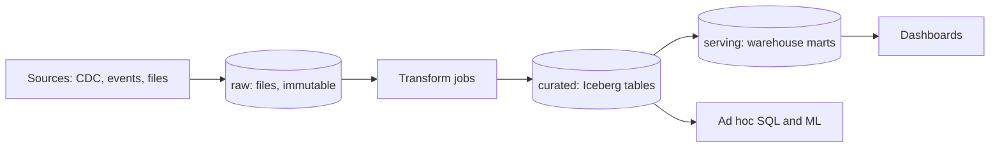
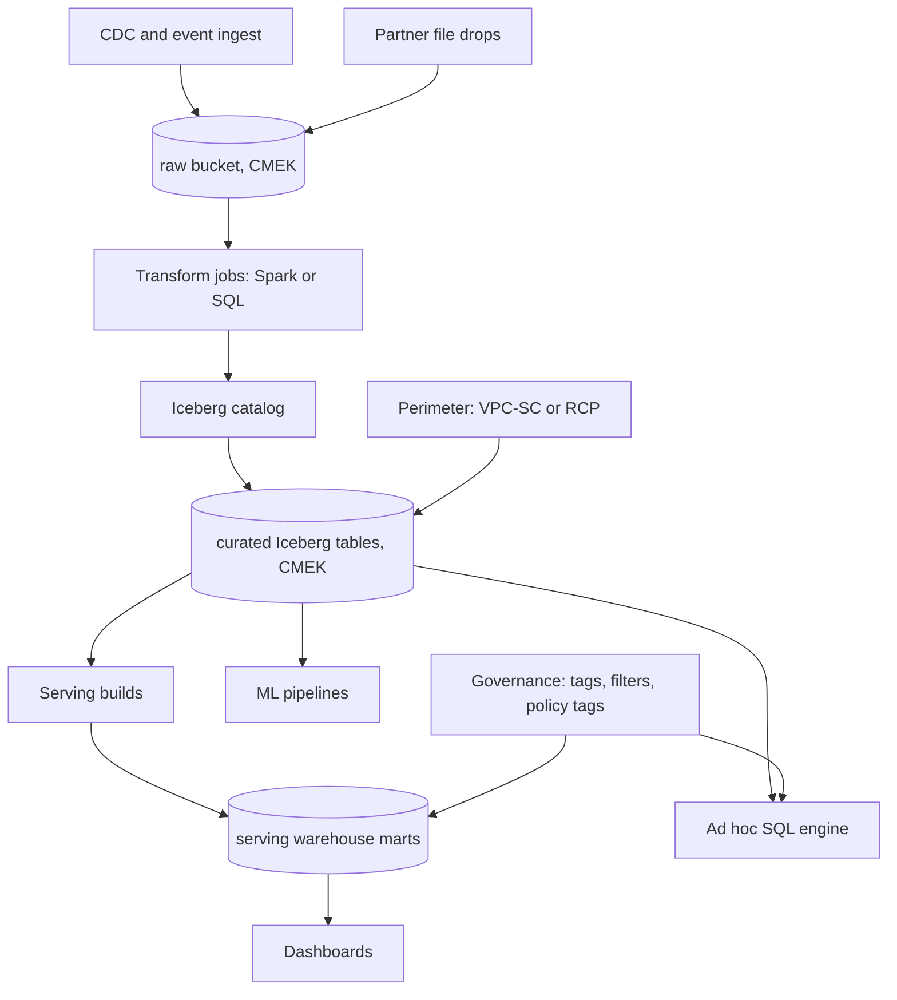

# Data lake and warehouse

This walkthrough follows the [interview framework](00-primer.md#interview-framework).
It uses the [estimation cheat sheet](00-primer.md#estimation-cheat-sheet) and
the [conventions](00-primer.md#conventions). The zone names raw, curated and
serving are the primer's [data zones](00-primer.md#data-zones); this file
governs them and does not redefine them. Getting data into raw is the [ETL
walkthrough's](11-etl-batch-streaming.md) job.

## The question

> "Design the analytics platform for a mid-sized company: a data lake and a
> warehouse. Hundreds of analysts, dashboards, and some ML. Where does data
> live, what format, how is it secured, and how do you keep the bill sane?"

Common variants:

- "Lake, warehouse or lakehouse? Defend one."
- "Why Iceberg? What does a table format give you over Parquet in folders?"
- "An analyst ran a query that cost a fortune. How do you stop that?"
- "Only the EU team may see EU customers, and nobody sees card numbers. Enforce it."
- "Prove that data cannot be copied out of the platform."

## The two-minute answer

Land everything **immutable in raw**: files in object storage, partitioned by
arrival time, under the environment's customer-managed key. A transform layer
writes **curated** tables in **Apache Iceberg**, an open table format that adds
atomic commits, schema evolution, hidden partitioning and time travel on top of
Parquet files. Iceberg is managed for us: **S3 Tables** on AWS, **BigLake
Iceberg tables in BigQuery** on GCP, both compacting files and expiring
snapshots automatically. Several engines read the same curated tables: Athena,
Redshift, Spark and BigQuery. **Serving** is warehouse-native: Redshift and
BigQuery marts and materialised views shaped for dashboards, rebuildable from
curated. Cost and speed come from **partitioning by event day and clustering by
the common filter column**, plus per-query byte caps. Access is three layers:
a **perimeter** (VPC Service Controls on GCP; the org's resource control policy
plus endpoint and bucket policies on AWS), **fine-grained grants** (Lake
Formation tags and data filters; BigQuery policy tags and row access policies),
and **CMEK** on every zone so a key revocation is the last line.



## Clarify the requirements

| Question | Assumed answer |
|---|---|
| Sources? | About 40 OLTP databases through CDC, an event stream, and partner file drops. |
| Volume? | 1 TB a day of raw input, growing 50% a year. |
| Freshness? | Curated within 15 minutes of raw; serving marts hourly; finance daily. |
| Users? | 500 analysts, 300 dashboards, a dozen ML pipelines. |
| History? | Raw kept 2 years (regulation); curated 2 years; serving 13 months. |
| Sensitive data? | Customer PII and card BINs. EU rows visible only to EU staff. |
| Clouds? | Either, one region per environment, so both mappings are shown. |
| Engines? | SQL first, Spark for ML. No single vendor lock on the curated layer. |

Non-functional: no query may read another team's restricted columns; a
perimeter breach must not allow bulk export; the monthly query bill must be
predictable within ±20%; any zone can be rebuilt from the one before it.

## Back-of-envelope estimates

**Ingest.** 1 TB a day is about 12 MB/s average; at 3× peak, **35 MB/s**. That
is trivial bandwidth. The hard parts are file counts and scan volume.

**Raw storage.** 1 TB × 365 × 2 years = **730 TB**, before growth. At 50%
growth the second year adds 1.5 TB/day, so plan for about 900 TB.

**Curated storage.** Raw JSON and CDC records compress roughly 4× into
columnar Parquet (**verify before relying on** this ratio for your data):
250 GB a day, about **180 TB** for 2 years. Snapshots add overhead: Iceberg's
default snapshot age is 5 days
([Iceberg configuration](https://iceberg.apache.org/docs/latest/configuration/),
checked 2026-11), so with 20% of rows rewritten daily by merges, retained
snapshots cost about 5 × 50 GB = 250 GB extra. Small.

**Small files.** A streaming writer committing every minute to 100 tables
makes 144,000 files a day. Compacted to the 512 MB target, which is both the
Iceberg default and the S3 Tables default
([S3 Tables maintenance](https://docs.aws.amazon.com/AmazonS3/latest/userguide/s3-tables-maintenance.html),
checked 2026-11), 250 GB is about 500 files a day. A query planner that opens
288 times fewer files is the difference between seconds and minutes.

**Scan volume, the number that drives the design.** The `orders` fact is 50 GB
a day curated, 40 columns. A typical analyst query covers 30 days and 5 columns:

- Unpartitioned: the full 2 years, 36 TB scanned.
- Partitioned by day: 30 × 50 GB = 1.5 TB.
- Plus column pruning (5 of 40): about 190 GB.
- Plus clustering on `region` (filter keeps 1 of 8): about 25 GB.

At 10,000 analyst queries a day × 25 GB, that is **250 TB (227 TiB) a day**.
BigQuery on-demand charges $6.25 per TiB, first TiB a month free
([BigQuery pricing](https://cloud.google.com/bigquery/pricing), checked
2026-11): about $1,420 a day. Athena charges $5 per TB scanned
([Athena pricing](https://aws.amazon.com/athena/pricing/), checked 2026-11):
about $1,250 a day. Call it **$40,000 a month** on demand. Without day
partitioning every query reads all 730 days instead of 30, so the bill is
about 24× higher. So: partition and cluster everything, cap bytes per query,
and move steady load to reserved capacity once on-demand spend passes the
reservation price.

**Partition counts.** Daily partitions for 2 years are 730, inside BigQuery's
10,000 per table; hourly would be 17,520 and breach it. A single job may touch
at most 4,000 partitions, so a full rebuild of a daily table older than about
11 years must be split
([BigQuery quotas](https://docs.cloud.google.com/bigquery/quotas), checked
2026-11). Daily partitions it is.

**Write rate into curated.** BigQuery allows 25 DML statements per 10 seconds
per table (same source). One `MERGE` per table per minute is 0.17 per 10
seconds: fine. Row-at-a-time updates are not.

## API and data model

The "API" of a lake is its tables and its grants.

### Zone contracts

| Zone | Physical form (AWS / GCP) | Written by | Read by |
|---|---|---|---|
| raw | S3 general-purpose bucket / Cloud Storage bucket, Parquet or JSON files under `source=<s>/dt=<yyyy-mm-dd>/hr=<hh>/` | Ingest only | Transform jobs only |
| curated | S3 Tables Iceberg table / BigLake Iceberg table in BigQuery, one namespace or dataset per domain | Transform jobs only, through the catalog | Analysts by grant, serving builds, ML |
| serving | Redshift Serverless schema / BigQuery native dataset | Serving builds | Dashboards, APIs |

The rule is one writer per zone and the catalog as the only door to curated:
nothing writes Iceberg files directly into the bucket.

### A curated table

```sql
-- Iceberg DDL (Athena or Spark). Hidden partitioning: the writer supplies
-- order_ts; Iceberg derives the day. Queries filter on order_ts, not a dt column.
CREATE TABLE orders.orders (
  order_id     string,
  customer_id  string,
  region       string,
  order_ts     timestamp,
  amount_minor bigint,
  currency     string,
  card_bin     string,      -- restricted column
  _ingest_id   string       -- raw file and offset, for lineage
)
PARTITIONED BY (day(order_ts))
TBLPROPERTIES ('table_type' = 'ICEBERG');
```

Upserts from CDC are a `MERGE` keyed on `order_id` that keeps the row with the
highest source log position, so a replayed CDC batch changes nothing.

### Governance metadata

| Entity | Meaning | Where |
|---|---|---|
| Domain tag | `domain=orders`, owner team | LF-Tag on the database / dataset label |
| Classification | `restricted`, `internal`, `public` per column | LF-Tag on columns / policy tag in a taxonomy |
| Row scope | `region` predicate per principal group | Lake Formation data filter / BigQuery row access policy |
| Lineage | `_ingest_id` plus job run ID | Column in every curated row; catalog lineage where available |

## High-level design



### Write path

1. Ingest appends files to raw under an arrival-time prefix. Nothing in raw is
   ever rewritten, except by a retention or erasure job.
2. A transform job reads new raw files since its last checkpoint, cleans and
   deduplicates, and commits to curated through the catalog. The commit is an
   atomic swap of the table's metadata pointer: readers see the old snapshot or
   the new one, never half.
3. Managed maintenance compacts small files and expires old snapshots.
4. Hourly serving builds read curated incrementally (by snapshot or by
   partition) and refresh marts in the warehouse.

### Read path

An analyst's query goes to the engine, which asks the catalog for the current
snapshot, prunes partitions and files using Iceberg's per-file column
statistics, and asks the governance layer which columns and rows this principal
may see. Dashboards hit serving marts only, which are small and cached, so
their cost does not scale with history.

## Deep dives

### Lakehouse table formats (Iceberg) vs a warehouse-native design

**The options.**

1. **Warehouse-native.** Load everything into Redshift or BigQuery storage.
   Simplest, fastest, and governance is one system. But the curated layer is
   readable only through that engine, Spark and ML read through connectors that
   bill per byte, and changing warehouse means exporting petabytes.
2. **Files in folders (Hive-style).** Parquet under `dt=` prefixes. Open, but
   no atomic commits: a reader can see half a job's output, there is no safe
   concurrent writer, deletes for erasure requests mean rewriting folders by
   hand, and a renamed column breaks old files.
3. **Open table format (Iceberg).** Parquet files plus a metadata tree:
   table metadata → manifest list per snapshot → manifests → data files with
   column statistics. A commit writes new metadata and swaps one pointer in the
   catalog.

**Why Iceberg wins for curated.** It gives warehouse semantics on open files:
ACID commits with optimistic concurrency, schema evolution by column ID (a
rename does not break old files), time travel to any retained snapshot, and
**hidden partitioning**, where Iceberg derives partition values from a column
so users never filter on a separate date column
([Iceberg partitioning](https://iceberg.apache.org/docs/latest/partitioning/),
checked 2026-11). Partition evolution is a metadata operation that does not
rewrite files; old data keeps its old layout and each layout is planned
separately ([Iceberg evolution](https://iceberg.apache.org/docs/latest/evolution/),
checked 2026-11). Most important for this question, every engine reads the
same table: Redshift queries Iceberg tables in the Glue Data Catalog
and supports Lake Formation fine-grained access on them
([Redshift docs](https://docs.aws.amazon.com/redshift/latest/dg/querying-iceberg.html),
checked 2026-11), and BigQuery reads and writes BigLake Iceberg tables.

**Why serving stays warehouse-native.** Dashboards want sub-second answers at
high concurrency, result caching and materialised views. Warehouse storage does
that better, and serving is disposable, so lock-in costs little.

**Managed vs self-managed Iceberg.** Self-managed Iceberg means you run
compaction, snapshot expiry and orphan-file cleanup, or the table rots into
small files and unbounded metadata. The managed options do it for you:

- **S3 Tables** compacts to a 512 MB default target (64–512 MB settable) and
  expires snapshots by `MinimumSnapshots` 1 and `MaximumSnapshotAge` 120 hours
  by default. Snapshot management fails for the whole table if a user-defined
  tag or branch exists, or if Iceberg retention properties are set
  ([S3 Tables maintenance](https://docs.aws.amazon.com/AmazonS3/latest/userguide/s3-tables-maintenance.html),
  checked 2026-11). A table bucket holds 10,000 tables and an account has 100
  table buckets per Region by default
  ([S3 Tables quotas](https://docs.aws.amazon.com/AmazonS3/latest/userguide/s3-tables-regions-quotas.html),
  checked 2026-11).
- **BigLake Iceberg tables in BigQuery** keep Parquet in your Cloud Storage
  bucket and compact and cluster automatically. Limits that bite: one mutating
  DML statement per table at a time, no partition evolution, and external
  engines read an exported metadata snapshot
  ([Google Cloud docs](https://docs.cloud.google.com/bigquery/docs/iceberg-tables),
  checked 2026-11). On 2026-04-20 Google renamed BigLake to Google Cloud
  Lakehouse and its metastore to the **Lakehouse runtime catalog**, which
  serves the Iceberg REST catalog API for Spark and other engines; API and IAM
  names still say `biglake`
  ([Google Cloud docs](https://docs.cloud.google.com/biglake/docs/biglake-basics),
  checked 2026-11).

**Where it breaks.** Many writers to one table conflict: Iceberg retries a
failed commit 4 times by default
([Iceberg configuration](https://iceberg.apache.org/docs/latest/configuration/),
checked 2026-11), so a hot table needs one writer per partition range or a
queue in front. Streaming at second-level latency makes thousands of tiny
snapshots; keep streaming in raw and commit to curated every 1–5 minutes.

### Zones (raw, curated, serving) and governance

The primer fixes what each zone holds and its retention order. Governance is
how the zones stay honest:

- **One writer identity per zone.** Ingest is the only principal with write on
  raw; the transform identity is the only one with write on curated; serving
  builds own serving. Analysts never write to curated. This is the primer's
  [per-component identity](00-primer.md#per-component-identity) rule, applied
  to data.
- **Raw is read by machines only.** Analysts do not query raw: it holds
  unmasked PII and duplicates. Debug access goes through a break-glass grant
  that expires.
- **Promotion is a contract.** A dataset enters curated only with an owner, a
  schema, a classification for every column and a freshness target. The
  transform job fails rather than promoting an unclassified new column, so
  schema drift cannot leak PII.
- **Erasure.** A deletion request is a `DELETE` on curated (Iceberg writes a
  delete file, then compaction applies it) and a scheduled rewrite of the
  affected raw partitions. Raw immutability yields to law here, through the
  one job allowed to do it, and expired snapshots must pass the erasure window
  before old files vanish.

### Cost and performance: partitioning and clustering

**Partitioning** splits a table into independently prunable units; a filter on
the partition column skips whole partitions before reading anything. Choose
the column the overwhelming majority of queries filter on, almost always event
time, and the coarsest grain that still prunes well: daily here, by the
partition-count arithmetic above.

**Clustering** sorts data within partitions by up to four columns in BigQuery
([Google Cloud docs](https://docs.cloud.google.com/bigquery/docs/clustered-tables),
checked 2026-11), so block-level min/max statistics let the engine skip blocks.
BigQuery reclusters in the background for free (same source). Iceberg does the
same with a sort order, and S3 Tables compaction applies `sort` or `z-order`
strategies when one is defined, at extra cost over `binpack`
([S3 Tables maintenance](https://docs.aws.amazon.com/AmazonS3/latest/userguide/s3-tables-maintenance.html),
checked 2026-11). Redshift's equivalent is the sort key: 1 MB blocks with
min/max metadata, compound by default, and `SORTKEY AUTO` recommended
([Redshift docs](https://docs.aws.amazon.com/redshift/latest/dg/t_Sorting_data.html),
checked 2026-11).

| Lever | Use when | Breaks when |
|---|---|---|
| Partition by day | Nearly every query has a time range | Queries without a time filter scan everything: force a filter |
| Cluster or sort by `region`, `customer_id` | Frequent equality or range filters on a few columns | High-cardinality column first in a compound key used only by its suffix |
| Hour partitions | Very recent, very large data | Partition count passes 10,000 in BigQuery |
| Partition by `customer_id` | Never | Millions of tiny partitions and files |

**Guardrails that make the bill predictable.**

- `require_partition_filter` on large BigQuery tables, so a query without a
  partition predicate fails instead of scanning 2 years.
- **Maximum bytes billed** per query: if the estimate exceeds it, the query
  fails without charge. For clustered tables the estimate is an upper bound, so
  it can reject a query that would have been cheap. `LIMIT` does not reduce
  bytes read on non-clustered tables. Custom quotas cap bytes per user or
  project per day
  ([Google Cloud docs](https://docs.cloud.google.com/bigquery/docs/best-practices-costs),
  checked 2026-11).
- **Athena workgroup per-query limit**: a query over the data-scanned limit
  (10 MB minimum) is cancelled, and is still charged for what it scanned.
  Workgroup-wide limits only alert
  ([AWS docs](https://docs.aws.amazon.com/athena/latest/ug/workgroups-setting-control-limits-cloudwatch.html),
  checked 2026-11).
- **Long-term storage.** A BigQuery table or partition not modified for 90
  days drops to a lower long-term storage rate automatically; queries do not
  reset the clock, but merges into old partitions do
  ([BigQuery pricing](https://cloud.google.com/bigquery/pricing), checked
  2026-11). Daily partitions plus append-mostly writes keep history cheap.

### Access control and CMEK

Three layers, each catching what the one inside it misses.

**1. Perimeter: who can reach the data APIs at all.**

- **GCP: VPC Service Controls.** This repo's environment stage already draws a
  perimeter around each `gcp-workload-<env>` host project, restricting
  `bigquery.googleapis.com` and `storage.googleapis.com` among others, and the
  root warns at plan (a check block, which never fails the plan) if a
  production perimeter is absent or in dry-run
  ([`envs/gcp/workload/main.tf`](../../envs/gcp/workload/main.tf), check
  `vpc_sc_enforced_in_prod`). Protecting the BigQuery API also protects the
  BigQuery Storage, Reservation and Connection APIs; the lakehouse catalog is a
  separate service, `biglake.googleapis.com`. BigQuery has known gaps: console
  users inside an ingress rule can save results to a local file, and querying
  Google Drive data is not blocked
  ([Google Cloud docs](https://docs.cloud.google.com/vpc-service-controls/docs/supported-products),
  checked 2026-11).
- **Repo gap to fix for a lake:** the default egress policy allows
  `storage.googleapis.com` to **any** resource
  ([`modules/gcp/stages/environment/main.tf`](../../modules/gcp/stages/environment/main.tf),
  `default_vpc_sc_egress_policies`). Inside a perimeter holding curated PII,
  that is a copy-out path. Replace it with egress to named projects only.
- **AWS: the RCP data perimeter.** The org RCP denies `s3:*` and `kms:*` to
  principals outside the organisation
  ([`rcp-data-perimeter.json.tftpl`](../../modules/aws/governance/organization-policy/policies/rcp-data-perimeter.json.tftpl)).
  RCPs do not list S3 Tables, Glue, Lake Formation or Athena among supported
  services ([AWS docs](https://docs.aws.amazon.com/organizations/latest/userguide/orgs_manage_policies_rcps.html),
  checked 2026-11), so on AWS the **KMS key** is the perimeter for curated data:
  an outsider who reaches a table cannot decrypt it, because the RCP covers
  `kms:*`.

**2. Fine-grained grants: which rows and columns.**

- **Lake Formation.** Tag-based access control (LF-TBAC) attaches LF-Tags such
  as `classification=restricted` to databases, tables and columns; tables
  inherit from databases and columns from tables. Grants go to tag
  expressions, so grants scale as principals plus resources, not their product
  ([AWS docs](https://docs.aws.amazon.com/lake-formation/latest/dg/tag-based-access-control.html),
  checked 2026-11). Data filters give row-, column- and cell-level security
  ([AWS docs](https://docs.aws.amazon.com/lake-formation/latest/dg/data-filtering.html),
  checked 2026-11), with limits: 100 filters per principal per table, and
  column filters reach nested fields only to five levels, with no cell-level
  security on nested columns
  ([AWS docs](https://docs.aws.amazon.com/lake-formation/latest/dg/data-filtering-notes.html),
  checked 2026-11).
- **The classic Lake Formation trap.** The default S3 Tables integration grants
  `IAM_ALLOWED_PRINCIPALS` all permissions, so IAM alone decides access and
  your LF grants do nothing
  ([AWS docs](https://docs.aws.amazon.com/AmazonS3/latest/userguide/s3-tables-integrating-aws.html),
  checked 2026-11). Integrate in Lake Formation mode, or revoke that grant.
- **BigQuery.** Column-level security through policy tags in a taxonomy, and
  row access policies whose filter acts as a `WHERE` clause for the grantees;
  the two combine, and data masking applies on top
  ([Google Cloud docs](https://docs.cloud.google.com/bigquery/docs/row-level-security-intro),
  checked 2026-11).

**3. CMEK: the key as the last control.**

- Every zone uses the environment's workload key, per the primer's
  [CMEK source](00-primer.md#cmek-source).
- **S3 Tables** accepts only customer managed keys for SSE-KMS (not AWS managed
  keys), and the maintenance principal `maintenance.s3tables.amazonaws.com`
  needs `kms:GenerateDataKey` and `kms:Decrypt`, or table creation fails
  ([AWS docs](https://docs.aws.amazon.com/AmazonS3/latest/userguide/s3-tables-kms-permissions.html),
  checked 2026-11). Changing a table bucket's default key affects only new
  tables ([AWS docs](https://docs.aws.amazon.com/AmazonS3/latest/userguide/s3-tables-kms-encryption.html),
  checked 2026-11).
- **BigQuery** encrypts native tables with the dataset's default key, through
  `bq-<project-number>@bigquery-encryption.iam.gserviceaccount.com`; the key
  ring must match the dataset location, and a default key does not apply to
  existing tables. If BigQuery loses the key, queries fail, and recovery can
  stay degraded for days
  ([Google Cloud docs](https://docs.cloud.google.com/bigquery/docs/customer-managed-encryption),
  checked 2026-11). Data in Cloud Storage is encrypted by **the bucket's** key,
  and the same source says BigLake tables support CMEK-encrypted Cloud Storage
  data; for Iceberg tables, **verify before relying on**. The Cloud Storage key ring
  must be in the bucket's location
  ([Google Cloud docs](https://docs.cloud.google.com/storage/docs/encryption/customer-managed-keys),
  checked 2026-11).
- **One key or one per zone?** One key per environment is the repo default and
  is enough when the perimeter and grants do the separating. A separate raw key
  is worth it when a regulator wants raw PII revocable without breaking
  dashboards.

## Trade-offs to defend

| Decision | Chosen | Rejected | Why | What would change the answer |
|---|---|---|---|---|
| Curated format | Iceberg | Warehouse-native tables; Delta Lake or Hudi | Multi-engine, open, managed on both clouds | One engine forever and no Spark: warehouse-native is simpler |
| Iceberg operations | Managed (S3 Tables, BigLake Iceberg in BigQuery) | Self-run compaction and expiry | Small files and metadata growth handled for us | Need branches or tags (S3 Tables expiry fails with them), or partition evolution on GCP |
| Serving | Warehouse-native marts | Dashboards on curated | Concurrency, caching, predictable cost | Few dashboards with loose latency |
| Partition grain | Day | Hour; none | 730 partitions in 2 years; prunes most queries | Most queries look at the last hour of a huge stream |
| Pricing | On-demand, then reserved capacity when steady | Capacity from day one | Unknown load first; caps and quotas bound risk | Spend steadily above the reservation price |
| Fine-grained access | Tags (LF-Tags, policy tags) and row filters | Per-table grants; bucket IAM | Grants scale with principals plus resources | A handful of tables and one team |
| Perimeter | VPC-SC enforced (GCP); RCP plus CMEK (AWS) | Network controls only | Stops copy-out with stolen credentials | Nothing: keep it |
| Keys | One workload CMEK per environment | Per-zone or per-dataset keys | Fewer grants, repo default | Regulation demands separately revocable raw PII |

## Failure modes and scaling limits

**At ×10 (10 TB a day, 5,000 analysts):**

- **Scan cost** grows faster than data, because more analysts query more
  history. Reserved capacity, serving marts for repeated questions, and
  per-user quotas become mandatory.
- **Commit contention** on hot curated tables. Move to partition-scoped
  writers or a single committer per table.
- **Compaction lag**: managed maintenance runs asynchronously; queries slow
  before anyone alerts. Watch file count per partition.

**At ×100:**

- **Catalog and metadata.** Manifest lists grow with snapshots and partitions;
  planning time rises. Shorten snapshot retention, rewrite manifests, split
  tables by domain.
- **S3 request rates.** At least 3,500 writes and 5,500 reads a second per
  prefix, scaling gradually with 503 Slow Down while it does
  ([AWS docs](https://docs.aws.amazon.com/AmazonS3/latest/userguide/optimizing-performance.html),
  checked 2026-11). Iceberg's object layout spreads keys; Hive-style `dt=`
  folders concentrate them.

**Blast radius.**

| Component | If it fails | Radius |
|---|---|---|
| Ingest | Raw stops growing | Curated and serving go stale, nothing breaks; replay after |
| Transform job | Curated stale | Serving stale; no corruption, commits are atomic |
| Catalog | No commits, no planning | Every curated read and write; serving marts still answer |
| Workload key disabled or grant revoked | Reads and writes fail | Every zone on that key: the whole environment's lake |
| Perimeter change | Jobs from outside denied | Pipelines crossing the perimeter |
| Bad merge | Wrong curated rows | Roll back to the previous snapshot; rebuild serving |

## AWS and GCP mapping

| Component | AWS | GCP | Difference that matters |
|---|---|---|---|
| raw | S3 general-purpose bucket, SSE-KMS | Cloud Storage bucket, CMEK | Both object stores; bucket names are global on both. |
| curated | S3 Tables (Iceberg) | BigLake Iceberg tables in BigQuery, data in your bucket | S3 Tables is its own bucket type with its own API (`s3tables`); BigLake tables live in a BigQuery dataset. |
| Catalog | Glue Data Catalog (`s3tablescatalog`) | Lakehouse runtime catalog (Iceberg REST), BigQuery | Spark uses Glue or the S3 Tables catalog on AWS; the REST catalog on GCP. |
| Ad hoc SQL | Athena, $5 per TB | BigQuery, $6.25 per TiB on-demand | Athena has no warehouse storage; BigQuery is both engine and warehouse. |
| serving | Redshift Serverless | BigQuery native tables, materialised views | On GCP, curated and serving share one engine. |
| Fine-grained access | Lake Formation: LF-Tags, data filters | Policy tags, row access policies, Dataplex | LF is a separate grant system next to IAM; BigQuery's is part of IAM. |
| Perimeter | RCP + endpoint and bucket policies | VPC Service Controls | VPC-SC covers BigQuery and the catalog API; RCPs cover S3 and KMS, not S3 Tables or Athena. |
| Keys | Workload CMK, plus a key-policy statement for S3 Tables maintenance | Per-environment `workload_cmek`, granted to the BigQuery and Cloud Storage service agents | GCP keys are location-bound to the dataset or bucket. |

## Build it here

### Where it lives

| Part | AWS | GCP |
|---|---|---|
| Lake, catalog, grants | `aws-workload-<env>` (`envs/aws/workload`), the workload account | `gcp-workload-<env>` (`envs/gcp/workload`), the environment host project |
| Perimeter | Org RCP from `aws-organization` (`envs/aws/organization`) | Environment perimeter in `gcp-workload-<env>` |
| Key | `workload_kms_key_arn` | `module.workload_cmek` (gap, see [CMEK source](00-primer.md#cmek-source)) |
| Apply order | `aws-organization` → `aws-security` → `aws-network` → `aws-workload-<env>` | `gcp-bootstrap` → `gcp-organization` → `gcp-projects` → `gcp-network-hub` → `gcp-workload-<env>` |

No component takes a VPC tier: S3, S3 Tables, Glue, Athena, BigQuery and Cloud
Storage are reached over endpoints or Private Google Access, per
[VPC-tier placement](00-primer.md#vpc-tier-placement) ([#14](14-n-tier-network.md)). Spark clusters you run
go in `private`. On GCP, egress is the environment's Cloud NAT, not inspected
through the hub, which is one more reason the perimeter matters.

### Config

```yaml
# Illustrative. Keys are real (config/landing-zone.schema.json); values are placeholders.
aws:
  workload_environments:
    prod:
      account_key: workload_prod
      vpc_cidr: 10.30.0.0/16
      is_production: true
gcp:
  environments:
    prod:
      region: europe-west2
      cidr_block: 10.40.0.0/16
      is_production: true # gcp-workload-prod then warns on a dry-run perimeter
  workload:
    presets_by_environment:
      prod: [prod-gcp-workload] # enforces the perimeter
```

Perimeter overrides are `gcp-workload-<env>` workspace variables, not config
keys. Add the catalog API and narrow the storage egress:

```hcl
# gcp-workload-prod workspace variables (illustrative).
vpc_sc_restricted_services = [ # the root's default list plus biglake
  "bigquery.googleapis.com", "storage.googleapis.com", "biglake.googleapis.com", "secretmanager.googleapis.com",
  "cloudkms.googleapis.com", "pubsub.googleapis.com", "sqladmin.googleapis.com", "container.googleapis.com",
  "artifactregistry.googleapis.com",
]
vpc_sc_egress_policies = [{
  identity_type = "ANY_IDENTITY"
  resources     = ["projects/PARTNER_PROJECT_NUMBER"] # named destinations only, never "*"
  operations    = [{ service_name = "storage.googleapis.com" }]
}]
```

### AWS: curated table bucket and tag-based grants

In `envs/aws/workload`, using `local.environment` and `local.kms_key_arn`.
Before applying, add a statement to `envs/aws/workload/kms.tf` admitting
`maintenance.s3tables.amazonaws.com` to `kms:GenerateDataKey` and `kms:Decrypt`,
conditioned on `kms:EncryptionContext:aws:s3:arn`, or table creation fails. The
apply role must be a Lake Formation administrator. Arguments checked against
aws v6.72.0
([`aws_s3tables_table_bucket`](https://registry.terraform.io/providers/hashicorp/aws/6.72.0/docs/resources/s3tables_table_bucket),
[`aws_s3tables_namespace`](https://registry.terraform.io/providers/hashicorp/aws/6.72.0/docs/resources/s3tables_namespace),
[`aws_lakeformation_lf_tag`](https://registry.terraform.io/providers/hashicorp/aws/6.72.0/docs/resources/lakeformation_lf_tag),
[`aws_lakeformation_resource_lf_tags`](https://registry.terraform.io/providers/hashicorp/aws/6.72.0/docs/resources/lakeformation_resource_lf_tags),
[`aws_lakeformation_permissions`](https://registry.terraform.io/providers/hashicorp/aws/6.72.0/docs/resources/lakeformation_permissions),
checked 2026-11).

```hcl
# Gap: the repo has no S3 Tables or Lake Formation module; raw resources in the landing zone's conventions.
resource "aws_s3tables_table_bucket" "orders_curated" {
  name = "${local.environment}-orders-curated" # <env>-<dataset>-<zone>
  encryption_configuration = {
    sse_algorithm = "aws:kms"
    kms_key_arn   = local.kms_key_arn # workload CMK; customer managed keys only
  }
  tags = { Service = "orders-lake" } # default_tags add the rest
}

resource "aws_s3tables_namespace" "orders" {
  namespace        = "orders"
  table_bucket_arn = aws_s3tables_table_bucket.orders_curated.arn
}
# Tables come from engine DDL (Iceberg PARTITIONED BY day(order_ts)), not Terraform.

resource "aws_lakeformation_lf_tag" "classification" {
  key    = "classification"
  values = ["public", "internal", "restricted"]
}

resource "aws_lakeformation_resource_lf_tags" "orders_internal" {
  database {
    # Federated S3 Tables catalog ID: verify before relying on this format.
    catalog_id = "${local.workload_account_id}:s3tablescatalog/${aws_s3tables_table_bucket.orders_curated.name}"
    name       = aws_s3tables_namespace.orders.namespace
  }
  lf_tag {
    key   = aws_lakeformation_lf_tag.classification.key
    value = "internal"
  }
}

resource "aws_lakeformation_permissions" "analysts_internal" {
  principal   = "REPLACE_WITH_ANALYST_ROLE_ARN"
  permissions = ["SELECT", "DESCRIBE"]
  lf_tag_policy {
    resource_type = "TABLE"
    expression {
      key    = aws_lakeformation_lf_tag.classification.key
      values = ["public", "internal"] # never "restricted"
    }
  }
}
```

Restricted columns get `classification=restricted` through a
`table_with_columns` block on the same `aws_lakeformation_resource_lf_tags`
type, and the EU row scope is an `aws_lakeformation_data_cells_filter`. The
raw bucket is a standard S3 bucket under the same key, which no module here
creates (gap). The analyst role also needs `kms:Decrypt` on the workload key.

### GCP: key, raw bucket, curated Iceberg and a serving mart

In `envs/gcp/workload`, using `local.env_config`, `local.project_prefix`,
`local.labels` and `var.environment`. Every location is
`local.env_config.region`, because both the BigQuery and Cloud Storage keys
must match their resource's location. Arguments checked against google v8.10.0
([`google_bigquery_dataset`](https://registry.terraform.io/providers/hashicorp/google/8.10.0/docs/resources/bigquery_dataset),
[`google_bigquery_table`](https://registry.terraform.io/providers/hashicorp/google/8.10.0/docs/resources/bigquery_table),
[`google_bigquery_connection`](https://registry.terraform.io/providers/hashicorp/google/8.10.0/docs/resources/bigquery_connection),
checked 2026-11). The Cloud Storage service agent format is
`service-<number>@gs-project-accounts.iam.gserviceaccount.com`
([Google Cloud docs](https://cloud.google.com/storage/docs/projects), checked
2026-11); the data sources below look both agents up.

```hcl
data "google_bigquery_default_service_account" "bq" { project = local.env_config.host_project_id }
data "google_storage_project_service_account" "gcs" { project = local.env_config.host_project_id }

# Gap: no per-environment workload CMEK exists yet (see CMEK source);
# this adds one with the existing kms module.
module "workload_cmek" {
  source       = "../../../modules/gcp/governance/kms"
  project_id   = local.env_config.host_project_id
  keyring_name = "${local.project_prefix}-${var.environment}-cmek"
  location     = local.env_config.region
  labels       = local.labels
  keys = {
    "lake" = { encrypter_decrypters = [
      data.google_bigquery_default_service_account.bq.member,
      data.google_storage_project_service_account.gcs.member,
    ] }
  }
}

module "lake_buckets" {
  source       = "../../../modules/gcp/cloud-storage"
  project_id   = local.env_config.host_project_id
  region       = local.env_config.region
  kms_key_name = module.workload_cmek.key_ids["lake"]
  labels       = merge(local.labels, { service = "orders-lake" })
  data_buckets = {
    raw     = { name_suffix = "orders-raw", retention_days = 730 }
    iceberg = { name_suffix = "orders-curated" }
  }
}

# Gap: no BigQuery or BigLake module; raw resources in the landing zone's conventions.
resource "google_bigquery_connection" "lake" {
  project       = local.env_config.host_project_id
  connection_id = "orders-lake"
  location      = local.env_config.region
  cloud_resource {}
}

resource "google_storage_bucket_iam_member" "lake_connection" {
  bucket = module.lake_buckets.bucket_names["iceberg"]
  role   = "roles/storage.objectUser" # BigQuery writes Iceberg files through the connection
  member = "serviceAccount:${google_bigquery_connection.lake.cloud_resource[0].service_account_id}"
}

resource "google_bigquery_dataset" "orders" {
  for_each   = toset(["curated", "serving"])
  project    = local.env_config.host_project_id
  dataset_id = "orders_${each.key}" # <dataset>_<zone>
  location   = local.env_config.region
  labels     = merge(local.labels, { service = "orders-lake" })
  # Native tables only; Iceberg files use the bucket key. Verify before relying on BigLake Iceberg tables accepting a dataset default key.
  default_encryption_configuration {
    kms_key_name = module.workload_cmek.key_ids["lake"]
  }
}

resource "google_bigquery_table" "orders_curated" {
  project             = local.env_config.host_project_id
  dataset_id          = google_bigquery_dataset.orders["curated"].dataset_id
  table_id            = "orders"
  clustering          = ["region", "customer_id"]
  deletion_protection = true
  biglake_configuration {
    connection_id = google_bigquery_connection.lake.name
    storage_uri   = "gs://${module.lake_buckets.bucket_names["iceberg"]}/orders/"
    file_format   = "PARQUET"
    table_format  = "ICEBERG"
  }
  schema = file("${path.module}/schemas/orders.json") # illustrative path
}

resource "google_bigquery_table" "daily_revenue" {
  project                  = local.env_config.host_project_id
  dataset_id               = google_bigquery_dataset.orders["serving"].dataset_id
  table_id                 = "daily_revenue"
  require_partition_filter = true # no unbounded scans
  clustering               = ["region"]
  deletion_protection      = true
  time_partitioning {
    type  = "DAY"
    field = "order_date"
  }
  schema = file("${path.module}/schemas/daily_revenue.json") # illustrative path
}
```

Gaps this design hits:

- **Versioning.** The cloud-storage module turns on versioning for every data
  bucket and has no noncurrent-version rule. Each noncurrent version is billed
  like a live one
  ([Google Cloud docs](https://docs.cloud.google.com/storage/docs/object-versioning),
  checked 2026-11), so every file that compaction replaces stays billed. Add a
  noncurrent-version lifecycle input to the module before using it for Iceberg.
- **Raw lock.** Neither cloud has a module input for a bucket lock or Object
  Lock on raw.
- **Bucket names.** The module names buckets `<host_project_id>-<suffix>`;
  the project ID already carries the prefix and environment.
- **Grants.** Analysts get `roles/bigquery.dataViewer` on `orders_serving` and
  policy-tag-scoped access on `orders_curated`, through
  `google_bigquery_dataset_iam_member`, never on the project. Policy tags and
  row access policies (`google_data_catalog_policy_tag`,
  `google_bigquery_row_access_policy`) follow the same pattern.

## Runbook

### Lake queries fail after a key or perimeter change

**Detection signal.** A step increase in failed jobs: BigQuery jobs failing
with KMS or `VPC_SERVICE_CONTROLS` errors in `INFORMATION_SCHEMA.JOBS`, or
Athena and Redshift queries failing with KMS `AccessDenied`. Dashboards show
errors rather than stale data. Corroborating: CloudTrail `Decrypt` denials on
the workload key; VPC-SC violation entries in Cloud Logging.

**Triage.**

1. **Which layer?** A KMS error means the key or its grant; a VPC-SC error
   names the perimeter and the denied service; `AccessDenied` from Lake
   Formation means a grant.
2. **What changed?** Recent Terraform Cloud runs on `aws-workload-<env>`,
   `gcp-workload-<env>` or `aws-organization`: a key-policy edit, a key
   disabled or scheduled for deletion, a new restricted service such as
   `biglake.googleapis.com`, or a narrowed egress policy.
3. **Which zones?** One key covers every zone in the environment, so check
   whether raw ingest is also failing.

**Mitigation.**

1. **Key disabled or pending deletion:** re-enable it or cancel the deletion
   at once. See [`docs/runbooks/kms-rotation.md`](../../docs/runbooks/kms-rotation.md)
   and [`docs/runbooks/aws-kms-rotation.md`](../../docs/runbooks/aws-kms-rotation.md)
   for key handling in this repo.
2. **Grant removed:** revert the change through the owning workspace in
   Terraform Cloud, not by hand. On AWS, check the S3 Tables maintenance
   statement survived.
3. **Perimeter:** set the workspace's `vpc_sc_dry_run_restricted_services` to
   stage the change in dry-run, and roll the enforced list back.
4. Pause transform and serving builds so retries do not pile up.

**Verification.** A canary query against each zone succeeds; BigQuery access
changes can take up to an hour to propagate and performance can stay degraded
for days, so watch latency as well as errors. Re-run failed builds; atomic
commits mean none left partial state.

**Follow-up.** Add a canary query per zone every 5 minutes. Require dry-run for
every perimeter change. Alert on any key state change.

### A query cost spike

**Detection:** daily bytes billed or scanned above twice the 7-day median.
**Triage:** top jobs by bytes in `INFORMATION_SCHEMA.JOBS` or Athena query
history; usually a missing partition filter or a new dashboard on curated.
**Mitigation:** lower the user's quota or the workgroup limit, set
`require_partition_filter`, and point the dashboard at a serving mart.
**Verification and follow-up:** spend back under the baseline; add the table to
the partition-filter list.

## Study aids

### Numbers to memorise

| Number | Value |
|---|---|
| Raw ingest | 1 TB/day, 35 MB/s peak, 730 TB for 2 years |
| Curated | About 4× smaller than raw; 180 TB for 2 years |
| Compaction target | 512 MB (Iceberg default; S3 Tables 64–512 MB) |
| BigQuery partitions | 10,000 per table; 4,000 per job |
| BigQuery clustering | Up to 4 columns, reclustered free |
| Scan price | BigQuery $6.25/TiB on-demand; Athena $5/TB |
| Pruning effect | 36 TB → 25 GB for a 30-day, 5-column, 1-region query |
| S3 per prefix | 3,500 writes, 5,500 reads per second |
| S3 Tables | 10,000 tables per bucket, 100 table buckets per Region |
| Iceberg snapshot default | 5 days; S3 Tables 120 hours, min 1 |

### Likely follow-ups

- **"Lake or warehouse?"** Both: an open curated layer in Iceberg for every
  engine, and warehouse-native serving for dashboards.
- **"What does Iceberg add over Parquet folders?"** Atomic commits, schema
  evolution by column ID, hidden partitioning, time travel and safe deletes.
- **"Analyst ran a $5,000 query?"** Bytes-billed cap, per-user quota,
  `require_partition_filter`, and serving marts for repeated questions.
- **"EU-only rows, no card numbers?"** A row filter on `region` and a
  restricted classification on `card_bin`: Lake Formation data filters and
  LF-Tags, or BigQuery row access policies and policy tags.
- **"Prove no copy-out."** VPC-SC enforced with egress to named projects only
  on GCP; on AWS the RCP keeps outsiders off S3 and KMS, and CMEK makes
  everything else undecryptable.
- **"Bad data landed in curated?"** Roll the table back to the previous
  snapshot, fix the job, re-run from raw, rebuild serving.

### Classic mistakes

- Partitioning by a high-cardinality column, or by hour for years of data.
- Letting analysts query raw.
- Turning on Lake Formation but leaving `IAM_ALLOWED_PRINCIPALS` grants.
- A VPC-SC egress rule to `*` for storage.
- Self-managed Iceberg with no compaction or snapshot expiry.
- Forgetting the S3 Tables maintenance principal in the key policy.

### Further reading

- [Apache Iceberg: partitioning](https://iceberg.apache.org/docs/latest/partitioning/) (checked 2026-11)
- [S3 Tables maintenance](https://docs.aws.amazon.com/AmazonS3/latest/userguide/s3-tables-maintenance.html) (checked 2026-11)
- [BigLake Iceberg tables in BigQuery](https://docs.cloud.google.com/bigquery/docs/iceberg-tables) (checked 2026-11)
- [Lake Formation tag-based access control](https://docs.aws.amazon.com/lake-formation/latest/dg/tag-based-access-control.html) (checked 2026-11)
- [Primer: data zones](00-primer.md#data-zones) and
  [CMEK source](00-primer.md#cmek-source)
