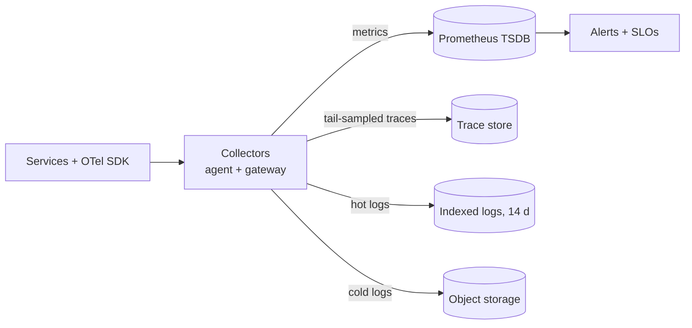
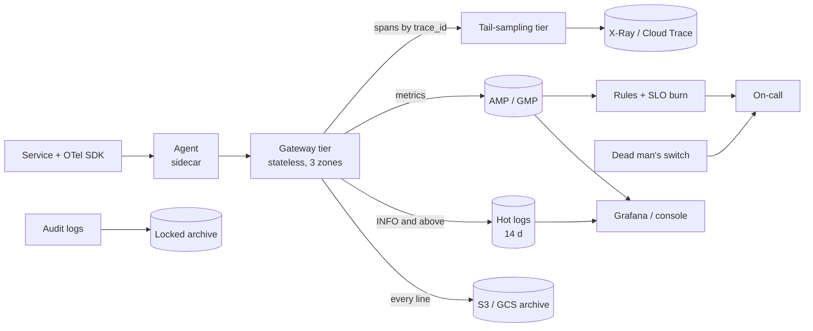

# Observability platform

This walkthrough follows the [interview framework](00-primer.md#interview-framework).
It uses the numbers in the [estimation cheat sheet](00-primer.md#estimation-cheat-sheet)
and the conventions in the [primer](00-primer.md#conventions). Its four deep
dives are the ones interviewers push on: moving metrics, logs and traces at
scale, cardinality, sampling, and retention tiers.

## The question

> "Design the observability platform for a company running a few hundred
> microservices. Engineers need metrics, logs and traces, alerting that wakes
> the right person, and the bill must not grow faster than the traffic."

Common variants:

- "Design a metrics system like Prometheus, or a log search system like a hosted log service."
- "A developer added `user_id` as a metric label and the bill tripled. What failed?"
- "You can't store every trace. Which ones do you keep?"
- "Keep logs for a year for audit without paying hot-storage prices."
- "How do you know the monitoring system itself is down?"

## The two-minute answer

Every service is instrumented once, with **OpenTelemetry**, and sends all three
signals over OTLP to a **collector pipeline**: an agent next to each workload,
then a stateless **gateway** fleet that enforces the rules. It batches, redacts, **drops unapproved metric labels** (cardinality
is the metric system's main cost and failure mode), and routes each signal to
the right store. **Metrics** go to a managed Prometheus-compatible time-series
database, which runs alert rules and SLO burn-rate alerts. **Traces** pass a
second collector tier that groups spans by trace ID and **tail-samples**:
it keeps every error and every slow trace plus a few per cent of the rest.
**Logs** are split by value before indexing: info and above to a **hot**
indexed tier for 14 days, every line to **cold** object storage, and audit logs
along a separate, never-sampled, write-once path. On AWS that is Amazon
Managed Service for Prometheus, CloudWatch Logs, X-Ray and S3; on GCP, Managed
Service for Prometheus, Cloud Logging, Cloud Trace and Cloud Storage.



## Clarify the requirements

| Question | Assumed answer |
|---|---|
| Scale? | 500 services, 20,000 containers in production, 20,000 requests a second at the edge at peak. |
| Which signals? | Metrics, logs and traces, correlated by trace ID. Profiles are out of scope. |
| Who uses it? | On-call engineers (alerts, dashboards), developers (debugging), security and audit (log retention). |
| Freshness? | An alert fires within 2 minutes of the symptom starting. Logs are searchable within 1 minute. |
| Retention? | Metrics 13 months for capacity trends; logs 14 days searchable, 400 days archived; traces 14–30 days. |
| Loss tolerance? | Losing a few seconds of metrics during a collector restart is fine. Audit logs are never sampled or dropped. |
| Build or buy? | Managed back ends; we own the pipeline, schemas and policy. Self-hosting a TSDB is a trade-off to defend. |
| Clouds? | Both AWS and GCP, one region each; each cloud's telemetry stays in that cloud. |

Non-functional: the platform must be more available than what it watches,
and outside its failure domain, or it goes blind during the outage it exists
for. Cost scales with useful data, not raw volume.

## Back-of-envelope estimates

The arithmetic uses the primer's [QPS conversions](00-primer.md#qps-conversions);
a month is 2.592 million seconds.

**Metrics.** About 500 active series per container (runtime, HTTP and business
metrics, with their labels) gives **10 million active series**. A 30-second
scrape interval gives 10 M / 30 = **333,000 samples a second**, or 864 billion a
month. Prometheus stores 1–2 bytes a sample
([Prometheus docs](https://prometheus.io/docs/prometheus/latest/storage/),
checked 2026-11). At 1.5 bytes that is 0.5 MB/s, 43 GB a day, about 650 GB for
15 days. Storage is cheap; **samples are the bill**. Managed Service for Prometheus
charges $0.06 per million samples for the first 50 billion, falling
to $0.024 above 500 billion
([Google Cloud pricing](https://cloud.google.com/stackdriver/pricing), checked
2026-11):

`50 B × $0.06 + 200 B × $0.048 + 250 B × $0.036 + 364 B × $0.024 ≈ $30,300 a month.`

Amazon Managed Service for Prometheus also charges per sample ingested, $0.90
per 10 million in its first tier in the pricing page's example
([AWS pricing](https://aws.amazon.com/prometheus/pricing/), checked 2026-11).
Either way, the cost is linear in series × scrape frequency. **Halving
cardinality halves the metrics bill**, which drives the cardinality deep dive.
Quotas fit: an AMP workspace defaults to 50 million active series and
1,666,666 samples a second
([AWS docs](https://docs.aws.amazon.com/prometheus/latest/userguide/AMP_quotas.html),
checked 2026-11).

**Logs.** Five lines a second per container gives 100,000 lines a second on
average and 300,000 at a 3× peak. At 500 bytes a line that is **50 MB/s
average and 150 MB/s peak**, or about 4,000 GiB a day. At $0.50 per GiB
ingested ([Google Cloud pricing](https://cloud.google.com/stackdriver/pricing),
checked 2026-11; CloudWatch Logs Standard is also $0.50 per GB in the
[AWS pricing examples](https://aws.amazon.com/cloudwatch/pricing/), checked
2026-11), indexing everything costs about **$60,000 a month**. Two quotas bite:

- Cloud Logging's `entries.write` limit is 4.8 GB a minute (80 MB/s) per project
  in large regions and 300 MB a minute (5 MB/s) elsewhere
  ([Google Cloud docs](https://docs.cloud.google.com/logging/quotas), checked
  2026-11). The 150 MB/s peak exceeds it, and exclusion filters do not reduce
  quota use
  ([Google Cloud docs](https://docs.cloud.google.com/logging/docs/routing/overview),
  checked 2026-11). So request an increase, or spread services across service
  projects.
- CloudWatch Logs allows 5,000 `PutLogEvents` calls a second per account and
  Region, 1 MB per batch
  ([AWS docs](https://docs.aws.amazon.com/AmazonCloudWatch/latest/logs/cloudwatch_limits_cwl.html),
  checked 2026-11). 20,000 containers flushing every 5 seconds make 4,000
  calls a second, 80% of it; gateways sending full batches need about 150.

**Traces.** 20,000 requests a second × 15 spans = **300,000 spans a second at
peak**, about 100,000 on average. At 700 bytes a span that is 210 MB/s into the
collectors at peak. Cloud Trace charges $0.20 per million spans
([Google Cloud pricing](https://cloud.google.com/stackdriver/pricing), checked
2026-11): 8.6 billion spans a day costs about $52,000 a month at 100%. Keeping
errors (about 1%), slow traces (about 1%) and a 5% baseline keeps **7%**, about
**$3,600 a month**. The OTLP trace ingestion limit is 2.4 GB a minute
(40 MB/s) in large regions
([Google Cloud docs](https://docs.cloud.google.com/trace/docs/quotas), checked
2026-11). 7% of the peak is 15 MB/s and fits; 100% would not.

**Tail-sampler memory.** With a 10-second decision wait, 300,000 spans/s ×
10 s × about 1 KB is 3 GB across the tier, and 20,000 new traces a second is
200,000 traces in flight. The processor's default `num_traces` is 50,000
([OpenTelemetry README](https://github.com/open-telemetry/opentelemetry-collector-contrib/blob/main/processor/tailsamplingprocessor/README.md),
checked 2026-11), so the default would evict traces before deciding. Set it
to at least 400,000 across the tier.

**Collector fleet.** Spans are not the only load: 300,000 log lines and
333,000 metric samples a second also pass through, about 933,000 items a second
at peak. Assume 10,000 items a second per vCPU (**verify before relying on**:
it depends on the processors). The peak needs about 93 vCPU; to survive losing
one of three zones, provision 93 × 3/2 ≈ **140 vCPU**.

## API and data model

### Ingestion

| Interface | Protocol | Notes |
|---|---|---|
| OTLP | gRPC on 4317, HTTP on 4318 | SDKs send to the local agent, never to a back end, so back ends change without redeploys. |
| Prometheus scrape | HTTP `/metrics` | Third-party software; the agent scrapes it. |
| stdout | Container log driver | Legacy logs; the agent parses them. |

### Resource attributes (required on every signal)

`service.name`, `service.version`, `deployment.environment`, `cloud.region`
and the owning team: low-cardinality, and they say *who* emitted the data. The
gateway drops pod and container IDs from metrics (see
[Cardinality](#cardinality)).

### Signals and their keys

| Signal | Identity | Correlation |
|---|---|---|
| Metric sample | Metric name + label set (the series) + timestamp | **Exemplars** attach a `trace_id` to a histogram bucket, so a latency spike links to a real trace without a `trace_id` label. |
| Log record | Timestamp, severity, body, attributes | `trace_id` and `span_id` fields; the SDK's log bridge fills them in. |
| Span | `trace_id` (16 bytes, W3C), `span_id`, parent | `status`, duration and attributes such as `http.route`, never the raw URL. |

### Query patterns

| Who | Query | Store |
|---|---|---|
| Alert rules | PromQL every 30–60 s over the last 5–60 minutes | TSDB, hot |
| Dashboards | PromQL over hours to 13 months | TSDB, downsampled beyond weeks |
| Debugging | Trace by ID; logs by `trace_id` | Trace store; hot logs |
| Incident search | Logs by service, severity and time | Hot logs (Logs Insights, Log Analytics SQL) |
| Forensics | Months-old logs, rarely | Cold archive |

## High-level design



**Write path.** The SDK batches in-process and sends OTLP to an agent in the
same task or pod, so a slow network never blocks application threads. The
agent adds resource attributes and forwards to the gateway behind an internal
load balancer. The gateway applies `memory_limiter`, redaction, the label
allowlist and batching, then fans out: metrics by remote write to the TSDB;
spans through a load-balancing exporter keyed on `trace_id` to the tail tier;
logs to the hot store (INFO and above) and the archive (all). Each exporter has a bounded,
disk-backed retry queue. When a back end throttles, the gateway sheds debug
logs first, then baseline traces, never metrics or audit.

**Read path.** Alert rules evaluate in the TSDB and route to the pager.
Engineers go from an alert to an exemplar's trace, then pivot on `trace_id` to
logs. That pivot is why correlation IDs matter more than any single store.

**Audit is separate.** CloudTrail and Cloud Audit Logs bypass the application
pipeline, going from the control plane to a locked archive in the security
account or logging project, which this repo already builds.

**Meta-monitoring.** An always-firing "watchdog" alert reaches an external
heartbeat service every minute; if it stops, something outside pages.

## Deep dives

### Metrics, logs and traces at scale

**The problem.** 210 MB/s of spans, 150 MB/s of logs and 333,000 samples a
second arrive from 20,000 producers, and an incident raises all three at once.
The pipeline must not fall over exactly when it is needed.

**Alternatives considered.**

1. **Direct export** from SDKs to back ends. Simplest, but batches are tiny
   (the `PutLogEvents` arithmetic above) and a policy change needs 500
   redeploys.
2. **A message bus in the middle** (Kafka, Kinesis, Pub/Sub). Durable buffering
   and replay, at the price of a stateful system on the hottest path.
3. **Agent + gateway collectors (chosen)** with disk-backed exporter queues.

**Why it wins.** The gateway is the one place to enforce label allowlists,
redaction, sampling and routing. Back ends see a few hundred well-batched
connections instead of 20,000. It is stateless, so it autoscales on CPU, and
managed back ends already buffer durably, so a bus would mostly duplicate them.

**Where it breaks.**

- **A back-end outage longer than the queue.** A 10 GB disk queue holds about
  a minute at peak log volume; then the gateway sheds by priority. Needing to
  replay hours of logs is the point to add a bus, for logs only.
- **Collector self-overload.** Without `memory_limiter`, a burst kills
  collectors, they lose their in-memory batches, and the fleet flaps.
- **Correlated failure.** Gateways sharing the services' cluster go blind with
  it. Run them on separate capacity, and keep the provider's native metrics as
  a fallback that needs no pipeline.

### Cardinality

**The problem.** A series is a metric name plus one combination of label
values. A metric's series count is the product of its labels' value counts:

`http_requests_total{service, route, method, status} = 500 × 20 × 4 × 8 = 320,000 series.`

Add `pod` (40 per service) and it becomes 12.8 million; add `user_id` and it
is unbounded. Every series costs TSDB memory, index and query time, and on
managed back ends a sample on every scrape.

**What the clouds enforce.** CloudWatch treats every unique dimension
combination as a separate metric, up to 30 dimensions
([AWS docs](https://docs.aws.amazon.com/AmazonCloudWatch/latest/monitoring/cloudwatch_concepts.html),
checked 2026-11), each billed per metric-month
([AWS pricing](https://aws.amazon.com/cloudwatch/pricing/), checked 2026-11):
the wrong home for high-cardinality application metrics. Cloud Monitoring allows 200 labels per Prometheus metric
and 1 million active series per monitored resource
([Google Cloud docs](https://docs.cloud.google.com/monitoring/quotas), checked
2026-11). AMP allows 150 labels per series and 7 KB of labels, and it can
throttle a workspace that doubles its 30-minute baseline or grows 10 million
series above it, whichever comes first
([AWS docs](https://docs.aws.amazon.com/prometheus/latest/userguide/AMP_quotas.html),
checked 2026-11). A cardinality explosion therefore becomes an outage of
*every team's* metrics, not just the offender's.

**Alternatives considered.**

1. **Trust developers and review dashboards.** The explosion arrives in a
   deploy; the bill lags by weeks.
2. **Per-tenant series limits in the TSDB only.** AMP's `limits_per_label_set`
   confines the damage to the offending service, but acts after the data has
   travelled.
3. **An allowlist at the gateway (chosen), with TSDB limits as a backstop.**

**Why it wins.** The gateway's metric pipeline keeps only approved labels:
`service`, `route` (the template such as `/orders/{id}`, never the raw path),
`method`, `status_class` and `zone`. It drops `pod`, `instance` and anything
ID-like, and aggregates what remains. It also exports its own count of series
per metric name, so a new label shows up on a dashboard before it shows up on
the bill. High-cardinality questions ("which customer is slow?") go to traces
and logs, which are priced per event, not per series. Exemplars bridge the two:
the histogram stays low-cardinality, and the exemplar carries one `trace_id`.

**Where it breaks.** Some per-pod metrics are genuinely needed to find one hot
pod; keep a `topk(10, ...)` recording rule rather than the full set.
Histograms multiply cardinality: a 12-bucket classic histogram is 14 series per
label set (the buckets plus `_sum` and `_count`). Prefer native histograms,
which AMP prices at 0.25 of a sample per populated bucket
([AWS pricing](https://aws.amazon.com/prometheus/pricing/), checked 2026-11).

### Sampling

**The problem.** Storing 100% of spans costs about $52,000 a month on Cloud
Trace and exceeds its regional OTLP limit at peak. Most traces are successful
and identical; the valuable ones are errors and slow outliers, which are under
2% of traffic.

**Alternatives considered.**

1. **Head sampling.** The root decides at the start and propagates the
   decision in `traceparent`: cheap and stateless. X-Ray's default rule is the
   classic form, the first request each second and 5% of the rest, decided at
   the root and honoured downstream
   ([AWS docs](https://docs.aws.amazon.com/xray/latest/devguide/xray-console-sampling.html),
   checked 2026-11). The flaw is that it decides before the outcome is known,
   so it drops 95% of errors.
2. **Tail sampling (chosen).** Decide after the trace completes, using rules
   on status, latency and attributes. OpenTelemetry notes that it needs
   stateful components that hold a lot of data, possibly many nodes
   ([OpenTelemetry docs](https://opentelemetry.io/docs/concepts/sampling/),
   checked 2026-11).
3. **Keep everything in cheap storage and index a sample.** CloudWatch
   Transaction Search ingests all spans as structured logs in the `aws/spans`
   log group and indexes a percentage as trace summaries
   ([AWS docs](https://docs.aws.amazon.com/AmazonCloudWatch/latest/monitoring/CloudWatch-Transaction-Search.html),
   checked 2026-11). At 210 MB/s that is 18 TB a day of ingestion: no
   substitute for sampling at this scale.

**How the tail tier works.** All spans of one trace must reach the same
collector
([OpenTelemetry README](https://github.com/open-telemetry/opentelemetry-collector-contrib/blob/main/processor/tailsamplingprocessor/README.md),
checked 2026-11). The gateway's load-balancing exporter hashes `trace_id` to
pick a backend, so the tail tier must be **individually addressable**: a
headless Kubernetes service, or ECS tasks registered as DNS A records. A
serverless service behind a load balancer does not work. Each sampler waits
10 seconds from a trace's first span, then applies these policies in order:

1. any span with `status = ERROR`: keep;
2. root duration over 2 s, the latency SLO: keep;
3. routes on a short debug allowlist: keep;
4. everything else: a 5% probabilistic sample.

Request rates and error ratios come from **metrics**, which are never
sampled.

**Where it breaks.** Scaling the tail tier changes the hash ring and splits
in-flight traces, so size it for peak and scale slowly. Traces longer than the
decision wait (batch jobs, queue consumers) need span links and their own
policy. Head sampling still belongs at the edge, so a bot flood never reaches
the tail tier.

### Retention tiers

**The problem.** Data is queried constantly for hours, sometimes for weeks and
almost never after that. Tiering by age cuts cost, if each tier still answers
its question.

| Signal | Hot (fast, indexed) | Warm | Cold |
|---|---|---|---|
| Metrics | Raw 30 s samples, 15 days | 5-minute recording-rule rollups, 13 months | None needed: rollups are small |
| Logs (application) | INFO and above, indexed, 14 days | Not used | Every line in object storage; archive class from day 30, deleted at day 400 |
| Traces | 14–30 days | Not used | Not kept |
| Audit | Analytics bucket, 400 days | Not used | Locked object storage, years |

**What the managed stores do for you.**

- **Cloud Monitoring and GMP** keep Prometheus data for 24 months: full
  resolution for 1 week, 1-minute points for the next 5 weeks, then 10-minute
  points ([Google Cloud docs](https://docs.cloud.google.com/monitoring/quotas),
  checked 2026-11). The warm tier is automatic.
- **AMP** keeps samples for 150 days by default, up to 1,095
  ([AWS docs](https://docs.aws.amazon.com/prometheus/latest/userguide/what-is-Amazon-Managed-Service-Prometheus.html),
  checked 2026-11). The docs describe no automatic downsampling (**verify
  before relying on**), so long-range dashboards read recording-rule rollups.
- **CloudWatch metrics** roll up on their own: 1-minute points for 15 days,
  5-minute for 63 days, 1-hour for 455 days
  ([AWS docs](https://docs.aws.amazon.com/AmazonCloudWatch/latest/monitoring/cloudwatch_concepts.html),
  checked 2026-11).
- **Cloud Logging** buckets keep 1–3,650 days; `_Default` is 30 days and
  `_Required` is a fixed 400
  ([Google Cloud docs](https://docs.cloud.google.com/logging/quotas), checked
  2026-11). Storage beyond 30 days costs $0.01 per GiB-month, and logs that
  are routed but not stored in a log bucket are not charged
  ([Google Cloud pricing](https://cloud.google.com/stackdriver/pricing),
  checked 2026-11).
- **CloudWatch Logs** Essentials (formerly Infrequent Access) has cheaper
  ingestion than Standard but no subscription filters, metric filters or Live
  Tail, and a log group's class is fixed at creation
  ([AWS docs](https://docs.aws.amazon.com/AmazonCloudWatch/latest/logs/CloudWatch_Logs_Log_Classes.html),
  checked 2026-11).
- **Traces:** Cloud Trace keeps spans in its `_Trace` bucket for 30 days
  ([Google Cloud docs](https://docs.cloud.google.com/trace/docs/quotas), checked
  2026-11). With Transaction Search on AWS, spans live in the `aws/spans` log
  group, so its retention setting applies.

**The decision that matters: tier before you index.** GCP charges when logs
are *stored in a log bucket*, so a Cloud Storage sink plus an exclusion on
`_Default` keeps debug logs out of the index at no Logging charge. AWS charges
when logs are *ingested into CloudWatch*, so the gateway must choose first:
debug logs straight to S3, or into an Essentials log group. With 70% of the
volume kept out of the index, it costs about $18,000 a month, not $60,000.

**Cold-tier traps.** Archive storage classes have minimum storage durations:
GCS Archive bills 365 days
([Google Cloud docs](https://docs.cloud.google.com/storage/docs/storage-classes),
checked 2026-11), S3 Glacier Flexible Retrieval 90 days and Deep Archive 180
days
([AWS docs](https://docs.aws.amazon.com/AmazonS3/latest/userguide/storage-class-intro.html),
checked 2026-11). Never transition data you delete sooner. Restores take
minutes to hours, so incident tooling must not depend on that tier.

## Trade-offs to defend

| Decision | Chosen | Rejected | Why | What would change the answer |
|---|---|---|---|---|
| Instrumentation | OpenTelemetry SDK + collectors | Vendor agents per signal | One protocol, back ends swappable, policy in one place. | A single-vendor shop with no portability need. |
| Metrics store | Managed Prometheus (AMP, GMP) | Self-hosted Prometheus + Thanos/Mimir; CloudWatch custom metrics | No TSDB to operate; PromQL; CloudWatch bills per dimension combination. | Over about 100 M series, where self-hosting on object storage becomes cheaper. |
| Pipeline buffer | Disk-backed exporter queues | Kafka/Kinesis/Pub/Sub in the path | Managed back ends already buffer; one fewer stateful system. | A need to replay hours of logs into new consumers. |
| Cardinality control | Gateway allowlist + TSDB label-set limits | Developer discipline | Explosions arrive in a deploy, not a review. | A tiny team with very few metrics. |
| Trace sampling | Tail sampling, about 7% kept | Head 5%; 100% | Keeps every error and slow trace. | Low traffic (keep 100%) or a regulator requiring every trace. |
| Log tiering | Route by value before indexing | Index everything, shorten retention | Ingestion, not storage, dominates log cost. | Volume small enough that $0.50/GB is noise. |
| Audit logs | Separate control-plane path to a locked archive | Through the app pipeline | Must never be sampled, shed or edited. | Nothing: this is a compliance line. |

## Failure modes and scaling limits

**At ×10 (200,000 requests a second, 100 M series, 1.5 GB/s of logs):**

- **Cardinality and sample cost fail first.** 100 M series exceed AMP's 50 M
  default (adjustable to 1.5 billion), 3.3 M samples/s exceed the 1.67 M
  ingestion cap, and the bill is about $217,000 a month at GMP prices. Scrape
  at 60 s and aggregate harder at the gateway.
- **Log write quotas.** 1.5 GB/s exceeds Cloud Logging's 80 MB/s per-project
  default by about 19×. Either many service projects with raised quotas, or a
  self-run log store on object storage with a small index.
- **Tail tier memory** grows to about 30 GB; shard by `trace_id` across more
  nodes.

**At ×100:** buy or build a columnar log and trace store on object storage
(the hosted per-GB price no longer works), shard the TSDB by tenant, and sample
logs as well as traces.

**Blast radius:**

| Component | If it fails | Blast radius |
|---|---|---|
| One agent | That task's telemetry is lost | One task; the service stays up. |
| Gateway tier | Agents buffer, then drop | All signals; alerts go stale, and the watchdog pages. |
| Tail tier | Traces are lost or split | Debugging only; metrics and alerts are unaffected. |
| TSDB throttling | Samples discarded | Every team's metrics and alerts: the worst case. |
| Hot log store | Searches fail | Incident debugging; the archive still receives data. |
| Audit path | No audit trail | Compliance: a security incident in its own right. |

## AWS and GCP mapping

| Component | AWS | GCP | Difference that matters |
|---|---|---|---|
| Collector | ADOT or upstream OTel Collector on ECS | Google-built OTel Collector on Cloud Run or GKE | AWS OTLP endpoints are HTTP only, not gRPC ([AWS docs](https://docs.aws.amazon.com/AmazonCloudWatch/latest/monitoring/CloudWatch-OTLPEndpoint.html), checked 2026-11). |
| Metrics TSDB | Amazon Managed Service for Prometheus | Managed Service for Prometheus | GMP keeps 24 months downsampled automatically; AMP keeps what you set, raw. |
| Native metrics and alarms | CloudWatch alarms | Cloud Monitoring alert policies | CloudWatch custom metrics are billed per dimension combination. |
| Hot logs | CloudWatch Logs, Standard class | Cloud Logging user-defined bucket with Log Analytics | GCP charges at bucket storage, AWS at ingestion. |
| Log archive | S3, lifecycle to Glacier classes | GCS, lifecycle to Archive class | GCS Archive minimum is 365 days; Glacier Flexible 90 days. |
| Traces | X-Ray with Transaction Search (`aws/spans`) | Cloud Trace via `telemetry.googleapis.com` | Transaction Search must be enabled before using the OTLP traces endpoint ([AWS docs](https://docs.aws.amazon.com/AmazonCloudWatch/latest/monitoring/CloudWatch-OTLPSimplesetup.html), checked 2026-11); Cloud Run's auto-generated spans are not charged ([Google Cloud pricing](https://cloud.google.com/stackdriver/pricing), checked 2026-11). |
| Audit | CloudTrail organization trail to the log archive | Organization audit sink to a locked bucket | Both already exist in this repo. |

Two differences change the design:

- **Where log tiering happens.** On GCP, a sink and an exclusion in Cloud
  Logging; on AWS, in the collector, before CloudWatch.
- **Long-range metrics.** GMP downsamples for you; on AMP, retention days are a
  cost choice and rollups are your recording rules.

## Build it here

### Where it lives

| Part | AWS | GCP |
|---|---|---|
| Collector gateway | A service in `aws-workload-<env>` (`envs/aws/workload`) through app-services | A service in `gcp-workload-<env>` (`envs/gcp/workload`) through app-services |
| Metrics TSDB, log tiers | Raw resources in `envs/aws/workload` | Raw resources in `envs/gcp/workload` |
| Per-service alerts and SLOs | `alarms` per service ([`modules/aws/ops/cloudwatch`](../../modules/aws/ops/cloudwatch/)) | `alerts` and `slo` per service ([`modules/gcp/monitoring/slo`](../../modules/gcp/monitoring/slo/)) |
| Audit tier | `aws-security` (`envs/aws/security`): organization CloudTrail into the log-archive bucket | `gcp-organization` (`envs/gcp/organization`): [`modules/gcp/governance/cloud-audit-logs`](../../modules/gcp/governance/cloud-audit-logs/) and [control-plane alerting](../../modules/gcp/monitoring/control-plane/) |
| Apply order | `aws-organization` → `aws-security` → … → `aws-workload-<env>` | `gcp-bootstrap` → `gcp-organization` → `gcp-projects` → `gcp-network-hub` → `gcp-workload-<env>` |

Placement follows [VPC-tier placement](00-primer.md#vpc-tier-placement):
collectors in `private`, managed stores in no tier. On AWS the hub's interface
endpoints include `logs` but not `aps` or `xray`, so those calls leave through
central inspection, and a narrowed `aws.network.egress_domain_allowlist` must
keep their hostnames. On GCP, egress uses the environment's Cloud NAT,
uninspected. A cross-account view (CloudWatch OAM, GCP metrics scopes) would
sit in `aws-shared-services` or a shared project; the repo builds none.

### Config

```yaml
# Illustrative. Keys are real (config/landing-zone.schema.json); values are placeholders.
aws:
  workload_environments:
    prod:
      account_key: workload_prod
      vpc_cidr: 10.30.0.0/16
      services:
        otel-gateway:
          container_image: REPLACE_WITH_ECR_COLLECTOR_IMAGE
          container_port: 4318 # OTLP/HTTP
          host_headers: ["otel.internal.example"]
          cpu: 4096 # 4 vCPU per task
          memory: 8192
          enable_autoscaling: true
          autoscaling_max_capacity: 36 # 144 vCPU: the peak, plus a zone's headroom
          task_role_managed_policy_arns:
            - arn:aws:iam::aws:policy/CloudWatchAgentServerPolicy # logs + X-Ray spans
          task_role_policy_json: >-
            {"Version":"2012-10-17","Statement":[{"Effect":"Allow","Action":"aps:RemoteWrite",
            "Resource":"arn:aws:aps:REGION:ACCOUNT_ID:workspace/WORKSPACE_ID"}]}
gcp:
  environments:
    prod:
      cidr_block: 10.40.0.0/16
      services:
        otel-gateway:
          image: REPLACE_WITH_AR_COLLECTOR_IMAGE
          min_instances: 3
          runtime_project_roles: # no resource-level IAM exists for telemetry writes
            - roles/monitoring.metricWriter
            - roles/logging.logWriter
            - roles/telemetry.tracesWriter
        checkout:
          slo: { sli_type: latency, goal: 0.99, latency_threshold: 2s, enable_burn_rate_alert: true }
          alerts: { enabled: true, p99_latency_ms: 2000 }
```

`roles/telemetry.tracesWriter` is the narrowest role for OTLP spans
([Google Cloud docs](https://docs.cloud.google.com/trace/docs/iam), checked
2026-11). On AWS, the OTLP traces endpoint is authorised as
`xray:PutTraceSegments`
([AWS docs](https://docs.aws.amazon.com/xray/latest/devguide/xray-opentelemetry-bearer-token.html),
checked 2026-11), and `CloudWatchAgentServerPolicy` grants it along with
`logs:PutLogEvents`
([AWS docs](https://docs.aws.amazon.com/aws-managed-policy/latest/reference/CloudWatchAgentServerPolicy.html),
checked 2026-11). Set the root variable `app_log_retention_days` (default 365,
too long for a hot tier) to 14.

**Gap: the gateway's health check.** app-services health-checks
`health_check_path` on `container_port` with matcher `200-399`
([`modules/aws/stages/app-services/main.tf`](../../modules/aws/stages/app-services/main.tf)).
The OTLP/HTTP receiver on 4318 serves only `/v1/*`, and the collector's
`health_check` extension listens on 13133, so no path on 4318 passes. Add a
health-check port input to app-services, or run the gateway as raw ECS.

Gaps this design hits: the tail-sampling tier must be addressable, so it
cannot be a Cloud Run or ALB-fronted service. Run it on ECS with Cloud Map
DNS (raw) or on [`modules/gcp/compute/gke-autopilot`](../../modules/gcp/compute/gke-autopilot/).
There is no Prometheus workspace or application log-tier module on either
cloud.

### AWS: the metrics workspace and a cheap debug log group

In `envs/aws/workload`, using `local.environment` and `local.kms_key_arn`.
AMP creates KMS grants as the caller, so add the AMP statement from the
[AWS docs](https://docs.aws.amazon.com/prometheus/latest/userguide/encryption-at-rest-Amazon-Service-Prometheus.html)
(checked 2026-11) to `envs/aws/workload/kms.tf`: `kms:CreateGrant`,
`DescribeKey`, `GenerateDataKey` and `Decrypt`, conditioned on
`kms:ViaService = aps.<region>.amazonaws.com`. A CMK workspace can't use
AWS-managed collectors (same page); here the OTel gateway writes to it.
Arguments checked against aws v6.72.0
([`aws_prometheus_workspace`](https://registry.terraform.io/providers/hashicorp/aws/6.72.0/docs/resources/prometheus_workspace),
[`aws_prometheus_workspace_configuration`](https://registry.terraform.io/providers/hashicorp/aws/6.72.0/docs/resources/prometheus_workspace_configuration),
[`aws_cloudwatch_log_group`](https://registry.terraform.io/providers/hashicorp/aws/6.72.0/docs/resources/cloudwatch_log_group),
checked 2026-11).

```hcl
# Gap: the repo has no Prometheus workspace module; raw resources in the landing zone's conventions.
resource "aws_prometheus_workspace" "metrics" {
  alias       = "${local.environment}-metrics" # <env>-<component>
  kms_key_arn = local.kms_key_arn              # workload CMK; cannot be changed later
  tags        = { Service = "otel-gateway" }   # default_tags add the rest
}

resource "aws_prometheus_workspace_configuration" "metrics" {
  workspace_id             = aws_prometheus_workspace.metrics.id
  retention_period_in_days = 400 # 13 months of rollups, plus margin

  # Cardinality backstop: one service's explosion cannot exhaust the workspace.
  # Keyed on `service`, a label the gateway allowlist keeps.
  limits_per_label_set {
    label_set = { service = "checkout" }
    limits {
      max_series = 2000000
    }
  }
}

# Gap: no module for application log tiers. Essentials ingests at a lower price, but has no subscription or metric filters.
resource "aws_cloudwatch_log_group" "debug" {
  name              = "/otel/${local.environment}/debug"
  log_group_class   = "INFREQUENT_ACCESS" # the API's name for Essentials; immutable
  retention_in_days = 7
  kms_key_id        = local.kms_key_arn # key policy already admits CloudWatch Logs
  tags              = { Service = "otel-gateway" }
}
```

### GCP: hot and cold application log tiers

In `envs/gcp/workload`, using `local.env_config`, `local.project_prefix`,
`local.labels` and `var.environment`. The log bucket and its key must share a
location, and the Cloud Logging service account needs the key
([Google Cloud docs](https://docs.cloud.google.com/logging/docs/routing/managed-encryption-storage),
checked 2026-11); the Cloud Storage service agent needs it for the bucket.
Project exclusions apply to the `_Default` sink
([Google Cloud docs](https://docs.cloud.google.com/logging/docs/reference/v2/rest/v2/projects.exclusions/create),
checked 2026-11). The environment stage does not enable
`telemetry.googleapis.com`, which the gateway's OTLP exporters need; add a
`google_project_service` for it (a gap). Arguments checked against google
v8.10.0 ([`google_logging_project_bucket_config`](https://registry.terraform.io/providers/hashicorp/google/8.10.0/docs/resources/logging_project_bucket_config),
[`google_logging_project_sink`](https://registry.terraform.io/providers/hashicorp/google/8.10.0/docs/resources/logging_project_sink),
[`google_storage_bucket`](https://registry.terraform.io/providers/hashicorp/google/8.10.0/docs/resources/storage_bucket),
checked 2026-11).

```hcl
data "google_logging_project_settings" "host" {
  project = local.env_config.host_project_id
}

# Gap: no per-environment workload CMEK exists yet (see the primer's CMEK source).
module "workload_cmek" {
  source       = "../../../modules/gcp/governance/kms"
  project_id   = local.env_config.host_project_id
  keyring_name = "${local.project_prefix}-${var.environment}-cmek"
  location     = local.env_config.region
  labels       = local.labels
  keys = {
    "logs" = {
      encrypter_decrypters = [
        "serviceAccount:${data.google_logging_project_settings.host.kms_service_account_id}",
        "serviceAccount:service-${local.env_config.host_project_number}@gs-project-accounts.iam.gserviceaccount.com",
      ]
    }
  }
}

# Gap: no module for application log tiers; raw resources in the landing zone's conventions.
resource "google_logging_project_bucket_config" "app_hot" {
  project          = local.env_config.host_project_id
  location         = local.env_config.region # must match the key
  bucket_id        = "app-hot"
  retention_days   = 14
  enable_analytics = true
  cmek_settings {
    kms_key_name = module.workload_cmek.key_ids["logs"]
  }
  depends_on = [module.workload_cmek] # the Logging service account's key grant first
}

resource "google_logging_project_sink" "app_hot" {
  project     = local.env_config.host_project_id
  name        = "app-hot"
  destination = "logging.googleapis.com/${google_logging_project_bucket_config.app_hot.id}"
  filter      = "resource.type=\"cloud_run_revision\" AND severity>=INFO"
}

resource "google_storage_bucket" "app_archive" {
  project                     = local.env_config.host_project_id
  name                        = "${local.project_prefix}-${var.environment}-app-logs-archive"
  location                    = local.env_config.region
  uniform_bucket_level_access = true
  public_access_prevention    = "enforced"
  labels                      = merge(local.labels, { service = "otel-gateway" })
  encryption {
    default_kms_key_name = module.workload_cmek.key_ids["logs"]
  }
  lifecycle_rule { # 370 days in ARCHIVE clears its 365-day minimum
    condition {
      age = 30
    }
    action {
      type          = "SetStorageClass"
      storage_class = "ARCHIVE"
    }
  }
  lifecycle_rule {
    condition {
      age = 400
    }
    action {
      type = "Delete"
    }
  }
  depends_on = [module.workload_cmek]
}

resource "google_logging_project_sink" "app_archive" {
  project                = local.env_config.host_project_id
  name                   = "app-archive"
  destination            = "storage.googleapis.com/${google_storage_bucket.app_archive.name}"
  filter                 = "resource.type=\"cloud_run_revision\""
  unique_writer_identity = true
}

resource "google_storage_bucket_iam_member" "app_archive_writer" {
  bucket = google_storage_bucket.app_archive.name
  role   = "roles/storage.objectCreator"
  member = google_logging_project_sink.app_archive.writer_identity
}

# Stop _Default storing the same app logs again: they are charged once, in app-hot.
resource "google_logging_project_exclusion" "app_from_default" {
  project = local.env_config.host_project_id
  name    = "app-logs-routed"
  filter  = "resource.type=\"cloud_run_revision\""
}
```

The archive gets every Cloud Run log, DEBUG included; the hot bucket is the
indexed subset. `resource.type="cloud_run_revision"` matches only what Cloud
Run captures from stdout and stderr. Logs the gateway exports over the Logging
API carry whatever resource type its exporter sets, so add that type to all
three filters. Cloud Storage sinks deliver roughly hourly
([Google Cloud docs](https://docs.cloud.google.com/logging/docs/routing/overview),
checked 2026-11), which is fine for a cold tier.

## Runbook

### Cardinality explosion: metrics throttled after a deploy

**Detection signal.** AMP's `DiscardedSamples` usage metric with reason
`rate_limited`
([AWS docs](https://docs.aws.amazon.com/prometheus/latest/userguide/AMP_quotas.html),
checked 2026-11), or GMP write errors in the gateway's own exporter metrics.
Corroborating: the gateway's per-metric series count jumps, many teams'
dashboards show gaps, and the gateway's retry queue grows.

**Triage.**

1. **Which metric?** Read the gateway's series-count-by-metric dashboard. Do
   not run an unbounded `count by (__name__)` query on a throttled workspace:
   it hits the query series limit and adds load.
2. **Which label?** Compare the label sets of the top metric before and after.
   The culprit is usually an ID, a raw URL or an error message.
3. **Which deploy?** Match `service.version` on the new series to the release.
4. **Are alerts blind?** Check the watchdog heartbeat and whether critical
   alert rules have evaluated in the last 5 minutes.

**Mitigation.**

1. **Drop the label at the gateway**: add it to the collector's deny list and
   roll the gateway. Minutes, without waiting for the offending team.
2. Roll back the offending service if the label can't be dropped cleanly.
3. If the label-set limit was missing, add one for that `service` in the
   `aws-workload-<env>` workspace through Terraform Cloud, not in the console.
4. Do not raise the quota to absorb it: that makes the incident a permanent
   bill.

**Verification.** `DiscardedSamples` returns to zero, the series count is back
to its baseline, and every team's dashboards fill in again.

**Follow-up.** A CI check that fails builds whose metrics use labels outside
the allowlist; an alert on series-count growth rate; per-service series budgets.

### The platform is silent: the watchdog heartbeat stops

**Detection:** the external heartbeat service pages because the always-firing
alert stopped arriving. **Triage:** gateway health, TSDB rule evaluation, then
the notification path (SNS topic, notification channel). **Mitigation:** fail
over to the provider's native alarms (`alarms` and `alerts` in the config)
while the pipeline recovers. **Verification and follow-up:** the heartbeat
resumes; game-day it every quarter.

## Study aids

### Numbers to memorise

| Fact | Value |
|---|---|
| Prometheus storage | 1–2 bytes a sample |
| Series × scrape | 10 M series at 30 s = 333,000 samples/s = 864 billion a month |
| GMP price | $0.06 down to $0.024 per million samples |
| AMP defaults | 50 M active series, 1.67 M samples/s, 150 labels, 150-day retention |
| Cloud Monitoring Prometheus | 1 M active series per monitored resource; 24 months, downsampled |
| CloudWatch metric rollups | 1 min for 15 d, 5 min for 63 d, 1 h for 455 d |
| Log ingestion | About $0.50 per GB on both clouds; GCP retention beyond 30 d at $0.01/GiB-month |
| Cloud Logging write quota | 4.8 GB/min per project (large regions), 300 MB/min elsewhere |
| CloudWatch `PutLogEvents` | 5,000 calls/s per account and Region, 1 MB batches |
| Cloud Trace | $0.20 per million spans; `_Trace` 30 days |
| Tail sampling defaults | `decision_wait` 30 s, `num_traces` 50,000 |

### Likely follow-ups

- **"Why not put `user_id` on the metric?"** Series count is the product of
  label values, and each series costs on every scrape. Put the ID on spans and
  logs, which are priced per event, and link with exemplars.
- **"Head or tail sampling?"** Tail: head decides before the outcome and
  drops 95% of errors. Head only at the edge, to shed abuse.
- **"Doesn't sampling break your error rate?"** No: rates come from metrics,
  which are never sampled.
- **"How do you cut the log bill?"** Tier before indexing. On GCP, route and
  exclude; on AWS, decide in the collector or use Essentials.
- **"Who watches the watcher?"** An always-firing alert to an external
  heartbeat, and native provider alarms as a fallback.

### Classic mistakes

- Unbounded labels: IDs, raw URLs, error strings.
- Head sampling at 1% and then wondering why no failed request has a trace.
- Indexing debug logs for 365 days.
- Audit logs flowing through the same sheddable pipeline as app logs.
- A monitoring stack that shares the failure domain of what it monitors.
- Transitioning short-lived data into archive classes with 90–365-day minimums.

### Further reading

- [OpenTelemetry sampling concepts](https://opentelemetry.io/docs/concepts/sampling/)
- [Tail sampling processor](https://github.com/open-telemetry/opentelemetry-collector-contrib/blob/main/processor/tailsamplingprocessor/README.md)
- [Cloud Logging routing overview](https://docs.cloud.google.com/logging/docs/routing/overview)
- [AMP quotas](https://docs.aws.amazon.com/prometheus/latest/userguide/AMP_quotas.html)
- The primer's [service map](00-primer.md#aws-gcp-service-map).
