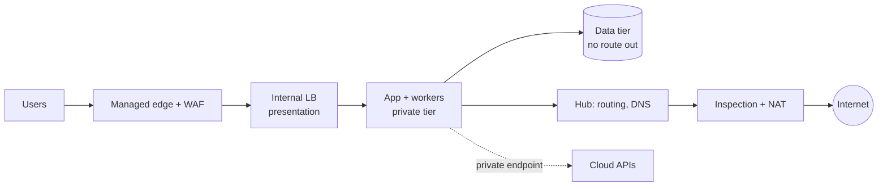
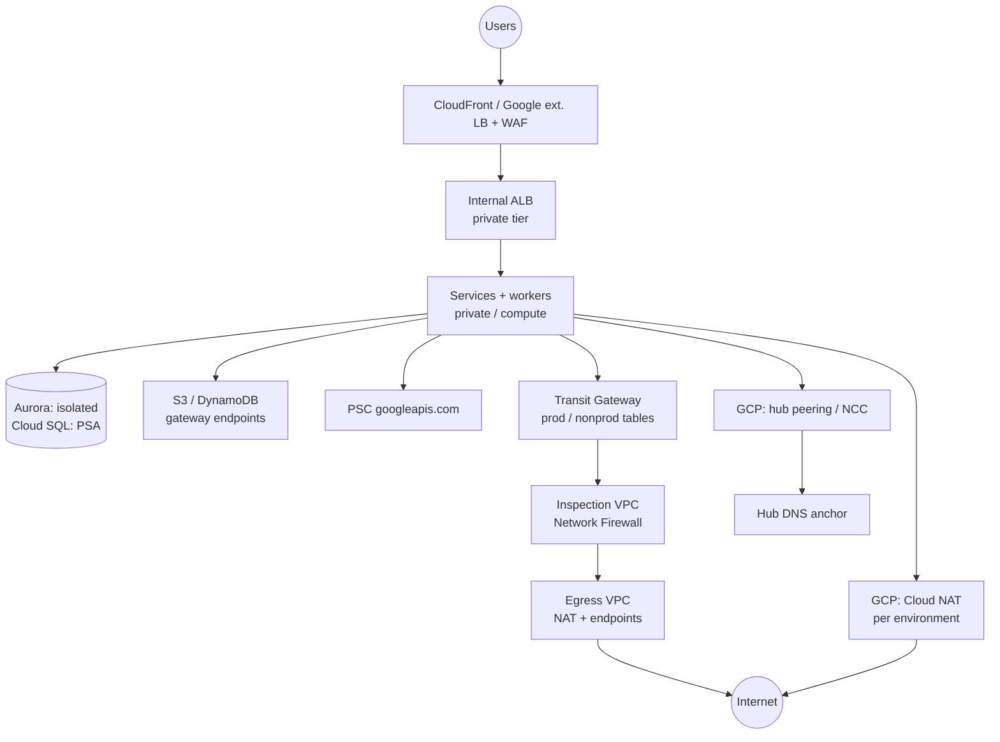

# N-tier network architecture

This walkthrough follows the [interview framework](00-primer.md#interview-framework)
and uses the [estimation cheat sheet](00-primer.md#estimation-cheat-sheet). The
placement rules live in the primer's [VPC-tier placement](00-primer.md#vpc-tier-placement);
this file elaborates on them and is the reference that every other "Build it
here" points to for tiers. It leans harder on existing modules than any other
walkthrough, because the landing zone *is* an N-tier network.

## The question

> "Design the network for a three-tier web application on a public cloud:
> presentation, application and data, with a separate compute tier for
> workers. Several environments, several teams. How do you segment it, how
> does traffic get in and out, and how do services reach managed databases and
> cloud APIs without the internet?"

Common variants:

- "Hub-and-spoke or one big VPC? Defend it."
- "All outbound traffic must be inspected. Where does the firewall go?"
- "Someone tagged a VM `database` and reached the DB. Fix the model."
- "Cloud SQL or RDS has no public IP. How does the app reach it?"
- "Prod and nonprod must never talk. Prove it."

## The two-minute answer

Four tiers, each a set of subnets with one job. **Presentation** is the load
balancer edge, ideally a managed edge (CloudFront or Google's external
Application Load Balancer) so no VM faces the internet. **Application** and
**compute** sit in private subnets with no public IPs. **Data** sits in
subnets with no route off the VPC, or behind Private Service Access, so a
database can never initiate a connection out. Between tiers, allow only the
next hop on named ports: security groups that reference each other on AWS, and
a tier firewall on GCP that selects tiers by **subnet range**, not by a tag
someone can edit. Environments are **spokes**, one VPC each, joined to a
**hub** that owns shared routing, DNS and egress. Prod and nonprod spokes never
learn each other's routes. On AWS every spoke's default route goes to the
Transit Gateway, through AWS Network Firewall, and out through a central NAT,
so egress is inspected. On GCP each environment has its own Cloud NAT, which is
not inspected. Say so, and name Secure Web Proxy or Cloud NGFW as the addition.
Cloud APIs and managed databases are reached over private endpoints, never the
internet.



## Clarify the requirements

| Question | Assumed answer |
|---|---|
| Clouds and regions? | AWS and GCP side by side, one region each, three zones. |
| Environments? | dev, staging, prod; one spoke VPC per environment per cloud. |
| Workload shape? | About 40 containerised services in prod (ECS on Fargate or Cloud Run), a few VM or GKE workers, managed PostgreSQL. |
| Public entry points? | HTTPS only, through a managed edge with a WAF. No SSH from the internet. |
| North-south peak? | 15,000 requests/s inbound; 1,500 outbound calls/s to third-party APIs. |
| Egress policy? | Prod egress inspected and allowlisted by domain; nonprod may be alert-only. |
| Prod and nonprod? | No direct path. Shared services (DNS, CI runners) reachable from both. |
| On-premises? | Optional, through the hub over VPN. Out of scope for the deep dives. |
| Compliance? | Flow logs on every subnet; firewall decisions logged. |

Non-functional targets: no single-zone dependency on any data path; adding a
service needs no network change; adding an environment needs one config
entry and one hub apply.

## Back-of-envelope estimates

**Address plan.** Each spoke gets a /16, and both clouds carve one /24 per
tier per zone by default
([`modules/aws/stages/workload/variables.tf:110`](../../modules/aws/stages/workload/variables.tf),
[`modules/gcp/network/tiered-vpc/main.tf:31`](../../modules/gcp/network/tiered-vpc/main.tf)).

- AWS reserves 5 addresses per subnet
  ([AWS docs](https://docs.aws.amazon.com/vpc/latest/userguide/subnet-sizing.html),
  checked 2026-11), so a /24 has 251 usable. The `private` tier across 3 AZs
  holds 3 × 251 = 753 addresses.
- Fargate in `awsvpc` mode takes one address per task. 40 services × 6 tasks at
  peak = 240, doubled during a rolling deploy = 480. Add the internal ALB
  (one or more ENIs per AZ, and it scales out) and the tier is about 65% full.
  At ×2 services it overflows.
- GCP reserves 4 addresses per primary range
  ([Google Cloud docs](https://docs.cloud.google.com/vpc/docs/subnets),
  checked 2026-11): 252 usable per /24.
- Cloud Run Direct VPC egress uses about 2× as many addresses as instances, keeps
  them up to 20 minutes after scale-down, and needs at least a /26
  ([Google Cloud docs](https://docs.cloud.google.com/run/docs/configuring/vpc-direct-vpc),
  checked 2026-11). The environment stage puts every Cloud Run service in the
  *first* private subnet
  ([`modules/gcp/stages/environment/main.tf:378`](../../modules/gcp/stages/environment/main.tf)).
  252 / 2 = 126 instances. Keep half free for a full redeploy's overlap and the
  real ceiling is about 63 instances for all services together.

That last number is the first thing this design breaks. Size the Cloud Run
subnet separately, or expand it: a GCP primary range can grow in place but never
shrink (same Google Cloud page).

**Egress bandwidth.** 1,500 outbound calls/s × 50 KB = 75 MB/s, or 0.6 Gbps
peak. Inbound user traffic does not cross the hub: it terminates at the edge
and the internal ALB inside the spoke. AWS Network Firewall handles up to 100
Gbps per AZ and drops traffic above that
([AWS docs](https://docs.aws.amazon.com/network-firewall/latest/developerguide/quotas.html),
checked 2026-11). A Transit Gateway VPC attachment handles up to 100 Gbps each
way per AZ
([AWS docs](https://docs.aws.amazon.com/vpc/latest/tgw/transit-gateway-quotas.html),
checked 2026-11). Headroom is about 160×.

**Egress connections.** An AWS NAT gateway supports 55,000 simultaneous
connections per IPv4 address to each unique destination (IP, port, protocol)
([AWS docs](https://docs.aws.amazon.com/vpc/latest/userguide/nat-gateway-basics.html),
checked 2026-11). Without connection reuse, 1,500 new connections/s to one
payment API, each held about 30 s including teardown, is 45,000 concurrent: 82%
of one address. With keep-alive pools it is a few hundred. Cloud NAT gives each
VM 64 ports by default with static allocation
([Google Cloud docs](https://docs.cloud.google.com/nat/docs/ports-and-addresses),
checked 2026-11). That is 64 concurrent connections from one VM to one
destination, so a GKE node with 30 pods calling the same API runs out first.

**Monthly inspected egress cost (AWS).** Average about 10 MB/s, or about 26 TB a
month. Prices are examples from each pricing page (checked 2026-11) and vary by
Region:

- TGW data processing at $0.02/GB: about $520
  ([pricing](https://aws.amazon.com/transit-gateway/pricing/)).
- Network Firewall at $0.065/GB is about $1,690, plus 3 endpoints × $0.395/h ×
  730 h, about $865
  ([pricing](https://aws.amazon.com/network-firewall/pricing/)).
- NAT gateway processing (an Ohio example of $0.045/GB on the
  [VPC pricing page](https://aws.amazon.com/vpc/pricing/)) is waived up to the
  firewall's volume when the NAT gateway is in the same Region and the same
  networking path as the firewall endpoint
  ([Network Firewall pricing](https://aws.amazon.com/network-firewall/pricing/)).
  Whether this hub's separate egress VPC counts as the same path is **verify
  before relying on**.

Inspection costs about $3,000 a month for this design, which is why it is
centralised once rather than run per spoke. S3 and DynamoDB gateway endpoints
are free (same VPC pricing page), so bulk data never touches that bill.

## API and data model

A network has no endpoints, but it has two contracts: the **flow matrix** the
tiers enforce, and the **cross-root outputs** that let a spoke find its hub.

### Flow matrix

| From → to | Port | AWS control | GCP control |
|---|---|---|---|
| Internet → edge | 443 | CloudFront + WAF, or a public ALB | External Application LB + Cloud Armor |
| Edge → presentation (internal LB) | 443/80 | CloudFront VPC origin to the internal ALB | Serverless NEG to Cloud Run; no subnet |
| Presentation → application | container port | `-svc` SG admits the ALB SG | public → compute rule on `compute_tier_ports` (8080, 8443, 3000) |
| Application → data | 5432 | `-db` SG admits only the `-svc` SG | compute → database on `database_ports` (3306, 5432, 6379); Cloud SQL over PSA |
| Data → anywhere | none | `-db` SG has no egress; `isolated` has no route | database-tier egress deny |
| Application → internet | 443 | SG egress 443 → TGW → firewall → NAT | Cloud NAT, not inspected |
| Application → cloud APIs | 443 | Gateway endpoints (S3, DynamoDB); others via inspection | PSC `googleapis.com` endpoint |
| Operators → VMs | 22 | SSM Session Manager, no inbound | IAP range `35.235.240.0/20` in the VPC rules, but the hub's hierarchical deny blocks it first (see deep dive 1) |
| Prod ↔ nonprod | none | Separate TGW tables; firewall policy decides | Peering is non-transitive; no route |

Sources: [`modules/aws/stages/app-services/main.tf:509`](../../modules/aws/stages/app-services/main.tf),
[`modules/gcp/network/tiered-vpc/main.tf:258`](../../modules/gcp/network/tiered-vpc/main.tf).

### Cross-root contracts

- **`aws-network`** publishes `contract.tgw_id`, `ipam_pool_ids`,
  `inspection_vpc_id`, `egress_vpc_id`, `resolver_profile_id` and
  `interface_endpoint_phz_id`
  ([`envs/aws/network/outputs.tf`](../../envs/aws/network/outputs.tf)).
  The workload root attaches its spoke to `tgw_id`.
- **`aws-workload-<env>`** publishes `tgw_attachment_id`, which goes back into
  `aws.network.spoke_attachments`. This hand-off is manual.
- **`gcp-network-hub`** publishes `hub_network` with `vpc_self_link`,
  `dns_domain`, `ncc_hub_id` and `ncc_spoke_group`
  ([`envs/gcp/network-hub/outputs.tf`](../../envs/gcp/network-hub/outputs.tf)),
  which `gcp-workload-<env>` turns into a peering or an NCC spoke plus a DNS
  peering zone.

## High-level design



**Request path.** A user resolves the public name to the managed edge. The WAF
filters the request, and the edge reaches the presentation tier privately: on
AWS a CloudFront VPC origin targets the internal ALB
(`app_ingress_mode = "cloudfront_vpc_origin"`); on GCP the external Application
Load Balancer uses a serverless NEG to an internal-ingress Cloud Run service
([`modules/gcp/network/app-ingress`](../../modules/gcp/network/app-ingress/)).
The ALB forwards to tasks in the `private` tier. A service queries its own
database in the data tier on 5432. The response returns the same way. No hop
crosses the hub.

**Egress path (AWS).** A service calls a third-party API. Its subnet's
`0.0.0.0/0` points at the Transit Gateway. The spoke's attachment is associated
with the `prod` table, whose only route sends everything to the inspection
attachment. The firewall applies the managed threat groups and the domain
allowlist, and hands the flow back to the TGW. The `inspection` table forwards
it to the egress VPC, and a same-AZ NAT gateway sends it out. The reply comes
back through the firewall because the `shared` table routes the org supernet to
inspection
([`modules/aws/stages/network-hub/main.tf:73`](../../modules/aws/stages/network-hub/main.tf)).

**Egress path (GCP).** A VM or GKE node in `private` leaves through the
environment's Cloud NAT. Cloud Run with the default `PRIVATE_RANGES_ONLY` sends
internet traffic straight out, past the VPC firewall and NAT (see the primer).

## Deep dives

### 1. Tier boundaries and controls

**The alternatives.** (a) One subnet, host firewalls. (b) Subnets per tier with
route-table separation only. (c) Subnets per tier, plus a stateful control at
each boundary keyed on identity. The landing zone does (c) on both clouds.

**AWS: security groups that reference security groups.** app-services creates
`<env>-<component>-svc` for the tasks and `<env>-<component>-db` for the Aurora
cluster. The `-db` group admits 5432 only from that service's `-svc` group and
has no egress rules. The `-svc` group admits the container port only from the
ALB's group, and sends 443 anywhere plus 5432 to its own database
([`modules/aws/stages/app-services/main.tf:509`](../../modules/aws/stages/app-services/main.tf)).
A reference is an identity, not an address, so it survives task churn and
needs no CIDR bookkeeping. The route table adds a second wall: the `isolated`
tier has no route off the VPC except the S3 and DynamoDB gateway endpoints, so
a compromised database host has nowhere to send data. Mind the quotas: 60
inbound and 60 outbound rules per group, 5 groups per ENI, and the product
capped at 1,000
([AWS docs](https://docs.aws.amazon.com/vpc/latest/userguide/amazon-vpc-limits.html),
checked 2026-11). One group per component keeps you far from both.

**GCP: the tiered VPC and its two firewall modes.**
[`modules/gcp/network/tiered-vpc`](../../modules/gcp/network/tiered-vpc/)
builds `public`, `private` and `database` subnets per zone, plus a baseline:
api-gateway → public on 443/80, public → compute on `compute_tier_ports`,
compute → database on `database_ports`, IAP and health-check ranges, a
database-tier egress deny, and a logged deny-all ingress at priority 65535.
`firewall_mode` chooses how that baseline is enforced:

- **`legacy`** (the default): VPC firewall rules matched by **network tag**
  (`public`, `compute`, `database`). The flaw: anyone with
  `compute.instances.setTags` can tag a VM `database` and receive traffic from
  the compute tier
  ([runbook](../../docs/runbooks/gcp-firewall-policy-migration.md)).
- **`both`**: adds one global network firewall policy whose rules select tiers
  by **subnet CIDR**. A VPC takes only one global network firewall policy
  ([Google Cloud docs](https://docs.cloud.google.com/firewall/docs/network-firewall-policies),
  checked 2026-11).
- **`policy`**: only the policy. Moving a VM between tiers now means moving its
  network interface to another subnet, which is a far rarer permission.

The order matters. By default GCP evaluates VPC rules *before* network firewall
policies (`AFTER_CLASSIC_FIREWALL`). `BEFORE_CLASSIC_FIREWALL` reverses that,
and anything no rule matches reaches the implied action: deny ingress, allow
egress
([Google Cloud docs](https://docs.cloud.google.com/firewall/docs/firewall-policies-rule-eval-order),
checked 2026-11). So in `both`, the legacy deny-all decides all ingress and the
policy's ingress rules never fire. Only `policy` mode proves them. The module
derives `BEFORE_CLASSIC_FIREWALL` for `policy` and raises a `check` warning
unless you set it explicitly
([`modules/gcp/network/tiered-vpc/main.tf:57`](../../modules/gcp/network/tiered-vpc/main.tf)).
Policy rules cannot use network tags, only secure tags or service accounts, so
ingress rules pick their tier by destination range. The policy has no trailing
deny-all, so unmatched traffic falls through to GKE's automatic VPC rules and
then the implied deny. A hierarchical policy on every folder denies tcp 22
and 3389 from `0.0.0.0/0` at priority 500
([`modules/gcp/stages/network-hub/main.tf:86`](../../modules/gcp/stages/network-hub/main.tf)).
Hierarchical policies are evaluated first and a matching deny ends evaluation
(evaluation-order docs above). The rule has no allow or `goto_next` for the
IAP range `35.235.240.0/20`, which falls inside `0.0.0.0/0`, so IAP TCP
forwarding for SSH and RDP is denied before the VPC's IAP rule is ever
reached.

**Where it breaks.**

- **IAP SSH is blocked (repo gap).** Fix it with a higher-priority
  hierarchical rule that allows, or sends to `goto_next`, tcp 22 and 3389 from
  `35.235.240.0/20`.
- No deployable root exposes `firewall_mode` yet, so every environment runs
  `legacy` ([known gaps, G7](../../docs/known-gaps.md)).
- In `policy` mode the implied deny is not logged, so you lose the deny-all
  logging.
- Cloud Run Direct VPC egress can carry network tags only for egress rules,
  never as an ingress target (Cloud Run docs above).

### 2. Hub-spoke vs flat networks

**Flat** means one VPC, or a full mesh of peered VPCs. It is simple, cheap
(no hub data charge) and fine for one team and one environment. It fails on
four counts: no place to put shared inspection, overlapping CIDRs when teams
grow, N² peerings for a mesh, and a blast radius that is the whole estate.

**Hub-spoke** puts routing, DNS, egress and hybrid links in a hub that each
environment spoke attaches to. Isolation becomes a routing property, not a
firewall rule you might forget.

- **AWS: segmented Transit Gateway.**
  [`modules/aws/stages/network-hub`](../../modules/aws/stages/network-hub/)
  builds `prod`, `nonprod`, `inspection` and `shared` route tables (plus
  `hybrid` with VPN) with default association and propagation off. A spoke is
  associated with `prod` or `nonprod`, whose only route is `0.0.0.0/0` →
  inspection, and propagated only into `inspection`. Prod and nonprod never
  learn each other's routes. A prod ↔ nonprod flow is still *routable through*
  the firewall, because the inspection table knows every spoke, so only the
  firewall policy separates the segments, and alert-only mode lets that flow
  pass ([AWS landing zone](../../docs/architecture/aws-landing-zone.md#network-topology)).
  Per-segment inspection tables would close this at the routing layer.
- **GCP: Shared VPC hosts peered to a hub, or NCC.** Each environment's
  `<env>-host` VPC peers to `hub-vpc-core`. VPC Network Peering is not
  transitive, so dev and prod, both peered to the hub, cannot reach each other
  through it ([Google Cloud docs](https://docs.cloud.google.com/vpc/docs/vpc-peering),
  checked 2026-11). The opt-in alternative is Network Connectivity Center:
  `gcp.network.connectivity: ncc` makes each environment an NCC spoke in the
  **edge** group of a STAR hub. Edge spokes reach only the center group, never
  each other
  ([Google Cloud docs](https://docs.cloud.google.com/network-connectivity/docs/network-connectivity-center/concepts/connectivity-topologies),
  checked 2026-11). It scales past peering-group quotas and can export the
  Private Service Access range to the hub, but it is not yet sandbox-proven
  ([migration runbook](../../docs/runbooks/gcp-peering-to-ncc-migration.md)).

**Why the hub wins here:** three environments, many teams, an inspected-egress
requirement and future hybrid links. **What it costs:** a TGW charge on every
inspected GB, a manual hand-off for each new AWS spoke, and one more apply.
**Where it breaks:** at multi-region. A TGW is regional, so you peer TGWs or
move to Cloud WAN. GCP VPCs are global, so additional regions are extra subnets
in the same VPC (`additional_regions`).

### 3. Inspected egress

The goal is that a compromised workload cannot send data to an arbitrary
host. The options, from weakest to strongest:

1. **NAT only.** It hides source addresses and blocks inbound connections, but
   it is not a proxy and inspects nothing
   ([Google Cloud docs](https://docs.cloud.google.com/nat/docs/overview),
   checked 2026-11).
2. **DNS filtering.** Route 53 Resolver DNS Firewall blocks lookups of listed
   domains; this hub enables it, failing closed. It is bypassed by a hard-coded
   IP.
3. **Central stateful firewall with domain allowlists** on HTTP Host and TLS
   SNI. This is the AWS design.
4. **TLS-intercepting proxy.** It sees URLs and payloads, at the cost of
   certificate distribution and breaking certificate-pinned clients.

**AWS, as built.** The inspection VPC runs AWS Network Firewall in
`STRICT_ORDER`: the managed `AttackInfrastructure`, `MalwareDomains` and
`BotNetCommandAndControlDomains` groups, then optional custom Suricata rules,
then an egress domain allowlist, with `HOME_NET` set to the org supernet
([`modules/aws/stages/network-hub/main.tf:400`](../../modules/aws/stages/network-hub/main.tf)).
The default action is `aws:alert_established`: log but pass, so day one never
blackholes. A production estate must fail closed. With `enforce_egress_allowlist`
set, which `aws-network` derives from `org.profile` and a production workload,
the plan fails unless the actions include `aws:drop_established` and the
allowlist is non-empty, or `aws.network.egress_alert_only_waived` is set.
The TGW attachment for inspection runs in **appliance mode**, so both
directions of a flow use the same AZ and the same stateful endpoint
([AWS docs](https://docs.aws.amazon.com/vpc/latest/tgw/how-transit-gateways-work.html),
checked 2026-11). Without it, asymmetric return traffic is dropped as
out-of-state.

**GCP, as built: not inspected.** Each environment has its own Cloud NAT for
the `private` and `database` tiers, and the database tier's egress is denied
by firewall. That is egress *control* (no public IPs, a known set of NAT
addresses), not inspection. To add inspection:

- **Cloud NGFW Standard** adds FQDN objects and threat intelligence to firewall
  policies. **Enterprise** adds intrusion prevention and URL filtering
  ([Google Cloud docs](https://docs.cloud.google.com/firewall/docs/about-firewalls),
  checked 2026-11). This builds on the tier policy above, so it needs
  `firewall_mode = "policy"` first.
- **Secure Web Proxy** inspects HTTP and HTTPS egress as an explicit proxy, as a
  next hop by route, or through a PSC service attachment, with optional TLS
  inspection
  ([Google Cloud docs](https://docs.cloud.google.com/secure-web-proxy/docs/overview),
  checked 2026-11). Its PSC mode is the closest GCP analogue to a central AWS
  inspection VPC.

Neither exists in this repo.

**A routing catch on GCP.** `tiered-vpc` creates every VPC with
`delete_default_routes_on_create = true`
([`modules/gcp/network/tiered-vpc/main.tf:105`](../../modules/gcp/network/tiered-vpc/main.tf)),
and no module in the repo recreates a `0.0.0.0/0` route. Public NAT can use only
routes whose next hop is the default internet gateway
([Google Cloud docs](https://docs.cloud.google.com/nat/docs/nat-product-interactions),
checked 2026-11), and peering never exchanges such routes (VPC peering docs
above). As written, the private tier probably has no internet path at all.
API traffic still works through the PSC endpoint. **Verify before relying on**
this in a sandbox; "Build it here" shows the one-resource fix.

**Where it breaks.** At ×100 egress, Network Firewall's 100 Gbps per AZ
becomes the ceiling, and per-GB processing dominates the bill. Move bulk flows
to gateway endpoints and PrivateLink, which bypass the firewall by design.

### 4. Private service access

Three patterns, each with different reach.

- **Gateway endpoints (AWS S3 and DynamoDB).** A route-table entry, free, on
  every non-public tier of the spoke, including `isolated`
  ([`modules/aws/stages/workload/main.tf:120`](../../modules/aws/stages/workload/main.tf)).
  They are the only way out of `isolated`, so put a bucket-scoped endpoint
  policy on them if exfiltration to someone else's bucket matters.
- **Interface endpoints (AWS PrivateLink).** An ENI per AZ, billed per AZ-hour
  plus per GB
  ([pricing](https://aws.amazon.com/privatelink/pricing/), checked 2026-11).
  The hub centralises `ec2`, `ssm`, `ssmmessages`, `ec2messages`, `kms`,
  `logs` and `sts` in the egress VPC with an org-scoped policy
  ([`modules/aws/network/vpc-endpoints/variables.tf:34`](../../modules/aws/network/vpc-endpoints/variables.tf)).
  The catch: `private_dns_enabled` answers only inside the egress VPC, and the
  module leaves cross-account zone association out of scope. A spoke therefore
  resolves those names to the public endpoints and reaches them through
  inspection and NAT. The fix is either spoke-local endpoints for chatty APIs
  or a hub-owned private hosted zone shared with spokes.
- **GCP Private Service Access.** An allocated range peered to Google's
  producer network, which Cloud SQL and Memorystore private IPs come from. It
  is on by default with a /16
  ([`modules/gcp/stages/net-spoke/variables.tf:160`](../../modules/gcp/stages/net-spoke/variables.tf)).
  It exchanges subnet routes only and is not transitive, so peered networks
  cannot reach it, and on-premises needs an exported custom route
  ([Google Cloud docs](https://docs.cloud.google.com/vpc/docs/private-services-access),
  checked 2026-11). That is why the environment VPC, not the hub, owns it.
- **GCP Private Service Connect for Google APIs.** A global endpoint on the
  `all-apis` or `vpc-sc` bundle, plus a private `googleapis.com` zone the module
  creates. The environment stage switches to `vpc-sc` once the perimeter is
  enforced. PSC endpoints are not reachable from peered networks
  ([Google Cloud docs](https://docs.cloud.google.com/vpc/docs/configure-private-service-connect-apis),
  checked 2026-11), so every environment needs its own.

**Why this matters in the interview:** private access is reachability *and*
DNS. Most "private endpoint does not work" incidents are a name resolving to
the public address.

## Trade-offs to defend

| Decision | Chosen | Rejected | Why | What would change the answer |
|---|---|---|---|---|
| Topology | Hub-spoke, spoke per environment | Flat VPC; peering mesh | Central egress and DNS; isolation by routing | One team, one environment, no inspection requirement |
| AWS tier control | SG-to-SG references per component | NACLs; CIDR rules | Identity-based, survives churn, stateful | A compliance rule demanding subnet ACLs too (add, do not replace) |
| GCP tier control | Firewall policy by subnet CIDR (`policy`) | Tag-based VPC rules | Tags are editable by too many principals | Pure Cloud Run estates with no VMs, where tags barely matter |
| AWS egress | Central Network Firewall + NAT | NAT per spoke | One allowlist, one bill, one log | Latency-critical egress or a per-GB bill that dwarfs the risk |
| GCP egress | Per-environment Cloud NAT (as built) | Secure Web Proxy via PSC | It is what exists; proxy needs client or route changes | A requirement for inspected egress on GCP |
| Data tier | No route out (`isolated`) / PSA | Private subnets with NAT | A database never needs to initiate | Self-managed databases that pull patches (use a mirror) |
| API access | Gateway endpoints + PSC | Everything via NAT | Free, private, bypasses inspection costs | Endpoint quotas or DNS complexity outweighing NAT cost |
| Hub link (GCP) | VPC peering (default) | NCC STAR | Proven in this repo | Peering-group quotas, many spokes, sandbox-proven NCC |

## Failure modes and scaling limits

**At ×10 (400 services, 6 Gbps egress):**

- **Subnet exhaustion fails first.** The GCP Cloud Run subnet tops out at about
  63 instances with deploy overlap. The AWS `private` tier tops out at about 750
  task addresses. Re-plan the address space before the services, not after.
- **NAT ports.** Per-destination limits bite on the busiest third-party API.
  Pool connections; add NAT addresses (AWS allows up to 8 per gateway) or turn
  on Cloud NAT dynamic port allocation. `net-spoke` does not pass the NAT
  module's `min_ports_per_vm` or `enable_dynamic_port_allocation` through yet.
- **Firewall rule capacity.** A growing allowlist eats the 200-unit default
  `domain_allowlist_capacity`, which cannot change after creation.

**At ×100:** inspection bandwidth (100 Gbps per AZ) and cost, TGW route quotas
(10,000 routes per gateway) and peering-group quotas on GCP. Split into
regional hubs, push bulk data to private endpoints, and consider the
TGW-native Network Firewall attachment.

**Blast radius:**

| Component | If it fails | Blast radius |
|---|---|---|
| One AZ's firewall endpoint | That AZ's egress drops | Spoke egress from that AZ |
| NAT gateway (AWS) | Same-AZ egress fails | One AZ; other AZs keep their own NAT |
| Transit Gateway route table | Wrong route or blackhole | Every spoke in that segment |
| Firewall policy change | Allowed flow now dropped | All spokes, both segments |
| Cloud NAT (GCP) | Egress fails | One environment |
| Hub peering or NCC spoke | Hub DNS fails | One environment's internal names |
| Tier firewall rule | Tier-to-tier traffic blocked | One environment |
| PSA peering | Cloud SQL unreachable | Every database in that environment |

## AWS and GCP mapping

| Component | AWS | GCP | Difference that matters |
|---|---|---|---|
| Spoke network | VPC per account (`workload-<env>`) | Shared VPC host per environment (`<prefix>-<env>-vpc`) | GCP VPCs are global; AWS VPCs are regional |
| Hub | Transit Gateway in the network account | Hub VPC in `shared-hub` (peering or NCC) | TGW routes transitively by table; peering never does |
| Tiers | `public` (opt-in), `private`, `isolated`, `tgw` | `public`, `private`, `database` per zone | AWS needs a `tgw` tier for attachment ENIs |
| Tier control | Security groups | VPC rules or network firewall policy | SGs reference identities; GCP policies select ranges, secure tags or service accounts |
| Org-wide floor | VPC Block Public Access via declarative policy | Hierarchical firewall + `vmExternalIpAccess` | BPA ingress-only still lets NAT out ([AWS docs](https://docs.aws.amazon.com/vpc/latest/userguide/security-vpc-bpa-basics.html), checked 2026-11) |
| Egress | Central inspection + NAT | Cloud NAT per environment | Only AWS is inspected |
| Inspection | AWS Network Firewall | Cloud NGFW Enterprise / Secure Web Proxy (not built) | Network Firewall runs inline on a route |
| Managed DB access | DB subnet group in `isolated` | Private Service Access | PSA is a peering; it is not transitive |
| Cloud API access | Gateway + interface endpoints | Private Google Access + PSC | PSC brings its own DNS zone; central AWS endpoints need shared DNS |
| Flow logs | VPC flow logs to the log-archive bucket | Subnet flow logs, exported to BigQuery | GCP sampling defaults to 0.1 in the environment stage |

Two differences change the design: transitive routing (a TGW table can send
everything to a firewall, while peering cannot, which is why GCP egress
inspection needs a proxy or NGFW rather than a hub hop), and DNS for private
endpoints.

## Build it here

### Where it lives

| Part | AWS | GCP |
|---|---|---|
| Hub, inspection, egress, endpoints, DNS | `aws-network` (`envs/aws/network`) in the network account | `gcp-network-hub` (`envs/gcp/network-hub`) in `shared-hub` / `shared-dns` |
| Spoke VPC, tiers, attachment | `aws-workload-<env>` (`envs/aws/workload`) | `gcp-workload-<env>` (`envs/gcp/workload`) through `modules/gcp/stages/environment` → `net-spoke` |
| Security groups, ALB, DB subnets | app-services inside `aws-workload-<env>` | Tier firewall inside `net-spoke` |
| Apply order | `aws-organization` → `aws-security` → `aws-network` → `aws-workload-<env>` → `aws-network` again with the attachment ID | `gcp-bootstrap` → `gcp-organization` → `gcp-projects` → `gcp-network-hub` → `gcp-workload-<env>` |

The second `aws-network` apply is the manual hand-off: until the spoke is listed
in `aws.network.spoke_attachments` it has no routing at all
([add an account](../../docs/runbooks/aws-add-account.md)). Applies run in
Terraform Cloud only.

### Config

```yaml
# Illustrative. Keys are real (config/landing-zone.schema.json); values are placeholders.
gcp:
  network:
    hub_cidr_block: 10.0.0.0/16
    dns_hub_cidr_block: 10.1.0.0/16
    connectivity: peering # ncc only after the sandbox proof
  environments:
    prod:
      cidr_block: 10.60.0.0/16
      region: europe-west2
      is_production: true
aws:
  workload:
    app_ingress_mode: cloudfront_vpc_origin # ALB stays internal
  workload_environments:
    prod:
      account_key: workload_prod
      vpc_cidr: 10.73.0.0/16
      is_production: true
  network:
    stateful_default_actions:
      - aws:drop_established
      - aws:alert_established
    egress_domain_allowlist:
      - .amazonaws.com
      - .github.com
      - api.payments.example.com
    spoke_attachments:
      prod: # from the aws-workload-prod output tgw_attachment_id
        attachment_id: tgw-attach-0123456789abcdef0
        segment: prod
```

Gaps this design hits:

- **`firewall_mode`** is not exposed by `gcp-workload-<env>` or
  `gcp-network-hub`. Wiring it means adding the variable to
  `modules/gcp/stages/environment` and passing it to `net-spoke`, after the
  sandbox proof below.
- **Custom Suricata rules** (`network_firewall_suricata_rules`) exist on the
  network-hub stage but not on `envs/aws/network`.
- **Cloud NAT tuning** (ports per VM, dynamic allocation) is not passed through
  `net-spoke`.
- **No inspected egress on GCP**, and no shared DNS for the central AWS
  interface endpoints.
- **IAP is denied by the hub's hierarchical policy.** `gcp-network-hub` needs
  an allow or `goto_next` rule for `35.235.240.0/20` on tcp 22 and 3389 at a
  priority higher than 500.

### GCP: prove policy mode on a sandbox spoke

The migration runbook requires a sandbox proof before any environment adopts
`policy`. A sandbox root calls `net-spoke` directly with the real inputs:

```hcl
# Sandbox root only: proves firewall_mode = "policy" before the environment stage wires it.
module "sandbox_spoke" {
  source = "../../../modules/gcp/stages/net-spoke"

  project_id     = "SANDBOX_HOST_PROJECT_ID"
  project_prefix = "my-org"
  region         = "europe-west2"

  network = {
    name           = "my-org-sandbox-vpc"
    cidr_block     = "10.90.0.0/16"
    explicit_zones = ["europe-west2-a", "europe-west2-b", "europe-west2-c"]
  }

  firewall_mode                     = "policy"
  firewall_policy_enforcement_order = "BEFORE_CLASSIC_FIREWALL"

  firewall = {
    compute_tier_ports = ["8080"]
    database_ports     = ["5432"]
  }
}
```

Run the runbook's Connectivity Tests against it (public → compute,
compute → database, Cloud Run → Cloud SQL, database egress denied), then
re-plan to 0 changes.

### GCP: a default route for Cloud NAT

In `envs/gcp/workload`. Argument names checked against google v8.10.0
([`google_compute_route`](https://registry.terraform.io/providers/hashicorp/google/8.10.0/docs/resources/compute_route),
checked 2026-11):

```hcl
# Gap: tiered-vpc deletes the default route and no module recreates it; Public NAT
# only uses routes whose next hop is the default internet gateway. Verify in a sandbox.
resource "google_compute_route" "default_internet" {
  project          = local.env_config.host_project_id
  name             = "${module.environment.network_name}-default-igw"
  network          = module.environment.network_self_link
  dest_range       = "0.0.0.0/0"
  next_hop_gateway = "default-internet-gateway"
  priority         = 1000
}
```

The public tier gains the route too, but its VMs cannot hold external IPs and
are not in the NAT's subnet list, so nothing there gains egress.

### AWS: a spoke-local interface endpoint for a chatty API

In `envs/aws/workload`, using `module.aws_workload`, `local.environment`,
`local.aws_region` and `local.vpc_cidr`. Endpoints take no KMS key, and the
security group follows the app-services naming. Arguments checked against aws
v6.72.0
([`aws_vpc_endpoint`](https://registry.terraform.io/providers/hashicorp/aws/6.72.0/docs/resources/vpc_endpoint),
[`aws_security_group`](https://registry.terraform.io/providers/hashicorp/aws/6.72.0/docs/resources/security_group),
[`aws_vpc_security_group_ingress_rule`](https://registry.terraform.io/providers/hashicorp/aws/6.72.0/docs/resources/vpc_security_group_ingress_rule),
checked 2026-11):

```hcl
# Gap: the hub's central endpoints answer private DNS only inside the egress VPC;
# a spoke-local SQS endpoint, in the landing zone's conventions.
resource "aws_security_group" "sqs_endpoint" {
  name        = "${local.environment}-sqs-endpoint"
  description = "SQS interface endpoint; HTTPS from this spoke only."
  vpc_id      = module.aws_workload.vpc_id

  tags = { Name = "${local.environment}-sqs-endpoint", Service = "sqs-endpoint" }
}

resource "aws_vpc_security_group_ingress_rule" "sqs_endpoint_https" {
  security_group_id = aws_security_group.sqs_endpoint.id
  description       = "HTTPS from the spoke VPC"
  ip_protocol       = "tcp"
  from_port         = 443
  to_port           = 443
  cidr_ipv4         = local.vpc_cidr
}

resource "aws_vpc_endpoint" "sqs" {
  vpc_id              = module.aws_workload.vpc_id
  service_name        = "com.amazonaws.${local.aws_region}.sqs"
  vpc_endpoint_type   = "Interface"
  private_dns_enabled = true
  subnet_ids          = module.aws_workload.subnet_ids_by_tier["private"]
  security_group_ids  = [aws_security_group.sqs_endpoint.id]

  tags = { Name = "${local.environment}-sqs", Service = "sqs-endpoint" }
}
```

Add an endpoint policy scoped by `aws:PrincipalOrgID`, as the hub module does,
and the SQS calls stop crossing the firewall and its per-GB bill.

## Runbook

### Production egress dropped at the inspection firewall

**Detection signal.** `DroppedPackets` (namespace `AWS/NetworkFirewall`) rises
for the hub firewall
([AWS docs](https://docs.aws.amazon.com/network-firewall/latest/developerguide/monitoring-cloudwatch.html),
checked 2026-11). Services see TLS handshake timeouts to external hosts, and
NAT `ConnectionEstablishedCount` falls below `ConnectionAttemptCount`
([AWS docs](https://docs.aws.amazon.com/vpc/latest/userguide/metrics-dimensions-nat-gateway.html),
checked 2026-11). It usually starts right after an `aws-network` apply.

**Triage.**

1. **Policy or routing?** Read the firewall alert logs in the log-archive
   bucket under `network-firewall/alert`. A drop entry with the destination's
   SNI means policy. No entry at all means the flow never reached the firewall:
   check routing.
2. **Policy:** was a domain removed from `aws.network.egress_domain_allowlist`,
   or did `stateful_default_actions` just gain `aws:drop_established`? Compare
   the last applied run in Terraform Cloud.
3. **Routing:** is the spoke listed in `aws.network.spoke_attachments`? Does
   the `prod` table still route `0.0.0.0/0` to inspection? Is
   `enable_network_firewall` still true? Without it, wired spokes have no
   egress ([known gaps](../../docs/known-gaps.md#open--validate-before-relying-on)).
4. **One AZ only?** Filter `DroppedPackets` and `OtherDroppedPackets` by
   `AvailabilityZone`. One hot AZ points to that endpoint or its NAT gateway.

**Mitigation.**

1. **Missing domain:** add it to the allowlist in config and apply
   `aws-network` through Terraform Cloud. Never edit the firewall policy in the
   console: the next apply reverts it.
2. **Broad breakage after a tightening:** remove `aws:drop_established` from
   `aws.network.stateful_default_actions`, which is what returns the firewall
   to log-but-pass, **and** set `aws.network.egress_alert_only_waived: true`.
   The waiver only lets the plan pass the production gate; on its own it
   changes no firewall behaviour. Both are reviewable and must be reverted once
   the allowlist is complete.
3. **Routing:** restore the spoke entry or revert the routing change.
4. **AZ endpoint fault:** open an AWS support case; the other AZs keep working
   because every route is same-AZ.

**Verification.** `DroppedPackets` back to baseline, the alert log shows the
domain passing, and a synthetic call from each AZ's private subnet succeeds.

**Follow-up.** Build the allowlist from alert-only logs before you tighten.
Add an allowlist-diff check to review. Consider spoke-local endpoints for AWS
APIs that are crossing the firewall.

### GCP: no egress, or Cloud NAT port exhaustion

**Detection:** `nat/dropped_sent_packets_count` with reason `OUT_OF_RESOURCES`,
or `nat/nat_allocation_failed`
([Google Cloud docs](https://docs.cloud.google.com/nat/docs/monitoring),
checked 2026-11). **Triage:** if no traffic is translated at all, check for a
`0.0.0.0/0` route to the default internet gateway; if only some VMs fail, check
`nat/allocated_ports` per VM. **Mitigation:** add the default route; raise
ports per VM or enable dynamic allocation (a `net-spoke` change). **Follow-up:**
pool outbound connections.

## Study aids

### Numbers to memorise

| Fact | Value |
|---|---|
| Reserved addresses per subnet | AWS 5, GCP 4 |
| Cloud Run Direct VPC egress | About 2× addresses per instance, /26 minimum, held 20 min |
| Security groups | 60 rules in, 60 out; 5 per ENI; product ≤ 1,000 |
| TGW | 5,000 attachments, 20 route tables, 100 Gbps per attachment per AZ |
| Network Firewall | 100 Gbps per AZ; 20 stateful groups per policy |
| AWS NAT gateway | 5 Gbps scaling to 100; 55,000 connections per address per destination |
| Cloud NAT | 64 ports per VM by default; 64,512 ports per NAT address |
| Inspected egress cost (examples) | TGW $0.02/GB + firewall $0.065/GB |
| This design | 0.6 Gbps egress peak, about 26 TB a month, about $3,000 a month to inspect |

### Likely follow-ups

- **"Why not NACLs?"** They are stateless and address-based, so you manage
  ephemeral ports and CIDRs by hand. Security groups are stateful and
  identity-based. NACLs are a coarse backstop at most.
- **"Why is the database tier unable to reach the internet?"** It never needs
  to initiate. No route out turns a credential leak into a contained incident.
- **"Is GCP egress inspected?"** No. It is per-environment Cloud NAT. Inspection
  would be Secure Web Proxy or Cloud NGFW Enterprise, which this repo does not
  build.
- **"How do prod and nonprod stay apart?"** AWS: separate TGW route tables; the
  firewall policy decides the routable-through-inspection path. GCP: peering is
  not transitive, and NCC edge spokes cannot see each other.
- **"Why select tiers by subnet rather than tag?"** Tags are an instance
  attribute that many roles can change. Subnet placement is a network decision.

### Classic mistakes

- One flat VPC with "private" meaning only "no public IP".
- A NAT gateway per spoke, so there is nowhere to inspect.
- Firewall rules keyed on mutable tags, or a policy that never decides because
  the evaluation order runs it last.
- Interface endpoints with no DNS plan.
- /24 subnets for serverless runtimes that consume two addresses per instance.
- Forgetting appliance mode, so stateful inspection drops return traffic.

### Further reading

- [AWS landing zone: network topology](../../docs/architecture/aws-landing-zone.md#network-topology)
- [GCP landing zone: network topology](../../docs/architecture/gcp-landing-zone.md#network-topology)
- [GCP firewall policy migration](../../docs/runbooks/gcp-firewall-policy-migration.md)
- [Building a scalable and secure multi-VPC network](https://docs.aws.amazon.com/whitepapers/latest/building-scalable-secure-multi-vpc-network-infrastructure/transit-gateway.html)
