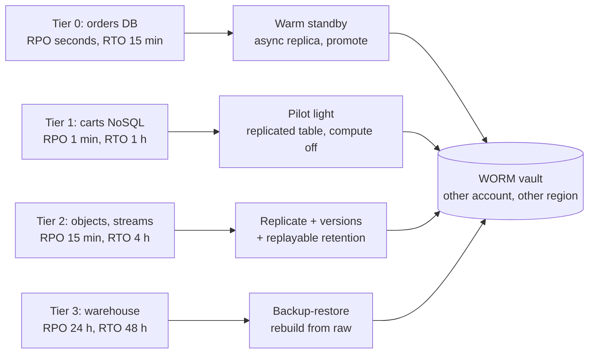
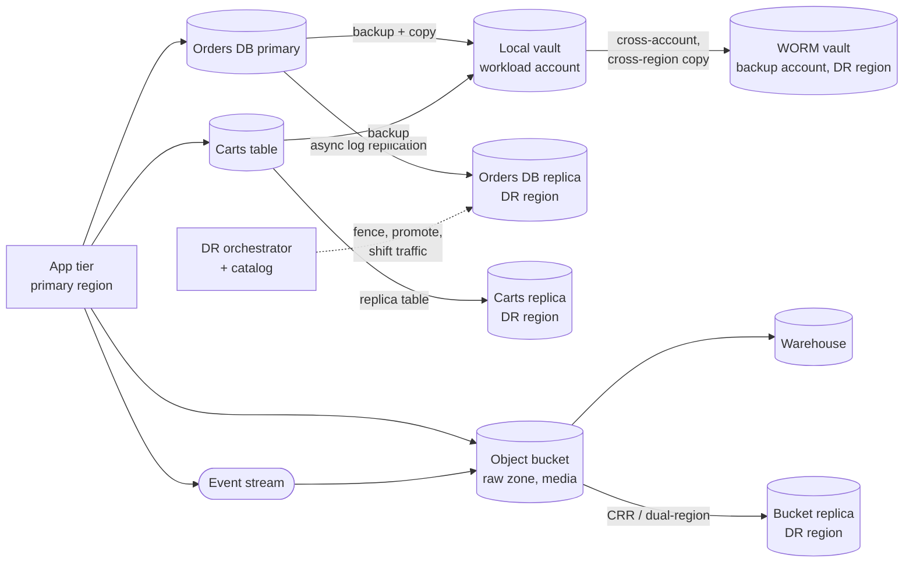

# Data disaster recovery across data architectures

This walkthrough follows the [interview framework](00-primer.md#interview-framework).
It uses the [estimation cheat sheet](00-primer.md#estimation-cheat-sheet), the
[conventions](00-primer.md#conventions) and the zone names in
[Data zones](00-primer.md#data-zones). Running two live regions, the top rung
of the ladder, is the multi-region active-active walkthrough.

## The question

> "Our company runs a relational order database, a NoSQL store for carts and
> sessions, object storage for media and the raw data zone, event streams, and
> a warehouse. Design disaster recovery for all of it. What RPO and RTO can
> each one have, how do you get there, and how do you prove it works?"

Common variants:

- "A region goes down. Walk me through the next 30 minutes."
- "A bad migration deleted half the orders table an hour ago. Now what?"
- "Ransomware got an admin's credentials. Are your backups safe?"
- "Why not replicate everything synchronously and call it done?"

## The two-minute answer

Start by separating two disasters. **Site loss** (a zone or region is gone)
is solved by replication. **Data loss** (a bad deploy, ransomware, a deleted
table) is solved only by **point-in-time and immutable backups**, because
replication copies the damage in seconds. Then tier the data by business
impact, give each tier an RPO and RTO, and pick the cheapest rung of the
ladder that meets them: **backup-restore**, **pilot light**, **warm
standby**, or **active-active**. Here the order database is
tier 0: an asynchronous cross-region replica that can be promoted, with
seconds of RPO and about 15 minutes of RTO. Carts are tier 1, replicated
tables with compute switched off in the DR region. Objects and streams are
tier 2: continuous replication, versioning, and replayable stream retention.
The warehouse is tier 3: rebuilt from the raw zone within two days. Every
store also writes backups into a
**write-once vault outside the primary region** (a second region on AWS, a
multi-region vault on GCP), in a separate account where the cloud allows,
because a compromised production account must not be able to delete its own
backups. Nothing counts until tested: weekly automated restore tests,
quarterly switchover drills, and runbooks a tired engineer can follow.



## Clarify the requirements

| Question | Assumed answer |
|---|---|
| Which disasters are in scope? | Zone loss, region loss, logical corruption, accidental deletion, account compromise. Not a whole-cloud outage. |
| Who sets RPO and RTO? | The business, per dataset; engineering prices each option. |
| Regions? | One primary and one DR region per cloud, same jurisdiction. |
| Can we lose acknowledged orders? | Seconds of them on region loss, if reconciled with the payment provider. Never to corruption: restore to before the bad write. |
| Is the DR region allowed to be smaller? | Yes, for tiers 1 to 3. Tier 0 must take full write load within 15 minutes. |
| Cost ceiling? | DR may add about 30% to data-tier spend. Active-active everywhere is out. |
| Compliance? | Backups kept 35 days hot and a year cold; tamper-proof against admins. |

Non-functional: tested, automated failover steps for tier 0; tier 3 may be
manual. DR copies use customer-managed keys that survive the same disasters as
the data.

## Back-of-envelope estimates

Peaks are 3× average, as in the [QPS conversions](00-primer.md#qps-conversions).
Every input is an assumption.

**Relational (orders).** 2 TB, 3,000 writes/s at peak, about 2 KB of
write-ahead log per write: 3,000 × 2 KB = **6 MB/s of log**, about 48 Mbps
across regions and about 0.5 TB of log a day. Keeping 35 days of
point-in-time logs is about 18 TB before compression. *Drives:* one
asynchronous replica stream is cheap, so tier 0 replicates continuously.

**NoSQL (carts).** 400 GB, 8,000 writes/s of 1 KB items. Cross-region
replication consumes write capacity in every replica
([AWS docs](https://docs.aws.amazon.com/amazondynamodb/latest/developerguide/V2globaltables_HowItWorks.html),
checked 2026-11), so the DR replica also needs 8,000 write units per second.
*Drives:* pilot light is not free; budget the replicated writes.

**Objects.** 800 TB stored, 3 TB a day of new objects: 3 TB ÷ 86,400 s ≈
35 MB/s average, about 105 MB/s (0.84 Gbps) at peak. S3 Replication Time
Control has a default quota of 1 Gbps
([AWS docs](https://docs.aws.amazon.com/AmazonS3/latest/userguide/replication-time-control.html),
checked 2026-11), so peak uses 84% of it: raise the quota. At 2 MB per
object, peak is about 53 objects/s, and each SSE-KMS object replicated costs 2
KMS requests, about 106/s
([same page](https://docs.aws.amazon.com/AmazonS3/latest/userguide/replication-time-control.html)).
*Drives:* restoring 800 TB at an optimistic 10 GB/s takes 80,000 s, about 22
hours, missing a 4-hour RTO, so objects are **replicated live**.

**Streams.** 20 MB/s ingest with 7 days of retention: 20 MB/s × 604,800 s ≈
12 TB. *Drives:* the raw zone lands every event within minutes, so streams
need no cross-region replica; after failover, in-flight events are replayed
from the outbox or source.

**Warehouse.** 300 TB. Rebuilding from the raw zone at an assumed 3 GB/s of
aggregate scan and write is 300,000 GB ÷ 3 GB/s = 100,000 s ≈ 28 hours.
*Drives:* a 48-hour RTO fits backup-restore; 4 hours would need a managed
replica.

**Backups.** Snapshot RPO equals the interval plus copy time: 24 h daily, 6 h
for Cloud SQL vault backups at best, about 1 h hourly on AWS. Aurora continuous
backup gives about 5 minutes
([AWS docs](https://docs.aws.amazon.com/AmazonRDS/latest/AuroraUserGuide/Aurora.Managing.Backups.html),
checked 2026-11).

**Tier 0 RTO budget.** Detect 3 min + decide 5 min + fence and promote 2 min +
DNS and connection drain 1 min + scale DR compute 4 min ≈ **15 minutes**.
People forget "decide"; it is why failover is a button, not a trigger.

## API and data model

The DR control plane is a **dataset catalog** that turns tiers into
configuration and records evidence.

| Entity | Key fields | Access pattern |
|---|---|---|
| `dataset` | `id`, `tier`, `rpo_seconds`, `rto_seconds`, `store_type`, `primary_region`, `dr_region`, `replication_mode`, `backup_plan`, `owner` | Read by the policy generator; drives tags and labels such as `backup=true` |
| `recovery_evidence` | `dataset_id`, `kind` (`restore_test`, `switchover`, `game_day`), `started_at`, `measured_rpo_s`, `measured_rto_s`, `passed` | Appended by each test; no pass in 30 days turns a dataset red |
| `failover_run` | `id`, `group`, `mode` (`switchover`, `failover`), `target_region`, `fenced_at`, `promoted_at`, `traffic_at` | Written by the orchestrator; the audit trail |

Orchestrator operations (Step Functions or Workflows over the managed APIs):

```text
POST /failover-groups/{group}/switchover   {target_region}        # planned, RPO 0
POST /failover-groups/{group}/failover     {target_region, ack_data_loss: true}
POST /datasets/{id}/restore                {to_time, target: "new-instance"}
GET  /datasets/{id}/posture                -> lag, last backup, last passing test
```

Events: `BackupCompleted`, `CopyCompleted`, `RestoreTestResult`,
`ReplicationLagBreached`, `FailoverCompleted`. A restore always creates a
**new** instance, as on Cloud SQL and Aurora
([Google Cloud docs](https://docs.cloud.google.com/sql/docs/postgres/backup-recovery/pitr),
[AWS docs](https://docs.aws.amazon.com/AmazonRDS/latest/AuroraUserGuide/Aurora.Managing.Backups.html),
checked 2026-11).

## High-level design



**Steady-state write path.** An order commits on the primary and its log
streams asynchronously to the DR replica, so lag is the region-loss RPO. The
outbox event lands in the raw zone, which replicates to the DR bucket.
Continuous backups record every change, and scheduled snapshots are copied
into the backup account's locked vault in the DR region. So two independent
copies reach the DR region: a live replica for speed, an immutable backup for
safety.

**Failover path (region loss).** Alarms page the on-call, who presses the
button. The orchestrator fences the old writer, promotes the orders and carts
replicas, scales pilot-light compute from zero and moves traffic. Streams
restart empty in the DR region; the warehouse comes back later from raw.

**Restore path (corruption).** Restore the last good time to a new instance,
diff and repair, then cut over. The replica has the same corruption.

Placement follows [VPC-tier placement](00-primer.md#vpc-tier-placement):
databases in `isolated` (AWS) or on Private Service Access (GCP); vaults and
buckets live in no tier.

## Deep dives

### RTO and RPO per tier, and the pattern ladder

AWS names four strategies, each a step up in cost and down in recovery time
([AWS whitepaper](https://docs.aws.amazon.com/whitepapers/latest/disaster-recovery-workloads-on-aws/disaster-recovery-options-in-the-cloud.html),
checked 2026-11):

| Rung | What runs in the DR region | Typical RPO / RTO | Used here for |
|---|---|---|---|
| Backup-restore | Nothing; backups copied there; infrastructure as code redeploys | Hours / hours to a day | Warehouse, cold archives |
| Pilot light | Data stores replicating; compute deployed but switched off | Minutes / tens of minutes | Carts, raw zone |
| Warm standby | A scaled-down full stack, already serving health checks | Seconds / minutes | Orders |
| Active-active | Full stacks serving traffic in each region | Near zero / near zero for site loss | Not used; see the active-active walkthrough |

The whitepaper draws the key line: pilot light cannot serve requests without
first switching things on, while warm standby serves immediately at reduced
capacity.

**Why each tier sits where it does.** The estimates decide it. Orders
generate only 6 MB/s of log and lost orders cost money, so tier 0 pays for warm
standby; Aurora Global Database RPO is "typically measured in seconds"
([AWS docs](https://docs.aws.amazon.com/AmazonRDS/latest/AuroraUserGuide/aurora-global-database-disaster-recovery.html),
checked 2026-11). Carts need only a table, so pilot light. The warehouse's
28-hour rebuild fits a 48-hour RTO, so backup-restore.

**The rung is per failure mode, not per dataset.** Even active-active has a
non-zero RPO for corruption, because the recovery point is "some point before
the disaster was discovered"
([AWS whitepaper](https://docs.aws.amazon.com/whitepapers/latest/disaster-recovery-workloads-on-aws/disaster-recovery-options-in-the-cloud.html)).
So every tier gets a second, data-loss target:

| Tier | Site-loss RPO / RTO | Data-loss recovery window | Mechanism for data loss |
|---|---|---|---|
| 0 Orders | Seconds / 15 min | Any second in 35 days (Aurora); 7 days on Cloud SQL through this repo | Aurora continuous backup (1–35 days); Cloud SQL PITR, plus vault backups every 6 h at best |
| 1 Carts | ~1 s / 1 h | Any second in 35 days (AWS); any minute in 7 days (Firestore) | DynamoDB PITR, up to 35 days at per-second granularity; Firestore PITR, 7 days at 1-minute granularity |
| 2 Objects | 15 min / 4 h | Soft delete or versions; vault copies | S3 versioning + Object Lock; Cloud Storage soft delete, 7–90 days |
| 2 Streams | Minutes (raw zone lag) / 1 h | Topic retention, then raw zone | Kinesis up to 365 days; Pub/Sub topics up to 31 days |
| 3 Warehouse | 24 h / 48 h | Time travel 2–7 days, then snapshots | BigQuery time travel plus 7-day fail-safe; Redshift snapshots |

Sources for the table, all checked 2026-11:
[Aurora backups](https://docs.aws.amazon.com/AmazonRDS/latest/AuroraUserGuide/Aurora.Managing.Backups.html),
[Cloud SQL PITR retention](https://docs.cloud.google.com/sql/docs/mysql/backup-recovery/configure-pitr)
(1–7 days of logs on Enterprise, 1–35 on Enterprise Plus),
[DynamoDB PITR](https://docs.aws.amazon.com/amazondynamodb/latest/developerguide/Point-in-time-recovery.html),
[Firestore PITR](https://docs.cloud.google.com/firestore/native/docs/pitr),
[Cloud Storage soft delete](https://docs.cloud.google.com/storage/docs/soft-delete),
[Kinesis retention](https://docs.aws.amazon.com/streams/latest/dev/kinesis-extended-retention.html),
[Pub/Sub topic retention](https://docs.cloud.google.com/pubsub/docs/topic-properties),
[BigQuery time travel](https://docs.cloud.google.com/bigquery/docs/time-travel),
[Redshift snapshots](https://docs.aws.amazon.com/redshift/latest/mgmt/working-with-snapshots.html).

**Where it breaks.** Restore time grows with data and RTO does not, so a tier
quietly falls off its rung. Measure restore time in every test.

### Replication modes and their consistency costs

| Mode | RPO on region loss | Write latency | Availability cost | Examples |
|---|---|---|---|---|
| Synchronous to a quorum in other regions | Zero | Plus a cross-region round trip on every write | Writes stop if the quorum is lost; MRSC needs exactly three regions | DynamoDB multi-Region strong consistency, Spanner |
| Asynchronous single-writer | Replication lag, seconds | None | Promotion is a decision; split-brain risk at failover | Aurora Global Database, Cloud SQL cross-region replica |
| Asynchronous single-writer with an RPO bound | At most the bound | None until lag exceeds the bound | Commits **block** when every replica is behind | Aurora PostgreSQL `rds.global_db_rpo` |
| Asynchronous multi-writer | Lag | None | Conflicts: last writer wins; transactions not atomic across regions | DynamoDB multi-Region eventual consistency |
| Periodic copy | Copy interval, often hours | None | Restore is slow | Snapshot copy jobs |

Facts behind the rows, checked 2026-11. DynamoDB MREC replicates "typically
within a second or less" and resolves concurrent writes per item by last
writer wins. Its transactions are atomic only in the Region where they ran.
MRSC must span exactly three Regions and supports an RPO of zero
([AWS docs](https://docs.aws.amazon.com/amazondynamodb/latest/developerguide/V2globaltables_HowItWorks.html)).
`rds.global_db_rpo` takes 20 seconds upward and pauses commits until a
secondary is within it
([AWS docs](https://docs.aws.amazon.com/AmazonRDS/latest/AuroraUserGuide/aurora-global-database-disaster-recovery.html)).

**Why asynchronous single-writer wins for tier 0.** Synchronous replication
puts a cross-region round trip (tens of milliseconds, see the
[latency numbers](00-primer.md#latency-numbers)) on every commit, and an
unreachable peer stops writes: availability traded for an RPO nobody asked
for. Multi-writer stores push conflicts into order logic, where last writer
wins would silently drop a payment state. Asynchronous single-writer keeps
commits local. Handle its two costs explicitly:

1. **Lag is the RPO.** Alarm on it: `AuroraGlobalDBRPOLag` on AWS, replica
   lag on Cloud SQL. Reconcile the lost window after failover against the
   payment provider and the outbox.
2. **Split brain.** Promotion must fence the old writer. Aurora's managed
   failover attempts write fencing but calls it best effort, snapshots the old
   volume so unreplicated data can be recovered, and recommends a 5-second DNS
   TTL on the global writer endpoint
   ([AWS docs](https://docs.aws.amazon.com/AmazonRDS/latest/AuroraUserGuide/aurora-global-database-disaster-recovery.html)).
   On Cloud SQL, failover to a DR replica can lose lagged data, while a
   switchover cannot, because the old primary goes read-only until the replica
   catches up
   ([Google Cloud docs](https://docs.cloud.google.com/sql/docs/postgres/intro-to-cloud-sql-disaster-recovery),
   checked 2026-11). Fencing belongs in the runbook too: stop app writers and
   revoke the old primary's credentials.

**Cross-store consistency is the hidden cost.** Each store recovers to its
own point. After a region loss the orders replica may be 2 seconds behind and
the object replica 10 minutes behind, so an order can reference an invoice PDF
that does not exist yet. Write blobs before the rows that reference them, make
references tolerate absence, and run a **reconciliation job** after every
recovery that replays the raw zone's events from the earliest recovery point,
with idempotent writes. The immutable, replicated raw zone is the data
platform's DR backbone.

### DR testing and runbooks

An untested backup is a hope. Four levels, from cheap to expensive:

1. **Automated restore tests, weekly.** AWS Backup restore testing restores a
   chosen recovery point on a schedule, optionally validates it, and deletes
   it after a retention window of 1 to 168 hours. It covers Aurora, RDS,
   DynamoDB, EBS, S3, Redshift and more
   ([AWS docs](https://docs.aws.amazon.com/aws-backup/latest/devguide/restore-testing.html),
   checked 2026-11). Validate with row counts and checksums and record the
   duration as `measured_rto_s`. On GCP, a scheduled Workflows job runs a PITR
   clone and the same checks.
2. **Tabletop, quarterly.** Walk the runbook with a stopwatch.
3. **Switchover drills, quarterly.** A planned switchover loses nothing:
   Aurora reports RPO 0 and, on recent engine versions, typically under 30
   seconds of write downtime
   ([AWS docs](https://docs.aws.amazon.com/AmazonRDS/latest/AuroraUserGuide/aurora-global-database-disaster-recovery.html)).
   Cloud SQL switchover is likewise lossless. Run a day in the DR region,
   then switch back.
4. **Game day, twice a year.** Inject the failure. AWS Fault Injection Service can pause DynamoDB global-table
   replication to isolate a Region
   ([AWS docs](https://docs.aws.amazon.com/amazondynamodb/latest/developerguide/V2globaltables_HowItWorks.html),
   checked 2026-11). Include one data-loss scenario, such as a dropped staging
   table.

Two runbook rules: **prefer data-plane actions at failover** (the whitepaper
suggests Application Recovery Controller routing controls, because control
planes have lower availability goals), and **cover failback**, a switchover
once the old region returns.

### The repo's backup modules and vaults

What exists today:

- **AWS organization backup plan.** [`modules/aws/backup/backup-org-policy`](../../modules/aws/backup/backup-org-policy/)
  attaches a `BACKUP_POLICY` to the Workloads OU: one daily rule at 05:00
  UTC, 365-day retention, selecting resources tagged `backup=true`, one
  region, a vault named `org-backup-vault`
  ([policy template](../../modules/aws/backup/backup-org-policy/policies/backup-policy.json)).
- **AWS central vault.** [`modules/aws/backup/backup-vault`](../../modules/aws/backup/backup-vault/)
  creates the vault in the backup account with a **Compliance-mode Vault
  Lock** (`changeable_for_days` default 3, `min_retention_days` 7,
  `max_retention_days` 3650) and a weekly restore testing plan. After the
  grace time (at least 3 days) nobody, not even root or AWS, can delete
  recovery points early
  ([AWS docs](https://docs.aws.amazon.com/aws-backup/latest/devguide/vault-lock.html),
  checked 2026-11). [`modules/aws/stages/backup`](../../modules/aws/stages/backup/)
  composes both across the management and backup accounts, applied by
  `aws-backup` (`envs/aws/backup`).
- **Databases.** [`modules/aws/data/rds-aurora`](../../modules/aws/data/rds-aurora/)
  keeps 7 days of continuous backup, a final snapshot, and deletion
  protection. [`modules/gcp/data/cloud-sql`](../../modules/gcp/data/cloud-sql/)
  always enables backups, with PITR and 7 days of logs by default.
- **GCP disks.** [`modules/gcp/backup/backup-plan`](../../modules/gcp/backup/backup-plan/)
  creates snapshot schedules, daily at 04:00 with 30-day retention by default.
  `gcp-workload-<env>` creates one per project (`enable_vm_backup_policy`).

Gaps this design must close, each checked against the code:

1. **No vault in the member accounts.** An Organizations backup policy runs
   in each member account, and "vaults must exist for each AWS account that
   receives the effective policy"
   ([AWS docs](https://docs.aws.amazon.com/organizations/latest/userguide/orgs_manage_policies_backup_syntax.html),
   checked 2026-11). The repo creates `org-backup-vault` only in the backup
   account, so workload accounts have no target. **Verify before relying on**
   whether something outside this repo creates it.
2. **Single region, no cross-account copy.** No `copy_actions`
   ([known gaps A5](../../docs/known-gaps.md#modernization--latest-best-practice-gaps-2026-review)).
3. **Databases not selected.** `modules/aws/stages/app-services` tags each
   Aurora cluster with its stage-wide `tags` plus `Service`. Setting
   `backup=true` in the stage-wide tags would select every taggable resource;
   there is no per-service tag input to select only the orders cluster.
4. **The vault key.** `kms_key_arn` defaults to `""`, the AWS-managed backup
   key. Cross-account copies of resources that AWS Backup does not fully
   manage need a customer-managed key, and a source encrypted with a CMK must
   share that key with the destination account
   ([AWS docs](https://docs.aws.amazon.com/aws-backup/latest/devguide/create-cross-account-backup.html),
   checked 2026-11). Aurora here uses the workload CMK.
5. **Restore testing covers EBS only** (`protected_resource_type = "EBS"`).
6. **No cross-region database replicas.** `rds-aurora` has no global-cluster
   input, and `cloud-sql` has no replica, backup-location, retained-backup
   count or `retain_backups_on_delete` input. The app-services database call
   does not forward `transaction_log_retention_days` and the config schema has
   no such key, so Cloud SQL PITR stays at 7 days even on Enterprise Plus.
   There is no GCP Backup and DR vault module.

## Trade-offs to defend

| Decision | Chosen | Rejected | Why | What would change the answer |
|---|---|---|---|---|
| Tier 0 replication | Async single-writer replica, promote on demand | Synchronous multi-region | Local commit latency; RPO of seconds is accepted | A regulator demanding RPO 0: MRSC tables or Spanner, with the latency |
| Failover trigger | Human decision, automated steps | Automatic on health check | A false failover costs data (lag) and causes split-brain | Active-active with no promotion step |
| Backup isolation | Separate backup account / project, Compliance lock | Backups in the workload account | A stolen production admin cannot delete them | Nothing; this is the ransomware control |
| Object DR | Live replication + versioning + lock | Restore from backup | 800 TB restore ≈ 22 h misses the 4 h RTO | A smaller, colder dataset |
| Stream DR | Replay from outbox and raw zone | Cross-region stream replication | Streams are derived; raw zone already replicated | A stream that is the system of record (no upstream source) |
| Warehouse DR | Rebuild from raw + snapshots | Managed cross-region replica | 28 h rebuild fits 48 h RTO at a fraction of the cost | BI becomes customer-facing with a 4 h RTO |

## Failure modes and scaling limits

**At ×10 (30 TB/day of objects, 30,000 writes/s).** Object replication needs
about 8.4 Gbps at peak, far over the 1 Gbps default RTC quota (no RTC SLA
above it), and about 1,000 KMS requests/s. The 60 MB/s orders log still replicates, but
lag spikes during bulk jobs and trips the RPO alarm; move bulk loads off the
primary.

**At ×100.** Warehouse rebuild time passes a week, so tier 3 must move up to a
managed replica such as BigQuery managed disaster recovery, whose replication
aims to stay within 15 minutes of the primary
([Google Cloud docs](https://docs.cloud.google.com/bigquery/docs/managed-disaster-recovery),
checked 2026-11). A single orders primary no longer fits; sharding makes DR
per-shard, the start of the active-active walkthrough's cell-based design.

**Blast radius.**

| Component | If it fails | Contained by |
|---|---|---|
| Primary region | All writes stop | Tier ladder; failover in 15 min for tier 0 |
| Replica | No site-loss protection; nothing user-visible | Lag and health alarms; rebuild |
| A bad deploy or write | Corruption everywhere replicas reach | PITR, versions, locked vault |
| Production account credentials | Attacker deletes data and tries to delete backups | Vault in another account; Compliance lock |
| The backup key | Every backup becomes unreadable | Separate key per vault; KMS deletion waits 7–30 days, default 30 ([AWS docs](https://docs.aws.amazon.com/kms/latest/developerguide/deleting-keys.html), checked 2026-11); alarm on `ScheduleKeyDeletion` |

## AWS and GCP mapping

| Component | AWS | GCP |
|---|---|---|
| Relational, cross-region | Aurora Global Database: switchover (RPO 0) or failover | Cloud SQL cross-region replica; advanced DR (DR replica, switchover, write endpoint) needs Enterprise Plus |
| Relational PITR | Continuous backup, 1–35 days | PITR logs, 1–7 days Enterprise, 1–35 Enterprise Plus |
| NoSQL, cross-region | DynamoDB global tables (MREC or MRSC) | Firestore multi-region location |
| NoSQL backup | PITR 1–35 days, on-demand and AWS Backup | PITR 7 days; scheduled backups up to 14 weeks, restored to a new database ([docs](https://docs.cloud.google.com/firestore/native/docs/backups), checked 2026-11) |
| Objects, cross-region | S3 CRR with RTC: 99.9% within 15 minutes | Dual-region with turbo replication: 15-minute RPO; default replication: 12 hours ([docs](https://docs.cloud.google.com/storage/docs/availability-durability), checked 2026-11) |
| Object deletion protection | Versioning, Object Lock | Soft delete (7–90 days), Object Retention, bucket lock |
| Streams | Kinesis, retention up to 365 days | Pub/Sub, topic retention up to 31 days; seek to time or snapshot |
| Warehouse | Redshift snapshots (about every 8 h or 5 GB per node) and cross-region copy | BigQuery time travel, fail-safe, managed DR (Enterprise Plus) |
| Central backup | AWS Backup vaults, Vault Lock, logically air-gapped vaults, restore testing | Backup and DR vaults with enforced retention; Cloud SQL plans every 6–23 h into a regional or multi-region vault |
| Traffic shift | Route 53 with ARC routing controls | Cloud DNS, global load balancer backends |

Differences that change the design:

- **Locking.** AWS Vault Lock in Compliance mode cannot be removed once its
  grace time ends. A GCP backup vault enforces a minimum retention of 1 day to
  99 years, and its access restriction setting is permanent
  ([Google Cloud docs](https://docs.cloud.google.com/backup-disaster-recovery/docs/concepts/backup-vault),
  checked 2026-11).
- **Isolation unit.** AWS isolates by account; a logically air-gapped vault
  adds RAM sharing and a permanent Compliance lock
  ([AWS docs](https://docs.aws.amazon.com/aws-backup/latest/devguide/logicallyairgappedvault.html),
  checked 2026-11). GCP isolates by vault, but a Cloud SQL vault backup still
  needs the instance's key.
- **Bucket geography.** A GCP dual-region bucket is one bucket; an S3 replica
  is a second bucket, so the app needs a region-aware name (or a Multi-Region
  Access Point; **verify before relying on** its failover controls).
- **Edition gates.** Cloud SQL advanced DR and BigQuery managed DR need
  Enterprise Plus.

## Build it here

### Where it lives

| Part | AWS | GCP |
|---|---|---|
| Databases, tables, buckets | `aws-workload-<env>` (`envs/aws/workload`) through app-services | `gcp-workload-<env>` (`envs/gcp/workload`) through the environment stage |
| Org backup plan | `aws-backup` (`envs/aws/backup`), management account | Not applicable |
| Locked vaults | `aws-backup`, backup account, primary and DR region | `gcp-workload-<env>`, the host project (a dedicated backup project would be better; none exists) |
| Member-account vault | `aws-workload-<env>` (new) | Not applicable |
| Apply order | `aws-organization` → `aws-security` → `aws-network` → … → `aws-backup` → `aws-workload-<env>` | `gcp-bootstrap` → `gcp-organization` → `gcp-projects` → `gcp-network-hub` → `gcp-workload-<env>` |

Also needed: cross-account backup enabled once in the management account
(`aws_backup_global_settings`), and a statement in `envs/aws/workload/kms.tf`
letting the backup account use the workload CMK for copies.

### Config

```yaml
# Illustrative. Keys are real (config/landing-zone.schema.json); values are placeholders.
aws:
  workload_environments:
    prod:
      account_key: workload_prod
      vpc_cidr: 10.30.0.0/16
      services:
        orders:
          path_patterns: ["/orders", "/orders/*"]
          database:
            instance_count: 2
            backup_retention_period: 35 # PITR window, the Aurora maximum
gcp:
  environments:
    prod:
      region: us-central1
      additional_regions:
        us-east4: # DR region for pilot-light compute
          subnet_cidrs: {public: 10.41.0.0/24, private: 10.41.16.0/24, database: 10.41.32.0/24}
      services:
        orders:
          database:
            edition: ENTERPRISE_PLUS # needed for advanced DR and 35-day PITR
            tier: db-perf-optimized-N-2 # the module requires this family for Enterprise Plus
            enable_high_availability: true
```

### AWS: locked vaults and the copy

In `envs/aws/backup`, using its `aws.backup` provider and `local.org`. The
`region` argument is the aws 6.x per-resource Region. Arguments checked
against aws v6.72.0
([`aws_backup_vault`](https://registry.terraform.io/providers/hashicorp/aws/6.72.0/docs/resources/backup_vault),
[`aws_backup_vault_lock_configuration`](https://registry.terraform.io/providers/hashicorp/aws/6.72.0/docs/resources/backup_vault_lock_configuration),
[`aws_backup_vault_policy`](https://registry.terraform.io/providers/hashicorp/aws/6.72.0/docs/resources/backup_vault_policy),
checked 2026-11).

```hcl
# Gap: no DR-region vault or vault CMK in the repo; raw resources in the landing zone's conventions.
resource "aws_kms_key" "backup_dr" {
  provider            = aws.backup
  region              = var.dr_region # new variable, e.g. "eu-west-1"
  enable_key_rotation = true
}

resource "aws_backup_vault" "dr" {
  provider    = aws.backup
  region      = var.dr_region
  name        = "org-backup-vault-dr"
  kms_key_arn = aws_kms_key.backup_dr.arn # a CMK: cross-account copies need one
}

resource "aws_backup_vault_lock_configuration" "dr" {
  provider            = aws.backup
  region              = var.dr_region
  backup_vault_name   = aws_backup_vault.dr.name
  changeable_for_days = 3 # Compliance mode: immutable after 3 days
  min_retention_days  = 7
  max_retention_days  = 400
}

resource "aws_backup_vault_policy" "dr" {
  provider          = aws.backup
  region            = var.dr_region
  backup_vault_name = aws_backup_vault.dr.name
  policy = jsonencode({ Version = "2012-10-17", Statement = [{
    Sid = "OrgCopyIn", Effect = "Allow", Principal = "*",
    Action = "backup:CopyIntoBackupVault", Resource = "*",
    Condition = { StringEquals = { "aws:PrincipalOrgID" = local.org.organization_id } }
  }] })
}
```

The policy document needs `copy_actions`. The stage does not forward the leaf
module's `content` input, so add a passthrough to
`modules/aws/stages/backup` (gap) and pass this document:

```hcl
locals {
  dr_vault_arn = aws_backup_vault.dr.arn
  backup_policy = jsonencode({ plans = { default = {
    regions = { "@@assign" = [local.aws_region] }
    rules = { hourly = {
      schedule_expression      = { "@@assign" = "cron(0 * ? * * *)" }
      target_backup_vault_name = { "@@assign" = "org-backup-vault" }
      lifecycle                = { delete_after_days = { "@@assign" = "35" } }
      copy_actions = { (local.dr_vault_arn) = {
        target_backup_vault_arn = { "@@assign" = local.dr_vault_arn }
        lifecycle               = { delete_after_days = { "@@assign" = "35" } }
      } }
    } }
    selections = { tags = { backup = {
      iam_role_arn = { "@@assign" = "arn:${local.partition}:iam::$account:role/aws-backup-org-role" }
      tag_key      = { "@@assign" = "backup" }
      tag_value    = { "@@assign" = ["true"] }
    } } }
  } } })
}
```

And in `envs/aws/workload`, the vault the policy expects in every member
account:

```hcl
# Gap: the repo creates org-backup-vault only in the backup account.
resource "aws_backup_vault" "org_local" {
  name        = "org-backup-vault" # must match the policy's target_backup_vault_name
  kms_key_arn = local.kms_key_arn
  tags        = { Service = "backup" }
}
```

Tag the orders cluster `backup = "true"` through a new per-service tag input
on app-services (gap; the stage-wide `tags` would select everything).

### GCP: a locked backup vault for Cloud SQL

In `envs/gcp/workload`. Arguments checked against google v8.10.0
([`google_backup_dr_backup_vault`](https://registry.terraform.io/providers/hashicorp/google/8.10.0/docs/resources/backup_dr_backup_vault),
[`google_backup_dr_backup_plan`](https://registry.terraform.io/providers/hashicorp/google/8.10.0/docs/resources/backup_dr_backup_plan),
[`google_backup_dr_backup_plan_association`](https://registry.terraform.io/providers/hashicorp/google/8.10.0/docs/resources/backup_dr_backup_plan_association),
checked 2026-11). Limits that shape it, all checked 2026-11:

- A Cloud SQL plan runs every **6 to 23 hours** with a window of at least 6
  hours ([docs](https://docs.cloud.google.com/backup-disaster-recovery/docs/cloud-console/backup-plan)),
  so vault backups give **at best a 6-hour RPO**; the instance's PITR logs
  (and `log_retention_days`) cover the gap.
- The plan sits in the instance's region. For Cloud SQL the vault is regional
  or a **multi-region** (`asia`, `eu`, `us`); cross-region vaults are not
  listed for Cloud SQL
  ([docs](https://docs.cloud.google.com/backup-disaster-recovery/docs/concepts/backup-vault)).
  A `us` vault survives the loss of `us-central1`.
- The vault key must be in the vault's location. Cloud SQL backups are
  encrypted with the **instance's** key, which the Backup and DR service agent
  must be able to use
  ([CMEK](https://docs.cloud.google.com/backup-disaster-recovery/docs/concepts/cmek),
  [Cloud SQL](https://docs.cloud.google.com/backup-disaster-recovery/docs/cloud-console/sql/csql-backup)).

```hcl
# Gap: no per-environment workload CMEK (see CMEK source) and no Backup and DR module.
locals {
  sql_agent      = "serviceAccount:service-${local.env_config.host_project_number}@gcp-sa-cloud-sql.iam.gserviceaccount.com"
  backupdr_agent = "serviceAccount:service-${local.env_config.host_project_number}@gcp-sa-backupdr.iam.gserviceaccount.com"
}

module "workload_cmek" {
  source       = "../../../modules/gcp/governance/kms"
  project_id   = local.env_config.host_project_id
  keyring_name = "${local.project_prefix}-${var.environment}-cmek"
  location     = local.env_config.region
  labels       = local.labels
  keys = { "orders-db" = { encrypter_decrypters = [local.sql_agent, local.backupdr_agent] } }
}

module "vault_cmek" { # the vault's key, in the vault's multi-region
  source       = "../../../modules/gcp/governance/kms"
  project_id   = local.env_config.host_project_id
  keyring_name = "${local.project_prefix}-${var.environment}-vault-cmek"
  location     = "us"
  labels       = local.labels
  keys         = { "orders-vault" = { encrypter_decrypters = [local.backupdr_agent] } }
}

resource "google_backup_dr_backup_vault" "orders" {
  project                                    = local.env_config.host_project_id
  location                                   = "us" # multi-region; matches the us-central1 instance
  backup_vault_id                            = "orders-vault"
  backup_minimum_enforced_retention_duration = "3024000s" # 35 days, undeletable
  access_restriction                         = "WITHIN_ORGANIZATION" # permanent
  labels                                     = merge(local.labels, { service = "orders" })
  encryption_config {
    kms_key_name = module.vault_cmek.key_ids["orders-vault"]
  }
}

resource "google_backup_dr_backup_plan" "orders" {
  project        = local.env_config.host_project_id
  location       = local.env_config.region
  backup_plan_id = "orders-6h"
  resource_type  = "sqladmin.googleapis.com/Instance"
  backup_vault   = google_backup_dr_backup_vault.orders.id
  backup_rules {
    rule_id               = "every-6h"
    backup_retention_days = 35
    standard_schedule {
      recurrence_type  = "HOURLY"
      hourly_frequency = 6 # Cloud SQL minimum
      time_zone        = "UTC"
      backup_window {
        start_hour_of_day = 0
        end_hour_of_day   = 24
      }
    }
  }
  log_retention_days = 7 # PITR logs kept with the backups
}

resource "google_backup_dr_backup_plan_association" "orders" {
  project                    = local.env_config.host_project_id
  location                   = local.env_config.region
  backup_plan_association_id = "orders-db"
  resource                   = "projects/${local.env_config.host_project_id}/instances/orders-db"
  resource_type              = "sqladmin.googleapis.com/Instance"
  backup_plan                = google_backup_dr_backup_plan.orders.name
}
```

Set the database's `encryption_key_name` in config to the `orders-db` key's
full ID (gap: it is not wired from a module output). The vault sits in the host
project; a dedicated backup project would isolate it better (gap). Whether the
Backup and DR `us` vault pairs with the Cloud KMS `us` location is **verify
before relying on**.

## Runbook

### Corrupting write: restore the orders database to a point in time

**Detection signal.** A spike in rows deleted or updated per minute on
`orders`, the hourly reconciliation job failing, or tickets about missing
orders. The replica alarm stays green: that is the tell for data loss, not
site loss.

**Triage.**

1. **Stop the bleeding first.** Roll back the deploy or disable the job that
   writes, and revoke the credential if compromise is possible.
2. **Find the last good time.** Use the deploy timestamp, the audit log
   (CloudTrail, Cloud Audit Logs, `log_statement=ddl`, which the Cloud SQL
   module enables) or the first bad row. Write it down in UTC.
3. **Choose the scope.** Rows from a few tables can be repaired from a
   restored copy; a wholesale loss means cutting over.
4. **Check the window.** The time must be after the earliest restorable time:
   35 days on Aurora with the config above; 7 days on Cloud SQL through this
   repo.

**Mitigation.**

1. Restore to a **new** instance at the last good time minus a margin:
   `aws rds restore-db-cluster-to-point-in-time`, or Cloud SQL PITR to a new
   instance. Use the same CMK and the `isolated` tier or Private Service
   Access network.
2. Diff the affected tables against production by primary key.
3. Repair in place in one transaction, checking that the affected row count
   matches the diff. For a wholesale loss, freeze writes and repoint the app
   at the restored instance.
4. Replay events committed after the restore point from the raw zone, with
   idempotent writes, so later valid orders are not lost.
5. If compromise may have tainted production backups, restore from the
   locked DR vault's copy.

**Verification.** Row counts and checksums match expectations, the
reconciliation job passes, and the payment provider's settlement report
matches orders for the affected window.

**Follow-up.** Record `measured_rto_s`, add the scenario to the game day, and
gate row-deleting migrations behind a backup checkpoint.

### Region loss: promote the orders replica

**Detection:** primary unreachable from two vantage points, region health
events. **Triage:** region or one service? Pick the secondary with the
smallest lag. **Mitigation:** stop app writes, fail over (`aws rds
failover-global-cluster --allow-data-loss`, or Cloud SQL replica failover),
scale DR compute, and flip the ARC routing control or DNS. **Verification:**
writes succeed in the DR region and errors return to baseline. **Follow-up:**
reconcile the lost lag window, restore missing rows from Aurora's
`rds:unplanned-global-failover-…` snapshot, then switch back with a lossless
switchover.

## Study aids

### Numbers to memorise

| Fact | Value |
|---|---|
| Aurora PITR window / latest restorable time | 1–35 days / within about 5 minutes |
| Aurora Global Database | RPO typically seconds; switchover RPO 0, typically under 30 s on recent versions |
| Cloud SQL | PITR logs 1–7 days Enterprise, 1–35 Enterprise Plus; vault backups every 6–23 h |
| DynamoDB PITR | Up to 35 days, per second; MREC lag typically ≤ 1 s; MRSC exactly 3 Regions |
| Firestore | PITR 7 days at 1 minute; backups up to 14 weeks |
| S3 RTC / GCS turbo | 99.9% within 15 min / RPO 15 min (default dual-region replication 12 h) |
| Cloud Storage soft delete | 7 days default, 7–90 configurable |
| Kinesis / Pub/Sub retention | Up to 365 days / topics up to 31 days |
| BigQuery | Time travel 2–7 days, plus 7-day fail-safe via support |
| Vault Lock grace time | At least 3 days, then immutable |
| KMS key deletion wait | 7–30 days, default 30 |

### Likely follow-ups

- **"Isn't a replica a backup?"** No. It copies a `DELETE` in a second. A
  backup is a point in time, kept where an attacker can't reach it.
- **"Why not fail over automatically?"** Failover loses the lag window and
  risks split-brain; a false alarm costs more than 5 minutes of judgement.
  Automate every step after the decision.
- **"How do you get RPO 0?"** Synchronous replication to a quorum: MRSC
  tables, Spanner, or Aurora's RPO bound, which blocks commits instead of
  losing them. You pay write latency and availability.
- **"How do you restore the warehouse?"** Rebuild from the immutable,
  replicated raw zone; time travel or snapshots for recent mistakes.
- **"How do you know DR works?"** Timed weekly restore tests, quarterly
  switchovers, and a dashboard of datasets without a recent pass.

### Classic mistakes

- One RPO and RTO for "the system" instead of per dataset.
- Backups in the same account, region and key as production.
- Replication without versioning or PITR.
- Testing backup jobs, not timed restores.
- Forgetting failback, quotas in the DR region, or the keys.
- Restoring stores to different points and never reconciling them.

### Further reading

- [Disaster recovery options in the cloud](https://docs.aws.amazon.com/whitepapers/latest/disaster-recovery-workloads-on-aws/disaster-recovery-options-in-the-cloud.html)
- [Cloud SQL disaster recovery](https://docs.cloud.google.com/sql/docs/postgres/intro-to-cloud-sql-disaster-recovery)
- The repo's [known gaps](../../docs/known-gaps.md).
