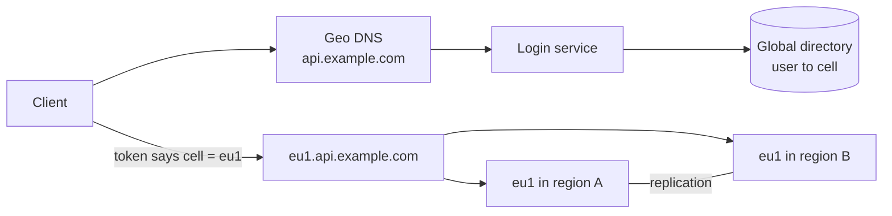
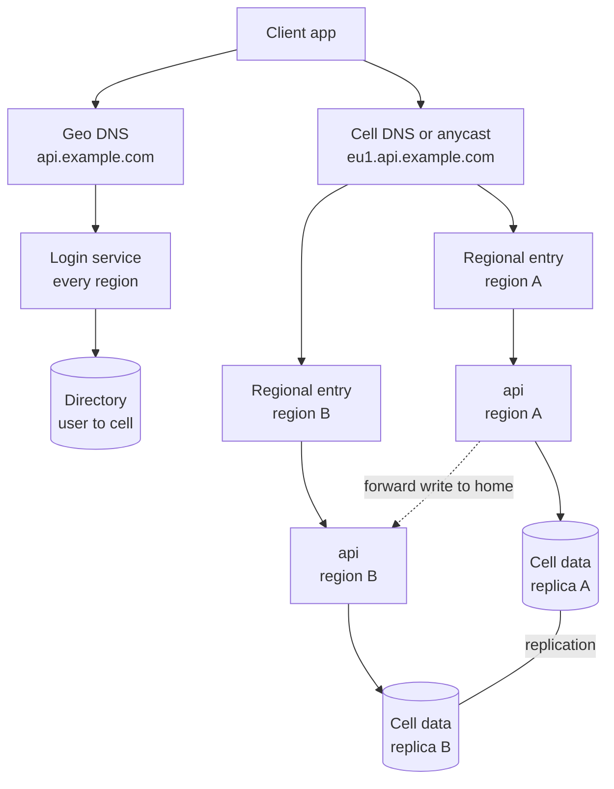

# Multi-region active-active global app

This walkthrough follows the [interview framework](00-primer.md#interview-framework).
It uses the [estimation cheat sheet](00-primer.md#estimation-cheat-sheet) and the
[conventions](00-primer.md#conventions). The [data DR walkthrough](15-data-disaster-recovery.md#rto-and-rpo-per-tier-and-the-pattern-ladder) ends its pattern
ladder at active-active; this is that rung, designed end to end.

## The question

> "Design a consumer app, say lists and tasks, used in Europe and North
> America. It must stay up if a whole cloud region fails, users should get low
> latency wherever they are, and European users' personal data must stay in
> the EU. Make it active-active."

Common variants:

- "How does DNS failover actually work, and how long does it take?"
- "Two regions accept writes to the same record. Who wins?"
- "How do you keep EU data in the EU when an EU user travels to New York?"
- "What is a cell, and why not just run two big regions?"

## The two-minute answer

Users are split into **cells**: complete copies of the stack (API, data,
queues), each for a slice of users and each running in **two regions of one
geography**, both serving traffic. EU cells live only in EU regions, which is
how residency is enforced: a user's data lives in their home cell, whatever
region they connect from. At login, a thin global **directory** maps the user
to a cell, and the session token carries the cell name. The client then calls
the cell's own hostname. On AWS that name has **Route 53 latency records with
health checks** over the cell's two regions. On GCP it is one **global
external Application Load Balancer** with a serverless backend in each region.
Within a cell, each user has a **home region that takes all their writes**,
so concurrent writes to one record are rare; reads are served anywhere. Replication is asynchronous on AWS (DynamoDB global tables,
last writer wins, RPO of seconds) and synchronous on GCP (Spanner `eur3`,
RPO zero). Each region is provisioned to carry its whole cell alone, and
deploys go one region of one cell at a time, so neither a region failure nor
a bad release takes everything down.



## Clarify the requirements

| Question | Assumed answer |
|---|---|
| Who and where? | 60 million accounts: 22 million homed in the EU, 38 million in North America. 24 million daily actives. |
| Availability target? | 99.99% for reads and writes: 52.6 minutes a year ([Availability nines](00-primer.md#availability-nines)). |
| Region loss? | Survive one region per geography automatically, RTO under 5 minutes. |
| Data loss on region loss? | Seconds, if conflicts are surfaced to the user; zero preferred. |
| Residency? | EU users' content and profile stay in EU regions, backups and logs included. A pseudonymous ID and its cell may be global, subject to legal sign-off. |
| Consistency? | Read-your-writes for the writer; others may lag about a second. |
| Sharing? | Lists can be shared, including across geographies. |

Regions chosen: on AWS, `eu-west-1` (Ireland) and `eu-central-1` (Frankfurt) for
the EU, and `us-east-1` and `us-east-2` for North America. On GCP, `europe-west1`
and `europe-west4`, and `us-east4` and `us-east1`, which are the read-write
regions of Spanner's `eur3` and `nam3`. This repo's default home region,
`eu-west-2` (London), is outside the EU.

## Back-of-envelope estimates

**Requests.** Assume 60 a day per daily active and a peak of 3× average,
because each geography peaks in its own daytime (conversions from
[QPS conversions](00-primer.md#qps-conversions)):

- North America: 15 million × 60 = 9 × 10⁸ a day, about 10,400 a second, so a
  **31,000 a second** peak.
- EU: 9 million × 60 = 5.4 × 10⁸ a day, about 6,250 a second, so a
  **19,000 a second** peak.
- Writes are 10%: 3,100 a second (North America) and 1,900 a second (EU) at
  peak.

**Cells.** Cap a cell at 25 million accounts and 20,000 requests a second, the
largest size load-tested: `eu1` at 19,000 a second, and `us1` and `us2` at
about 15,500 each.

**Capacity: active-active costs 2×.** Each region must carry its whole cell
alone, without betting on autoscaling during a regional event. At the folk rule
of a few hundred requests per vCPU
([throughput rules](00-primer.md#throughput-per-instance-and-per-partition);
**verify before relying on** 300 for your code), `eu1` needs 19,000 ÷ 300 ≈
**64 vCPU per region**, running near 50% normally. A third region per
geography cuts the overhead to 1.5×.

**Cell store, AWS (`eu1`).** Each replica applies every write once, locally or
by replication: 1,900 write units a second per region. Reads of items under 4
KB, eventually consistent: 17,100 a second, about 8,550 read units, all in one
region after a failover. Both sit well inside the default 40,000 per table
([AWS docs](https://docs.aws.amazon.com/amazondynamodb/latest/developerguide/ServiceQuotas.html),
checked 2026-11). The trap is failover itself. On-demand instantly
accommodates up to double the previous peak, and a new table starts at 4,000
writes and 12,000 reads a second
([AWS docs](https://docs.aws.amazon.com/amazondynamodb/latest/developerguide/on-demand-capacity-mode.html),
checked 2026-11). A replica whose recorded peak is below half the failover
load can throttle, so set warm throughput to the full-cell rate rather than
trusting history.

**Cell store, GCP (`eu1`).** In a multi-region configuration, 1,000 Spanner
processing units serve about 15,000 reads a second per region and 2,700
writes a second in total at 100% CPU
([Google Cloud docs](https://docs.cloud.google.com/spanner/docs/performance),
checked 2026-11), and the high-priority CPU ceiling is 45% per region
([Google Cloud docs](https://docs.cloud.google.com/spanner/docs/cpu-utilization),
checked 2026-11). Steady state: 8,550 reads per region (0.57 of a node) plus
1,900 writes (0.70), so 1.27 nodes at 100%; 1.27 ÷ 0.45 ≈ 2.8, so **3,000
processing units**.

**Storage and replication.** 60 million accounts × 1 MB = 60 TB, held in two
regions: 44 TB in the EU, 76 TB in North America. Replication is writes ×
1 KB: 1.9 MB/s at the EU peak; at the EU average of 625 writes a second,
625 × 1 KB × 86,400 ≈ 54 GB a day. Cross-region
transfer is charged on both sides, and DynamoDB bills each replicated write in
every replica region
([AWS pricing](https://aws.amazon.com/dynamodb/pricing/on-demand/), checked 2026-11).

**Directory.** 60 million rows × 200 bytes = 12 GB; 2–3 signup writes a
second. Reads: 24 million daily actives × an assumed 5 logins or token
refreshes a day = 1.2 × 10⁸ a day, about 1,400 a second. Tiny, so strong consistency across
continents is affordable.

**Failover time on AWS DNS.** Route 53 flips after the failure threshold
(default 3) of checks at a 30-second interval, or 10 seconds with fast checks
([AWS API reference](https://docs.aws.amazon.com/Route53/latest/APIReference/API_HealthCheckConfig.html),
checked 2026-11). An alias to a load balancer carries its 60-second TTL
([AWS docs](https://docs.aws.amazon.com/elasticloadbalancing/latest/userguide/how-elastic-load-balancing-works.html),
checked 2026-11). Worst case 3 × 30 + 60 = **150 seconds**, or **90 seconds**
with fast checks, plus clients that ignore TTL. That fits the 5-minute RTO,
and the client also retries the sibling region.

## API and data model

### API

| Endpoint | Served by | Notes |
|---|---|---|
| `POST /v1/session` | Login service at `api.example.com`, every region | Looks up the directory; returns a signed token with `sub`, `cell` and `cell_host` (`eu1.api.example.com`). |
| `GET /v1/lists/{list_id}/items` | Cell | Local read in whichever region served the request. |
| `PUT /v1/items/{item_id}` | Cell; forwarded to the user's home region | `If-Match: <version>` and `Idempotency-Key`. Returns the new `version`. |
| `DELETE /v1/items/{item_id}` | Cell; home region | Writes a tombstone, not a hard delete. |
| Any request to the wrong cell | Cell | `421 Misdirected Request` with the right `cell_host`; the client re-routes. |

Cells verify tokens with cached public keys, so a directory or login outage
stops new logins, not existing sessions.

### Data model

**Directory (global):**

| Key | Attributes | Access |
|---|---|---|
| `login_hash` (keyed HMAC of the normalised email) | `user_id` | Login; signup claims it with a conditional put. |
| `user_id` | `cell`, `geo`, `state` (`active`, `migrating`) | Login and cell migration. |

**Cell data (one store per cell, replicated across the cell's two regions):**

| Entity | Key | Attributes |
|---|---|---|
| Item | `pk = user_id#list_id`, `sk = item_id` | `body`, `version`, `base_version`, `updated_at`, `updated_region`, `deleted`, `expires_at` |
| List membership | `pk = list_id`, `sk = user_id` | `role`, `member_cell` |
| Conflict copy | `pk = user_id`, `sk = item_id#version` | Both versions, for the user to resolve |

An item is one row, not one list document, so last writer wins loses at most
one item's edit. `expires_at` holds epoch seconds, as DynamoDB time to live
requires, so tombstones clean themselves up.

## High-level design



**Read path.** The client sends its token to `eu1.api.example.com`. Route 53
answers with the lower-latency healthy region's ALB; on GCP the anycast address
reaches the nearest healthy region. `api` verifies the token, returns 421 if
`cell` is not this cell, and reads the local replica. For read-your-writes, the
client sends its last write's timestamp, and reads within 5 seconds of it go to
the home region.

**Write path.** The home region is `hash(user_id) mod 2` over the cell's
regions, unless a per-region override flag says otherwise. A non-home region
forwards the write to the home region's own hostname (`eu1-a.api.example.com`),
which does a conditional write (`version = :expected`) locally and returns the
new version. Replication reaches the sibling in about a second. On GCP nothing
is forwarded: any region writes, and the commit waits for Spanner's quorum.

**Sharing.** A list lives in its owner's cell; collaborators elsewhere call
that cell's API, never its database, so an EU-owned list stays in the EU.

## Deep dives

### Global routing and DNS failover

| Option | How it fails over | Strength | Where it breaks |
|---|---|---|---|
| DNS with health checks (Route 53, Cloud DNS) | The resolver stops returning the unhealthy endpoint | Any regional endpoint; cheap | Detection plus TTL, and clients that cache longer |
| Anycast L7 front door (GCP global external ALB, Global Accelerator) | The edge stops sending new requests to the bad backend | No DNS caching; one stable address | A shared global component |
| Client-side | Retry the sibling region's hostname | Fastest for own apps | Not for browsers |

**AWS choice: Route 53 latency records plus client retry.** The cell zone
(`eu1.api.example.com`) has a latency record per region: an alias to that
region's public ALB, with a health check.

- Checkers in many locations poll every 30 seconds. An endpoint is healthy if
  more than 18% of them say so; an HTTP check must connect within 4 seconds
  and answer 2xx or 3xx within 2 seconds
  ([AWS docs](https://docs.aws.amazon.com/Route53/latest/DeveloperGuide/dns-failover-determining-health-of-endpoints.html),
  checked 2026-11). Private addresses cannot be checked
  ([AWS API reference](https://docs.aws.amazon.com/Route53/latest/APIReference/API_HealthCheckConfig.html),
  checked 2026-11), hence the public regional hostname.
- **Fail over on the data plane.** Route 53's control plane is in `us-east-1`;
  its health checks and answers are not. Recovery should rely on checks
  flipping, not on editing records. For a deliberate shift, use Application
  Recovery Controller routing controls, whose data plane runs in several
  Regions
  ([AWS fault isolation whitepaper](https://docs.aws.amazon.com/whitepapers/latest/aws-fault-isolation-boundaries/global-services.html),
  checked 2026-11).
- **Global Accelerator** gives static anycast IPs. It moves new connections
  off an unhealthy endpoint, keeps existing TCP connections there until the
  340-second idle timeout, and routes to all endpoints if none is healthy
  ([AWS docs](https://docs.aws.amazon.com/global-accelerator/latest/dg/introduction-how-it-works.html),
  checked 2026-11).

**GCP choice: one global external Application Load Balancer per cell,** with a
serverless NEG per region behind one anycast IP. Serverless backends take no
health checks. Failover comes from **outlier detection**, which ejects a region
after consecutive 5xx or gateway errors (a longer `baseEjectionTime`, such as
180 seconds, reduces flapping), or from **Cloud Run service health**
([Google Cloud docs](https://docs.cloud.google.com/load-balancing/docs/negs/serverless-neg-concepts),
checked 2026-11). Service health counts a region healthy while 60% or more of
its instances pass readiness probes, and needs at least one minimum instance
per region
([Google Cloud docs](https://docs.cloud.google.com/run/docs/configuring/configure-service-health),
checked 2026-11). That page does not state a launch stage; **verify before
relying on** it as GA.

**The geography split happens once, at login,** through a geolocation record
for `api.example.com`. Cloud DNS external-endpoint checks use exactly three
source regions and at least a 30-second interval. With
**geofencing**, an EU bucket never spills to the US; if all its endpoints fail,
Cloud DNS returns them all rather than failing over
([Google Cloud docs](https://docs.cloud.google.com/dns/docs/routing-policies-overview),
checked 2026-11). That suits residency.

**Health check design.** Check what a request in that region needs (the local
replica and queues), never a global dependency such as the directory. A blip
there fails every region at once, and DNS then fails open: Cloud DNS returns
all endpoints, and Route 53 treats every record in the group as healthy
([AWS docs](https://docs.aws.amazon.com/Route53/latest/DeveloperGuide/health-checks-how-route-53-chooses-records.html),
checked 2026-11).

### Data placement and residency

| Data | Where | Why |
|---|---|---|
| Items, lists, profile | Home cell only: two regions of one geography | Personal data |
| Directory | Global: `login_hash`, `user_id`, `cell` only | Needed before the cell is known. A keyed hash is still pseudonymous personal data, and GCP's `nam-eur-asia1` also keeps a read-only replica in Taiwan (`asia-east1`): **verify with counsel**; the fallback is per-geography login domains |
| Logs, traces | The cell's regions; no bodies or emails | The classic leak |
| Backups, analytics | A vault and warehouse inside the geography; only aggregates cross | The second classic leak |

**Enforce in layers.**

1. **Org guardrails.** The AWS region SCP denies requests whose
   `aws:RequestedRegion` is outside the list. That key controls which endpoint
   is called, not the effect of the call, and some operations have cross-Region
   effects
   ([AWS docs](https://docs.aws.amazon.com/IAM/latest/UserGuide/reference_policies_condition-keys.html),
   checked 2026-11). **Verify before relying on** the SCP alone to stop a
   DynamoDB replica in a disallowed Region. GCP's `gcp.resourceLocations`
   applies only to new resources, does not govern where data is processed, and
   skips global resources
   ([Google Cloud docs](https://docs.cloud.google.com/resource-manager/docs/organization-policy/defining-locations),
   checked 2026-11).
2. **Per-geography scope.** EU cells sit under a folder or OU with an EU-only
   list, narrower than the org's.
3. **Application routing.** Only the home cell writes a user's data; DNS
   geolocation is about latency. An EU user in New York reaches a US login,
   which sends the client to `eu1`: a transatlantic round trip (about 150 ms,
   per the [latency table](00-primer.md#latency-numbers)), but compliant.

**Placement in the store.** On AWS, each cell's global table has replicas only
in its two regions. On GCP, `eur3` keeps every replica, the witness included,
in the EU (Belgium, Netherlands, Finland), while `eur5` includes London
([Google Cloud docs](https://docs.cloud.google.com/spanner/docs/instance-configurations),
checked 2026-11). Choose by residency boundary, not latency.

### Conflict resolution

**Avoid conflicts by design.** The home-region rule makes each user's data
single-writer while both regions are up, which keeps conditional writes
meaningful: MREC global tables evaluate a condition against the
replica in the Region where the write lands
([AWS docs](https://docs.aws.amazon.com/amazondynamodb/latest/developerguide/V2globaltables_HowItWorks.html),
checked 2026-11).

**Conflicts still occur** in the failover window, on shared lists, and when
offline clients sync late.

| Strategy | How | Good for | Cost |
|---|---|---|---|
| Last writer wins | MREC keeps the write with the latest internal timestamp, per item (same source) | Independent fields, idempotent puts | Silently drops the loser |
| Detect and keep both | Each write carries `base_version`; a stream consumer flags a replicated change whose base does not match and stores a conflict copy | User content | The user resolves it |
| Merge types (CRDTs) | Counters as per-region shards that are summed; sets as add and remove rows with tombstones | Counts, membership | Only data with a merge rule |
| Prevent (synchronous) | MRSC or Spanner: a write commits in a quorum of regions | Uniqueness, invariants | Cross-region latency per write |

**The failover window, concretely.** `eu-west-1` dies at 10:00:00. Its last
second or so of acknowledged writes has not replicated: MREC replicates
"typically within a second or less" and its RPO is that delay (same source).
Its users are re-homed to `eu-central-1` by an override flag set there. At
10:00:30 a user edits an item based on a stale copy. When Ireland returns, its
09:59:59 write replicates and loses to the 10:00:30 write, without trace. The
`base_version` check catches it: the new write was based on version 6, but
version 7 existed. Keep both, and ask the user. Re-homing back is a deliberate
step after replication catches up, never automatic, or the flag flaps.

**When to pay for synchronous.**

- **DynamoDB MRSC** needs exactly three Regions (or two replicas and a
  witness). It gives RPO zero and returns `ReplicatedWriteConflictException`
  for concurrent writes, which you retry. It supports no time to live,
  transactions or local secondary indexes (same source). Here it holds the
  **directory**, where signup needs a globally unique `login_hash` and writes
  are rare.
- **Spanner** commits every write by quorum through the leader region, so
  compute should sit near it
  ([Google Cloud docs](https://docs.cloud.google.com/spanner/docs/instance-configurations),
  checked 2026-11). GCP cells use it outright; `eur3`'s read-write regions are
  close, so the penalty is small (**verify before relying on** a millisecond
  figure), and conflict handling becomes "retry the aborted transaction".

So on GCP conflicts are a non-topic for cell data; on AWS with MREC they are
a feature you build.

### Cell-based design

**What a cell buys.** Regions bound **infrastructure** failures; cells bound
**software and data** failures. A bad deploy or poison request hits one cell,
a third of users at most. AWS calls this a bulkhead
([AWS Well-Architected](https://docs.aws.amazon.com/wellarchitected/latest/reducing-scope-of-impact-with-cell-based-architecture/reducing-scope-of-impact-with-cell-based-architecture.html),
checked 2026-11). Here each cell spans two regions, so the bulkheads compose:
a region failure takes half of every cell there, and each survives on its
sibling.

**Partition key: the owning user.** New users go to the newest cell in their
geography with headroom.

**The router is the thinnest thing in the system.** AWS's guidance: keep the
routing layer "as simple and horizontally scalable as possible", free of
business logic, and working for other cells when one is unreachable
([AWS Well-Architected](https://docs.aws.amazon.com/wellarchitected/latest/reducing-scope-of-impact-with-cell-based-architecture/cell-routing.html),
checked 2026-11). Here it is a directory lookup at login whose answer goes in
the token, a DNS name per cell, and a 421 from any cell that gets someone
else's request. Nothing shared sits on the request path.

**Deploy in waves:** a canary cell, then one region of one cell, its other
region, then the next cell. Never both regions of a cell at once, or a bad
build defeats the redundancy you paid 2× for.

**Cell migration:** mark the user `migrating`, copy rows, freeze writes for
seconds, copy the tail, flip `cell`; the old cell answers 421.

**Where it breaks.** Cross-cell features (global search) need asynchronous
fan-in, not cross-cell queries, and each cell is a fixed cost, wasteful below a
few million users.

## Trade-offs to defend

| Decision | Chosen | Rejected | Why | What would change the answer |
|---|---|---|---|---|
| Topology | Active-active, two regions per geography | Warm standby; one big region | Region loss with no restore or scale-up; 2× compute | An RTO of hours: warm standby. |
| Write ownership | Home region per user | Any region writes, last writer wins | Conditional writes stay correct; conflicts only at failover | Spanner, where any region can write. |
| AWS cell store | DynamoDB global table, MREC | MRSC; Aurora Global Database | Lowest latency; keeps time to live and transactions | RPO must be zero: MRSC, with a third EU Region. |
| GCP cell store | Spanner `eur3` / `nam3` | Firestore multi-region; Cloud SQL with a replica | RPO zero, no conflicts, residency-shaped configurations | Cost at small scale: Cloud SQL plus a cross-region replica (active-passive). |
| AWS routing | Route 53 latency and health checks, plus client retry | Global Accelerator; CloudFront origin failover | Simple, per-cell zones in the cell's account | Static IPs or sub-minute failover: Global Accelerator. |
| Cell router | Token claim plus a DNS name per cell | A proxy router tier | Nothing shared on the request path | Clients you cannot change, such as third-party webhooks. |
| Directory | Global, strongly consistent (MRSC / Spanner) | Per-geography login domains | One login URL, global uniqueness | Counsel says pseudonymous IDs must not leave the EU. |
| Failover capacity | Pre-provisioned 100% per region | Autoscale on failover | Static stability | A third region per geography (1.5×). |

## Failure modes and scaling limits

**At ×10 (600 million accounts, about 30 cells),** operations fail before
technology. Thirty cells in two waves each is a long deploy, so automate the
waves and alarm per cell. Directory reads reach about 14,000 a second: cache
`user_id → cell` at the login service. Raise per-account and per-project quotas
for each cell before launch.

**At ×100,** new geographies (APAC) each bring a residency boundary and a
region pair. Shared lists across three geographies make cross-cell latency
visible, and cross-region transfer becomes a top-five cost line.

| Component | If it fails | Blast radius |
|---|---|---|
| One region | Its half of each cell drains to the sibling | Latency for moved users; seconds of RPO on AWS |
| One cell (bad deploy) | Errors for its users | A third of users at most; roll back that cell |
| Directory, geo DNS or login | No new logins or signups | New sessions only |
| A cell's DNS zone or global ALB | That cell's entry point | One cell; clients retry regional hostnames |
| A regional KMS key | That replica cannot decrypt | One cell in one region; backups need the key too |
| Replication lag | Stale sibling reads; RPO grows | One cell |

## AWS and GCP mapping

| Component | AWS | GCP | Difference that matters |
|---|---|---|---|
| Geography split at login | Route 53 geolocation records | Cloud DNS geolocation policy with geofencing | Cloud DNS checks: 3 source regions, 30 s minimum interval. |
| Region failover inside a cell | Route 53 latency records with health checks | Global external ALB, a serverless NEG per region | GCP is anycast: no TTL wait. AWS is DNS: 90–150 s. |
| Compute | ECS on Fargate, a workspace per Region | Cloud Run in each region | The GCP second region is raw today (see below). |
| Cell data | DynamoDB global table, MREC | Spanner `eur3` / `nam3` | Asynchronous, last writer wins, versus a synchronous quorum. |
| Directory | DynamoDB global table, MRSC (3 Regions) | Spanner `nam-eur-asia1` | Both strong; both retry on contention. Spanner adds read-only replicas in Belgium and Taiwan. |
| Residency guardrail | Region SCP (`aws:RequestedRegion`) | `gcp.resourceLocations` | Neither governs processing or cross-region side effects. |
| Keys | One CMK per Region (or multi-Region keys) | One key ring per region | Spanner multi-region CMEK takes one regional key per replica location. |
| Images | ECR, replicated per Region | Artifact Registry, multi-region | A regional repository is a hidden single-region dependency. |

## Build it here

### What the repo supports per region today

| Need | AWS | GCP |
|---|---|---|
| Choose a region per deployment | One region per workspace: `aws_region`, defaulting to `org.regions.aws` (`envs/aws/workload/variables.tf`) | One per environment: `gcp.environments.<env>.region` |
| Second region of one network | No. The hub is one region; [ADR 0009](../../docs/adr/0009-aws-second-region.md) (proposed, not built) adds a second `aws-network` workspace | `additional_regions` adds a subnet per tier and Cloud NAT to the same global VPC; mock-tested only ([known gaps](../../docs/known-gaps.md)) |
| App services in a second region | Yes, as a second workspace; outside the hub's Region it must set `enable_network_hub = false` | No: app-services, PSC and the backup policy are primary-region only |
| Global routing | No Route 53 routing or health-check module; `modules/aws/network/dns-records` writes simple records only | `modules/gcp/network/app-ingress` is global but takes one region's NEG |
| Multi-region data | No DynamoDB module; KMS keys are single-Region ([KMS runbook](../../docs/runbooks/aws-kms-rotation.md#multi-region-key-considerations)) | No Spanner module; no workload CMEK ([CMEK source](00-primer.md#cmek-source)) |
| Residency guardrails | `aws.allowed_regions` (org SCP) | `gcp.allowed_regions` (org-wide); [`modules/gcp/governance/org-policy`](../../modules/gcp/governance/org-policy/) can also target a folder |

In short: GCP gets a multi-region cell into one project with a few raw
resources. On AWS, every Region but the hub's runs standalone (no TGW, central
endpoints or egress) until ADR 0009 is built, so a Fargate task there cannot
even pull from ECR. Close that gap first.

### Where it lives

| Part | AWS | GCP |
|---|---|---|
| A cell | One account (`workload_prod_eu1`) and two workspaces, `aws-workload-prod-eu1-a` and `aws-workload-prod-eu1-b` (`envs/aws/workload`), one per Region | One environment, `gcp-workload-prod-eu1` (`envs/gcp/workload`), with `additional_regions` |
| Cell data | Global table created by `-a`; replica owned by `-b` | Spanner instance in the environment's host project |
| Cell DNS | A zone in the cell's account; each workspace writes its own record | The app-ingress anycast IP |
| Geo split, directory | A new global-edge root (gap: none exists) | The same |
| EU-only location policy | An SCP per OU (gap) | A folder policy from `gcp-organization` (`envs/gcp/organization`) |
| Apply order | `aws-organization` → `aws-network` → `-a` → `-b` | `gcp-organization` → `gcp-projects` → `gcp-network-hub` → `gcp-workload-prod-eu1` |

Placement follows [VPC-tier placement](00-primer.md#vpc-tier-placement) ([#14](14-n-tier-network.md)):
`public_alb` puts the ALB in `public` with a regional WAF, because Route 53
checks need a public endpoint; tasks stay in `private`.

### Config

```yaml
# Illustrative. Keys are real (config/landing-zone.schema.json); values are placeholders.
org:
  regions:
    aws: eu-west-1 # the hub Region; London (eu-west-2) is outside the EU
    gcp: europe-west1
gcp:
  allowed_regions: [europe-west1, europe-west4, europe-north1, us-east4, us-east1, us-central1]
  environments:
    prod-eu1:
      region: europe-west1
      cidr_block: 10.40.0.0/16
      additional_regions:
        europe-west4:
          subnet_cidrs: {public: 10.41.0.0/24, private: 10.41.16.0/24, database: 10.41.32.0/24}
aws:
  allowed_regions: [eu-west-1, eu-central-1, us-east-1, us-east-2]
  enabled_regions: [eu-west-1, eu-central-1, us-east-1, us-east-2]
  workload_accounts:
    workload_prod_eu1: {email: aws+workload-prod-eu1@example.com, ou: Workloads}
  workload_environments:
    prod-eu1-a: {account_key: workload_prod_eu1, vpc_cidr: 10.50.0.0/16, is_production: true}
    prod-eu1-b: {account_key: workload_prod_eu1, vpc_cidr: 10.51.0.0/16, is_production: true}
  workload:
    app_ingress_mode: public_alb
```

The cell's two workspaces share one account, the simple way to own both
replicas of a global table. Per-workspace values go in
`config/tfc-workspaces.yaml`, which tfc-admin sets as workspace variables: for
`aws-workload-prod-eu1-b`, `aws_region: eu-central-1`,
`enable_network_hub: false` and `app_alb_certificate_arn`. Whether
`gcp.resourceLocations` admits Spanner's `eur3` from these values is **verify
before relying on**.

### AWS: the cell's global table and its DNS

In `aws-workload-prod-eu1-a`, using the root's `local.environment`,
`local.kms_key_arn` and `module.app_services`. Arguments were checked against
aws v6.72.0
([`aws_dynamodb_table`](https://registry.terraform.io/providers/hashicorp/aws/6.72.0/docs/resources/dynamodb_table),
[`aws_dynamodb_table_replica`](https://registry.terraform.io/providers/hashicorp/aws/6.72.0/docs/resources/dynamodb_table_replica),
[`aws_route53_health_check`](https://registry.terraform.io/providers/hashicorp/aws/6.72.0/docs/resources/route53_health_check),
[`aws_route53_record`](https://registry.terraform.io/providers/hashicorp/aws/6.72.0/docs/resources/route53_record),
checked 2026-11).

```hcl
# Gap: the repo has no DynamoDB module; raw resources in the landing zone's conventions.
resource "aws_dynamodb_table" "items" {
  name                        = "prod-eu1-items" # one table per cell, same name in both Regions
  billing_mode                = "PAY_PER_REQUEST"
  hash_key                    = "pk"
  range_key                   = "sk"
  stream_enabled              = true # MREC replicates through streams
  stream_view_type            = "NEW_AND_OLD_IMAGES"
  deletion_protection_enabled = true
  attribute {
    name = "pk"
    type = "S"
  }
  attribute {
    name = "sk"
    type = "S"
  }
  ttl {
    attribute_name = "expires_at" # epoch seconds
    enabled        = true
  }
  point_in_time_recovery { enabled = true }
  server_side_encryption {
    enabled     = true
    kms_key_arn = local.kms_key_arn # this Region's workload CMK
  }
  warm_throughput {
    read_units_per_second  = 20000 # carry the whole cell's reads after a failover
    write_units_per_second = 4000
  }
  lifecycle {
    ignore_changes = [replica] # -b owns its replica through aws_dynamodb_table_replica
  }
  tags = { Service = "api" } # default_tags add the rest
}

# Gap: no Route 53 routing module; each cell workspace writes its own latency record.
resource "aws_route53_health_check" "api" {
  fqdn              = "eu1-a.api.example.com" # this Region's own public hostname
  type              = "HTTPS"
  port              = 443
  resource_path     = "/healthz/deep" # local replica and queues only, no global dependencies
  request_interval  = 10
  failure_threshold = 3
}

resource "aws_route53_record" "api_latency" {
  zone_id         = var.cell_zone_id # gap: hypothetical input; the cell zone eu1.api.example.com
  name            = "eu1.api.example.com"
  type            = "A"
  set_identifier  = local.environment
  health_check_id = aws_route53_health_check.api.id
  latency_routing_policy {
    region = "eu-west-1"
  }
  alias {
    name                   = module.app_services.alb_dns_name
    zone_id                = module.app_services.alb_zone_id
    evaluate_target_health = true
  }
}
```

In `aws-workload-prod-eu1-b`, the sibling Region owns its replica:

```hcl
resource "aws_dynamodb_table_replica" "items" {
  global_table_arn = "arn:aws:dynamodb:eu-west-1:${local.workload_account_id}:table/prod-eu1-items"
  kms_key_arn      = local.kms_key_arn # eu-central-1's workload CMK
  tags             = { Service = "api" }
}
```

It repeats the health check and record with `eu1-b` and `eu-central-1`.
Each task role needs the item actions and `Query` on its
Region's table **and** `kms:Decrypt` and `kms:GenerateDataKey` on its Region's
CMK, through `task_role_policy_json` in
`aws.workload_environments.<env>.services`. Whether the workload key policy
admits DynamoDB's replication service-linked role as is: **verify before
relying on**. The directory's MRSC table is the same resource with
`consistency_mode = "STRONG"` replicas, in the global-edge root.

### GCP: the second region and the cell's database

In `gcp-workload-prod-eu1`, using `local.env_config`, `local.project_prefix`,
`local.labels`, `var.environment` and `module.environment`. Arguments were
checked against google v8.10.0
([`google_cloud_run_v2_service`](https://registry.terraform.io/providers/hashicorp/google/8.10.0/docs/resources/cloud_run_v2_service),
[`google_compute_region_network_endpoint_group`](https://registry.terraform.io/providers/hashicorp/google/8.10.0/docs/resources/compute_region_network_endpoint_group),
[`google_spanner_instance`](https://registry.terraform.io/providers/hashicorp/google/8.10.0/docs/resources/spanner_instance),
[`google_spanner_database`](https://registry.terraform.io/providers/hashicorp/google/8.10.0/docs/resources/spanner_database),
checked 2026-11).

```hcl
locals {
  r2 = "europe-west4" # the additional_regions key; the stage does not output its subnets
  r2_subnet    = "projects/${local.env_config.host_project_id}/regions/${local.r2}/subnetworks/${local.project_prefix}-${var.environment}-vpc-private-${local.r2}"
  eur3_regions = ["europe-west1", "europe-west4", "europe-north1"]
}

# Gap: no workload CMEK; the primer's workload_cmek gains a for_each, one key ring per region.
module "workload_cmek" {
  source   = "../../../modules/gcp/governance/kms"
  for_each = toset(local.eur3_regions)

  project_id   = local.env_config.host_project_id
  keyring_name = "${local.project_prefix}-${var.environment}-cmek" # names are per location
  location     = each.key
  labels       = local.labels
  keys = {
    "api"     = { encrypter_decrypters = ["serviceAccount:service-${local.env_config.host_project_number}@serverless-robot-prod.iam.gserviceaccount.com"] }
    "spanner" = { encrypter_decrypters = ["serviceAccount:service-${local.env_config.host_project_number}@gcp-sa-spanner.iam.gserviceaccount.com"] }
  }
}

# Gap: app-services deploys only in the primary region; the second region is raw.
resource "google_cloud_run_v2_service" "api_r2" {
  project             = local.env_config.host_project_id
  name                = "api"
  location            = local.r2
  ingress             = "INGRESS_TRAFFIC_INTERNAL_LOAD_BALANCER"
  deletion_protection = true
  labels              = merge(local.labels, { service = "api" })
  scaling { min_instance_count = 2 }
  template {
    service_account = module.environment.app_services["api"].runtime_service_account
    encryption_key  = module.workload_cmek[local.r2].key_ids["api"]
    vpc_access {
      egress = "PRIVATE_RANGES_ONLY" # app-services default
      network_interfaces {
        subnetwork = local.r2_subnet
        tags       = ["compute"]
      }
    }
    containers { image = "REPLACE_WITH_MULTI_REGION_ARTIFACT_REGISTRY_IMAGE" }
  }
  depends_on = [module.workload_cmek]
}

# Gap: app-ingress takes one region's NEG; a second backend is a module change.
resource "google_compute_region_network_endpoint_group" "api_r2" {
  project               = local.env_config.host_project_id
  name                  = "${var.environment}-api-neg-${local.r2}"
  region                = local.r2
  network_endpoint_type = "SERVERLESS"
  cloud_run { service = google_cloud_run_v2_service.api_r2.name }
}

# Gap: the repo has no Spanner module.
resource "google_spanner_instance" "cell" {
  project          = local.env_config.host_project_id
  name             = "${var.environment}-data"
  display_name     = "${var.environment} cell data"
  config           = "eur3" # every replica in the EU
  processing_units = 3000
  labels           = merge(local.labels, { service = "api" })
}

resource "google_spanner_database" "items" {
  project             = local.env_config.host_project_id
  instance            = google_spanner_instance.cell.name
  name                = "items"
  deletion_protection = true
  encryption_config {
    kms_key_names = [for r in local.eur3_regions : module.workload_cmek[r].key_ids["spanner"]]
  }
}
```

Notes:

- The app-ingress change: add the NEG as a second `backend` on its backend
  service, with `outlier_detection` (`consecutive_errors`,
  `base_ejection_time`). Give the primary service `min_instances` too, for
  service health.
- Spanner takes one regional key per replica location
  (`gcloud spanner instances get-locations`); whether `eur3`'s witness needs
  one is **verify before relying on**.
- The second region reuses the `api-run` identity: same component, other
  region. Its image must come from a multi-region or replicated repository;
  app-services creates a regional one, which a dead primary region would take
  with it.

## Runbook

### A region is impaired: drain its cells to the sibling regions

**Detection signal.** Per-region synthetic checks fail on the regional
hostnames (`eu1-a.api.example.com`); the Route 53 health check goes unhealthy,
or on GCP the NEG's 5xx rate and outlier ejections rise. Corroborating:
DynamoDB `ReplicationLatency` from that region climbs
([AWS docs](https://docs.aws.amazon.com/amazondynamodb/latest/developerguide/V2globaltables_HowItWorks.html),
checked 2026-11), and the provider's health dashboard shows an event.

**Triage.**

1. **Region or release?** If that region of that cell was just deployed, roll
   back; do not fail over.
2. **One cell or all cells in the region?** One points to the cell, all to the
   region.
3. **Is the sibling healthy and warm?** Error rate, pre-provisioned headroom,
   warm throughput.
4. **Gray failure?** Checks can pass while users see errors.

**Mitigation.**

1. **AWS:** if the checks have not flipped, turn off the region's Application
   Recovery Controller routing control (data plane). Editing records or
   inverting checks depends on the `us-east-1` control plane: fallback only.
2. **GCP:** outlier detection or service health drains automatically. To force
   it, remove that region's NEG from the backend service through the
   `gcp-workload-<env>` workspace in Terraform Cloud.
3. **Re-home writers** by setting the override flag in the surviving region
   only, so nothing depends on the failed one. Spanner cells need no step.
4. Expect conflict copies once the region returns.

**Verification.** Traffic and writes flow in the siblings, error rates are at
baseline, p99 is acceptable for moved users, and there is no 421 storm (stale
directory data).

**Follow-up.** Fail back deliberately: wait for `ReplicationLatency` to reach
baseline, review conflict copies, then remove the override one cell at a time.
Record the observed RPO, and game-day it quarterly with the Fault Injection
Service replication pause that the global tables documentation describes (same
source).

## Study aids

### Numbers to memorise

| Fact | Value |
|---|---|
| Route 53 health checks | 30 s or 10 s interval; threshold default 3; healthy if more than 18% of checkers agree |
| Route 53 failover, worst case | 3 × 30 + 60 = 150 s; 90 s with fast checks |
| Global Accelerator | Moves new connections; TCP idle timeout 340 s |
| DynamoDB MREC | Replicates typically within 1 s; last writer wins per item; RPO = lag |
| DynamoDB MRSC | Exactly 3 Regions; RPO 0; no TTL, transactions or LSIs |
| On-demand burst | 2× previous peak instantly; pre-warm for failover |
| Spanner multi-region | 99.999%; per 1,000 PU, 2,700 writes and 15,000 reads per region; 45% CPU ceiling |
| Cloud Run service health | Healthy at 60% of instances ready; at least 1 minimum instance per region |
| Active-active capacity | 2 regions = 2× peak; 3 regions = 1.5× |

### Likely follow-ups

- **"Why not let both regions write anything?"** Under MREC conditions are
  checked locally, so invariants break and edits vanish silently. A home region
  keeps one writer per user.
- **"Isn't DNS failover too slow?"** 90–150 s on AWS. Client retry covers your
  own apps, Global Accelerator the rest; GCP's anycast avoids the TTL.
- **"How is residency enforced?"** By where the home cell's data lives, not
  where DNS sends the user, backed by location guardrails and in-geography
  backups and logs.
- **"Why cells if you have two regions?"** Regions do not protect you from
  your own deploys. Cells do.
- **"RPO on region loss?"** Seconds on MREC, with conflict copies; zero on
  Spanner or MRSC.

### Classic mistakes

- Health checks that test a global dependency.
- Failing over through a single-region control plane.
- Treating DNS geolocation as data residency.
- Sizing each region for half the load, or deploying both regions of a cell at
  once.
- Storing a whole list as one item under last writer wins.
- Regional image repositories and keys that the failover region depends on.

### Further reading

- [Reducing the scope of impact with cell-based architecture](https://docs.aws.amazon.com/wellarchitected/latest/reducing-scope-of-impact-with-cell-based-architecture/reducing-scope-of-impact-with-cell-based-architecture.html)
- [AWS fault isolation boundaries: global services](https://docs.aws.amazon.com/whitepapers/latest/aws-fault-isolation-boundaries/global-services.html)
- [Cloud Run: serve traffic from multiple regions](https://docs.cloud.google.com/run/docs/multiple-regions)
- [ADR 0009: AWS second region](../../docs/adr/0009-aws-second-region.md)
