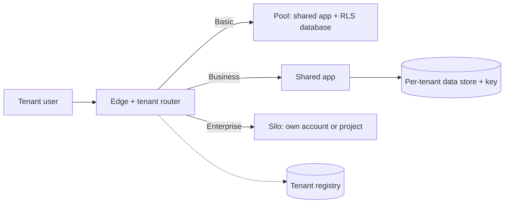
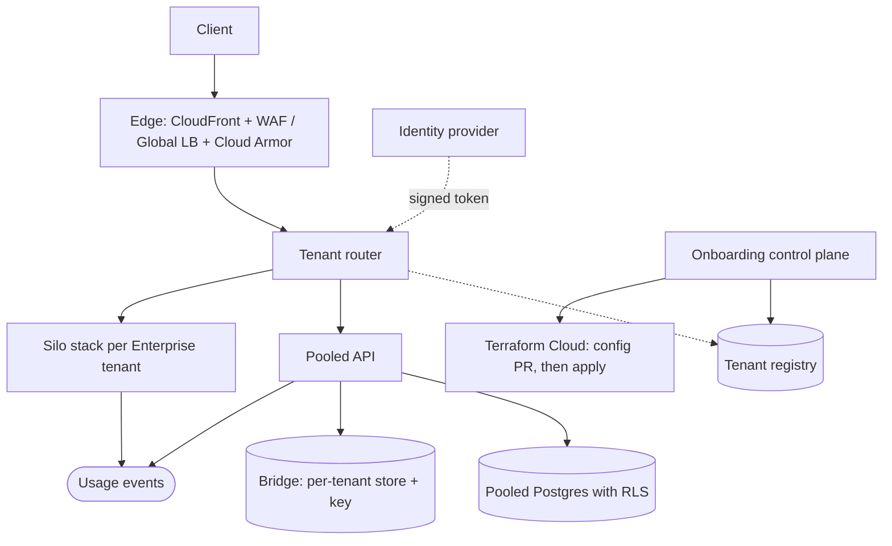

# Multi-tenant SaaS isolation tiers

This walkthrough follows the [interview framework](00-primer.md#interview-framework).
It uses the numbers in the [estimation cheat sheet](00-primer.md#estimation-cheat-sheet)
and the conventions in the [primer](00-primer.md#conventions). Its last deep
dive maps each isolation tier onto this landing zone's AWS accounts, GCP
projects and SaaS stacks, so the tiers are something you can apply, not only
draw.

## The question

> "You are building a B2B SaaS product. Small customers should be cheap to
> serve, but a few large, regulated customers demand that nobody else's
> workload can touch their data or their performance. Design the tenancy
> model: how tenants are isolated, how you stop one tenant hurting another,
> and how you encrypt each tenant's data."

Common variants:

- "Silo, pool or bridge: when do you use each?"
- "One tenant's batch import slows everyone down. Fix it." (noisy neighbour)
- "A customer wants their own encryption key and the right to have their data
  destroyed on exit." (per-tenant keys, crypto-shredding)
- "How do you stop a bug in one query from returning another tenant's rows?"
- "Promote a tenant from the shared tier to a dedicated stack without
  downtime."

## The two-minute answer

Isolation is a **per-tier product decision**, not one architecture. In the
cheapest tier, the **pool**, tenants share compute and a database, every row
carries `tenant_id`, and isolation is enforced twice: by Postgres **row-level
security** keyed on a per-transaction tenant setting, and by **tenant-scoped
credentials**. In the **bridge**, compute is shared but each tenant's data
store and key are its own. In the **silo**, a tenant gets a whole stack in its
own AWS account or GCP environment. All tiers run one code version. A
**tenant registry** records each tenant's tier, region, key and limits; a
router resolves the tenant from the signed token and routes to the pool or to
that tenant's silo. **Noisy neighbours** are contained
by per-tenant rate limits at the edge and in the app, per-tenant database
statement timeouts, and moving heavy tenants up a tier. **Per-tenant encryption**
uses a dedicated key where the tenant has dedicated storage, and one key with a
per-tenant encryption context in the pool; deleting a dedicated key
crypto-shreds that tenant. In this repo a silo is an `aws.workload_accounts`
entry or a `gcp.environments` entry, and a bridge is a GCP `service_teams`
project.



## Clarify the requirements

Questions to ask, with the answers assumed here:

| Question | Assumed answer |
|---|---|
| How many tenants, and in which tiers? | 2,000: 1,900 Basic, 95 Business, 5 Enterprise. |
| What does each tier buy? | Basic: shared everything. Business: dedicated data store and key. Enterprise: dedicated stack, network and key, and a named region. |
| Regulation? | Enterprise tenants need data residency, a customer-controlled key and proof of deletion on exit. |
| Traffic? | 200 million API requests a day; peak 3× average. |
| Skew? | Heavy-tailed. A Basic tenant's bulk import can be 20× its normal rate. |
| Latency? | p99 under 300 ms for interactive calls in every tier. |
| Onboarding? | Basic self-service in seconds; Business within an hour; Enterprise within a working day. |
| Tier changes? | Tenants upgrade; moving data between tiers is an online migration. |
| Clouds? | Enterprise tenants pick AWS or GCP; smaller products may run on Supabase and Vercel. |

Non-functional: no cross-tenant read or write, ever, even under a code bug;
a single tenant can consume at most 5% of pooled capacity; every tenant's
spend is attributable; one release goes to every tier.

## Back-of-envelope estimates

Arithmetic uses the primer's [QPS conversions](00-primer.md#qps-conversions).

**Requests.** 200 million a day is about 2,300 a second; at 3× peak, design
for **7,000 requests a second**. By tier: pool 60% (4,200/s), bridge 30%
(2,100/s), silo 10% (700/s across five stacks).

**Pool compute.** Assume 150 requests a second per task or instance. The pool
must still carry its 4,200/s peak after losing one of three zones, so size it
for 4,200 ÷ ⅔ = **6,300/s: 42 tasks, 14 per zone**. After a zone loss, 28
tasks × 150 = 4,200/s, exactly the peak.

**Noisy neighbour.** A Basic tenant normally sends about 2% of pool traffic
(84/s). A 20× import is 1,700/s: 40% of pool capacity, which is the outage.
A per-tenant limit of **100/s sustained, 200/s burst** caps one tenant at
200 ÷ 4,200 ≈ 5% of peak.

**Pooled database.** About 3 queries per request is 12,600 queries/s, 20%
writes, so about 2,500 writes/s: inside the
[folk rule](00-primer.md#throughput-per-instance-and-per-partition) for one
relational primary. Connections: 42 tasks × a pool of 10 = 420.

**Storage.** Pool 1,900 × 2 GB = 3.8 TB in one cluster. Bridge 95 × 25 GB =
2.4 TB in 95 stores. Silo 5 × 400 GB = 2 TB.

**Keys.** A customer managed AWS KMS key costs $1 a month, plus $1 for each
of its first two rotations
([AWS pricing](https://aws.amazon.com/kms/pricing/), checked 2026-11). The
100 bridge and silo keys cost at most about **$300 a month**. A key for every
one of 2,000 tenants fits the 100,000-keys-per-Region quota
([AWS docs](https://docs.aws.amazon.com/kms/latest/developerguide/resource-limits.html),
checked 2026-11) but costs up to **$6,000 a month**, so the pool uses an
encryption context instead. Cloud KMS bills per active key version
([Google Cloud pricing](https://cloud.google.com/kms/pricing), checked 2026-11;
the per-version price did not render, so **verify before relying on** it).
Rotation adds versions, so old versions that protect nothing should be
destroyed.

**KMS request rate.** The symmetric cryptographic quota is shared by every key
in an account and Region: 20,000 requests a second in eu-west-2, 100,000 in
us-east-1 ([AWS docs](https://docs.aws.amazon.com/kms/latest/developerguide/requests-per-second.html),
checked 2026-11). Requests AWS services make on your behalf count too. The
pool's per-object tenant condition needs S3 Bucket Keys off, so each of about
200 object reads and writes a second is one KMS call: comfortable for the
quota, but 518 million requests a month at $0.03 per 10,000 is about
**$1,550 a month**. Cloud KMS allows 60,000 cryptographic requests a minute
per calling project, and CMEK use by Google services does not count against
it ([Google Cloud docs](https://docs.cloud.google.com/kms/quotas), checked
2026-11).

**Accounts and projects.** An AWS organization defaults to **10 accounts**,
creates at most 5 at a time, and can be raised to 50,000
([AWS docs](https://docs.aws.amazon.com/organizations/latest/userguide/orgs_reference_limits.html),
checked 2026-11). This repo's baseline already uses 6 foundational accounts
plus dev and prod workload accounts, so the third silo tenant needs a quota
increase first. On GCP a folder holds at most 300 child folders and project
creation is quota-limited per user and organization
([Google Cloud docs](https://docs.cloud.google.com/resource-manager/docs/limits),
checked 2026-11).

These numbers drive the choices: per-tenant limits at 5% of the pool, an
encryption context in the pool, dedicated keys above it, and silo as a premium
tier because accounts are a quota.

## API and data model

### Tenant context

Every request carries an identity-provider token with two trusted claims,
`tenant_id` (a UUID) and `tier`, set server-side (`app_metadata` in Supabase
Auth), never in user-editable fields. No endpoint accepts a tenant ID from the
path or body as authority.

| Endpoint | Caller | Purpose |
|---|---|---|
| `POST /tenants` | signup flow | Create a Basic tenant: one registry row, no infrastructure. |
| `POST /tenants/{id}/tier` | billing, operator | Request an upgrade. Returns `202`; the control plane migrates and flips routing. |
| `DELETE /tenants/{id}` | operator | Offboard: export, delete rows or the store, schedule key deletion. |
| `GET /tenants/{id}/usage` | tenant admin | Metered usage for billing. |

### Key tables

| Table | Where | Key | Access pattern |
|---|---|---|---|
| `tenants` | registry (control plane) | `tenant_id` | Read on every request through a cache with a 60 s TTL: tier, `cell` (pool or silo name), region, key reference, rate limits, `state` (`active`, `migrating`, `suspended`). |
| `tenant_limits` | registry | `tenant_id` | Requests a second, burst, concurrent jobs, storage quota. Overrides the tier default. |
| Every business table | pool database | `(tenant_id, id)` | `tenant_id` leads every primary key and index, and row-level security filters on it. |
| `usage_events` | metering stream | `(tenant_id, ts)` | Append-only; aggregated hourly for billing and for noisy-neighbour detection. |

With `tenant_id` leading every index, queries stay scoped to one tenant, and
splitting the pool by tenant range later is a copy, not a re-key.

## High-level design



### Request path

1. The edge terminates TLS and applies a coarse rate rule keyed on the
   client's tenant hint header plus source IP. The hint is unauthenticated, so
   keying on it alone would let anyone exhaust another tenant's bucket.
2. The router validates the token, reads the tenant's registry row from cache,
   and checks the tenant's authoritative token bucket.
3. Basic and Business tenants go to the pooled API. Enterprise hostnames
   (`acme.app.example.com`) resolve straight to the silo's own ingress.
4. The pooled API opens a transaction, sets `app.tenant_id`, and queries
   under row-level security; object storage uses tenant-scoped credentials.
   A Business tenant's data goes to its own store, found through the registry.

### Write path: onboarding

A Basic tenant is a registry row, created in seconds. A Business tenant is a
config pull request and one workload apply that creates its store and key. An
Enterprise tenant is a config pull request that vends an account or
environment, then a workspace that builds the stack: hours, bounded by
account vending. Tier changes are Terraform runs in the same workspaces as
everything else, not a second provisioning system.

## Deep dives

### Silo, pool and bridge, layer by layer

AWS describes the models as a full-stack **silo** (nothing shared), a
full-stack **pool** (everything shared), and the observation that real
products mix them by tier
([AWS SaaS Architecture Fundamentals](https://docs.aws.amazon.com/whitepapers/latest/saas-architecture-fundamentals/full-stack-silo-and-pool.html),
checked 2026-11). The **bridge** is that mix applied per layer: some layers
pooled, others siloed
([AWS SaaS Tenant Isolation Strategies](https://docs.aws.amazon.com/whitepapers/latest/saas-tenant-isolation-strategies/the-bridge-model.html),
checked 2026-11; AWS marks both papers historical). Decide per layer, not per
product.

| Layer | Pool (Basic) | Bridge (Business) | Silo (Enterprise) |
|---|---|---|---|
| Edge, identity | Shared | Shared | Own hostname; shared identity provider |
| Compute | Shared tasks | Shared tasks | Own cluster or services |
| Data | Shared tables, `tenant_id` + RLS | Own database or bucket | Own everything |
| Key | Workload key + encryption context | Own key | Own key, optionally customer-held |
| Network | Shared VPC | Shared VPC | Own VPC, own egress path |
| Blast radius | Every pooled tenant | Data: one tenant; compute: shared | One tenant |

**Pool enforcement.** An application `WHERE tenant_id = ?` is one forgotten
clause from a breach, so the database enforces it too. When
row-level security is enabled and a table has no policy, nothing is visible;
superusers, `BYPASSRLS` roles and, unless `FORCE` is set, the table owner
bypass it
([PostgreSQL docs](https://www.postgresql.org/docs/current/ddl-rowsecurity.html),
checked 2026-11).

```sql
-- Run as the schema owner (the migration role), never as the application role.
CREATE TABLE invoices (
  tenant_id    uuid        NOT NULL,
  invoice_id   uuid        NOT NULL DEFAULT gen_random_uuid(),
  amount_minor bigint      NOT NULL,
  created_at   timestamptz NOT NULL DEFAULT now(),
  PRIMARY KEY (tenant_id, invoice_id)
);

ALTER TABLE invoices ENABLE ROW LEVEL SECURITY;
ALTER TABLE invoices FORCE ROW LEVEL SECURITY;

-- NULLIF: an unset or reset setting yields NULL, so no row matches (fail closed).
CREATE POLICY tenant_isolation ON invoices
  USING (tenant_id = NULLIF(current_setting('app.tenant_id', true), '')::uuid)
  WITH CHECK (tenant_id = NULLIF(current_setting('app.tenant_id', true), '')::uuid);

-- app_rw: not the owner, no BYPASSRLS.
GRANT SELECT, INSERT, UPDATE, DELETE ON invoices TO app_rw;
ALTER ROLE app_rw SET statement_timeout = '5s';
```

Per request, inside one transaction:

```sql
BEGIN;
SELECT set_config('app.tenant_id', $1, true); -- $1 from the verified token; reverts at COMMIT
SELECT invoice_id, amount_minor FROM invoices WHERE created_at > now() - interval '30 days';
COMMIT;
```

`set_config(..., true)` lasts only for the current transaction, and
`current_setting(name, true)` returns NULL instead of raising an error when
the setting does not exist
([PostgreSQL docs](https://www.postgresql.org/docs/current/functions-admin.html),
checked 2026-11). `SET LOCAL` cannot take a bind parameter, hence the
function. A transaction-scoped setting is safe behind a transaction-mode
pooler; a session `SET` is not. On Supabase the policy reads the claim:
`USING (tenant_id = (SELECT (auth.jwt() -> 'app_metadata' ->> 'tenant_id')::uuid))`.
Wrapping it in `SELECT` makes Postgres evaluate it once per statement, and
`service_role` bypasses RLS, so it stays server-side
([Supabase docs](https://supabase.com/docs/guides/database/postgres/row-level-security),
checked 2026-11).

**Where each model breaks.** The pool breaks on blast radius: a bad migration
or a leaked admin credential touches every tenant. The silo breaks on
operations: 500 silos are 500 workspaces to keep on one version. The bridge
breaks on connections: 42 tasks × 95 stores × 2 is about 8,000, so use small
lazy pools per store behind a proxy (RDS Proxy, PgBouncer).

### Noisy neighbours

A noisy neighbour is any shared resource one tenant can exhaust: request
capacity, database CPU and locks, connections, queues, even account quotas.
Contain it in layers, cheapest first.

1. **Edge rate limits keyed by tenant.** AWS WAF rate-based rules can
   aggregate on a header value as a custom key
   ([AWS docs](https://docs.aws.amazon.com/waf/latest/developerguide/waf-rule-statement-type-rate-based-aggregation-options.html),
   checked 2026-11). Cloud Armor rate limiting can key on `HTTP_HEADER`, using
   the first 128 bytes of the value, and combine up to three keys
   ([Google Cloud docs](https://docs.cloud.google.com/armor/docs/rate-limiting-overview),
   checked 2026-11). The edge stops floods, not 10% overuse.
2. **A token bucket per tenant in the router**, with limits from the registry.
   Return `429` with `Retry-After`. API Gateway usage plans give per-key
   throttles, but they are best effort and every API shares an account-level
   10,000 requests a second in most Regions
   ([AWS docs](https://docs.aws.amazon.com/apigateway/latest/developerguide/api-gateway-request-throttling.html),
   [quotas](https://docs.aws.amazon.com/apigateway/latest/developerguide/limits.html),
   checked 2026-11), itself a pooled resource.
3. **A separate lane for bulk work.** Imports go to a queue with a per-tenant
   concurrency cap (two jobs per Basic tenant), consumed by workers that are
   not the interactive tasks, so a 20× import delays only its own jobs.
4. **Database guards.** `statement_timeout` and
   `idle_in_transaction_session_timeout` on the application role
   ([PostgreSQL docs](https://www.postgresql.org/docs/current/runtime-config-client.html),
   checked 2026-11), and per-tenant storage quotas.
5. **Shuffle sharding** when the pool has several cells. Give each tenant a
   random pair of 8 workers: 28 combinations, so a poison tenant takes down
   about 1/28 of capacity instead of 1/4
   ([Amazon Builders' Library](https://aws.amazon.com/builders-library/workload-isolation-using-shuffle-sharding/),
   checked 2026-11).
6. **Move the tenant up a tier** when it needs more than its share every day.

Detection matters as much: meter request and query time by `tenant_id` and
alert when one tenant exceeds 5% of pool CPU or connections.

### Per-tenant encryption

Storage-level CMEK is granular to the **resource**: a bucket, an Aurora
cluster, a Cloud SQL instance. Cloud SQL takes its key at instance creation
only, from a key ring in the instance's region
([Google Cloud docs](https://docs.cloud.google.com/sql/docs/postgres/cmek),
checked 2026-11). So a per-tenant key needs either a per-tenant resource or
application-layer envelope encryption. That is the design rule.

| Tier | Key | How data is bound to the tenant |
|---|---|---|
| Pool | One workload key per environment | Encryption context: the object ARN under the tenant's prefix on S3, or `tenant_id` in app-layer `GenerateDataKey` calls; IAM allows only the caller's own context. |
| Bridge | One key per tenant | The tenant's own store uses it as its CMEK. |
| Silo | The silo's own key | Already isolated by account or project; optionally a customer-held key (external key store or Cloud EKM). |

**The pool trick.** The service assumes a tenant-access role with the session
tag `tenant_id`. Assuming a role with session tags needs `sts:TagSession` in
the trust policy, and a session takes at most 50 tags
([AWS docs](https://docs.aws.amazon.com/IAM/latest/UserGuide/id_session-tags.html),
checked 2026-11). Its policy uses `${aws:PrincipalTag/tenant_id}` both in the
S3 resource ARN and in the `kms:EncryptionContext:` condition value; policy
variables are allowed in the resource part of an ARN and in string condition
values
([IAM docs](https://docs.aws.amazon.com/IAM/latest/UserGuide/reference_policies_variables.html),
[KMS condition keys](https://docs.aws.amazon.com/kms/latest/developerguide/conditions-kms.html),
checked 2026-11). Without S3 Bucket Keys, S3's encryption context is the
object ARN; with them it is the bucket ARN
([AWS docs](https://docs.aws.amazon.com/AmazonS3/latest/userguide/UsingKMSEncryption.html),
checked 2026-11), so Bucket Keys stay off on the pooled bucket: the KMS cost
in the estimates. A bug that asks for another tenant's object is denied by
IAM. GCP has no session tags; its pooled equivalent is app-layer envelope
encryption with a per-tenant data key wrapped by the environment key.

**Crypto-shredding on offboarding.** Deleting an AWS KMS key has a mandatory
7–30 day wait (default 30), during which the key cannot be used and the
deletion can be cancelled; afterwards the data is unrecoverable
([AWS docs](https://docs.aws.amazon.com/kms/latest/developerguide/deleting-keys.html),
checked 2026-11). A Cloud KMS key version is scheduled for destruction for 30
days by default and can be restored meanwhile
([Google Cloud docs](https://docs.cloud.google.com/kms/docs/destroy-restore),
checked 2026-11). Destroying a version makes objects under it permanently
unreadable
([Cloud Storage CMEK](https://docs.cloud.google.com/storage/docs/encryption/customer-managed-keys),
checked 2026-11). Backups under that key die with it, which is the point.
Pool tenants are deleted row by row plus a backup-expiry window; say so in the
contract.

**Key availability is tenant availability.** Disabling a Cloud SQL instance's
key suspends the instance until the key is back (same Cloud SQL page). A
customer who revokes a customer-held key takes their own tenant offline.
Alarm on key state.

### Mapping tiers onto this repo's accounts and projects

The landing zone already has the isolation units; tiers are a choice of which
one a tenant gets.

| Tier | AWS | GCP | SaaS stack (Supabase, Vercel) |
|---|---|---|---|
| Pool | The `aws-workload-prod` account, shared | The `prod` environment's host project | One `saas-<name>` stack, RLS in its Supabase database |
| Bridge | Same account; per-tenant store and key in `envs/aws/workload` | A `service_teams` project per tenant in the `prod` environment, attached to its Shared VPC | Not offered: Supabase isolates per project, so the next step is a silo |
| Silo | An `aws.workload_accounts` entry plus `aws.workload_environments` entry: own account, VPC, CMK and workspace `aws-workload-<tenant>-prod` | A `gcp.environments` entry: own folder, host project, VPC and workspace `gcp-workload-<tenant>-prod` | A `saas.workspaces` entry with its own `saas.stacks` settings |

- **AWS silo.** The account comes from [`envs/aws/organization`](../../envs/aws/organization/)
  through [`modules/aws/governance/account`](../../modules/aws/governance/account/),
  following [Add an AWS account](../../docs/runbooks/aws-add-account.md). The
  workload root creates its own CMK, `alias/workload-<env>`
  ([`envs/aws/workload/kms.tf`](../../envs/aws/workload/kms.tf)), and the spoke
  routes only once listed in `aws.network.spoke_attachments`. The account
  brings its own IAM, quotas (including the KMS rate) and bill.
- **GCP silo.** A new environment key drives five roots: bootstrap trust, the
  folder, the host project from [`envs/gcp/projects`](../../envs/gcp/projects/)
  (through [`modules/gcp/project`](../../modules/gcp/project/)), the hub's VPC-SC
  perimeter, then the spoke
  ([Add a new environment](../../docs/runbooks/add-environment.md)). Keys match
  `^[a-z][a-z0-9-]{0,14}$` in
  [`config/landing-zone.schema.json`](../../config/landing-zone.schema.json),
  so tenant slugs need a short form.
- **GCP bridge.** Each `service_teams` entry is a project created by
  [`modules/gcp/stages/workload`](../../modules/gcp/stages/workload/) in the
  environment folder and attached to the Shared VPC
  ([`modules/gcp/stages/environment/main.tf`](../../modules/gcp/stages/environment/main.tf),
  [Service team onboarding](../../docs/runbooks/service-team-onboarding.md)).
  The project gives the tenant's store its own IAM, quota and billing line
  while sharing the network and Cloud NAT. Setting `service_team` on a service
  moves its Cloud Run and Cloud SQL into the project too.
- **SaaS silo.** [`modules/saas/stages/saas-workload`](../../modules/saas/stages/saas-workload/)
  composes one Supabase project and one Vercel project; the
  [`envs/saas`](../../envs/saas/) root reads `saas.stacks.<name>` for the
  workspace `saas-<name>`
  ([SaaS bootstrap](../../docs/runbooks/saas-bootstrap.md)).

Two repo facts that shape the design. AWS environment names must match
`^[a-z][a-z0-9-]{0,30}$`
([`envs/aws/workload/variables.tf`](../../envs/aws/workload/variables.tf)),
so use `acme-prod` as the environment and `tenant_acme_prod` only as the
account key. And egress differs: an AWS silo's traffic goes through the shared
inspection VPC in the network account, while each GCP environment has its own
Cloud NAT, not inspected through the hub. A tenant demanding its own egress
path gets it on GCP by default.

## Trade-offs to defend

| Decision | Chosen | Rejected | Why | What would change the answer |
|---|---|---|---|---|
| Tenancy model | Tiered: pool, bridge, silo | One model for all | Price and isolation differ per customer; the code does not. | A product with only regulated customers: silo only. |
| Pool isolation | RLS plus tenant-scoped IAM | App-side `WHERE` only | A forgotten clause is a breach; two independent controls. | A store without RLS (DynamoDB): `LeadingKeys` conditions instead. |
| Tenant setting | `set_config(..., true)` per transaction | Session `SET`; a role per tenant | Pooler-safe and fails closed; 1,900 roles do not scale. | Very few large tenants: a role each. |
| Bridge unit | Own store and key; on GCP own project | Schema per tenant in one cluster | Per-tenant CMEK needs a per-tenant resource. | No per-tenant key requirement: schemas are cheaper. |
| Silo unit | Account or GCP environment | Separate VPC in a shared account | IAM, quotas and billing are account-scoped. | Hundreds of silos: cells of tenants per account. |
| Pool key | One key, per-tenant context | A key per tenant | 2,000 keys cost up to $6,000 a month; context gives the same IAM boundary. | A contract requiring key deletion for small tenants. |
| Noisy neighbour | Layered limits, bulk lane, promote | Overprovision | Overprovisioning hides the problem until the next big tenant. | Uniform tenants with flat traffic. |
| Provisioning | Terraform workspaces from config PRs | A bespoke tenant provisioner | One pipeline, one review, one state model. | Thousands of silo onboardings a month. |

## Failure modes and scaling limits

**At ×10 (20,000 tenants, 70,000 requests a second).**

- The **pooled database** fails first: about 25,000 writes a second is past
  one primary. Split the pool into cells by tenant range; `tenant_id`-leading
  keys make it a copy. Route by the registry's `cell`.
- **Registry reads** become hot: keep the 60 s cache and serve misses from a
  replica.
- **KMS requests** with Bucket Keys off reach about 2,000 a second: still
  within the eu-west-2 quota, but the cost is now about $15,000 a month.
  Reconsider bucket-per-cell with Bucket Keys plus prefix-only IAM.
- **50 silos** exceed the default account quota and the 5-concurrent creation
  limit; onboarding queues.

**At ×100.** Silos become cells, one account or environment per group of
tenants, with a fleet manager for upgrades across hundreds of workspaces.

**Blast radius.**

| Component | If it fails |
|---|---|
| Edge or router | Every pooled tenant; silos keep working (own hostnames). |
| Tenant registry | New sessions fail; cached routing survives about 60 s. |
| Pooled database | Every Basic tenant, and Business tenants' shared metadata. |
| One bridge store or key | One tenant. |
| One silo | One tenant. |
| Identity provider | Everyone: it is the shared dependency silos keep. Run it highly available. |
| A bad release | Every tier, because every tier runs one version. Canary on the pool, then silos. |

## AWS and GCP mapping

| Component | AWS | GCP |
|---|---|---|
| Edge and per-tenant rate limits | CloudFront + AWS WAF rate rules on a header key | Global external Application Load Balancer + Cloud Armor `HTTP_HEADER` keys |
| Pooled compute | ECS on Fargate (app-services) | Cloud Run (app-services) |
| Pooled database with RLS | Aurora PostgreSQL | Cloud SQL for PostgreSQL |
| Tenant-scoped credentials | STS session tags + `aws:PrincipalTag` | No session tags: per-tenant grants or app-layer checks |
| Per-tenant key | KMS key per tenant; encryption context in the pool | Cloud KMS key per tenant; app-layer envelope in the pool |
| Bridge unit | Store and key in the shared workload account | Service project per tenant on the Shared VPC |
| Silo unit | Workload account | Environment: folder, host project, VPC |
| Quota boundary | Account and Region (KMS rate is per account) | Project (KMS rate is per calling project) |

Differences that change the design:

- **Session tags exist only on AWS.** One AWS role serves every pooled tenant
  with an IAM-enforced boundary. On GCP the pooled boundary is RLS plus
  application checks, until the tenant moves to a bridge project.
- **A GCP project is a lighter boundary than an AWS account.** A project per
  bridge tenant is routine; an account per bridge tenant is not, so the AWS
  bridge stays inside the shared account.

## Build it here

### Where it lives

| Part | AWS | GCP | SaaS |
|---|---|---|---|
| Pool | `aws-workload-prod` (`envs/aws/workload`) through app-services | `gcp-workload-prod` (`envs/gcp/workload`) through app-services | `saas-web` (`envs/saas`) |
| Bridge | Raw per-tenant keys and role in `envs/aws/workload` | `service_teams` projects plus raw buckets and keys in `envs/gcp/workload` | Not offered |
| Silo | `aws-organization` vends the account; `aws-workload-acme-prod` builds it | Five-root flow, then `gcp-workload-acme-prod` | `saas-acme` |
| Apply order | `aws-organization` → tfc-admin → `aws-workload-acme-prod` → `aws-network` (accept the spoke) | `gcp-bootstrap` → `gcp-organization` → `gcp-projects` → `gcp-network-hub` → `gcp-workload-<env>` | tfc-admin → `saas-<name>` |

Placement follows [VPC-tier placement](00-primer.md#vpc-tier-placement):
services in `private`, the pooled database in `isolated` (AWS) or on Private
Service Access (GCP), buckets reached over endpoints. The region for GCP
buckets and keys is `local.env_config.region`.

### Config

```yaml
# Illustrative. Keys are real (config/landing-zone.schema.json); values are placeholders.
aws:
  workload_accounts:
    tenant_acme_prod: {email: aws+tenant-acme-prod@example.com, ou: Prod, tags: {Tenant: acme}}
  workload_environments:
    acme-prod: {account_key: tenant_acme_prod, vpc_cidr: 10.60.0.0/16, is_production: true}
  network:
    spoke_attachments:
      acme-prod: {attachment_id: tgw-attach-REPLACE_ME, segment: prod}
gcp:
  environments:
    prod:
      cidr_block: 10.30.0.0/16
      service_teams:
        tenant-globex:
          project_admin_group_email: tenant-ops@my-org.example.com
          activate_apis: [storage.googleapis.com]
          shared_vpc_subnets:
            primary: {region: europe-west2, subnet_name: my-org-prod-vpc-private-europe-west2-a}
          labels: {tenant: globex}
    acme-prod:
      region: europe-west2
      cidr_block: 10.70.0.0/16
      is_production: true
      budget_monthly_limit: 3000
saas:
  workspaces: [web, acme]
  stacks:
    acme:
      supabase: {project_name: my-org-acme}
      vercel: {project_name: my-org-acme, github_repo: my-org/web}
```

A real tenant appears in one cloud; the example shows all three to name the
keys. Apply `tenant-globex` before the GCP snippet below, which places
resources in its project.

### AWS: per-tenant keys and the pool's tenant-access role

In `envs/aws/workload`, using `local.environment`, `local.workload_account_id`,
`local.kms_key_arn` and `data.aws_partition.current`. The pooled bucket
`<env>-tenant-data` uses SSE-KMS with the workload key and Bucket Keys off.
Arguments checked against aws v6.72.0
([`aws_kms_key`](https://registry.terraform.io/providers/hashicorp/aws/6.72.0/docs/resources/kms_key),
[`aws_kms_alias`](https://registry.terraform.io/providers/hashicorp/aws/6.72.0/docs/resources/kms_alias),
[`aws_iam_role`](https://registry.terraform.io/providers/hashicorp/aws/6.72.0/docs/resources/iam_role),
[`aws_iam_role_policy`](https://registry.terraform.io/providers/hashicorp/aws/6.72.0/docs/resources/iam_role_policy),
checked 2026-11).

```hcl
# Gap: no per-tenant key or tenant-access role in the repo; raw resources in the landing zone's conventions.
locals {
  bridge_tenants = toset(["globex", "initech"]) # exported from the tenant registry; slugs, never names
  arn_prefix     = "arn:${data.aws_partition.current.partition}"
}

resource "aws_kms_key" "tenant" {
  for_each                = local.bridge_tenants
  description             = "Tenant ${each.key} data key for aws-workload-${local.environment}"
  enable_key_rotation     = true # the OPA policy requires rotation
  deletion_window_in_days = 30   # the crypto-shred delay on offboarding
  policy = jsonencode({
    Version = "2012-10-17"
    Statement = [{ # IAM delegation only: every caller also needs an IAM grant
      Sid       = "AccountRootAdmin", Effect = "Allow", Action = "kms:*", Resource = "*"
      Principal = { AWS = "${local.arn_prefix}:iam::${local.workload_account_id}:root" }
    }]
  })
  tags = { Service = "tenant-data", Tenant = each.key }
}

resource "aws_kms_alias" "tenant" {
  for_each      = local.bridge_tenants
  name          = "alias/workload-${local.environment}-tenant-${each.key}"
  target_key_id = aws_kms_key.tenant[each.key].key_id
}

# Pool tier: the api task assumes this role per request, tagging the session with the tenant.
resource "aws_iam_role" "tenant_access" {
  name = "${local.environment}-api-tenant-access"
  assume_role_policy = jsonencode({
    Version = "2012-10-17"
    Statement = [{
      Effect    = "Allow"
      Principal = { AWS = "${local.arn_prefix}:iam::${local.workload_account_id}:role/${local.environment}-api-task" }
      Action    = ["sts:AssumeRole", "sts:TagSession"]
      Condition = { StringLike = { "aws:RequestTag/tenant_id" = "?*" } } # no tag, no session
    }]
  })
  permissions_boundary = "${local.arn_prefix}:iam::${local.workload_account_id}:policy/tfc-apply-boundary"
  tags                 = { Service = "api" }
}

resource "aws_iam_role_policy" "tenant_access" {
  name = "tenant-scoped"
  role = aws_iam_role.tenant_access.id
  policy = jsonencode({
    Version = "2012-10-17"
    Statement = [
      {
        Sid      = "OwnPrefixOnly"
        Effect   = "Allow"
        Action   = ["s3:GetObject", "s3:PutObject"]
        Resource = "${local.arn_prefix}:s3:::${local.environment}-tenant-data/$${aws:PrincipalTag/tenant_id}/*"
      },
      { # S3 calls KMS with the object ARN as context (S3 Bucket Keys off)
        Sid       = "OwnObjectKeysOnly"
        Effect    = "Allow"
        Action    = ["kms:Decrypt", "kms:GenerateDataKey"]
        Resource  = local.kms_key_arn
        Condition = { StringLike = { "kms:EncryptionContext:aws:s3:arn" = "${local.arn_prefix}:s3:::${local.environment}-tenant-data/$${aws:PrincipalTag/tenant_id}/*" } }
      },
    ]
  })
}
```

Notes:

- `$${...}` escapes Terraform interpolation, so IAM receives the literal
  `${aws:PrincipalTag/tenant_id}`.
- The `api` task role, `prod-api-task`, needs `sts:AssumeRole` and
  `sts:TagSession` on this role through `task_role_policy_json` in its
  `aws.workload_environments.prod.services` entry. Cache each tenant's session
  for its lifetime to keep STS calls low.
- A bridge tenant's Aurora cluster takes `aws_kms_key.tenant["globex"].arn` as
  its storage key; callers get `kms:Decrypt` through IAM.

### GCP: a bridge tenant's bucket under its own key

In `envs/gcp/workload`, using `local.env_config`, `local.project_prefix`,
`local.labels`, `var.environment` and `module.environment`. Arguments checked
against google v8.10.0
([`google_storage_bucket`](https://registry.terraform.io/providers/hashicorp/google/8.10.0/docs/resources/storage_bucket),
[`google_kms_crypto_key_iam_member`](https://registry.terraform.io/providers/hashicorp/google/8.10.0/docs/resources/google_kms_crypto_key_iam),
[`google_storage_project_service_account`](https://registry.terraform.io/providers/hashicorp/google/8.10.0/docs/data-sources/storage_project_service_account),
checked 2026-11).

```hcl
locals {
  bridge_tenants = toset(["globex", "initech"]) # each is a service_teams key "tenant-<slug>"
}

data "google_storage_project_service_account" "tenant" { # the tenant project's Cloud Storage agent
  for_each = local.bridge_tenants
  project  = module.environment.service_team_project_ids["tenant-${each.key}"]
}

# Gap: no per-environment workload CMEK exists yet (see CMEK source);
# this adds one with the existing kms module, one key per bridge tenant.
module "workload_cmek" {
  source = "../../../modules/gcp/governance/kms"

  project_id   = local.env_config.host_project_id
  keyring_name = "${local.project_prefix}-${var.environment}-cmek"
  location     = local.env_config.region # same region as the buckets
  labels       = local.labels
  keys         = { for t in local.bridge_tenants : "tenant-${t}" => {} }
}

# Granted here, not through encrypter_decrypters: the module keys its bindings on
# the member, and a new tenant project's agent email is unknown until apply.
resource "google_kms_crypto_key_iam_member" "tenant_gcs" {
  for_each      = local.bridge_tenants
  crypto_key_id = module.workload_cmek.key_ids["tenant-${each.key}"]
  role          = "roles/cloudkms.cryptoKeyEncrypterDecrypter"
  member        = "serviceAccount:${data.google_storage_project_service_account.tenant[each.key].email_address}"
}

# Gap: no tenant-data module; raw bucket in the tenant's project, in the landing zone's conventions.
resource "google_storage_bucket" "tenant" {
  for_each = local.bridge_tenants

  project                     = module.environment.service_team_project_ids["tenant-${each.key}"]
  name                        = "${local.project_prefix}-${var.environment}-tenant-${each.key}" # global names
  location                    = upper(local.env_config.region)
  uniform_bucket_level_access = true
  public_access_prevention    = "enforced"
  labels                      = merge(local.labels, { service = "tenant-data", tenant = each.key })

  encryption {
    default_kms_key_name = module.workload_cmek.key_ids["tenant-${each.key}"]
  }

  depends_on = [google_kms_crypto_key_iam_member.tenant_gcs] # the grant must exist first
}
```

Notes:

- If other walkthroughs' components already use `module.workload_cmek`, add
  the tenant keys to the same `keys` map rather than a second key ring.
- The key ring sits in the host project and the bucket in the tenant's
  project. The pooled `api-run` service account gets
  `roles/storage.objectUser` on each tenant bucket alone
  (`google_storage_bucket_iam_member`), per
  [Per-component identity](00-primer.md#per-component-identity).
- Offboarding destroys the tenant key's versions after the export, then
  removes the `service_teams` entry; the project's
  `deletion_policy = "PREVENT"` makes its deletion a deliberate second step.

## Runbook

### A pooled tenant is saturating the shared database

**Detection signal.** Pool p99 latency over 300 ms for 5 minutes together with
database CPU over 80% or connections over 90% of the pool's limit. The
per-tenant dashboard shows one `tenant_id` above 5% of query time.

**Triage.**

1. **One tenant or many?** Group query time by `tenant_id`. Many tenants at
   once points to a release or a plan regression, not a neighbour.
2. **Which lane?** Interactive requests within limits, a bulk job, or a
   runaway query (one long statement, lock waits)?
3. **Is it a cross-tenant query?** An admin or reporting job running as a
   `BYPASSRLS` role is the usual culprit; stop it first.

**Mitigation.**

1. Lower the tenant's limits in the registry (`tenant_limits`); the router
   picks them up within the 60 s cache TTL. Do not change the tier default.
2. Pause the tenant's bulk jobs (concurrency 0) and cancel its long queries
   with `pg_cancel_backend`.
3. If it persists, suspend the tenant's writes in the registry and tell its
   account team. Never fail the pool to save one tenant's job.
4. For a plan regression, roll back the release through the normal pipeline.

**Verification.** Pool p99 under 300 ms, database CPU under 60%, and the
tenant's share of query time under 5%.

**Follow-up.** Cap the path that leaked; propose the bridge tier to the
tenant; add the case to the game day.

### Suspected cross-tenant data exposure

**Detection:** a customer report, or a canary tenant's sentinel rows appearing
in another tenant's response. **Triage:** find the request through logs keyed
by tenant and request ID; check whether RLS was bypassed (owner or
`BYPASSRLS` role, missing `FORCE`, a security-definer function).
**Mitigation:** disable the endpoint behind a flag, revoke the role or
credential involved, and preserve logs. Then follow
[incident response](../../docs/runbooks/aws-incident-response.md) and the
contractual notification process. **Verification and follow-up:** the canary
test passes; add a CI test that every table in the pooled schema has RLS
enabled and forced.

## Study aids

### Numbers to memorise

| Fact | Value |
|---|---|
| This design | 2,000 tenants; 7,000 requests/s peak; pool sized 6,300/s for zone loss |
| Per-tenant cap | 5% of pool: 100/s sustained, 200/s burst |
| AWS KMS key | $1/month, plus $1 for each of the first two rotations |
| AWS KMS symmetric quota | 20,000/s in eu-west-2; 100,000/s in us-east-1; shared by all keys |
| AWS KMS deletion wait | 7–30 days, default 30 |
| Cloud KMS | 60,000 crypto requests/min per calling project; 30-day default destroy schedule |
| AWS Organizations | 10 accounts default; 5 concurrent creations |
| GCP folders | 300 children per parent; 10 levels deep |
| Session tags | At most 50; trust policy needs `sts:TagSession` |
| Shuffle sharding | 8 workers, pairs: 28 shards, 1/28 blast radius |

### Likely follow-ups

- **"Why not silo everyone?"** 2,000 accounts is 2,000 workspaces, a quota
  negotiation and 2,000 idle baselines. Silo is a tier people pay for.
- **"How do you upgrade a tenant from pool to silo?"** Vend the silo, copy the
  tenant's rows by `tenant_id`, replicate changes until caught up, set the
  registry state to `migrating`, pause writes for seconds, flip the `cell`,
  then delete pool rows after a retention window.
- **"Per-tenant keys for 2,000 tenants?"** Possible (100,000 keys per Region),
  but up to $6,000 a month. Use an encryption context in the pool; dedicated
  keys where the tenant has dedicated storage.
- **"What does crypto-shredding not cover?"** Logs, analytics copies and
  caches outside the key's reach. Keep tenant data out of them.

### Classic mistakes

- Taking `tenant_id` from the URL or body instead of the verified token.
- RLS enabled but not forced, with the application connecting as the owner.
- A session-level `SET` behind a transaction-mode pooler, leaking one tenant's
  setting to the next transaction.
- A per-tenant key on a shared database, which storage-level CMEK cannot do.
- Per-tenant customisations in silos, so silos drift from the pool's version.
- No per-tenant metrics, so a noisy neighbour looks like a platform outage.

### Further reading

- [AWS SaaS Lens](https://docs.aws.amazon.com/wellarchitected/latest/saas-lens/saas-lens.html)
- [PostgreSQL row security policies](https://www.postgresql.org/docs/current/ddl-rowsecurity.html)
- [Shuffle sharding](https://aws.amazon.com/builders-library/workload-isolation-using-shuffle-sharding/)
- The primer's [CMEK source](00-primer.md#cmek-source) and
  [service map](00-primer.md#aws-gcp-service-map).
