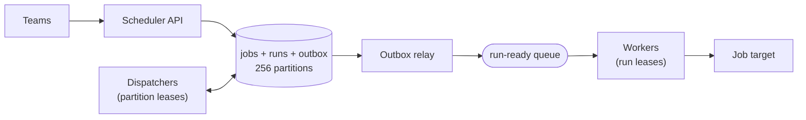
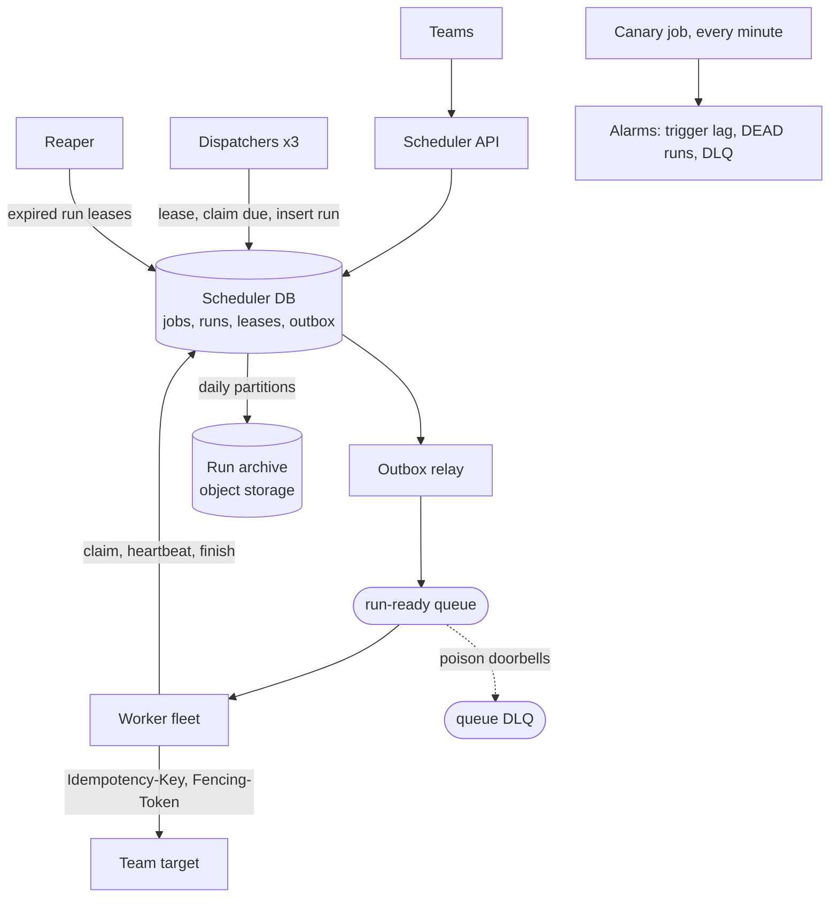
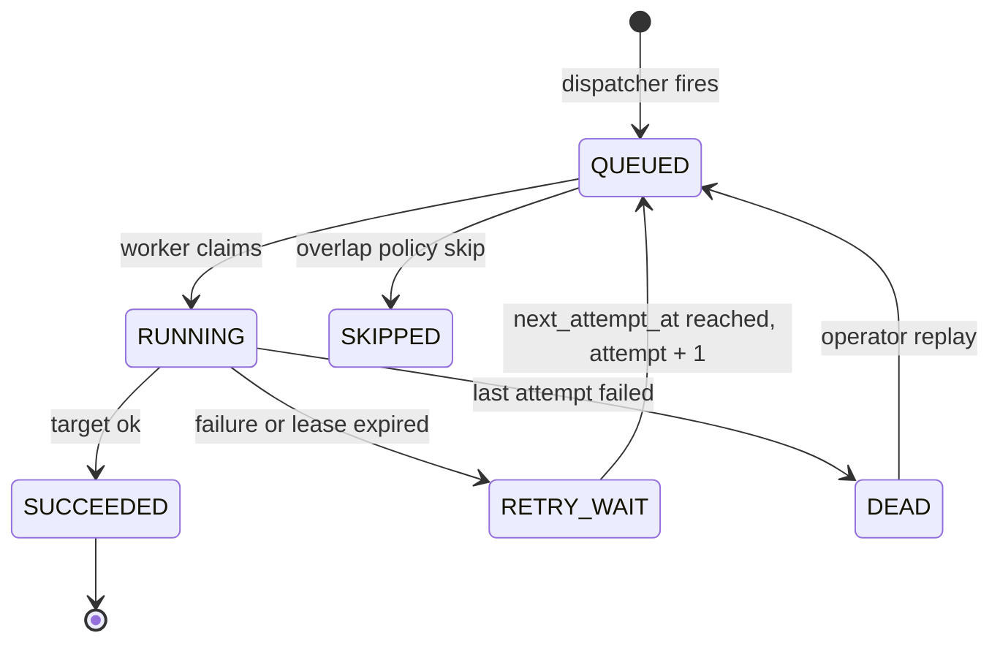

# Distributed job scheduler

This walkthrough follows the [interview framework](00-primer.md#interview-framework),
uses the [estimation cheat sheet](00-primer.md#estimation-cheat-sheet) and the
[conventions](00-primer.md#conventions). It reuses the
[transactional outbox](03-microservices-sync-async.md#the-transactional-outbox)
from the microservices walkthrough rather than re-explaining it.

## The question

> "Design a distributed job scheduler. Teams register jobs that run once at a
> given time or on a cron schedule. Millions of jobs, many scheduler nodes,
> and no job may be skipped or fired twice. How do you trigger on time, spread
> the work, and handle failures?"

Common variants:

- "Design cron for a whole company." (the at-scale cron variant)
- "Design delayed jobs: run this callback in 3 hours."
- "Two scheduler nodes both think they own a job. What happens?" (leases)
- "A job fails. How do retries and dead letters work?"
- "Everyone schedules at midnight. Now what?" (the top-of-hour herd)

## The two-minute answer

Jobs live in a relational table with a precomputed **`next_fire_at`** in UTC,
spread over **256 logical partitions** by a hash of the job ID. A small fleet
of **dispatchers** each lease a set of partitions. Every second a dispatcher
claims due jobs in its partitions and, in **one transaction**, inserts a
`runs` row keyed by `(job_id, scheduled_for)`, advances `next_fire_at` and
queues a "run ready" message through an outbox. The unique key makes
**triggering exactly-once** even if two dispatchers race; the lease, with a
**fencing token** checked inside that transaction, just stops them racing
often. Execution is **at-least-once**: a worker takes the message as a
doorbell, claims the run with a **lease and its own fencing token** in the
database, and passes the run ID as an idempotency key to the target. Failures
go back to the database as `RETRY_WAIT` with jittered backoff, then `DEAD`.
Cron uses the job's time zone, explicit misfire and overlap policies, and a
default spread for top-of-hour jobs. On
AWS it runs on ECS on Fargate, Aurora PostgreSQL and SQS; on GCP on Cloud Run
worker pools, Cloud SQL and Pub/Sub.



## Clarify the requirements

| Question | Assumed answer |
|---|---|
| Who uses it? | Internal teams. Targets are internal HTTPS endpoints or the team's own queue; nothing calls the internet. |
| Job types? | One-shot ("at T") and recurring (cron with an IANA time zone). |
| How many? | 5 million recurring jobs and 20 million one-shot jobs created a day. |
| Precision? | p99 trigger lag (actual minus scheduled) under 2 seconds; jobs due at the top of the hour may spread over its first minute. |
| Exactly-once? | Each scheduled time creates exactly one run. Execution may repeat after a crash, so targets get an idempotency key. |
| Retries? | Per job: attempts (default 5) and backoff; a failed run must be visible and replayable. |
| Overlap? | Per job: allow, skip if the previous run is still going, or queue. |
| Regions? | One region, multi-AZ. |
| History? | Run history queryable for 30 days, then archived. |

Non-functional: 99.95% trigger availability; no lost runs after a node or AZ
failure; one tenant's burst must not delay others.

## Back-of-envelope estimates

Arithmetic uses the primer's [QPS conversions](00-primer.md#qps-conversions).

**Runs.** 5 million recurring jobs at a mean of 12 fires a day is 60 million;
plus 20 million one-shots is **80 million runs a day, about 930 a second**.

**The herd: this is the number that bites.** Assume 4% of recurring jobs
(200,000) use `0 * * * *`. Spread over the first minute, that adds 3,300 a
second, so design for **about 4,300 triggers a second** at the top of each
hour. Midnight UTC is worse if daily jobs cluster; the spread policy in
[At-scale cron](#at-scale-cron) handles it.

**Database writes.** Per run: insert the run, update the job, insert and mark
the outbox row, claim, finish: about **6 row writes**. 4,300 × 6 is about
26,000 row writes a second at peak, 5,600 on average. That sits at the top of
the [folk rule](00-primer.md#throughput-per-instance-and-per-partition) for
one relational primary, so batching is required (500 jobs per dispatcher
transaction, relay marks in batches) and the 256 partitions exist so that a
second shard is a remapping, not a migration. **Verify before relying on** the
single-primary figure with a load test at the herd rate.

**Storage.** Jobs: 25 million live rows at about 1 KB is 25 GB. Runs: 80
million a day at about 400 bytes is 32 GB a day, so 30 days hot is about 1 TB.
Runs are partitioned by day and old partitions archived and dropped, never
`DELETE`d.

**Queue.** 4,300 messages a second at 1 KB is 4.3 MB/s: trivial for SQS
standard, which is "nearly unlimited", or Pub/Sub
([AWS docs](https://docs.aws.amazon.com/AWSSimpleQueueService/latest/SQSDeveloperGuide/quotas-messages.html),
[Google Cloud docs](https://docs.cloud.google.com/pubsub/quotas), checked 2026-11).

**Workers.** At a median run time of 5 seconds, Little's law gives 4,650 runs
in flight on average and 21,500 at the herd peak. Size the fleet at twice the
average (about 9,300 slots). The herd's 200,000 runs × 5 s = 1 million
slot-seconds then drain through the 4,650 spare slots in about four minutes. The design
decision: **trigger on time, start within capacity**. Trigger lag and start
lag are separate SLOs.

## API and data model

### API

| Endpoint | Purpose | Notes |
|---|---|---|
| `POST /jobs` | Create a job | `Idempotency-Key` header; body has `schedule` (`at` or `cron` + `time_zone`), `target`, `retry`, `misfire_policy`, `overlap_policy`. Returns `job_id`, `next_fire_at`. |
| `PATCH /jobs/{id}` | Pause, resume, edit | Optimistic concurrency on `version`; recomputes `next_fire_at`. |
| `DELETE /jobs/{id}` | Cancel | Disables the job; queued runs become `CANCELLED`. |
| `GET /jobs/{id}/runs` | History | Newest first, from the day-partitioned `runs` table. |
| `POST /runs/{job_id}/{scheduled_for}:replay` | Re-run a `DEAD` run | Creates attempt N+1 with a fresh attempt budget. |

### The message (the doorbell)

```json
{ "job_id": "job_3Fq9", "scheduled_for": "2026-11-07T10:00:00Z", "attempt": 1, "partition_id": 117 }
```

The message carries no payload a worker trusts. The worker reads the run from
the database, so a duplicate or stale message is harmless. The **run ID** is
`job_id` + `scheduled_for`, and the target receives it as `Idempotency-Key`
with the fencing token as `Fencing-Token`. Cloud Scheduler identifies a run
the same way, by job name plus the `X-CloudScheduler-ScheduleTime` header,
which stays constant across retries
([Google Cloud docs](https://docs.cloud.google.com/scheduler/docs/overview), checked 2026-11).

### Tables

| Table | Key | Access pattern |
|---|---|---|
| `jobs` | `job_id`; index `(partition_id, next_fire_at) WHERE enabled` | Dispatcher: due jobs of one partition, oldest first. API: point reads and writes. |
| `runs` | `(job_id, scheduled_for)`, range-partitioned by day on `scheduled_for`; index `(partition_id, state, next_attempt_at)` | Insert on trigger; claim, heartbeat and finish by key; requeue `RETRY_WAIT` rows when due. |
| `partition_leases` | `partition_id` | `owner`, `token`, `expires_at`; one row per partition, in the same database as that partition's jobs. |
| `outbox` | `id` | Debezium-default columns, as in the [outbox](03-microservices-sync-async.md#the-transactional-outbox). |

A unique constraint on a partitioned PostgreSQL table must include the
partition key ([PostgreSQL docs](https://www.postgresql.org/docs/current/ddl-partitioning.html),
checked 2026-11). Keying runs by `(job_id, scheduled_for)` and partitioning on
`scheduled_for` satisfies that and makes the natural key the dedup key.

## High-level design



### Trigger path

1. The API writes the job with `next_fire_at` computed from its schedule and
   time zone, stored in UTC.
2. Each dispatcher holds leases on about a third of the 256 partitions and
   loops over them once a second.
3. For each partition, one transaction checks the lease, claims up to 500 due
   jobs, inserts their runs as `QUEUED`, advances `next_fire_at`, and writes
   one outbox row per new run.
4. The relay publishes outbox rows to the queue and marks them published.

### Execution path

1. A worker receives a doorbell and claims the run through the scheduler
   API's internal `/runs` endpoint (`QUEUED` to `RUNNING`), getting a run
   lease and fencing token. It then acknowledges the message at once.
2. It calls the target with the idempotency key and fencing token, renewing
   the lease every 20 seconds.
3. It finishes the run (`SUCCEEDED`, or `RETRY_WAIT` / `DEAD`) with a write
   conditioned on its fencing token.
4. The dispatcher requeues due `RETRY_WAIT` runs; the reaper fails runs whose
   lease expired, so they retry too.

The queue is a doorbell; **the database is the truth**. Acknowledging after
the claim means a 6-hour job needs no 6-hour visibility timeout.

## Deep dives

### Exactly-once triggering and leases

**The guarantee, stated precisely.** Exactly one run per `(job, scheduled
time)`; at-least-once execution of that run; effectively-once side effects
when the target honours the idempotency key. Nothing promises exactly-once
execution, and managed schedulers don't either: Cloud Scheduler is
at-least-once and in rare cases runs a job more than once per schedule
([Google Cloud docs](https://docs.cloud.google.com/scheduler/docs/overview), checked 2026-11),
and EventBridge Scheduler's retries give at-least-once delivery
([AWS docs](https://docs.aws.amazon.com/scheduler/latest/UserGuide/what-is-scheduler.html),
checked 2026-11).

**Who fires a job?**

| Option | Wins | Breaks |
|---|---|---|
| Single leader (one elected node fires everything) | Simple reasoning. | One node's throughput; failover gap; split brain without fencing. |
| Competing dispatchers on one table with `SKIP LOCKED` | No coordination; any node fires any job. | Every node scans the same index range; contention rises with nodes. |
| **Partition leases + unique run key** (chosen) | Disjoint work per node; scales across shards; correctness never depends on the lease. | A lease table and rebalancing logic. |

**Partition leases.** One row per partition. The token rises on every change
of owner, so it is monotonic per partition; times come from the database's
`now()`, so dispatcher clocks don't matter.

```sql
-- Acquire an expired partition. No row returned: someone else holds it.
UPDATE partition_leases
   SET owner = $1, token = token + 1, expires_at = now() + interval '15 seconds'
 WHERE partition_id = $2 AND expires_at < now()
RETURNING token;

-- Renew every 5 seconds. No row returned: the lease is lost; stop work on it.
UPDATE partition_leases
   SET expires_at = now() + interval '15 seconds'
 WHERE partition_id = $2 AND owner = $1 AND token = $3 AND expires_at > now()
RETURNING token;
```

A dispatcher acquires partitions until it holds its fair share, `ceil(256 /
live dispatchers)`, counted from a heartbeat table, and releases the excess
when a new node joins.

**The trigger transaction.** A lease alone is not enough: a dispatcher paused
by GC can wake after its lease expired and keep writing. So the lease is
checked **inside** the firing transaction, and the unique key catches the rest.

```sql
BEGIN;  -- READ COMMITTED
SELECT 1 FROM partition_leases
 WHERE partition_id = $p AND owner = $me AND token = $tok AND expires_at > now()
   FOR SHARE;                    -- no row: ROLLBACK, we are fenced out
SELECT job_id, next_fire_at FROM jobs
 WHERE partition_id = $p AND enabled AND next_fire_at <= now()
 ORDER BY next_fire_at LIMIT 500
   FOR UPDATE SKIP LOCKED;
-- For each job; the app computes $next from the cron and time zone:
INSERT INTO runs (job_id, scheduled_for, partition_id, attempt, max_attempts, state)
VALUES ($job, $due, $p, 1, $max_attempts, 'QUEUED')
ON CONFLICT (job_id, scheduled_for) DO NOTHING
RETURNING job_id;                -- no row: already fired; skip the outbox insert
UPDATE jobs SET next_fire_at = $next, version = version + 1
 WHERE job_id = $job AND next_fire_at = $due
RETURNING job_id;                -- no row: should be impossible under the lock; ROLLBACK
INSERT INTO outbox (id, aggregatetype, aggregateid, type, payload, created_at)
VALUES (gen_random_uuid(), 'run', $job || '/' || $due, 'RunQueued', $doorbell, now());
COMMIT;
```

Why each piece is there:

- **`FOR SHARE` on the lease row.** A takeover is an `UPDATE` of that row, so
  it waits until this transaction ends. If the takeover committed first, this
  statement waits, re-evaluates its `WHERE` against the new row, and returns
  nothing. That is PostgreSQL's documented READ COMMITTED behaviour for
  `SELECT FOR SHARE`
  ([PostgreSQL docs](https://www.postgresql.org/docs/current/transaction-iso.html),
  checked 2026-11). A stale owner can therefore never commit after a new
  owner starts. Keep transactions short: a long one delays a takeover.
- **`SKIP LOCKED`** stops the dispatcher queueing behind an API edit of a job
  ([PostgreSQL docs](https://www.postgresql.org/docs/current/sql-select.html),
  checked 2026-11); the skipped job fires on the next loop.
- **`ON CONFLICT DO NOTHING RETURNING`** is the exactly-once point: two racing
  dispatchers create one run, and the loser writes no outbox row.
- **`next_fire_at = $due`** is a defensive compare-and-set: the row lock makes
  it match, so zero rows signals a bug, never a normal race.

**Run leases for execution.** The worker's claim uses the same idea with a
global sequence as the fencing token. `nextval` gives every caller a distinct
value, never reclaims one on rollback, and may leave gaps
([PostgreSQL docs](https://www.postgresql.org/docs/current/functions-sequence.html),
checked 2026-11). Keep the default `CACHE 1`: a larger cache hands each session
its own block, so a later claim could get a smaller token
([PostgreSQL docs](https://www.postgresql.org/docs/current/sql-createsequence.html),
checked 2026-11). The scheduler API runs these statements; workers call its
internal `/runs` endpoints and hold no database credentials.

```sql
-- Claim. No row: stale or duplicate doorbell. Acknowledge it and drop it.
UPDATE runs
   SET state = 'RUNNING', lease_owner = $worker,
       lease_expires_at = now() + interval '60 seconds',
       fencing_token = nextval('run_fencing_seq')
 WHERE job_id = $1 AND scheduled_for = $2 AND attempt = $3 AND state = 'QUEUED'
RETURNING fencing_token;

-- Heartbeat every 20 seconds. No row: the lease is lost; abandon the attempt.
UPDATE runs SET lease_expires_at = now() + interval '60 seconds'
 WHERE job_id = $1 AND scheduled_for = $2 AND fencing_token = $3 AND state = 'RUNNING'
RETURNING fencing_token;
```

The target keeps the highest `Fencing-Token` it has seen per idempotency key
and rejects lower ones, so a worker that lost its lease cannot overwrite the
work of the worker that replaced it.

**Where it breaks.** A target that ignores the idempotency key repeats side
effects after a crash; no scheduler can prevent that. A lease shorter than a
GC pause causes needless takeovers.

### Partitioning work

**Why 256 logical partitions.** Partitions are the unit of ownership, of
rebalancing and of sharding. 256 gives about 85 per dispatcher at three nodes,
and 2 per node even at 100 dispatchers. Rebalancing moves whole partitions,
not jobs.

**Hash, not time.** `partition_id = hash(job_id) mod 256`, fixed at creation.
Partitioning by fire time would put every top-of-hour job in one partition;
partitioning by tenant would let one large tenant own a hot partition. Hashing
spreads both.

**Mapping partitions to databases.** A `partition → shard` table starts with
every partition on shard 0. Each shard holds its partitions' lease rows,
because the fencing check must share a transaction with the write it guards.
To split, a migration owner takes a range's leases, copies its jobs and
active runs, flips the map and releases.

**Fairness between tenants.** Partitioning spreads load, not priority. Two
controls: **per-tenant concurrency limits** at claim time (over the limit, the
run stays `QUEUED` and the doorbell is requeued with a delay, so trigger time
is honoured and start time waits), and **per-tenant creation quotas** at the
API.

**Within a partition**, the dispatcher reads up to 500 due jobs per
transaction, oldest first, so a backlog drains in schedule order.

**Where it breaks.** Once sharded, a failed shard stops only its partitions'
triggers: the blast radius is the shard.

### Retries and dead letters

There are two failure channels, and they must not be confused.

| Channel | What fails | Handled by | Ends in |
|---|---|---|---|
| **Transport** | The doorbell can't be processed: malformed, database unreachable during claim | Queue redelivery, `maxReceiveCount` or `max_delivery_attempts` | The **queue DLQ** |
| **Execution** | The job ran and failed, timed out, or its worker died | The run's attempt budget in the database | Run state **`DEAD`** |

**Why retries live in the database.** Job backoff can be hours. SQS message timers go to 15 minutes at most
([AWS docs](https://docs.aws.amazon.com/AWSSimpleQueueService/latest/SQSDeveloperGuide/quotas-messages.html),
checked 2026-11), and a Pub/Sub retry policy's maximum backoff is 600 seconds
([Terraform Registry](https://registry.terraform.io/providers/hashicorp/google/8.10.0/docs/resources/pubsub_subscription),
checked 2026-11). The database holds `next_attempt_at` for any delay, keeps
every attempt queryable, and makes a replay an `UPDATE`.

**The failure transition**, conditioned on the fencing token like every
worker write:

```sql
UPDATE runs
   SET state = CASE WHEN attempt < max_attempts THEN 'RETRY_WAIT' ELSE 'DEAD' END,
       next_attempt_at = now() + make_interval(secs => $backoff_seconds),
       last_error = $error
 WHERE job_id = $1 AND scheduled_for = $2 AND fencing_token = $3 AND state = 'RUNNING'
RETURNING state;   -- no row: lease lost, another worker owns the run now
```



**Backoff.** Full jitter: `backoff = random(0, min(cap, base × 2^attempt))`,
with base 30 seconds and cap 1 hour by default. AWS's Builders' Library
explains why exponential backoff needs jitter, and why retries should happen
at one layer only: retries at every layer multiply load
([AWS Builders' Library](https://aws.amazon.com/builders-library/timeouts-retries-and-backoff-with-jitter/),
checked 2026-11). Here the database owns retries, so workers do **not** retry
the target call themselves beyond one fast retry for a connection reset.

**Which errors retry.** Timeouts, 5xx and 429 (honouring `Retry-After`);
other 4xx go straight to `DEAD`.

**The reaper.** A worker that dies leaves its run `RUNNING` with a lease that
stops being renewed. Every 10 seconds the dispatcher, in its own partitions,
moves runs whose `lease_expires_at` is more than 30 seconds past to
`RETRY_WAIT`, counting the attempt. A doorbell that was lost or dead-lettered
leaves a run `QUEUED`; the same sweep re-publishes runs `QUEUED` for over 5
minutes. Nothing depends on the queue never losing a message.

**Dead letters.** `DEAD` runs page the owning team (the job is broken; replay
after a fix). The queue DLQ pages the platform (workers or database broken;
fix, then redrive). Pub/Sub's dead-letter attempts range from 5 to 100 and are approximate
([Google Cloud docs](https://docs.cloud.google.com/pubsub/docs/handling-failures),
checked 2026-11); the sweep covers any doorbell forwarded early.

### At-scale cron

**Never scan cron expressions.** Compute the next occurrence once, store it as
UTC `next_fire_at`, and recompute only when the job fires or is edited.

**Time zones and daylight saving time.** Store the IANA zone, compute in it,
store UTC. Decide what a skipped or repeated wall-clock time means, and
document it. EventBridge Scheduler's rule is a good default: on spring-forward
a non-existent time is skipped, and on fall-back a repeated time runs once
([AWS docs](https://docs.aws.amazon.com/scheduler/latest/UserGuide/schedule-types.html),
checked 2026-11). Cloud Scheduler warns that jobs in DST zones "might observe
execution anomalies" and recommends UTC
([Google Cloud docs](https://docs.cloud.google.com/scheduler/docs/configuring/cron-job-schedules),
checked 2026-11). The unique run key makes the fall-back rule automatic: the
same UTC instant can't fire twice.

**Misfire policy.** After an outage, a job may have missed several times. Per
job:

- `fire_once` (default): fire one catch-up run, then resume the schedule;
- `fire_all`: create a run for each missed time (backfills, billing);
- `skip`: resume at the next future time.

A starting deadline bounds lateness: past it, the run is `SKIPPED`. Kubernetes
CronJob uses the same idea with `startingDeadlineSeconds`, and its
`concurrencyPolicy` values `Allow`, `Forbid` and `Replace` map onto this
design's overlap policies
([Kubernetes docs](https://kubernetes.io/docs/concepts/workloads/controllers/cron-jobs/),
checked 2026-11). Skip-if-running is checked at trigger time: if the job's
previous run is still `RUNNING`, the new run is inserted as `SKIPPED`, so the
skip is visible in history.

**Flattening the herd.** Most teams who write `0 * * * *` mean "about once an
hour". Two tools:

- **Default spread.** Jobs created with minute 0 get a deterministic offset
  within the first 60 seconds, `hash(job_id) mod 60` seconds, unless they set
  `exact: true`. EventBridge Scheduler offers the managed equivalent, a
  flexible time window
  ([AWS docs](https://docs.aws.amazon.com/scheduler/latest/UserGuide/managing-schedule-flexible-time-windows.html),
  checked 2026-11).
- **Visible herd metrics.** Publish the fire histogram by second.

**Why not one cloud schedule per job?** Cloud Scheduler allows 5,000 jobs per
region by default
([Google Cloud docs](https://docs.cloud.google.com/scheduler/quotas), checked 2026-11).
EventBridge Scheduler allows 10 million schedules per Region, but invokes with
60-second precision at a default 1,000 invocations a second in the larger
Regions, delaying the excess
([quotas](https://docs.aws.amazon.com/scheduler/latest/UserGuide/scheduler-quotas.html),
[precision](https://docs.aws.amazon.com/scheduler/latest/UserGuide/schedule-types.html),
checked 2026-11). It is a real option on AWS alone.

**Where it breaks.** A popular template with a tight cron creates herds by
itself; cap the minimum interval at one minute by default.

## Trade-offs to defend

| Decision | Chosen | Rejected | Why | What would change the answer |
|---|---|---|---|---|
| Trigger engine | Own dispatcher on PostgreSQL | EventBridge Scheduler; Cloud Scheduler | Cloud Scheduler caps at 5,000 jobs per region; EventBridge has 60 s precision and is AWS only. | AWS only, minute precision is fine, and quotas are raised. |
| Exactly-once point | Unique `(job_id, scheduled_for)` | Trusting the lease; distributed locks | The database enforces it whatever the lease does. | A store without transactions or unique constraints. |
| Ownership | Partition leases with fencing tokens | Single leader; free-for-all `SKIP LOCKED` | Disjoint work; maps cleanly onto shards. | Under 100 triggers/s: free-for-all is simpler. |
| Store | Relational, 256 partitions on one shard | DynamoDB or Bigtable timer index | Transactions make the trigger atomic. | ×10 load: shard by partition, or move to a wide-column timer index. |
| Queue role | Doorbell; ack after claim | Queue as source of truth; ack after finish | Job length is decoupled from visibility and ack limits. | Very short jobs where an extra DB claim dominates cost. |
| Retries | In the database with full jitter | Queue redelivery and delay | Backoff beyond 15 minutes; visible attempt history. | Only short, transport-level retries are needed. |
| Herd | Default spread within the minute | Exact-second firing for all | Cuts peak triggers 60× for most jobs. | Jobs with real wall-clock contracts (`exact: true`). |

## Failure modes and scaling limits

**At ×10 (about 43,000 triggers a second at the herd, 260,000 row writes a
second):**

- **The single primary fails first.** Split the 256 partitions across 4 to 8
  shards; the map exists for exactly this.
- **The outbox relay:** one per shard, or CDC as the outbox walkthrough describes.
- **Workers** autoscale on queue age, not CPU.

**At ×100:** move to a wide-column table keyed by `(fire minute, partition)`,
loaded into in-memory timing wheels a few minutes ahead by the partition
owner. A unique run key still guards exactly-once.

**Blast radius by component:**

| Component | If it fails | Blast radius |
|---|---|---|
| One dispatcher | Its leases expire in ≤15 s; others take over | Trigger lag of up to about 20 s for its partitions. |
| All dispatchers | Nothing fires; runs pile up as overdue | Every job; the misfire policy decides catch-up. |
| Database primary | Multi-AZ failover; dispatch and claims pause | Everything on that shard, for the failover time. |
| Outbox relay | Runs stay `QUEUED`; the sweep can't help | Every new run; no data lost. |
| Queue | Doorbells undelivered | Execution only; the sweep republishes. |
| Worker fleet | Runs stay `QUEUED`, then lease-expire | Start lag; triggers still on time. |
| A target | Its runs retry, then `DEAD` | That team's jobs only. |

## AWS and GCP mapping

| Component | AWS | GCP | Difference that matters |
|---|---|---|---|
| API | ECS on Fargate behind the internal ALB | Cloud Run service, internal ingress | None that matters here. |
| Dispatchers, relay, workers | ECS on Fargate services | Cloud Run worker pools | A request-billed Cloud Run service has CPU only during requests ([Google Cloud docs](https://docs.cloud.google.com/run/docs/configuring/billing-settings), checked 2026-11); worker pools are built for non-request, pull workloads with no URL ([Google Cloud docs](https://docs.cloud.google.com/run/docs/resource-model), checked 2026-11) and went GA on 14 April 2026 ([release notes](https://docs.cloud.google.com/run/docs/release-notes), checked 2026-11). |
| Database | Aurora PostgreSQL | Cloud SQL for PostgreSQL | Both support `SKIP LOCKED`, partitioning and sequences. |
| Doorbell queue and DLQ | SQS standard, redrive to a DLQ | Pub/Sub topic, pull subscription, dead-letter topic | SQS visibility up to 12 hours ([AWS docs](https://docs.aws.amazon.com/AWSSimpleQueueService/latest/SQSDeveloperGuide/quotas-messages.html), checked 2026-11); Pub/Sub ack deadline up to 600 s ([Google Cloud docs](https://docs.cloud.google.com/pubsub/docs/lease-management), checked 2026-11). Ack-after-claim makes both irrelevant. |
| Managed cron (platform jobs) | EventBridge Scheduler | Cloud Scheduler | 10 million schedules vs 5,000 jobs per region by default. |
| Managed delayed one-shot | EventBridge Scheduler `at()` | Cloud Tasks | Cloud Tasks schedules up to 30 days ahead at 500 dispatches a second per queue ([Google Cloud docs](https://docs.cloud.google.com/tasks/docs/quotas), checked 2026-11). |
| Dead-man's switch | CloudWatch alarm, missing data `breaching` ([AWS docs](https://docs.aws.amazon.com/AmazonCloudWatch/latest/monitoring/alarms-and-missing-data.html), checked 2026-11) | Cloud Monitoring metric-absence condition ([Google Cloud docs](https://docs.cloud.google.com/monitoring/alerts/types-of-conditions), checked 2026-11) | Same idea: silence is the alarm. |

The difference that changes the design: on AWS, a Fargate service always has
CPU, so the dispatcher loop lives inside the API service. On GCP the API stays
a Cloud Run service and the loops move to worker pools.

## Build it here

### Where it lives

| Part | AWS | GCP |
|---|---|---|
| API, dispatcher, database | `scheduler` service in `aws-workload-<env>` (`envs/aws/workload`) through `modules/aws/stages/app-services` | `scheduler` service and `scheduler-db` in `gcp-workload-<env>` (`envs/gcp/workload`); dispatcher in a raw worker pool |
| Doorbell queue and DLQ | `job-worker`'s module queue (`<env>-job-worker`, `<env>-job-worker-dlq`) | The `scheduler` service's module topic, `scheduler-sub` and `scheduler-dlq` |
| Workers | `job-worker` ECS service | Raw worker pool `job-worker` |
| Apply order | `aws-organization` → … → `aws-network` → `aws-workload-<env>` | `gcp-bootstrap` → `gcp-organization` → `gcp-projects` → `gcp-network-hub` → `gcp-workload-<env>` |

Placement follows [VPC-tier placement](00-primer.md#vpc-tier-placement):
compute in `private`, Aurora in `isolated`, Cloud SQL on Private Service
Access. Targets are internal, so no internet egress is needed. On GCP, workers
use `ALL_TRAFFIC` VPC egress so they can reach internal-ingress Cloud Run
targets; GCP egress is per-environment Cloud NAT, not inspected through the hub.

### Config

```yaml
# Illustrative. Keys are real (config/landing-zone.schema.json); values are placeholders.
aws:
  workload_environments:
    prod:
      account_key: workload_prod
      vpc_cidr: 10.30.0.0/16
      services:
        scheduler: # API + dispatcher loop + relay + reaper in one task
          desired_count: 3
          path_patterns: ["/jobs", "/jobs/*", "/runs/*"]
          database:
            instance_count: 2
            serverless_max_capacity: 32
          task_role_policy_json: >-
            {"Version":"2012-10-17","Statement":[{"Effect":"Allow",
            "Action":"sqs:SendMessage","Resource":"arn:aws:sqs:REGION:ACCOUNT_ID:prod-job-worker"}]}
        job-worker:
          desired_count: 4
          enable_autoscaling: true
          autoscaling_max_capacity: 200
          health_check_path: /healthz
          queue:
            enabled: true
            visibility_timeout_seconds: 60 # covers the claim only; acked after it
            max_receive_count: 5
gcp:
  environments:
    prod:
      cidr_block: 10.40.0.0/16
      services:
        scheduler: # API only; its runtime SA also runs the dispatcher pool
          min_instances: 1
          invoker_members: # workers claim, heartbeat and finish runs through the API
            - serviceAccount:job-worker-run@HOST_PROJECT_ID.iam.gserviceaccount.com
          database:
            tier: db-custom-8-32768
            enable_high_availability: true
          pubsub:
            enabled: true # topic "scheduler" = run-ready doorbells
            ack_deadline_seconds: 60
            max_delivery_attempts: 5
```

Gaps in the golden path that this design hits:

- **No always-on runtime on GCP.** app-services has no worker-pool runtime
  and does not expose instance-based billing, so both GCP loops are raw.
- **No scheduled tasks.** AWS app-services has no scheduled ECS task, and
  `modules/gcp/compute/cloud-run-job` creates no trigger (a Cloud Scheduler
  job must call the job's `:run` endpoint with OAuth
  ([Google Cloud docs](https://docs.cloud.google.com/run/docs/execute/jobs-on-schedule),
  checked 2026-11)). This design needs neither: nightly partition maintenance
  is itself a job in the scheduler.
- **Broker encryption.** `envs/aws/workload` does not pass
  `queue_kms_key_arn`, so the queue uses SQS-managed keys; the GCP environment
  stage does not forward `pubsub_kms_key_name`.
- **One database per service.** Sharding beyond one Aurora cluster or Cloud
  SQL instance needs raw clusters.

### GCP: dispatcher and worker pools

In `envs/gcp/workload`, using `local.env_config`, `local.project_prefix`,
`local.labels`, `var.environment` and `module.environment`. Arguments checked
against google v8.10.0
([`google_cloud_run_v2_worker_pool`](https://registry.terraform.io/providers/hashicorp/google/8.10.0/docs/resources/cloud_run_v2_worker_pool),
[`google_pubsub_subscription_iam_member`](https://registry.terraform.io/providers/hashicorp/google/8.10.0/docs/resources/pubsub_subscription_iam),
checked 2026-11).

```hcl
# Gap: no per-environment workload CMEK exists yet (see the primer's CMEK source).
module "workload_cmek" {
  source = "../../../modules/gcp/governance/kms"

  project_id   = local.env_config.host_project_id
  keyring_name = "${local.project_prefix}-${var.environment}-cmek"
  location     = local.env_config.region
  labels       = local.labels
  keys = {
    "scheduler" = {
      encrypter_decrypters = [
        "serviceAccount:service-${local.env_config.host_project_number}@serverless-robot-prod.iam.gserviceaccount.com",
      ]
    }
  }
}

# Gap: app-services has no worker-pool runtime; raw pools in the landing zone's conventions.
resource "google_service_account" "job_worker" {
  project      = local.env_config.host_project_id
  account_id   = "job-worker-run" # <component>-run
  display_name = "job-worker runtime (${var.environment})"
}

locals {
  pools = {
    # The dispatcher is the scheduler component's second runtime: same SA, already its IAM DB user.
    "scheduler-dispatch" = module.environment.app_services["scheduler"].runtime_service_account
    "job-worker"         = google_service_account.job_worker.email
  }
}

resource "google_cloud_run_v2_worker_pool" "this" {
  for_each = local.pools

  project             = local.env_config.host_project_id
  name                = each.key
  location            = local.env_config.region
  deletion_protection = true
  labels              = merge(local.labels, { service = each.key })

  scaling {
    scaling_mode          = "MANUAL"
    manual_instance_count = each.key == "job-worker" ? 4 : 3
  }

  template {
    service_account = each.value
    encryption_key  = module.workload_cmek.key_ids["scheduler"]

    vpc_access {
      egress = "ALL_TRAFFIC" # Cloud SQL private IP and internal-ingress targets
      network_interfaces {
        subnetwork = values(module.environment.subnets.private)[0].id
        tags       = ["compute"]
      }
    }

    containers {
      image = "REPLACE_WITH_ARTIFACT_REGISTRY_IMAGE"
    }
  }

  depends_on = [module.workload_cmek]
}

# Workers pull the module's doorbell subscription; the module already grants scheduler-run.
resource "google_pubsub_subscription_iam_member" "job_worker" {
  project      = local.env_config.host_project_id
  subscription = module.environment.app_services["scheduler"].pubsub_subscription
  role         = "roles/pubsub.subscriber"
  member       = "serviceAccount:${google_service_account.job_worker.email}"
}
```

Notes:

- `job-worker-run` gets `roles/run.invoker` on the scheduler API and each
  target through their `invoker_members`, and no database access. On AWS,
  `job-worker` likewise gets no Aurora access.
- Manual scaling is a starting point; worker pools can autoscale on Pub/Sub
  backlog (**verify before relying on** it for your backlog shape).
- The scheduler's Cloud SQL grants are conditional on `scheduler-db`
  ([Per-component identity](00-primer.md#per-component-identity)), so the
  dispatcher pool needs no new database grant.

## Runbook

### Jobs firing late or not at all

**Detection signal.** Trigger lag, `now() - scheduled_for` at insert, emitted
per partition by the dispatcher: alert at p99 over 10 seconds for 5 minutes.
The **canary job**, a one-minute cron whose run writes a heartbeat metric, has
a missing-data-breaching alarm (a metric-absence condition on GCP): page after
3 missing minutes. Corroborating: overdue jobs (`next_fire_at < now() - 1
minute`) rise.

**Triage.**

1. **Are all partitions late, or some?** All: the database or every
   dispatcher. Some: the partitions of one dispatcher, or one shard.
2. **Lease thrash?** Fast-rising `partition_leases` tokens: GC pauses, CPU
   starvation, or renewals stuck behind long transactions.
3. **Database?** CPU, lock waits and connections on Aurora or Cloud SQL.
4. **Herd or bug?** Lag only in the first minute of the hour is the herd.
5. **Relay?** Runs inserted but stuck `QUEUED` with unpublished outbox rows is
   the outbox runbook in the microservices walkthrough, not this one.

**Mitigation.**

1. **Dispatchers down or starved:** restart or scale the `scheduler` ECS
   service or the `scheduler-dispatch` pool. Leases expire in 15 seconds and
   survivors take over.
2. **Lease thrash:** raise the lease to 30 seconds and lower the batch size
   to shorten transactions.
3. **Database saturated:** pause bulk tenants' job creation, cut the batch to
   100, and defer the reaper sweep. Change sizing through the owning workspace
   (`aws-workload-<env>` or `gcp-workload-<env>`) in Terraform Cloud.
4. **Recovery storm:** after a long outage, the misfire policies fire
   catch-up runs at once. Throttle catch-up firing to a fixed rate per
   partition rather than letting `fire_all` jobs swamp the workers.

**Verification.** Trigger lag p99 under 2 seconds, overdue jobs at zero, the
canary heartbeat present, and lease tokens stable.

**Follow-up.** Load-test the herd at twice the expected size; game-day a
killed dispatcher and a database failover.

### DEAD runs or the queue DLQ spike after a deploy

**Detection:** `DEAD` runs per minute, or a non-empty `<env>-job-worker-dlq`
or `scheduler-dlq-sub`. **Triage:** many teams' runs (the worker deploy) or
one team's (their target)? **Mitigation:** roll back the worker; replay `DEAD`
runs through the API and redrive the DLQ; idempotency makes both safe.
**Verification and follow-up:** both at zero; add the failing case to the
worker's contract tests.

## Study aids

### Numbers to memorise

| Fact | Value |
|---|---|
| This design | 80 million runs a day, 930/s average, 4,300/s at the herd |
| Row writes per run | About 6 |
| Leases | Partition 15 s, renewed every 5 s; run 60 s, heartbeat every 20 s |
| EventBridge Scheduler | 10 million schedules; 1,000 invocations/s default in large Regions; 60 s precision; retries up to 185 times or 24 hours ([AWS docs](https://docs.aws.amazon.com/scheduler/latest/APIReference/API_RetryPolicy.html), checked 2026-11) |
| Cloud Scheduler | 5,000 jobs per region; up to 5 retries ([Google Cloud docs](https://docs.cloud.google.com/scheduler/docs/configuring/retry-jobs), checked 2026-11); HTTP job runs up to 30 minutes ([quotas](https://docs.cloud.google.com/scheduler/quotas), checked 2026-11) |
| SQS | Timers 15 min max; visibility 12 h max |
| Pub/Sub | Ack deadline 600 s max; dead-letter 5–100 attempts |
| Cloud Tasks | 30 days ahead; 500 dispatches/s per queue |

### Likely follow-ups

- **"How do you guarantee a job fires exactly once?"** A unique key on
  `(job_id, scheduled_for)` inside the trigger transaction. Leases reduce
  races; the constraint resolves them.
- **"What if a node pauses and wakes up after its lease expired?"** The lease
  check runs in the same transaction with `FOR SHARE`, so it fails, and the
  target rejects its lower fencing token.
- **"Does the job run exactly once?"** No. It runs at least once; the target
  gets an idempotency key and a fencing token for effectively-once effects.
- **"Why not keep retries in the queue?"** Delays are capped at 15 minutes
  (SQS) or 600 seconds (Pub/Sub), and attempt history disappears.
- **"Everyone schedules at midnight."** Default spread within the minute,
  `exact: true` for those who need it, and per-tenant concurrency limits so
  start lag stays fair.

### Classic mistakes

- Running a cron daemon on every node, or a single cron box with no failover.
- Using a distributed lock as the only exactly-once guarantee, with no
  fencing token.
- Scanning all cron expressions every minute.
- Storing local times, or ignoring daylight saving time.
- Retry loops in the worker, the queue and the client at once.

### Further reading

- [PostgreSQL READ COMMITTED and row locks](https://www.postgresql.org/docs/current/transaction-iso.html)
- [EventBridge Scheduler schedule types and DST](https://docs.aws.amazon.com/scheduler/latest/UserGuide/schedule-types.html)
- [Kubernetes CronJob](https://kubernetes.io/docs/concepts/workloads/controllers/cron-jobs/)
- The [transactional outbox](03-microservices-sync-async.md#the-transactional-outbox) and the primer's [service map](00-primer.md#aws-gcp-service-map).
