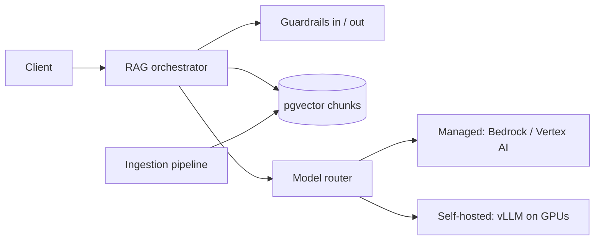
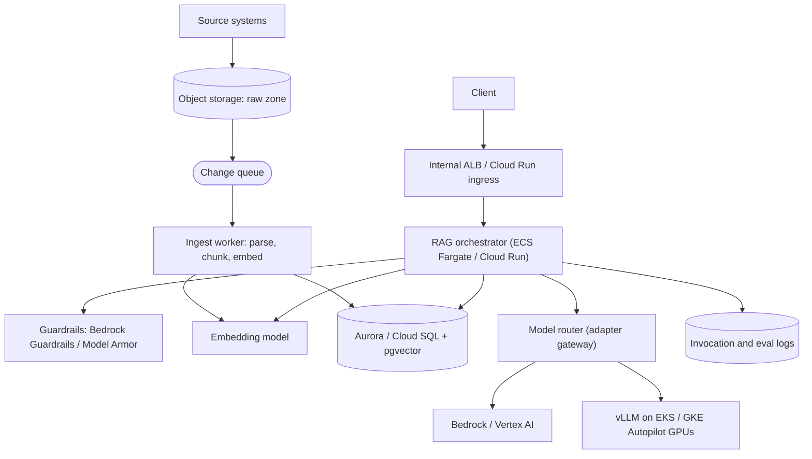

# LLM serving and RAG system

A question-answering assistant grounded in a company's own documents, served
from managed models (Amazon Bedrock, Vertex AI) and, where it pays, from
self-hosted open models on GPUs. It follows the
[interview framework](00-primer.md#interview-framework), takes its numbers from
the [estimation cheat sheet](00-primer.md#estimation-cheat-sheet) and its build
from the [conventions](00-primer.md#conventions). Model routing reuses the
[adapter gateway](04-adapter-gateway.md) walkthrough and does not re-explain it.

Naming: Google now documents Vertex AI's generative products as **Gemini
Enterprise Agent Platform** and is renaming Vertex AI Search to **Agent
Search**
([overview](https://docs.cloud.google.com/gemini-enterprise-agent-platform/overview),
[Agent Search](https://docs.cloud.google.com/generative-ai-app-builder/docs/introduction),
checked 2026-11). This walkthrough says "Vertex AI", as the API, IAM roles and
Terraform resources still do.

## The question

> "Build an assistant that answers customer questions from our help centre,
> product docs and support tickets. Answers must cite sources, never leak one
> customer's data to another, and stay fresh when a document changes. Walk me
> through serving the model and the retrieval pipeline."

Common variants:

- "Design an LLM inference platform: GPUs, batching, autoscaling."
- "Our LLM bill tripled. Where does the money go, and what do you cut?"
- "How do you know the new prompt or model is better?" (evaluation)
- "How do you stop prompt injection and data leakage?" (guardrails)

## The two-minute answer

A stateless **RAG orchestrator** takes a question, screens it with an **input
guardrail**, embeds it, and runs a **filtered hybrid search** (vector plus
keyword) over chunks in Postgres with pgvector, filtered by tenant and access
groups *inside the query*. It packs the top chunks into a prompt with a cached
system prefix and calls a **model router**, the adapter gateway from the
[earlier walkthrough](04-adapter-gateway.md), which picks a managed model or a self-hosted one by
capability, cost and health, and treats a 429 as a capacity signal rather than
a fault. The answer streams back through an **output guardrail** that checks
grounding against the retrieved chunks. Documents enter through an
**event-driven ingestion pipeline** (parse, structure-aware chunking,
embedding, atomic per-document replace), so an edit is searchable in minutes
and a deletion takes effect at once. Self-hosted models run behind a
continuous-batching server, autoscaled on queue depth, not GPU utilisation.
Every call logs tokens and retrieved chunk IDs, feeding an **offline
evaluation set** that gates every prompt, model or chunking change.



## Clarify the requirements

| Question | Assumed answer |
|---|---|
| Who asks? | 200,000 daily users across about 2,000 customer tenants. |
| Corpus? | 500,000 documents, about 2,000 tokens each; 2% change a day. |
| Isolation? | Hard: a chunk is visible only to its tenant and the user's groups. |
| Latency? | Streamed; first token p95 under 2 s, full answer under 15 s. |
| Freshness? | An edit is searchable within 5 minutes (p95); a deletion or permission revocation within 1 minute. |
| Quality? | Answers cite chunks; "I don't know" beats a guess. |
| Regions? | One region, multi-zone; data must stay in the customer's geography. |
| Models? | Managed frontier models allowed; open models for cost or residency. |

Non-functional: 99.9% availability for the ask endpoint (so a second model
provider, not a second region), no customer data used for training, and full
cost attribution per tenant.

## Back-of-envelope estimates

**Traffic.** 200,000 users × 5 questions = 1 million a day, about 12 a second
on average. Peak at 3× is 35; design for **40 queries a second**.

**Tokens per query.** System prompt 1,000 + retrieved context 8 chunks × 500
= 4,000 + history 1,000 + question 100 = **6,100 input tokens**; answers
average **400 output tokens**. A day is 6.1 billion input and 0.4 billion
output tokens.

**Cost per query** = 6,100 × p_in + 400 × p_out, at the provider's list prices.
If output costs about 5× input (an assumption; check the
[Bedrock](https://aws.amazon.com/bedrock/pricing/) and
[Vertex AI](https://cloud.google.com/vertex-ai/generative-ai/pricing) pricing
pages, checked 2026-11), input is 6,100 of 8,100 price units: **75% of the
spend is context**. So retrieval depth is the main cost lever, not answer length.

**Managed quota.** Bedrock deducts input plus `max_tokens` at the start of a
request, then settles at input + cache writes + output × the model's
**burndown rate**: 5×, 10× or 15× for current Anthropic models, 1× for most
others. Cache reads do not count
([AWS docs](https://docs.aws.amazon.com/bedrock/latest/userguide/quotas-token-burndown.html),
checked 2026-11). At 5×: 6,100 + 400 × 5 = 8,100 quota tokens a request, ×
2,400 requests a minute = **19.4 million tokens a minute** at peak (17.0
million with the system prompt cached). Raise the quota before launch, and
keep `max_tokens` near the real answer length.

**Self-hosted GPUs (if the answer model is an 8B open model).**

- KV cache per token, for a model with 32 layers, 8 KV heads and head size 128
  (an assumed Llama-class shape): 2 × 32 × 8 × 128 × 2 bytes = **128 KiB**.
- **Decode is bandwidth-bound.** Each step reads all weights (FP8: about 8
  GB) plus the KV cache of every active sequence (6,300 tokens × 128 KiB ≈
  0.83 GB each). Steps a second ≤ bandwidth ÷ bytes per step, and each step
  gives every sequence one token.
- **An L4 fails the SLO.** It has 24 GB at 300 GB/s
  ([Google Cloud docs](https://docs.cloud.google.com/compute/docs/gpus),
  checked 2026-11). Filling it with 16 sequences reads 8 + 13 = 21 GB a step:
  at most 14 tokens a second per stream, so 400 tokens take 29 s.
- **An H100** has 80 GB at 3.35 TB/s (same source). Capped at **48
  sequences**: 8 + 48 × 0.83 = 48 GB a step, a ceiling of 70 steps a second;
  at an assumed 60% of peak bandwidth, about 42 tokens a second per stream
  (**verify by benchmark**). Memory used: about 50 GB of 80.
- A request then holds a slot about 11 s (1 s prefill, 400 tokens in 9.5 s),
  inside the 15 s SLO. Little's law: 40 × 11 = 440 sequences in flight ÷ 48 =
  10 GPUs.
- Prefill competes with decode in mixed batches: 4 requests a second × 6,100
  prompt tokens × 2 × 8e9 FLOPs ≈ 390 TFLOP/s per GPU, about 20% of an
  H100's dense FP8 peak (NVIDIA lists 3,958 TFLOPS with sparsity,
  [NVIDIA](https://www.nvidia.com/en-us/data-center/h100/), checked 2026-11).
  Chunked prefill bounds the stall.
- Spread across three zones, losing one must still carry peak: 10 ÷ ⅔ = **15
  H100s at peak**, 5 per zone, at 67% of capacity normally. At the trough
  (one third of peak, 4 GPUs of load) the same rule floors it at 6.

**Vector store.** 1 billion corpus tokens in 512-token chunks with 64-token
overlap (stride 448) is **2.2 million chunks**. At 1,024 dimensions of float32,
vectors are 4 KiB each: 9 GB in the table, about as much again in the HNSW
index, plus 4.5 GB of chunk text, so about **25 GB**. That fits one Postgres
instance with 52–64 GB of RAM, which keeps the index cached. Search load is 40
queries a second plus a few writes: small for one primary.

**Ingestion.** 2% churn is 45,000 chunks a day, under one embedding a second.
Re-embedding all 2.2 million after a model change is a batch job.

What these numbers decide: Postgres rather than a vector database at this
size; managed models by default, because 15 H100s held for a 3× peak sit
largely idle; and context trimming as the first cost control.

## API and data model

### API

| Endpoint | Purpose | Notes |
|---|---|---|
| `POST /v1/ask` | Question in, streamed answer out (server-sent events) | Body: `question`, `conversation_id`, optional `model_tier` (`fast`, `best`). The tenant and groups come from the token, never the body. |
| `POST /v1/feedback` | Thumbs up or down on an answer | Labels feed the evaluation set. |
| `POST /internal/documents/{id}/events` | Change notification from a source connector | `upsert` or `delete`, with `version` and `content_sha256`. |

The final stream event carries `citations`, `model` and token counts
(`input`, `cached`, `output`) for display and per-tenant billing.

### Data model

```sql
CREATE EXTENSION IF NOT EXISTS vector;

CREATE TABLE document (
  tenant_id      text NOT NULL,
  doc_id         text NOT NULL,
  version        bigint NOT NULL,
  content_sha256 text,                -- NULL on a tombstone
  deleted_at     timestamptz,         -- set: a tombstone that keeps the version
  indexed_at     timestamptz NOT NULL DEFAULT now(),
  PRIMARY KEY (tenant_id, doc_id)
);

CREATE TABLE chunk (
  chunk_id    bigint GENERATED ALWAYS AS IDENTITY PRIMARY KEY,
  tenant_id   text NOT NULL,
  doc_id      text NOT NULL,
  acl_groups  text[] NOT NULL,
  ordinal     int NOT NULL,
  content     text NOT NULL,
  emb_titan_v2 vector(1024) NOT NULL,  -- one column and HNSW index per embedding model
  FOREIGN KEY (tenant_id, doc_id) REFERENCES document (tenant_id, doc_id) ON DELETE CASCADE
);

CREATE INDEX chunk_emb_titan_v2 ON chunk
  USING hnsw (emb_titan_v2 vector_cosine_ops) WITH (m = 16, ef_construction = 64);
CREATE INDEX chunk_tenant ON chunk (tenant_id);
CREATE INDEX chunk_acl ON chunk USING gin (acl_groups);
CREATE INDEX chunk_doc ON chunk (tenant_id, doc_id);
CREATE INDEX chunk_fts ON chunk USING gin (to_tsvector('english', content));
```

Access patterns:

- **Retrieve** (40/s): nearest chunks for one tenant and the user's groups.
- **Replace a document** (under 1/s): delete its chunks, insert new ones, in
  one transaction.
- **Delete a document**: tombstone the `document` row (keeping its version)
  and delete its chunks; purge tombstones after 30 days.

1,024 dimensions sits under pgvector's HNSW limit of 2,000 for `vector`
(4,000 for `halfvec`), and `<=>` is cosine distance
([pgvector](https://github.com/pgvector/pgvector), checked 2026-11). Amazon
Titan Text Embeddings V2 outputs 1,024 by default
([AWS docs](https://docs.aws.amazon.com/bedrock/latest/userguide/titan-embedding-models.html),
checked 2026-11). Google's `gemini-embedding-001` outputs 3,072 by default, too
many for an HNSW index on `vector`, so request 1,024 with
`output_dimensionality`
([Google Cloud docs](https://docs.cloud.google.com/vertex-ai/generative-ai/docs/embeddings/get-text-embeddings),
checked 2026-11). Each embedding model gets its own column and index, so a
re-embed never mixes vector spaces or dimensions.

## High-level design



**Request path.**

1. Authenticate; derive `tenant_id` and groups from the token.
2. Input guardrail: prompt attacks and PII.
3. Embed the question; the filtered hybrid search returns 20 candidates and a
   reranker keeps 8.
4. Assemble the prompt: static system prompt first (cacheable), chunks inside
   delimiters marked as untrusted data.
5. The router picks a backend by capability, tier and health, and streams.
6. Output guardrail checks grounding; the final event adds citations and
   token counts.

**Write path.** A source change lands the document in the
[raw zone](00-primer.md#data-zones) and a notification on a queue. A worker
skips it if `content_sha256` is unchanged, else chunks and embeds it outside
any transaction, then replaces its chunks atomically (deep dive 2).

**Placement.** Orchestrator, workers and GPU nodes in `private`; the
database in `isolated` (AWS) or on Private Service Access (GCP). See
[VPC-tier placement](00-primer.md#vpc-tier-placement).

## Deep dives

### 1. Inference serving: batching, GPU capacity, autoscaling, routing

**Why batching dominates.** Decoding a token reads every weight from GPU
memory, so one sequence at a time leaves the arithmetic idle. Static batching
holds a batch until its longest answer ends. **Continuous batching** adds and
removes sequences at every step, and **PagedAttention** allocates the KV cache
in blocks instead of reserving the maximum length. vLLM does both, plus prefix
caching, behind an OpenAI-compatible API
([vLLM docs](https://docs.vllm.ai/en/latest/), checked 2026-11).

**What limits a GPU** is memory capacity (sequences that fit) and bandwidth
(tokens a second per stream). Levers, in order: fewer chunks, prefix caching,
FP8 KV cache, a capped batch, a GPU with more bandwidth. A 70B model in FP8
(about 70 GB)
needs tensor parallelism across two to four H100s to leave room for cache.

**Requesting GPUs.**

- **GKE Autopilot** needs both a `cloud.google.com/gke-accelerator` node
  selector (for example `nvidia-h100-80gb`) and an `nvidia.com/gpu` limit
  ([Google Cloud docs](https://docs.cloud.google.com/kubernetes-engine/docs/how-to/autopilot-gpus),
  checked 2026-11).
- **AWS:** Fargate does not accept the `gpu` task parameter
  ([AWS docs](https://docs.aws.amazon.com/AmazonECS/latest/developerguide/fargate-tasks-services.html),
  checked 2026-11). Use ECS on GPU EC2 instances such as p5 (eight H100s)
  ([AWS docs](https://docs.aws.amazon.com/AmazonECS/latest/developerguide/ecs-gpu.html),
  checked 2026-11), or **EKS Auto Mode**, which manages the NVIDIA drivers
  ([AWS docs](https://docs.aws.amazon.com/eks/latest/userguide/auto-accelerated.html),
  checked 2026-11).

**The middle tier: managed endpoints for open weights.** Between per-token
APIs and your own cluster, the provider runs the GPUs for your model:

- **SageMaker AI** real-time endpoints host models as inference components,
  which can scale to zero instances, with a cold start of several minutes
  ([AWS docs](https://docs.aws.amazon.com/sagemaker/latest/dg/endpoint-auto-scaling-zero-instances.html),
  checked 2026-11).
- **Model Garden** deploys open models to an endpoint on a vLLM container,
  billed for the compute
  ([Google Cloud docs](https://docs.cloud.google.com/vertex-ai/generative-ai/docs/model-garden/explore-models),
  checked 2026-11).
- **Bedrock Custom Model Import** serves fine-tuned Llama, Mistral, Qwen or
  GPT-OSS weights behind `InvokeModel`, billed per running model copy in
  5-minute windows
  ([AWS docs](https://docs.aws.amazon.com/bedrock/latest/userguide/import-model-calculate-cost.html),
  checked 2026-11).

It is the first answer for a fine-tuned open model; GPU time still bills, so
break-even still applies.

**Autoscaling.** Scale on what the server is waiting on. Google recommends
queue size for throughput within a latency target, batch size for stricter
latency, and warns that GPU utilisation measures time busy, not work
([Google Cloud docs](https://docs.cloud.google.com/kubernetes-engine/docs/best-practices/machine-learning/inference/autoscaling),
checked 2026-11). With vLLM that is `vllm:num_requests_waiting`, with
`vllm:kv_cache_usage_perc` as a guard and `vllm:time_to_first_token_seconds`
as the SLO metric ([vLLM metrics](https://docs.vllm.ai/en/latest/design/metrics.html),
checked 2026-11). A new GPU node plus model download takes minutes: keep the
zone-loss floor warm and spill to managed meanwhile.

**Load balancing.** Round-robin ignores full KV caches. **GKE Inference
Gateway** scores replicas by KV-cache use, queue depth and prefix-cache match,
and sheds low-priority requests first
([Google Cloud docs](https://docs.cloud.google.com/kubernetes-engine/docs/concepts/about-gke-inference-gateway),
checked 2026-11). AWS has no managed equivalent; use least outstanding
requests.

**Model routing.** The router is the adapter gateway. Each backend is an
adapter behind the port, publishing a capability manifest (context window,
tool use, residency, price tier); see
[adapter and port contract](04-adapter-gateway.md#adapter-and-port-contract-with-capability-negotiation).
Selection, breakers, budgets and hedging follow
[routing and failover policy](04-adapter-gateway.md#routing-and-failover-policy).
What is specific to LLMs:

- **A 429 is a capacity signal, not a breaker fault.** It slows the token
  bucket and moves overflow to the next backend.
- **Managed spill paths count as backends.** Bedrock cross-Region inference
  profiles route within a geography or, for about 10% less, globally; AWS
  still advises bounded retries and multi-model fallback
  ([AWS docs](https://docs.aws.amazon.com/bedrock/latest/userguide/cross-region-inference.html),
  checked 2026-11). On Vertex AI, a Standard PayGo 429 is temporary
  contention, and the `global` endpoint is the recommended mitigation
  ([Google Cloud docs](https://docs.cloud.google.com/vertex-ai/generative-ai/docs/dynamic-shared-quota),
  checked 2026-11). Residency rules out the global options for EU tenants,
  which is a capability the manifest must express.
- **Fail over only before the first token.**
- **Tiering is routing:** `fast` to a small model, `best` to a frontier model.

### 2. The RAG pipeline: ingestion, chunking, vector store, freshness

**Chunking.** Fixed windows split tables and steps; semantic splitting costs
an embedding per sentence. The choice is **structure-aware**: split on
headings, list items and tables, merge small sections up to 512 tokens, and
prefix each chunk with its heading path. Tune the size on the evaluation set.

**Hybrid retrieval.** Vectors miss exact identifiers such as error codes;
keywords miss paraphrase. Run both (`chunk_fts` covers keywords), fuse by
reciprocal rank, rerank the top 20.

**Filtered vector search.** HNSW filters *after* the index scan, so a
selective tenant filter can return fewer rows than the limit; iterative scans
(pgvector 0.8.0+) keep scanning until enough rows match
([pgvector](https://github.com/pgvector/pgvector), checked 2026-11). Cloud SQL
ships pgvector 0.8.5 on PostgreSQL 13 and later
([Google Cloud docs](https://docs.cloud.google.com/sql/docs/postgres/extensions),
checked 2026-11). Aurora PostgreSQL 16.8 and later ship 0.8.x, but 16.6, the
`rds-aurora` module's default, ships 0.7.4 without iterative scans
([AWS docs](https://docs.aws.amazon.com/AmazonRDS/latest/AuroraPostgreSQLReleaseNotes/AuroraPostgreSQL.Extensions.html),
checked 2026-11).

```sql
BEGIN;
SET LOCAL hnsw.ef_search = 100;              -- default 40
SET LOCAL hnsw.iterative_scan = relaxed_order;
WITH candidates AS MATERIALIZED (
  SELECT chunk_id, doc_id, content, emb_titan_v2 <=> $1::vector AS distance
  FROM chunk
  WHERE tenant_id = $2
    AND acl_groups && $3::text[]
  ORDER BY distance
  LIMIT 20
)
SELECT * FROM candidates ORDER BY distance + 0;  -- re-sort; "+ 0" stops PG17+ dropping it
COMMIT;
```

The filter is in SQL, never in the prompt or applied afterwards: a chunk the
query does not return cannot leak. For a small tenant the planner may use the
B-tree and sort exactly, which is correct.

**Atomic replace, safe against reordered events.** Embed first, then run one
statement for upserts and deletes:

```sql
BEGIN;
INSERT INTO document (tenant_id, doc_id, version, content_sha256, deleted_at)
VALUES ($1, $2, $3, $4, $5)  -- upsert: $5 NULL; delete: $4 NULL, $5 now()
ON CONFLICT (tenant_id, doc_id) DO UPDATE
  SET version = EXCLUDED.version,
      content_sha256 = EXCLUDED.content_sha256,
      deleted_at = EXCLUDED.deleted_at,
      indexed_at = now()
  WHERE document.version < EXCLUDED.version
RETURNING doc_id;
-- No row returned: a stale or duplicate event. ROLLBACK and acknowledge it.
DELETE FROM chunk WHERE tenant_id = $1 AND doc_id = $2;
-- Upsert only: INSERT the new chunks (multi-row INSERT or COPY), then:
COMMIT;
```

Readers see the old chunks or the new ones, never a mix. A delete leaves a
tombstone row with its version, so an older upsert arriving late matches no
row and changes nothing (tested on PostgreSQL 17 with pgvector 0.8.1). Purge
tombstones by `deleted_at` only after the longest plausible event delay (30
days here); reconciliation covers anything later.

**Freshness.** Event-driven, plus a nightly reconciliation of each source's
document list and hashes against `document`, because connectors drop events.
Deletions and permission changes skip embedding: a `DELETE` or `acl_groups`
update takes milliseconds, which is how the 1-minute revocation holds. A new
embedding model is a migration: `ADD COLUMN emb_next vector(N)` and build its
HNSW index `CONCURRENTLY`; ingestion then writes both columns on every chunk
it inserts, so a replace keeps both models' vectors; backfill `emb_next` by
batch, switch the query's column when the evaluation set agrees, then drop
`emb_titan_v2` (its index goes with it).

**Where pgvector breaks.** At 10× this corpus (22 million chunks, about 250
GB) the index leaves memory and rebuilds take hours. Move vectors to a
dedicated store (OpenSearch Serverless or S3 Vectors, both also Bedrock
Knowledge Base stores
([AWS docs](https://docs.aws.amazon.com/bedrock/latest/userguide/knowledge-base-setup.html),
checked 2026-11), or Vertex AI Vector Search) and keep `document` in Postgres
as the source of truth.

**Managed RAG?** Bedrock Knowledge Bases and RAG Engine
([Google Cloud docs](https://docs.cloud.google.com/vertex-ai/generative-ai/docs/rag-engine/rag-overview),
checked 2026-11) suit a single-tenant assistant; per-chunk ACLs and 1-minute
revocation argue for owning the pipeline.

### 3. Guardrails, evaluation and cost per token

**Guardrails, in layers.**

1. **Authorisation in retrieval** (above): the only control that does not
   depend on a classifier.
2. **Input screening.** Bedrock Guardrails' `ApplyGuardrail` API evaluates
   text without invoking a model, so it fronts any backend. Model Armor
   screens prompts and responses for injection, sensitive data and malicious
   URLs, for models on any cloud
   ([Google Cloud docs](https://docs.cloud.google.com/model-armor/overview),
   checked 2026-11).
3. **Prompt construction.** Retrieved text is data: delimit it, and give the
   model no tools that act without confirmation.
4. **Output checks.** Bedrock's contextual grounding check scores grounding
   and relevance against source and query (limits in Study aids), and on a
   stream may flag an answer only after it has streamed
   ([AWS docs](https://docs.aws.amazon.com/bedrock/latest/userguide/guardrails-contextual-grounding-check.html),
   checked 2026-11). Screen streams in segments.

**Evaluation.**

- **Offline set.** 500–2,000 real questions with labelled chunks and
  reference answers. Recall@8 catches chunking regressions; faithfulness needs
  an LLM judge calibrated against human labels.
- **Managed tooling.** Bedrock evaluations run judge-model and RAG jobs, even
  for RAG sources outside Bedrock
  ([AWS docs](https://docs.aws.amazon.com/bedrock/latest/userguide/evaluation.html),
  checked 2026-11); Google's Gen AI evaluation service offers rubric-based and
  computation-based metrics
  ([Google Cloud docs](https://docs.cloud.google.com/vertex-ai/generative-ai/docs/models/evaluation-overview),
  checked 2026-11).
- **Gate.** No prompt, model, chunking or embedding change ships unless
  offline scores hold; then canary 5% and watch thumbs-down, "I don't know"
  and grounding-block rates.

**Cost per token, and the levers.**

| Lever | Effect | Mechanism |
|---|---|---|
| Fewer, better chunks | 8 → 5 chunks cuts input by about 25% | Reranking; tune on the eval set |
| Prompt caching | Cache reads bill at a lower rate and, on Bedrock, do not count toward TPM | Static prefix first; checkpoints need a model-specific minimum of 512 to 4,096 tokens; default TTL 5 minutes ([AWS docs](https://docs.aws.amazon.com/bedrock/latest/userguide/prompt-caching.html), checked 2026-11) |
| Tiered models | Small model for easy questions | Router plus classifier |
| Discounted tiers for offline work | Flex PayGo about 50% off, batch 50% off on Vertex AI ([Google Cloud docs](https://docs.cloud.google.com/gemini-enterprise-agent-platform/models/deploy/consumption-options), checked 2026-11); Bedrock Flex tier at a discount ([AWS docs](https://docs.aws.amazon.com/bedrock/latest/userguide/service-tiers-inference.html), checked 2026-11) | Evaluations and re-embeds run there |
| Reserved capacity for the baseline | Fixed price for steady load | Bedrock Reserved tier (minimum 100,000 input and 10,000 output tokens a minute, 1 or 3 months, overflow to Standard) or Provisioned Throughput; Vertex AI Provisioned Throughput (1 week to 1 year, spillover to Standard PayGo by default) |
| Self-hosting | Pays only at high, steady utilisation | Break-even when GPU-hours × hourly price < tokens × token price |

Attribute every call to a tenant from the gateway's own log, with the
provider's invocation log as the audit copy.

## Trade-offs to defend

| Decision | Chosen | Rejected | Why | What would change the answer |
|---|---|---|---|---|
| Model hosting | Managed by default; self-host one high-volume small model | Self-host everything | 15 H100s sized for a 3× peak sit largely idle; managed bills per token | Steady volume above break-even, strict residency |
| Fine-tuned open model | Managed endpoint (Custom Model Import, SageMaker AI, Model Garden) | Own GKE or EKS pool | No cluster, drivers or node scaling to run | Sustained high volume, or KV-aware routing the endpoint lacks |
| Vector store | pgvector in Postgres | Dedicated vector database | 25 GB fits one instance; ACLs, versions and vectors commit together | 10× corpus |
| Chunking | Structure-aware, 512 tokens with heading path | Fixed windows; semantic splitting | Keeps tables and steps whole; reproducible | Long unstructured prose: semantic splitting |
| Retrieval | Hybrid (vector + keyword) with rerank | Vector only | Exact identifiers matter in support | A pure-prose corpus with no codes |
| Access control | Filter in SQL at query time | Per-tenant indexes; filtering after retrieval | No leak path; one index | A few huge tenants needing silo isolation: per-tenant schemas |
| Guardrails | Managed service plus grounding check | Own classifiers | Maintained, model-agnostic | Domain policies the services cannot express |
| Streaming vs output check | Stream with segment checks; buffer for high-risk tenants | Always buffer | First token in 2 s | Regulated content: buffer everything |
| GPU autoscaling signal | Queue depth, with KV-cache guard | GPU or CPU utilisation | Utilisation measures time busy, not work | Strict latency SLO: batch size |
| Managed RAG | Own pipeline | Knowledge Bases / RAG Engine | Per-chunk ACLs, 1-minute revocation, custom chunking | Single-tenant internal assistant |

## Failure modes and scaling limits

### At 10× (400 queries a second)

- **Managed quota fails first:** about 194 million quota tokens a minute at
  5× burndown. Spread across models, cross-Region profiles and reserved
  capacity; trim context.
- **The vector store** scales with the corpus, not traffic: 400 searches a
  second fit a primary plus read replicas.
- **Self-hosted** needs about 150 H100s; regional GPU quota and stock become
  the constraint.

### At 100×

Context and guardrail calls dominate cost. Cache answers per tenant keyed on
the question and retrieved chunk versions, and shard a dedicated vector
service by tenant.

### Blast radius per component

| Component | If it fails | Containment |
|---|---|---|
| Primary model provider | Answers stop or slow | Router fails over before the first token; second provider warm at 5% |
| Self-hosted pool | Fewer slots, rising TTFT | Spill to managed; zone-loss floor |
| Vector database | No retrieval | Multi-AZ failover; answer "search unavailable" rather than ungrounded |
| Embedding model | No new queries can be embedded | Second embedding adapter only if the same model; otherwise fail closed |
| Guardrail service | Unscreened traffic | Fail closed for input; degrade to buffered output |
| Ingestion | Stale answers | Reconciliation catches up; alert on lag |

## AWS and GCP mapping

| Component | AWS | Google Cloud | Difference that matters |
|---|---|---|---|
| Managed models | Amazon Bedrock | Vertex AI (Gemini Enterprise Agent Platform) | Bedrock throttles on TPM with output burndown; Vertex AI Standard PayGo uses usage tiers, and a 429 is contention |
| Spill and capacity | Cross-Region inference profiles; Priority, Flex and Reserved tiers; Provisioned Throughput (not with inference profiles) | `global` endpoint; Priority and Flex PayGo; Provisioned Throughput with spillover | Global routing breaks geography residency on both |
| Orchestrator | ECS on Fargate (app-services) | Cloud Run (app-services) | Raise timeouts for streamed answers on both |
| Managed open-model endpoints | SageMaker AI inference components; Bedrock Custom Model Import | Model Garden deployment to an endpoint (vLLM) | Billed by GPU time or model copy, not per token |
| Self-hosted GPUs | EKS Auto Mode or ECS on GPU EC2; no Fargate GPUs | GKE Autopilot with accelerator selectors | GKE adds Inference Gateway for KV-aware routing |
| Vector store | Aurora PostgreSQL + pgvector | Cloud SQL PostgreSQL + pgvector | Same SQL on both |
| Guardrails | Bedrock Guardrails (`ApplyGuardrail`) | Model Armor templates and floor settings | Both screen any model |
| Managed RAG | Bedrock Knowledge Bases | RAG Engine; Agent Search for enterprise search | Optional |
| Invocation logs | Model invocation logging to CloudWatch Logs or S3, off by default, per account and Region ([AWS docs](https://docs.aws.amazon.com/bedrock/latest/userguide/model-invocation-logging.html), checked 2026-11) | Sampled request-response logging to BigQuery ([Google Cloud docs](https://docs.cloud.google.com/vertex-ai/generative-ai/docs/multimodal/request-response-logging), checked 2026-11) | Logs hold prompts with customer data: CMEK and retention |
| Private API access | Interface endpoint `bedrock-runtime` ([AWS docs](https://docs.aws.amazon.com/bedrock/latest/userguide/vpc-interface-endpoints.html), checked 2026-11) | Private Google Access; VPC Service Controls perimeter | See Build it here |

## Build it here

### Where it lives

| Part | AWS | GCP |
|---|---|---|
| Orchestrator, ingest worker, pgvector database | `aws-workload-<env>` (`envs/aws/workload`) through app-services | `gcp-workload-<env>` (`envs/gcp/workload`) through app-services in the environment stage |
| Guardrail, invocation logging, Model Armor | Raw resources in `envs/aws/workload` | Raw resources in `envs/gcp/workload` |
| GPU serving | No module: EKS or ECS on EC2 is new work | The environment's optional GKE Autopilot cluster |
| Egress to model APIs | TGW → Network Firewall → NAT in `aws-network` (`envs/aws/network`) | Private Google Access; Cloud Run's internet traffic bypasses Cloud NAT under `PRIVATE_RANGES_ONLY` |
| Apply order | `aws-organization` → … → `aws-network` → `aws-workload-<env>` | `gcp-bootstrap` → `gcp-organization` → `gcp-projects` → `gcp-network-hub` → `gcp-workload-<env>` |

On AWS, the hub's central interface endpoints do not include Bedrock, and
their private DNS answers only inside the endpoints VPC, so Bedrock calls
leave through inspection. A narrowed `aws.network.egress_domain_allowlist`
must keep `bedrock-runtime.<region>.amazonaws.com`. On GCP, add
`aiplatform.googleapis.com` and `modelarmor.googleapis.com` to the root's
`vpc_sc_restricted_services` in production. Tiers follow
[VPC-tier placement](00-primer.md#vpc-tier-placement) ([#14](14-n-tier-network.md)).

### Config

```yaml
# Illustrative. Keys are real (config/landing-zone.schema.json); values are placeholders.
aws:
  workload_environments:
    prod:
      services:
        rag-api:
          path_patterns: ["/v1/*"]
          cpu: 1024
          memory: 2048
          enable_autoscaling: true
          autoscaling_max_capacity: 20
          database:
            engine_version: "16.9"    # module default 16.6 ships pgvector 0.7.4
            enable_serverless_v2: false  # default true forces db.serverless at 4 ACU max
            instance_class: db.r6g.2xlarge  # 64 GiB keeps the HNSW index cached
            instance_count: 2
          task_role_policy_json: >-
            {"Version":"2012-10-17","Statement":[
            {"Effect":"Allow","Action":["bedrock:InvokeModel","bedrock:InvokeModelWithResponseStream","bedrock:ApplyGuardrail"],
            "Resource":["arn:aws:bedrock:REGION::foundation-model/*","arn:aws:bedrock:REGION:ACCOUNT_ID:inference-profile/*","arn:aws:bedrock:REGION:ACCOUNT_ID:guardrail/*"]},
            {"Effect":"Allow","Action":"kms:Decrypt","Resource":"WORKLOAD_KMS_KEY_ARN"}]}
gcp:
  environments:
    prod:
      services:
        rag-api:
          cpu: "2000m"
          memory: 2Gi
          timeout: "900s"        # streamed answers
          runtime_project_roles:
            - roles/aiplatform.user
            - roles/modelarmor.user
          database:
            tier: db-custom-8-53248   # 8 vCPU, 52 GB
            enable_high_availability: true
            encryption_key_name: projects/HOST_PROJECT_ID/locations/REGION/keyRings/PREFIX-prod-cmek/cryptoKeys/rag-db
```

Gaps in the golden path:

- **pgvector** and the schema come from application migrations.
- **Cloud SQL CMEK** cannot be added to an existing instance, and the key
  ring must be in its region
  ([Google Cloud docs](https://docs.cloud.google.com/sql/docs/postgres/cmek),
  checked 2026-11): apply `workload_cmek` below first.
- **Bedrock ARNs:** narrow them to the router's models and profiles. A
  cross-Region profile also needs the foundation model in each destination
  Region (**verify before relying on** the exact ARN set).
- **GKE:** `enable_gke_autopilot = true` is a root variable of
  `envs/gcp/workload`, not a config key; GPU selectors live in manifests.

### AWS: guardrail and invocation logging

In `envs/aws/workload`, using `local.environment`, `local.kms_key_arn`,
`local.aws_region`, `local.workload_account_id` and
`data.aws_partition.current`. The workload key policy admits CloudWatch Logs
and delegates to IAM, so the guardrail key needs identity grants only:
`kms:Decrypt` for the task role (above); `Decrypt`, `DescribeKey`,
`GenerateDataKey` and `CreateGrant` for the apply role
([AWS docs](https://docs.aws.amazon.com/bedrock/latest/userguide/guardrails-permissions-kms.html),
checked 2026-11). Arguments checked against aws v6.72.0
([`aws_bedrock_guardrail`](https://registry.terraform.io/providers/hashicorp/aws/6.72.0/docs/resources/bedrock_guardrail),
[`aws_bedrock_model_invocation_logging_configuration`](https://registry.terraform.io/providers/hashicorp/aws/6.72.0/docs/resources/bedrock_model_invocation_logging_configuration),
checked 2026-11).

```hcl
# Gap: the repo has no Bedrock module; raw resources in the landing zone's conventions.
resource "aws_bedrock_guardrail" "rag" {
  name                      = "${local.environment}-rag-api"
  blocked_input_messaging   = "Sorry, I can't help with that request."
  blocked_outputs_messaging = "Sorry, I couldn't find a grounded answer."
  kms_key_arn               = local.kms_key_arn

  content_policy_config {
    filters_config {
      type            = "PROMPT_ATTACK"
      input_strength  = "HIGH"
      output_strength = "NONE" # prompt attacks are screened on input
    }
  }
  sensitive_information_policy_config {
    pii_entities_config {
      type   = "EMAIL"
      action = "ANONYMIZE"
    }
  }
  contextual_grounding_policy_config {
    filters_config {
      type      = "GROUNDING"
      threshold = 0.7
    }
    filters_config {
      type      = "RELEVANCE"
      threshold = 0.7
    }
  }
  tags = { Service = "rag-api" } # default_tags add the rest
}

locals {
  bedrock_boundary_name = "tfc-apply-boundary" # as app-services' tfc_apply_boundary_policy_name; null = none
}

resource "aws_cloudwatch_log_group" "bedrock_invocations" {
  name              = "/bedrock/${local.environment}/invocations"
  retention_in_days = 30
  kms_key_id        = local.kms_key_arn
  tags              = { Service = "rag-api" }
}

resource "aws_iam_role" "bedrock_logs" {
  name = "${local.environment}-bedrock-logs"
  assume_role_policy = jsonencode({ Version = "2012-10-17", Statement = [{
    Effect = "Allow", Principal = { Service = "bedrock.amazonaws.com" }, Action = "sts:AssumeRole"
    Condition = {
      StringEquals = { "aws:SourceAccount" = local.workload_account_id }
      ArnLike      = { "aws:SourceArn" = "arn:${data.aws_partition.current.partition}:bedrock:${local.aws_region}:${local.workload_account_id}:*" }
    }
  }] })
  permissions_boundary = local.bedrock_boundary_name == null ? null : "arn:${data.aws_partition.current.partition}:iam::${local.workload_account_id}:policy/${local.bedrock_boundary_name}"
  tags                 = { Service = "rag-api" }
}

resource "aws_iam_role_policy" "bedrock_logs" {
  role = aws_iam_role.bedrock_logs.id
  policy = jsonencode({ Version = "2012-10-17", Statement = [{
    Effect   = "Allow", Action = ["logs:CreateLogStream", "logs:PutLogEvents"]
    Resource = "${aws_cloudwatch_log_group.bedrock_invocations.arn}:log-stream:aws/bedrock/modelinvocations"
  }] })
}

# One configuration per account and Region: the workload account is per environment.
resource "aws_bedrock_model_invocation_logging_configuration" "this" {
  logging_config {
    text_data_delivery_enabled = true
    cloudwatch_config {
      log_group_name = aws_cloudwatch_log_group.bedrock_invocations.name
      role_arn       = aws_iam_role.bedrock_logs.arn
    }
  }
  depends_on = [aws_iam_role_policy.bedrock_logs]
}
```

Bodies over 100 KB go only to S3: add `large_data_delivery_s3_config` with a
CMEK bucket if prompts can be that large.

### GCP: database key and Model Armor template

In `envs/gcp/workload`, using `local.env_config`, `local.project_prefix`,
`local.labels` and `var.environment`. Arguments checked against google v8.10.0
([`google_model_armor_template`](https://registry.terraform.io/providers/hashicorp/google/8.10.0/docs/resources/model_armor_template),
checked 2026-11). The Cloud SQL service agent is
`service-<number>@gcp-sa-cloud-sql.iam.gserviceaccount.com`
([Google Cloud docs](https://docs.cloud.google.com/sql/docs/postgres/configure-cmek),
checked 2026-11); create it first with
`gcloud beta services identity create --service=sqladmin.googleapis.com`.

```hcl
# Gap: no per-environment workload CMEK exists yet (see the primer's CMEK source);
# this adds one with the existing kms module.
module "workload_cmek" {
  source = "../../../modules/gcp/governance/kms"

  project_id   = local.env_config.host_project_id
  keyring_name = "${local.project_prefix}-${var.environment}-cmek"
  location     = local.env_config.region # Cloud SQL needs the key in its region
  labels       = local.labels
  keys = {
    "rag-db" = {
      encrypter_decrypters = [
        "serviceAccount:service-${local.env_config.host_project_number}@gcp-sa-cloud-sql.iam.gserviceaccount.com",
      ]
    }
  }
}

# Gap: the repo has no Model Armor module; raw resource in the landing zone's conventions.
resource "google_model_armor_template" "rag" {
  project     = local.env_config.host_project_id
  location    = local.env_config.region
  template_id = "rag-api"
  labels      = merge(local.labels, { service = "rag-api" })

  filter_config {
    pi_and_jailbreak_filter_settings {
      filter_enforcement = "ENABLED"
      confidence_level   = "MEDIUM_AND_ABOVE"
    }
    sdp_settings {
      basic_config {
        filter_enforcement = "ENABLED"
      }
    }
    malicious_uri_filter_settings {
      filter_enforcement = "ENABLED"
    }
  }
}
```

The template takes no CMEK argument. `rag-api-run` gets
`roles/modelarmor.user`, which lets it sanitise with templates
([Google Cloud docs](https://docs.cloud.google.com/model-armor/access-control/roles-permissions),
checked 2026-11), through `runtime_project_roles`: a project grant, as with
Vertex AI.

## Runbook

### Model capacity brownout: 429s and rising time to first token

**When to use:** the primary model's throttle rate or first-token latency
rises and users see slow or failed answers.

**Detection signal.**

- Router 429 rate from one backend above 5% for 5 minutes, or TTFT p95 above
  2 s.
- Bedrock `InvocationThrottles` in CloudWatch, or Vertex AI 429s in the
  gateway log; self-hosted `vllm:num_requests_waiting` climbing with
  `vllm:kv_cache_usage_perc` near 1.

**Triage.**

1. **One backend or all?** One is provider capacity; all suggests our egress,
   credentials or a prompt-size regression.
2. **Did our traffic change?** Compare input tokens per request and
   `max_tokens` with yesterday.
3. **Self-hosted:** pending Pods mean GPU stock or quota.

**Mitigation.**

1. **Let the router shift overflow** to the warm second backend; never raise
   retries.
2. **Shed by tier:** `fast` to the small model; pause evaluations and
   re-embeds.
3. **Trim context:** 8 → 5 chunks cuts quota use by about a quarter.
4. **Spill only where residency allows:** a geographic cross-Region profile
   on AWS; Vertex AI's `global` endpoint only for unrestricted tenants.
5. **Self-hosted:** raise the HPA minimum; spill to managed meanwhile.

**Verification.** 429 rate under 1%, TTFT p95 under 2 s, and grounding-check
block rate unchanged (the fallback model answers as well).

**Follow-up.** Buy Reserved or Provisioned capacity for the measured
baseline; add a regression test on input tokens per request.

### Stale or over-shared answers after a document change

**Detection signal.** Ingestion lag (oldest unprocessed change) above 5
minutes, or a user report of a deleted document cited. **Triage.** Check queue
depth and worker errors; find the document's `version` in `document`.
**Mitigation.** For an exposure, run the deep dive 2 delete with a version
above the current one now, then fix the connector. **Verification.** The query in
deep dive 2 no longer returns its chunks. **Follow-up.** Run reconciliation
for that source; add the case to the evaluation set.

## Study aids

### Numbers to remember

| Number | Value | Source |
|---|---|---|
| This design | 1 M queries/day, 40/s peak, 6,100 in / 400 out tokens | Estimates above |
| Context share of spend | About 75% at a 5× output price | Estimates above |
| Bedrock output burndown | 5×, 10× or 15× for Anthropic models; 1× default | [AWS](https://docs.aws.amazon.com/bedrock/latest/userguide/quotas-token-burndown.html) (checked 2026-11) |
| KV cache, 8B GQA model | About 128 KiB per token in FP16 | Arithmetic above |
| L4 / H100 memory and bandwidth | 24 GB, 300 GB/s / 80 GB, 3.35 TB/s | [Google Cloud](https://docs.cloud.google.com/compute/docs/gpus) (checked 2026-11) |
| pgvector HNSW limits | 2,000 dims (`vector`), 4,000 (`halfvec`); `ef_search` default 40 | [pgvector](https://github.com/pgvector/pgvector) (checked 2026-11) |
| Grounding check limits | 100,000 / 1,000 / 5,000 characters (source / query / response) | [AWS](https://docs.aws.amazon.com/bedrock/latest/userguide/guardrails-contextual-grounding-check.html) (checked 2026-11) |
| Batch and Flex discount | About 50% on Vertex AI | [Google Cloud](https://docs.cloud.google.com/gemini-enterprise-agent-platform/models/deploy/consumption-options) (checked 2026-11) |

### Likely follow-ups

- **"Why not fine-tune instead of RAG?"** Fine-tuning teaches style and format,
  not fresh facts; it cannot cite, cannot forget a deleted document, and
  cannot apply per-user ACLs.
- **"How do you stop one tenant seeing another's data?"** The filter is in the
  retrieval query, from the token, never from the prompt or the model.
- **"The provider returns 429. Open the breaker?"** No: it is a capacity
  signal. Slow down and move overflow.
- **"When do you self-host?"** When steady utilisation makes GPU-hours cheaper
  than tokens, or residency requires it; a fine-tuned open model goes to a
  managed endpoint first.

### Classic mistakes

- Filtering ACLs after retrieval, or asking the model to respect them.
- Scaling GPU pools on utilisation, or with no warm floor.
- Setting `max_tokens` far above real answers and throttling on reservations.
- Shipping a prompt change without an offline evaluation.
- Mixing vectors from two embedding models in one index.
- Treating retrieved text as instructions.

### Further reading

- [GKE inference autoscaling best practices](https://docs.cloud.google.com/kubernetes-engine/docs/best-practices/machine-learning/inference/autoscaling)
  (checked 2026-11).
- In this repo: the [adapter gateway](04-adapter-gateway.md) walkthrough and
  the primer's [conventions](00-primer.md#conventions).
